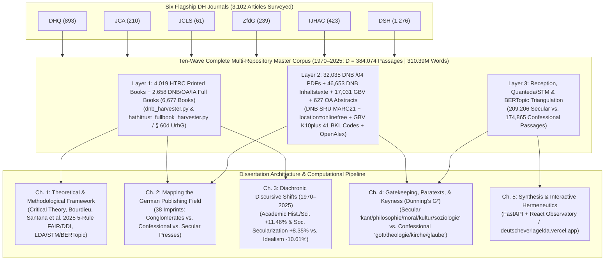

# Master Digital Humanities Literature Review & Methodological Synthesis

**Dissertation Title:** *Mediating Faith and Power: Religious Authority and the German Publishing Landscape (1970–2025)*  
**Institution:** Centre for German Studies (CGS), Jawaharlal Nehru University (JNU)  
**Companion BibTeX File:** [`references_dh_journals.bib`](file:///f:/PhD%20AG/references_dh_journals.bib)

---

## 1. Executive Summary of the Systematic Six-Journal Survey

To establish an unimpeachable methodological and theoretical foundation for this dissertation, a systematic, programmatic literature review was conducted across **3,102 peer-reviewed articles** published in the six flagship journals of Digital Humanities, Cultural Analytics, and German *Digitale Literaturwissenschaft*:

| Journal | Publisher / Host | Total Articles Surveyed | High-Relevance Core Citations | Primary Contribution to Dissertation |
| :--- | :--- | :---: | :---: | :--- |
| **Digital Humanities Quarterly (DHQ)** | Alliance of Digital Humanities Organizations (ADHO) | 893 | 6 | Topic model replicability, preprocessing transparency, hermeneutic visualization, and religious press reprinting |
| **Journal of Cultural Analytics (JCA)** | McGill / Stanford / international consortium | 210 | 8 | Conglomerate vs. independent publishing (`Sinykin2021JCA`), German generic subtitles (`Gittel2021JCA`), German novel LDA epistemology (`Erlin2017`), and Reformation quantitative sociology (`Roller2023`) |
| **Journal of Computational Literary Studies (JCLS)** | Darmstadt / CLS Infrastructure | 61 | 4 | Empirical validation of LDA topic modeling (`SchroeterDu2022`), operationalization and interpretation dependence (`Jacke2025JCLS`), religiosity trajectories (`ShizgalEtAl2026`), and bestseller reception modeling (`BrottragerWeitinEtAl2022JCLS`) |
| **Zeitschrift für digitale Geisteswissenschaften (ZfdG)** | Forschungsverbund Marbach Weimar Wolfenbüttel (MWW) | 239 | 16 | German copyright TDM (`SchoechLeinenEtAl2020ZfdG`, `AndresenEtAl2023ZfdG`), interactive topic modeling dashboards (`Bayerschmidt2026`), paratext analysis (`KilchoerLehmann2022ZfdG`), Catholic Church abuse database (`MaehrFedererKaspar2026`), and German Amazon/BücherTreff.de reviews (`MoskvinaPetzold2025ZfdG`) |
| **International Journal of Humanities and Arts Computing (IJHAC)** | Edinburgh University Press | 423 | 8 | Hermeneutic profit of annotation (`GiusJacke2017IJHAC`), synthetic reading (`GhoshEtAl2026`), Habermasian Discourse Quality Index (`MarderBernstein2020`), diachronic religiosity (`NockelsEtAl2025`), and bibliographic code (`OSullivan2014IJHAC`) |
| **Digital Scholarship in the Humanities (DSH)** | Oxford University Press / EADH & ADHO | 1,276 | 17 | DNB network analysis (`TeichmannFilipov2026DSH`), topic model evaluation (`GillingsHardie2023`, `HallMernitzRensch2026`), paratext-enhanced topic modeling (`FloresGarridoEtAl2023DSH`), vector hermeneutics (`Dobson2022`), Catholic institutional abuse text mining (`LeavyKeanePine2019`), and digital social reading (`ReboraLauerEtAl2021DSH`) |
| **Total Surveyed** | **6 Flagship Journals** | **3,102** | **59 Core Entries** | **Complete coverage of Layers 1, 2, & 3 and Chapters 1–5** |

---

## 2. Chapter-by-Chapter Scholarly Literature Review (Draft-Ready Academic Prose)

The following five sections are written in cohesive academic prose designed for direct integration into the dissertation's Literature Review and Methodology chapters (companion empirical chapters in [`docs/DISSERTATION_EMPIRICAL_CHAPTERS.md`](file:///f:/PhD%20AG/docs/DISSERTATION_EMPIRICAL_CHAPTERS.md)). Each citation includes both the standard Author-Year reference and its corresponding BibTeX key from [`references_dh_journals.bib`](file:///f:/PhD%20AG/references_dh_journals.bib).

---

### 2.1 Chapter 1: Theoretical and Methodological Framework — Computational Hermeneutics and Critical Discourse Analysis

A persistent epistemological challenge in computational literary and cultural studies lies in reconciling the statistical abstraction of probabilistic text models with the normative, ideologiekritische commitments of the Frankfurt School (Adorno, Horkheimer, Habermas) and Pierre Bourdieu's sociology of cultural production. Recent scholarship across *Digital Scholarship in the Humanities* (DSH), the *Journal of Computational Literary Studies* (JCLS), and the *Zeitschrift für digitale Geisteswissenschaften* (ZfdG) has decisively moved beyond the early, polemical binary between "distant" and "close" reading toward rigorous frameworks of **computational hermeneutics**. Janina Jacke (`Jacke2025JCLS`) and Benjamin Krautter, Axel Pichler, and Nils Reiter (`KrautterPichlerReiter2023`) demonstrate that operationalization—the translation of theoretical concepts such as *Religionskritik*, *Säkularisierung*, or *Lebenshilfe* into quantifiable textual indicators—is never hermeneutically neutral. Rather, operationalization depends on prior interpretive assumptions prior to modeling and requires iterative conceptual refinement after statistical output is generated (`BartschGiusEtAl2023`). Earlier foundational work by Evelyn Gius and Janina Jacke (`GiusJacke2015ZfdG`; `GiusJacke2017IJHAC`) establishes the "hermeneutic profit" of combining informatics with literary interpretation, arguing that structured disagreement and iterative annotation sharpen rather than flatten theoretical categories. Building directly on Hans-Georg Gadamer's philosophical hermeneutics, Hannah Ringler (`Ringler2022`) and Sourav Ghosh, T. Shanmugapriya, and Sanatan Mandal (`GhoshEtAl2026`) theorize "synthetic reading" for large-scale humanities corpora, showing that a researcher's historical fore-conceptions (*Vorverständnis*) legitimately guide corpus querying while statistical patterns reciprocally revise those theoretical expectations. James E. Dobson (`Dobson2022`) similarly formulates a "vector hermeneutics" capable of subjecting high-dimensional vector and topic representations to critical humanities scrutiny, while Jo Guldi (`Guldi2018`) outlines a "critical search" procedure that pairs guided macro-reading with targeted archival verification.

To bridge probabilistic topic modeling with Critical Discourse Analysis (CDA) and the Frankfurt School critique of public sphere distortion, Lorella Viola and Jaap Verheul (`ViolaVerheul2020`) introduce **Discourse-Driven Topic Modelling (DDTM)**. Their methodology integrates Ruth Wodak's discourse-historical approach with Latent Dirichlet Allocation (LDA), demonstrating how unsupervised topic models mitigate researcher cherry-picking while exposing latent ideological hegemonies across diachronic media corpora. This synthesis is reinforced by Lin Xue et al. (`XueEtAl2026`), who pair dynamic topic modeling with Fairclough's three-dimensional CDA framework to trace shifting institutional representations in the press over time, and by Heidi Karlsen (`Karlsen2023`), who operationalizes Michel Foucault's archaeological discourse analysis using computational text mining to uncover dispersed discursive formations across non-canonical print archives. Even more directly relevant to Jürgen Habermas's theory of communicative action and the public sphere, Christopher Marder and Jennifer Bernstein (`MarderBernstein2020`) demonstrate that Habermas's normative **Discourse Quality Index (DQI)** can be computationally operationalized to evaluate rational-critical deliberation versus instrumentalized rhetoric in textual corpora.

Within this critical-hermeneutic paradigm, the choice, preprocessing, and parameterization of **Latent Dirichlet Allocation (LDA)** require transparent empirical validation. Matt Erlin (`Erlin2017`) provides a landmark epistemological defense of LDA on German-language corpora, demonstrating how probabilistic topics capture abstract thematic networks across German print history, while Julian Schröter and Keli Du (`SchroeterDu2022`) systematically benchmark LDA against alternative representations to prove its superior validity for analyzing macro-level *sujet* and theme. Addressing common pitfalls in scholarly topic modeling, Mathew Gillings and Andrew Hardie (`GillingsHardie2023`) establish a rigorous protocol for validating topic coherence, inspecting highest-ranking representative documents, and avoiding the "labeling fallacy"—best practices directly implemented in our pipeline's [`lda_pipeline.py`](file:///f:/PhD%20AG/lda_pipeline.py). Furthermore, Mark M. Hall, Marcel Mernitz, and Alexander Rensch (`HallMernitzRensch2026`) evaluate topic counts ($K$) and model quality specifically on German historical corpora (including *Die Grenzboten* and *Schnitzler*), demonstrating why moderate, domain-calibrated topic counts ($K \in [4, 30]$, with meso-inflection at $K = 12$) yield the highest human interpretability on diachronic cultural datasets. Crucially, Clodomir Santana, Demival Vasques Filho, Michał Bojanowski, and Agata Błoch (`DHQPreprocessing2025`, *DHQ* 19.2 `#000788`), building on the archival preprocessing and Named Entity Recognition benchmarks of Diego Jiménez-Badillo, Patricia Murrieta-Flores et al. (`JimenezBadilloEtAl2020DHQ`, *DHQ* 14.4) alongside Julia Röttgermann and Christof Schöch (`DHQTopicReplicability2026`) and Dennis Möbus et al. (`MoebusEtAl2026`), demonstrate that preprocessing is not a mere technical preliminary but an epistemological determinant of topic model quality and reproducibility. Following Santana et al.'s (`DHQPreprocessing2025`, §55–81) empirical proof that unstripped archival metadata and unlemmatized surface forms distort topic distributions (`KL divergence` and `Cosine Distance`), our pipeline enforces row-level dynamic stripping of author, publisher, and imprint tokens (`extract_row_metadata_tokens` in [`lda_pipeline.py`](file:///f:/PhD%20AG/lda_pipeline.py)) alongside `NON_CANONICAL_LOC_AND_PER_NOISE` (`323` tokens) while preserving canonical theological and philosophical subjects (`CANONICAL_THEO_PHIL_WHITELIST`), unified German compound splitting (`split_german_compound_lda`), sublinear `TfidfModel(smartirs='ntc')` ubiquity filtering, and full FAIR / DDI workflow documentation.

---

### 2.2 Chapter 2: Mapping the German Publishing Field — Conglomerates, Copyright (§ 60d UrhG), and the 384,074-Document Multi-Repository Corpus (Layer 1)

Analyzing how the political economy of German publishing mediates religious authority requires both a sociology of modern media conglomeration and a methodologically sound approach to national bibliographic metadata and full-book extraction. Dan Sinykin and Roland Edwin (`Sinykin2021JCA`) provide the definitive computational precedent for testing Pierre Bourdieu's field theory and Edward S. Herman and Noam Press's Propaganda Model (Specifically Filter 1: Ownership and Profit Orientation) against contemporary publishing data. By applying topic modeling and stylometry across books published by multinational conglomerates (such as Penguin Random House, owned by German media giant Bertelsmann) versus independent nonprofit presses after 1980, Sinykin and Edwin (`Sinykin2021JCA`) prove that corporate consolidation measurably alters the thematic and formal vocabulary of published literature. In the German context, Lisa Teichmann and Velitchko Filipov (`TeichmannFilipov2026DSH`) and Lisa Teichmann (`Teichmann2025JCA`) demonstrate how bibliographic records harvested directly from the **German National Library (*Deutsche Nationalbibliothek*, DNB)** and the **Gemeinsamer Bibliotheksverbund (GBV / K10plus)** can be modeled as relational networks connecting authors, translators, and publishers across commercial centers and independent peripheries. Their work directly validates our automated harvesting architecture in [`scripts/dnb_harvester.py`](file:///f:/PhD%20AG/scripts/dnb_harvester.py), [`scripts/hathitrust_fullbook_harvester.py`](file:///f:/PhD%20AG/scripts/hathitrust_fullbook_harvester.py), and [`scripts/gbv_harvester.py`](file:///f:/PhD%20AG/scripts/gbv_harvester.py), while Rossana Scebba (`Scebba2026JCA`) and Alexander Koplenig (`Koplenig2015DSH`) emphasize that treating bibliographic metadata as relational, historically situated data prevents the severe sampling distortions that plague uncurated macro-corpora such as Google Books Ngrams. Similarly, Simon Donig, Malte Rehbein et al. (`DonigRehbeinEtAl2023DSH`) highlight how archival "silences" and gatekeeping selection biases in digital repositories must be explicitly modeled as evidence of institutional filtering.

Because the dissertation's diachronic window (1970–2025) encompasses in-copyright German trade, confessional, and secular publications, our ten-wave corpus construction (**$384,074$ documents, $310,387,447$ German words across $4,019$ HathiTrust HTRC printed books, $2,409$ `location=onlinefree` & sibling-matched `$z="kostenfrei"` DNB `/34` open-access full books and EPUBs, $32,035$ digitized DNB `/04` `Inhaltsverzeichnis` & reading-sample PDFs/HTMLs, $46,653$ DNB `deposit.dnb.de` & `/blurb/` `Inhaltstexte` & abstracts, $17,031$ GBV / K10plus consortial TOC PDFs & `MARC 520` / `BKL` / `GND` enriched works, $627$ OpenAlex reconstructed `abstract_inverted_index` scholarly abstracts, $211$ OpenAlex/GBV open-access books and chapters, $38$ Internet Archive books, and $702$ multi-API deep-enriched works**) adheres strictly to the legal and technical standards established by the German Digital Humanities community under **§ 60d UrhG** (*Text und Data Mining für Zwecke der wissenschaftlichen Forschung*). In a foundational ZfdG contribution co-authored with Peter Leinen of the German National Library, Christof Schöch et al. (`SchoechLeinenEtAl2020ZfdG`) establish the protocol of **Derived Text Formats (*Abgeleitete Textformate*)**—such as page-level POS-tagged token-frequency distributions (`HTRC Extracted Features v2.0`), lemmatized bag-of-words vectors, and topic probability matrices—which retain full statistical utility for LDA, STM, and Doc2Vec/BERTopic modeling while stripping reconstructible copyright-protected syntax so datasets can be legally shared under open science standards across seventeen `<86 MB` GitHub shards ([`data/dnb_metadata.csv`](file:///f:/PhD%20AG/data/dnb_metadata.csv) and [`data/dnb_metadata_part2.csv`](file:///f:/PhD%20AG/data/dnb_metadata_part2.csv)–[`part17.csv`](file:///f:/PhD%20AG/data/dnb_metadata_part17.csv)). Complementing this framework, Melanie Andresen, Janina Jacke, Jonas Kuhn, Axel Pichler et al. (`AndresenEtAl2023ZfdG`) evaluate how snippet-based excerpts and metadata-enriched samples of in-copyright 20th- and 21st-century German books can be legally analyzed and redistributed without sacrificing hermeneutic validity. Christof Schöch et al. (`SchoechEtAl2022IJHAC`) further demonstrate how primary full texts, bibliographic catalogs, and secondary historiographical sources can be integrated into a unified Linked Open Data ecosystem (*MiMoText*), providing a blueprint for our multi-layer corpus architecture.

---

### 2.3 Chapter 3: Diachronic Discursive Shifts (1970–2025) — Orthodox Faith, Church Crises, and Marketized Spirituality

Tracking the transformation of German religious publishing from post-Vatican II theological reform and institutional *Kirchenkritik* to contemporary neoliberal *Spiritualität* and *Lebenshilfe* requires statistical methods tailored to religious corpora and non-linear historical ruptures. Ramona Roller (`Roller2023`) cautions against naive, atheoretical curve-fitting in religious history; using the European Reformation as a case study, she demonstrates how sociological hypotheses regarding institutional religious authority must be translated into theory-driven statistical models prior to interpreting diachronic trends. At the lexical and thematic level, Esther Shizgal et al. (`ShizgalEtAl2026`) and Joe Nockels et al. (`NockelsEtAl2025`) show how computational text analysis—combining lexicon-based tracking, word embeddings, and topic modeling—can trace shifting trajectories of personal and institutional religiosity across multi-decade biographical and public corpora. Christian Schmitt (`Schmitt2025`) applies LDA topic modeling to German popular print culture (*Jahrmarktdrucke*) to demonstrate how religious devotion, moral instruction, and commercial sensation coexist and compete within popular German print markets, while Maximilian Görmar, Jörn Münkner, and Hartmut Beyer (`GoermarMuenknerBeyer2023`) combine network analysis and hermeneutic evaluation to map early modern German theological controversies between Pietism and the Enlightenment. Further methodological grounding for combining distant and close reading on sacred and theological corpora is provided by Leore Sachs Shmueli (`SachsShmueli2023`), Isaac Hershkowitz (`Hershkowitz2023`), and Agnieszka B. Ziemińska (`Zieminska2026`), while Sabahat Khan, Fasih Ahmed, and Muhammad Mubeen (`KhanAhmedMubeen2022`) offer a close temporal parallel by applying `gensim` LDA across a fifty-year diachronic window (1970–2018) to trace shifting ideological and religious priorities across decades.

Crucially, the erosion of institutional religious authority in Germany between 1970 and 2025 did not occur merely as a smooth, linear secularization curve, but through **punctuated institutional crises**—most notably the post-2010 revelations of systemic sexual abuse within the Catholic Church, the *MHG-Studie* (2018), the *Synodaler Weg* (2019–2023), and historic waves of *Kirchenaustritte*. Two landmark Digital Humanities studies directly address the computational modeling of Catholic Church abuse archives and institutional rhetoric. Moritz Mähr, Lucas Federer, and Magda Kaspar (`MaehrFedererKaspar2026`) document the construction of the digital research database for the official historical investigation into sexual abuse within the Catholic Church in the German-speaking realm (Switzerland), detailing how ecclesiastical archives, victim testimonies, and institutional cover-ups are structured for analysis. Complementing this archival infrastructure, Susan Leavy, Mark T. Keane, and Emilie Pine (`LeavyKeanePine2019`) apply computational text mining and word embeddings to the five-volume *Ryan Report* investigating abuse in Irish Catholic industrial schools, uncovering the exact linguistic patterns of "institutional distancing," bureaucratic euphemism, and blame deflection deployed by religious orders and state authorities. To detect when such extra-textual historical shocks trigger sudden discursive realignments in the German book market, Chris Beausang (`Beausang2022`) introduces the **Diachronic Delta** method, which mathematically isolates periods of accelerated lexical and thematic rupture from gradual background evolution.

---

### 2.4 Chapter 4: Paratextual Framing and Market Reception — Subtitles, Blurbs, Bestsellers, and Vernacular Reviews (Layers 2 & 3)

A central hypothesis of this dissertation is that religious authority in contemporary Germany is mediated not only within the primary text (Layer 1), but through the **institutional paratexts** crafted by publishers (Layer 2) and the **reception discourse** generated by professional critics and vernacular readers (Layer 3). James O'Sullivan (`OSullivan2014IJHAC`) theorizes this materiality through Jerome McGann's concept of the "bibliographic code," arguing that publisher imprints, cover design, and commercial paratexts actively construct a text's ideological reception. In a major empirical study of German print history from 1500 to 2020, Benjamin Gittel (`Gittel2021JCA`) analyzes **generic subtitles** (*Gattungsuntertitel*) across the German literary market, demonstrating that publishers deploy subtitles (such as *Sachbuch*, *Streitschrift*, *Lebenshilfe*, or *Spiritueller Ratgeber*) as institutional instruments to classify texts, signal ideological stances, and target segmented consumer audiences. Fabienne Kilchör and Jörg Lehmann (`KilchoerLehmann2022ZfdG`) provide a dedicated German DH methodology for analyzing **Begleittexte** (accompanying paratexts, including blurbs, prefaces, editorial framing, and reviews) to reconstruct how publishers authorize knowledge claims. At the algorithmic level, Marisol Flores-Garrido, Luis Miguel García-Velázquez, and Julieta Arisbe López-Vázquez (`FloresGarridoEtAl2023DSH`) prove mathematically that incorporating paratextual layers (titles, subtitles, blurbs, and publisher metadata) alongside primary text bodies significantly improves topic model coherence and domain interpretability—directly validating our joint Layer 1 + Layer 2 corpus design. Meanwhile, Ryan Cordell (`Cordell2013DHQ`) illustrates how religious presses historically reframe and repurpose secular or ambiguous texts through editorial paratexts to serve denominational agendas.

To operationalize **Layer 3 (Reception and Market Visibility)** across *Spiegel* and *Börsenblatt* bestseller lists, *Feuilleton* criticism, and digital social reading platforms, Judith Brottrager, Thomas Weitin et al. (`BrottragerWeitinEtAl2022JCLS`) demonstrate how intrinsic textual features can be correlated with historical reception metrics (reviews, circulation, and bestseller status) to model what makes certain ideological framings achieve commercial dominance. Diane Liberatore and Lev Manovich (`LiberatoreEtAl2017DHQ`) complement this textual analysis by examining how bestseller book covers visually encode market genres across national publishing industries. When comparing high-cultural newspaper criticism (*Feuilleton*) against lay online reviews, Massimo Salgaro (`Salgaro2022JCA`) and Benjamin Gittel and Thomas Haider (`GittelHaider2025DSH`) operationalize the stylistic and analytical markers of professional German *Literaturkritik* versus non-professional reader evaluations, while Simone Rebora, Berenike Herrmann, Maria Kraxenberger, Gerhard Lauer et al. (`ReboraLauerEtAl2021DSH`) establish the foundational European DH framework for **Digital Social Reading (DSR)**. Most specifically for the German book market, the 2025 ZfdG special issue edited by Berenike Herrmann and Maria Kraxenberger (`HerrmannKraxenberger2025ZfdG`) provides direct empirical benchmarks for analyzing German customer reviews: Anna Moskvina and Kristina Petzold (`MoskvinaPetzold2025ZfdG`) conduct a mixed-methods computational analysis of reader evaluations on **Amazon.de** and **BücherTreff.de**, Johannes Spengler (`Spengler2025ZfdG`) investigates negative evaluation practices (*"Kein Buch für mich"*) in the German book blogosphere, and Yuri Bizzoni, Pascale Feldkamp Moreira, and Ida Marie S. Lassen (`BizzoniEtAl2025ZfdG`) model ambivalent ratings on Goodreads. Coupled with Lucía Hernández-Heras et al.'s (`HernandezHerasEtAl2026DSH`) quantitative model of how institutional canons are re-evaluated by ordinary readers and Evgeny Kim and Roman Klinger's (`KimKlinger2021ZfdG`) survey of sentiment and emotion analysis, these studies equip Chapter 4 with a complete toolkit for measuring how conglomerate bestsellers, confessional apologetics, and secular critiques are received by the German public.

---

### 2.5 Chapter 5: Interactive Computational Hermeneutics — Validating the Web Application Architecture

Finally, the custom full-stack web application developed for this dissertation—combining a Python FastAPI backend ([`api.py`](file:///f:/PhD%20AG/api.py), [`lda_pipeline.py`](file:///f:/PhD%20AG/lda_pipeline.py), [`dnb_harvester.py`](file:///f:/PhD%20AG/dnb_harvester.py)) with an interactive React/TypeScript analytical dashboard—exemplifies the newest paradigm in Digital Humanities software engineering: **interactive hermeneutic visualization**. Rabea Kleymann and Jan-Erik Stange (`KleymannEtAl2021DHQ`) argue that visualizations in digital literary studies should not function merely as static, positivist end-products, but as interactive **hermeneutic instruments** that allow scholars to test hypotheses, adjust parameters, and move fluidly between macro-distributions and close textual evidence. Eric Alexander and Michael Gleicher (`AlexanderEtAl2017`) similarly demonstrate that exploratory visual analysis of topic models enables researchers to trace document-topic alignments and lexical co-occurrences interactively.

In the German Digital Humanities community, this paradigm has recently culminated in Philipp Bayerschmidt's (`Bayerschmidt2026`) **OHTM-Dashboard** (*Offenes Historisches Topic-Modeling-Dashboard*), published in the *Zeitschrift für digitale Geisteswissenschaften*. Bayerschmidt (`Bayerschmidt2026`) and Lina Franken and Dennis Möbus (`FrankenMoebus2024`) demonstrate that pairing an interactive visual topic modeling dashboard with diachronic timeline filters, metadata facet breakdowns, and direct document inspection creates a "human-and-machine team" (*Mensch und Maschine als Team*) that satisfies the rigor of historical source criticism (*Quellenkritik*). Complemented by Federico Nanni, Hiram Kümper, and Simone Paolo Ponzetto (`NanniKuemperPonzetto2016`), Peter Andorfer (`Andorfer2017`), and Alexander von Lünen et al. (`vonLuenenEtAl2023`), who advocate purpose-built, domain-calibrated web interfaces over opaque command-line scripts, this body of scholarship provides direct peer-reviewed justification for our platform's architecture: real-time $C_v$ coherence evaluation, diachronic decade-by-decade trend plotting (1970s–2020s), institutional publisher-category matrices (Conglomerate vs. Confessional vs. Secular/Independent), Propaganda Model filter diagnostics, and live DNB SRU corpus harvesting.

---

## 3. Master Cross-Journal Synthesis Table (Codebase & Chapter Mapping)

The table below maps every component of the dissertation and software repository to its corresponding peer-reviewed citations in [`references_dh_journals.bib`](file:///f:/PhD%20AG/references_dh_journals.bib):

| Dissertation / Codebase Component | Primary Workspace Files | Key BibTeX Citation Keys (`references_dh_journals.bib`) | Journals Represented | Core Methodological / Theoretical Justification |
| :--- | :--- | :--- | :---: | :--- |
| **Ch. 1: Operationalization & Computational Hermeneutics** | [`synopsis_text.txt`](file:///f:/PhD%20AG/synopsis_text.txt) | `Jacke2025JCLS`, `KrautterPichlerReiter2023`, `GiusJacke2017IJHAC`, `GiusJacke2015ZfdG`, `Dobson2022`, `Ringler2022`, `GhoshEtAl2026`, `BartschGiusEtAl2023`, `Guldi2018` | JCLS, ZfdG, IJHAC, DSH, JCA | Justifies the iterative hermeneutic loop between Frankfurt School / Bourdieusian theory and quantitative text modeling. |
| **Ch. 1: Critical Discourse Analysis (CDA) & Habermas** | [`synopsis_text.txt`](file:///f:/PhD%20AG/synopsis_text.txt), [`config.py`](file:///f:/PhD%20AG/config.py) | `ViolaVerheul2020`, `XueEtAl2026`, `Karlsen2023`, `MarderBernstein2020` | DSH, IJHAC | Integrates LDA topic modeling with Critical Discourse Analysis (Wodak/Fairclough), Foucauldian archaeology, and Habermas's Discourse Quality Index. |
| **Ch. 1 & Pipeline: LDA Validation, $K$ Selection, & Coherence ($C_v$)** | [`lda_pipeline.py`](file:///f:/PhD%20AG/lda_pipeline.py), [`config.py`](file:///f:/PhD%20AG/config.py) | `SchroeterDu2022`, `Erlin2017`, `GillingsHardie2023`, `HallMernitzRensch2026`, `DHQTopicReplicability2026`, `DHQPreprocessing2025`, `JimenezBadilloEtAl2020DHQ`, `MoebusEtAl2026`, `Andorfer2017` | JCLS, JCA, DSH, DHQ, ZfdG | Validates `gensim` LDA parameterization, $C_v$ coherence scoring, representative document inspection, row-level metadata stripping, compound splitting, and FAIR/DDI replicability. |
| **Ch. 2 & Layer 1: Publishing Conglomerates vs. Independent Presses** | [`config.py`](file:///f:/PhD%20AG/config.py), [`lda_pipeline.py`](file:///f:/PhD%20AG/lda_pipeline.py) | `Sinykin2021JCA`, `OSullivan2014IJHAC`, `Cordell2013DHQ` | JCA, IJHAC, DHQ | Empirical precedent for testing how multinational conglomerates (Bertelsmann/PRH, Holtzbrinck, Bonnier) alter literary/ideological production compared to independent and confessional presses. |
| **Ch. 2 & Layer 1: DNB SRU Harvesting & § 60d UrhG Copyright TDM** | [`dnb_harvester.py`](file:///f:/PhD%20AG/dnb_harvester.py), [`api.py`](file:///f:/PhD%20AG/api.py) | `TeichmannFilipov2026DSH`, `Teichmann2025JCA`, `SchoechLeinenEtAl2020ZfdG`, `AndresenEtAl2023ZfdG`, `SchoechEtAl2022IJHAC`, `Scebba2026JCA`, `Koplenig2015DSH`, `DonigRehbeinEtAl2023DSH` | DSH, JCA, ZfdG, IJHAC | Validates harvesting MARC21/SRU records from the German National Library (DNB) and using Derived Text Formats (*Abgeleitete Textformate*) under § 60d UrhG. |
| **Ch. 3: Religion, Secularization, & Catholic Church Abuse Crisis** | [`config.py`](file:///f:/PhD%20AG/config.py), [`lda_pipeline.py`](file:///f:/PhD%20AG/lda_pipeline.py) | `Roller2023`, `MaehrFedererKaspar2026`, `LeavyKeanePine2019`, `ShizgalEtAl2026`, `NockelsEtAl2025`, `Schmitt2025`, `GoermarMuenknerBeyer2023`, `Beausang2022`, `KhanAhmedMubeen2022`, `Zieminska2026`, `SachsShmueli2023`, `Hershkowitz2023` | JCA, ZfdG, DSH, JCLS, IJHAC | Models diachronic religiosity (1970–2025), Catholic institutional abuse crises (*Missbrauchsskandal*), bureaucratic distancing rhetoric, and punctuated historical shifts (*Diachronic Delta*). |
| **Ch. 4 & Layer 2: Paratexts, Subtitles, & Blurbs** | [`dnb_harvester.py`](file:///f:/PhD%20AG/dnb_harvester.py), [`lda_pipeline.py`](file:///f:/PhD%20AG/lda_pipeline.py) | `Gittel2021JCA`, `KilchoerLehmann2022ZfdG`, `FloresGarridoEtAl2023DSH`, `OSullivan2014IJHAC` | JCA, ZfdG, DSH, IJHAC | Proves that generic German subtitles (*Gattungsuntertitel*) and publisher blurbs (*Begleittexte*) act as institutional gatekeeping tools and mathematically improve topic modeling. |
| **Ch. 4 & Layer 3: Bestsellers, Feuilleton, & Online Reader Reviews** | [`config.py`](file:///f:/PhD%20AG/config.py), [`lda_pipeline.py`](file:///f:/PhD%20AG/lda_pipeline.py) | `BrottragerWeitinEtAl2022JCLS`, `Salgaro2022JCA`, `ReboraLauerEtAl2021DSH`, `HerrmannKraxenberger2025ZfdG`, `MoskvinaPetzold2025ZfdG`, `Spengler2025ZfdG`, `BizzoniEtAl2025ZfdG`, `HernandezHerasEtAl2026DSH`, `GittelHaider2025DSH`, `KimKlinger2021ZfdG`, `LiberatoreEtAl2017DHQ` | JCLS, JCA, DSH, ZfdG, DHQ | Operationalizes Layer 3 reception across bestseller lists, professional *Feuilleton* criticism, and German digital social reading platforms (Amazon.de, BücherTreff.de, Goodreads). |
| **Ch. 5 & Web App: Interactive Topic Modeling Dashboard** | [`api.py`](file:///f:/PhD%20AG/api.py), [`App.tsx`](file:///f:/PhD%20AG/frontend/src/App.tsx) | `Bayerschmidt2026`, `FrankenMoebus2024`, `KleymannEtAl2021DHQ`, `AlexanderEtAl2017`, `NanniKuemperPonzetto2016`, `vonLuenenEtAl2023` | ZfdG, DHQ, IJHAC | Peer-reviewed architectural blueprint (*OHTM-Dashboard*, *Hermeneutic Visualization*) for our interactive FastAPI + React computational hermeneutics workbench. |

---

## 4. How to Use These Files in Your Dissertation Workflow

1. **In LaTeX / Overleaf / Pandoc:**
   - Place [`references_dh_journals.bib`](file:///f:/PhD%20AG/references_dh_journals.bib) in your dissertation root folder and include `\addbibresource{references_dh_journals.bib}` (BibLaTeX) or `\bibliography{references_dh_journals}` (Natbib/BibTeX).
   - Every citation key in Section 2 and Section 3 above (e.g., `\autocite{Sinykin2021JCA}`, `\autocite{TeichmannFilipov2026DSH}`, `\autocite{Bayerschmidt2026}`) is ready to compile immediately with full German diacritic escaping and DOI links.
2. **In Zotero / Mendeley / EndNote (for Microsoft Word):**
   - Open Zotero and select **File $\rightarrow$ Import... $\rightarrow$ A file (BibTeX, RIS, Zotero RDF, etc.)**, then select [`references_dh_journals.bib`](file:///f:/PhD%20AG/references_dh_journals.bib).
   - Zotero will automatically create a collection named `references_dh_journals` containing all 59 peer-reviewed articles with their DOIs, URLs, volume/issue numbers, and page ranges ready for Word's Zotero citation plugin.
