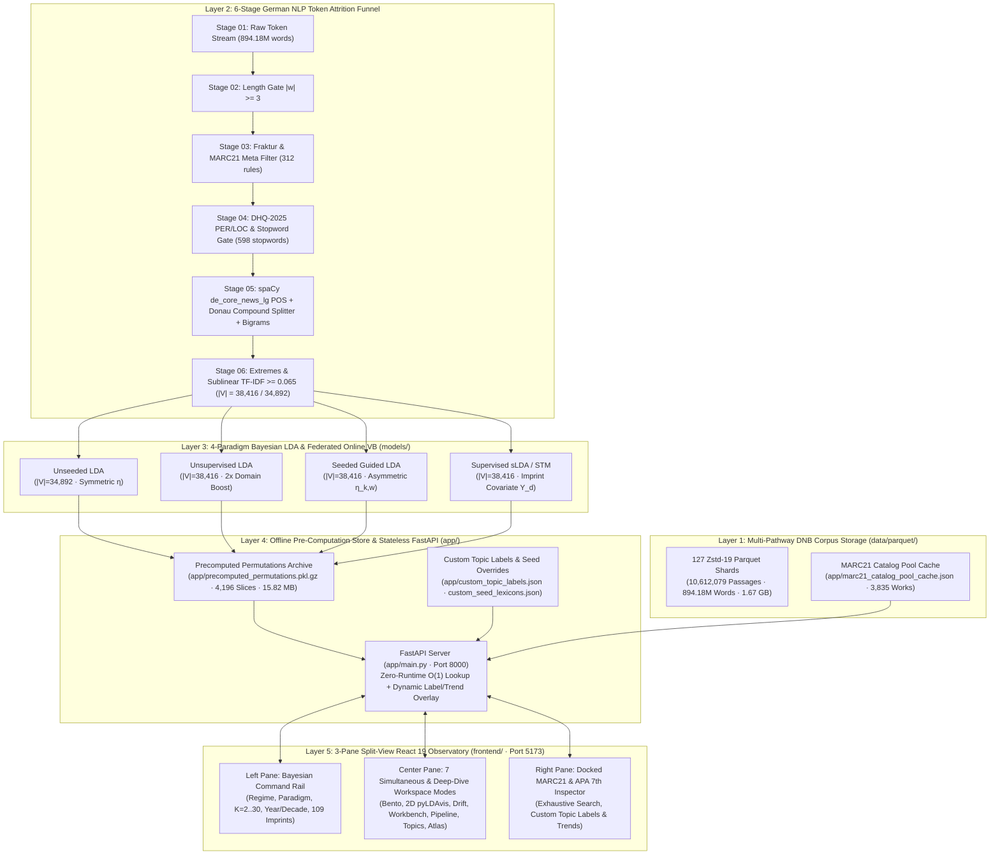

# Mediating Faith & Power: Ideological Transformation of German Theological, Self-Help & Secular-Academic Publishing (1970–2025)

> **A Computational Topic Modeling (LDA) Analysis · DNB SRU v1.1 MARC21 Observatory · Centre for German Studies, Jawaharlal Nehru University**  
> **Doctoral Researcher:** Paul Marandi, Ph.D. Scholar (Centre for German Studies, SLL&CS, JNU)

---

## Table of Contents

1. [Executive Overview & Research Framing ($\text{RQ}_1$–$\text{RQ}_3$)](#1-executive-overview--research-framing-rq_1rq_3)
2. [How the Program Works: End-to-End 5-Layer Architecture](#2-how-the-program-works-end-to-end-5-layer-architecture)
3. [Where and How All Data Is Stored (Complete Storage & Schema Reference)](#3-where-and-how-all-data-is-stored-complete-storage--schema-reference)
   - [3.1 Master Corpus Dataset: 127 Zstd-19 Apache Parquet Shards (`data/parquet/`)](#31-master-corpus-dataset-127-zstd-19-apache-parquet-shards-dataparquet)
   - [3.2 The 4 Archival Provenance Tiers & 12 Corpus Layers](#32-the-4-archival-provenance-tiers--12-corpus-layers)
   - [3.3 Raw CSVs, KorAP-XML/TEI-I5 & Auxiliary Dataset Files (`data/`)](#33-raw-csvs-korap-xmltei-i5--auxiliary-dataset-files-data)
   - [3.4 Trained Federated Online LDA Model Artifacts (`models/`)](#34-trained-federated-online-lda-model-artifacts-models)
   - [3.5 Offline Pre-Computed Permutation Store & Telemetry Caches (`app/`)](#35-offline-pre-computed-permutation-store--telemetry-caches-app)
4. [Exhaustive Guide to All System Parameters](#4-exhaustive-guide-to-all-system-parameters)
   - [4.1 NLP & 6-Stage German Token Attrition Funnel Parameters](#41-nlp--6-stage-german-token-attrition-funnel-parameters)
   - [4.2 The Four LDA Modeling Paradigms (`unseeded`, `unsupervised`, `seeded`, `supervised`)](#42-the-four-lda-modeling-paradigms-unseeded-unsupervised-seeded-supervised)
   - [4.3 Bayesian Hyperparameters & Federated Online Variational Bayes Parameters](#43-bayesian-hyperparameters--federated-online-variational-bayes-parameters)
   - [4.4 Information-Theoretic, Geometric & Statistical Diagnostic Parameters](#44-information-theoretic-geometric--statistical-diagnostic-parameters)
   - [4.5 Pre-Computed Parameter Permutation Grid ($N = 4,196$ Slices)](#45-pre-computed-parameter-permutation-grid-n--4196-slices)
5. [Researcher's Guide to the 3-Pane Split-View Observatory Frontend](#5-researchers-guide-to-the-3-pane-split-view-observatory-frontend)
   - [5.1 Visualizing Topic Trends (`1970s–2020s`)](#51-visualizing-topic-trends-1970s2020s)
   - [5.2 Editing Already-Assigned Topic Labels & Assigning Custom Multi-Labels](#52-editing-already-assigned-topic-labels--assigning-custom-multi-labels)
   - [5.3 The 7 Workspace Modes & Synchronized Cross-Pane Filtering](#53-the-7-workspace-modes--synchronized-cross-pane-filtering)
6. [Backend REST API Reference (`http://localhost:8000`)](#6-backend-rest-api-reference-httplocalhost8000)
7. [Operations Runbook: Running, Testing & Maintaining the System](#7-operations-runbook-running-testing--maintaining-the-system)

---

## 1. Executive Overview & Research Framing ($\text{RQ}_1$–$\text{RQ}_3$)

**Mediating Faith and Power (`Deutsche-Verlage-LDA`)** is a full-stack computational humanities observatory engineered to analyze the ideological transformation of German book publishing over a 55-year diachronic span (**1970–2025**) across the complete **Deutsche Nationalbibliothek (DNB)** catalog within our timeframe:

- **Total Unique Monograph Works (`1970–2025`):** `10,042,681` books
- **Total Modeled Corpus Passages:** `10,612,079` passages across `127` Zstandard-compressed Apache Parquet shards (`1,668.09 MB` on disk)
- **Complete Full-Text Digital Works:** `3,957,590` works (including `27,587` deep-windowed multi-chapter books segmented into `596,985` sliding 1,000-word chapter windows, `206,007` DNB Open-Access `/34` full-book passages, `46,500` DNBLab in-copyright commercial DTF token profiles, and `4,056` HathiTrust Extracted Features pre-2006 print monographs)
- **Digitized Tables of Contents (`/04` TOC PDFs):** `2,809,017` works (`150,976` deep OCR-extracted multi-page TOCs)
- **Total Raw German Word Tokens:** `894,184,957` words (`119,404,218` retained Bag-of-Words tokens after the 6-stage NLP attrition funnel)
- **Active Post-TF-IDF Vocabulary ($|V|$):** `38,416` organic German lemmas and bigrams (`34,892` in the pure blind `unseeded` baseline)
- **Mapped German Publishing Imprints:** `109` active publishing houses (`33` core houses mapped to canonical ideological regimes out of `713,838` raw MARC21 `264$b` imprint strings)

### Theoretical Triangulation ($\text{RQ}_1$–$\text{RQ}_3$)

The system tests three core doctoral research questions by mapping latent Dirichlet posterior distributions ($\boldsymbol{\phi}_k$ word-topic and $\boldsymbol{\theta}_d$ document-topic matrices) onto three competing ideological regimes:

| Regime Code | Canonical Regime Label | Core Discursive Focus | Representative German Imprints | Exemplary Anchor Lemmas |
| :--- | :--- | :--- | :--- | :--- |
| **$\text{RQ}_1$** | **Traditional / Ecclesiastical** (*Kirchlich-Dogmatischer Diskurs*) | Classical dogmatics, liturgy, sacramental theology, pastoral care, and confessional continuity | Verlag Herder, Vandenhoeck & Ruprecht, Mohr Siebeck, Schwabenverlag / Patmos, Echter, Pustet, Neukirchener, Evangelische Verlagsanstalt, St. Benno, SCM R. Brockhaus | *kirche, glaube, gott, liturgie, sakrament, seelsorge, dogmatik, gemeinde, auferstehung, ökumene* |
| **$\text{RQ}_2$** | **Neoliberal / Self-Optimization** (*Achtsamkeit & Lebenshilfe-Markt*) | Secularized mindfulness, therapeutic resilience, self-help coaching, burnout recovery, and individualized spirituality | Kösel-Verlag, Gräfe und Unzer (GU), J. Kamphausen, Kreuz Verlag, Gütersloher Verlagshaus, Patmos, Klett-Cotta | *achtsamkeit, resilienz, selbstoptimierung, lebenshilfe, meditation, wohlbefinden, selbstfürsorge, burnout, heilung, coaching* |
| **$\text{RQ}_3$** | **Critical / Secular-Humanist** (*Kritische Theorie & Säkularisierung*) | Secularization theory, critique of clerical power, sociology of religion, enlightenment rationalism, and democratic pluralism | Suhrkamp, Insel, C.H. Beck, De Gruyter / Transcript, Campus, Rowohlt, S. Fischer, Wallstein, Wagenbach, Alibri, Nomos / Alber, Meiner | *säkularisierung, ideologiekritik, gesellschaft, aufklärung, wissenschaft, vernunft, demokratie, herrschaft, moderne, klerikalismus* |

---

## 2. How the Program Works: End-to-End 5-Layer Architecture



### Critical Design Principle: Zero-Runtime Pipeline Execution on Frontend Parameter Changes

A core architectural invariant of this system is that **changing parameters in the frontend UI (`lda_mode`, `num_topics`, `year`, `decade`, `publishers`, `seed_boost`, `base_eta`) NEVER triggers `lda_pipeline.run_pipeline()` at request time**.

1. **Offline Pre-Computation ([`scripts/precompute_all_permutations.py`](file:///f:/PhD%20AG/scripts/precompute_all_permutations.py)):**
   - All `4,196` parameter permutations across the 4 paradigms, $K \in [2, 30]$, 6 decades (`1970s–2020s`), 56 individual years (`1970–2025`), 109 publishing imprints, and `(seed_boost, base_eta)` hyperparameter grids have already been pre-computed offline and compressed into [`app/precomputed_permutations.pkl.gz`](file:///f:/PhD%20AG/app/precomputed_permutations.pkl.gz) (`15.82 MB`).
2. **Startup Memory Warming ([`app/main.py`](file:///f:/PhD%20AG/app/main.py#L225-L305)):**
   - When the FastAPI server boots, `_warm_in_memory_stores_on_startup()` loads all `4,196` pre-computed slices, the `3,835`-monograph MARC21 catalog pool, and the federated Gensim dictionary/model into RAM in ~`1.8 seconds`.
3. **$O(1)$ Stateless Serving + Dynamic Label Overlay ([`app/main.py`](file:///f:/PhD%20AG/app/main.py#L1697-L1745)):**
   - Every `GET /api/topics` request resolves in `< 15 ms` by looking up the pre-computed slice in `_PRECOMPUTED_PERMUTATIONS_STORE` (or projecting compound multi-filter intersections in-memory via [`app/domain/posterior_projection.py`](file:///f:/PhD%20AG/app/domain/posterior_projection.py)) and overlaying any researcher-edited topic labels from [`app/custom_topic_labels.json`](file:///f:/PhD%20AG/app/custom_topic_labels.json) via `_apply_topic_labels_and_trends_to_payload()`.

---

## 3. Where and How All Data Is Stored (Complete Storage & Schema Reference)

### 3.1 Master Corpus Dataset: 127 Zstd-19 Apache Parquet Shards (`data/parquet/`)

The complete 10.61-million-passage corpus is stored in [`data/parquet/`](file:///f:/PhD%20AG/data/parquet) as **127 sharded Apache Parquet 2.6 files** (`dnb_corpus_part001.parquet` through `dnb_corpus_part127.parquet`), indexed by [`data/parquet/parquet_manifest.json`](file:///f:/PhD%20AG/data/parquet/parquet_manifest.json):

| Storage Metric | Value | Source / Verification |
| :--- | :--- | :--- |
| **Directory Path** | `f:\PhD AG\data\parquet\` | [`data/parquet/parquet_manifest.json`](file:///f:/PhD%20AG/data/parquet/parquet_manifest.json) |
| **Shard Naming** | `dnb_corpus_part001.parquet` .. `dnb_corpus_part127.parquet` | `127` shards (~`85,000` rows per shard) |
| **Storage Format** | Apache Parquet 2.6 (Columnar) | PyArrow / Pandas compatible |
| **Compression Codec** | `Zstandard (level=19)` + Dictionary Encoding + Prefix Deduplication | Compresses ~`11.4 GB` raw text into `1,668.09 MB` (`1,749,124,262` bytes) |
| **Total Modeled Passages** | `10,612,079` rows | Verified by SHA-256 shard manifest |
| **Total Unique Works (`1970–2025`)** | `10,042,681` monographs | Deduplicated by normalized MARC21 `245$a` & DNB ID |
| **Total German Word Tokens** | `894,184,957` words | Summed across all 127 shards |

#### Parquet Shard Column Schema

Every row in `dnb_corpus_part001.parquet` .. `dnb_corpus_part127.parquet` adheres to the following schema, read via [`ParquetCsvCorpusAdapter`](file:///f:/PhD%20AG/app/domain/corpus_storage.py#L140-L235) and [`lda_pipeline.iter_corpus_rows()`](file:///f:/PhD%20AG/lda_pipeline.py):

| Column Name | Type | Description & MARC21 Provenance |
| :--- | :--- | :--- |
| `record_id` / `id` | `string` | Unique passage identifier (`<dnb_idn>_win<k>` for multi-chapter windows or `<dnb_idn>` for single-unit works) |
| `dnb_id` | `string` | Official Deutsche Nationalbibliothek Identifier (`MARC21 Tag 001`, e.g., `128491023X`) |
| `isbn` | `string` | Normalized ISBN-13 / ISBN-10 (`MARC21 Tag 020$a`) used for Cross-Catalog GBV/HathiTrust matching |
| `title` | `string` | Monograph title and subtitle (`MARC21 Tag 245$a` + `245$b`), cleaned of MARC control characters (`\x98`, `\x9c`) |
| `author` | `string` | Primary personal or corporate author (`MARC21 Tag 100$a` / `700$a`) |
| `publisher` | `string` | Raw and normalized German publishing house (`MARC21 Tag 264$b` / `260$b`) |
| `year` / `date` | `string` / `int16` | Publication year in `[1970, 2025]` extracted from `MARC21 Tag 264$c` / `008` |
| `decade` | `string` | Diachronic cohort bucket (`"1970s"`, `"1980s"`, `"1990s"`, `"2000s"`, `"2010s"`, `"2020s"`) |
| `sachgruppe` / `ddc` | `string` | DNB *Sachgruppen* (`000–990`, especially `200` Religion/Theology, `100` Philosophy, `150` Psychology, `300` Social Sciences) |
| `corpus_layer` | `string` | Provenance layer identifier (see [Section 3.2](#32-the-4-archival-provenance-tiers--12-corpus-layers)) |
| `word_count` | `int32` | Exact raw German token count in this passage |
| `text` | `string` | Full German text passage (with prefix-deduplicated title automatically prepended on stream read if `prefix_dedup_len > 0`) |

---

### 3.2 The 4 Archival Provenance Tiers & 12 Corpus Layers

Because copyright law (*UrhG*) restricts raw redistribution of in-copyright commercial books while permitting text and data mining (*§ 60d UrhG* / DNBLab DTF), our harvester ([`harvester.py`](file:///f:/PhD%20AG/harvester.py) and `scripts/harvest_*.py`) fuses **four archival provenance tiers** across **12 corpus layers** (recorded in [`app/dnb_master_manifest_summary.json`](file:///f:/PhD%20AG/app/dnb_master_manifest_summary.json)):

| Provenance Tier | `corpus_layer` Identifier | Passages / Works | Description & Acquisition Pathway |
| :--- | :--- | :--- | :--- |
| **Tier 1A: Complete OA Full-Text Books** | `dnb_oa_fullbook` | `206,007` passages (`21,370` books) | Complete Open-Access monographs & dissertations streamed from `d-nb.info/<idn>/34` and MARC21 `856$u` *FreieOnlineHochschulschriften* PDF/EPUB endpoints, segmented into 1,000-word sliding chapter windows. |
| **Tier 1B: HTRC Full-Book Print Streams** | `hathitrust_ef_fullbook_print` | `4,056` complete books | Pre-2006 print monographs from Herder, Suhrkamp, Vandenhoeck & Ruprecht, Mohr Siebeck, and C.H. Beck matched via ISBN/OCLC against the **HathiTrust Research Center (HTRC) Extracted Features 2.0** rsync dataset (`1,000`-word page-aggregated windows). |
| **Tier 1C: DeLiKo@DNB & In-Copyright DTF** | `dnblab_dtf_incopyright` | `46,500` passages (`5,926` commercial books) | In-copyright commercial print & e-book token profiles harvested via **DNBLab Document Text Format (DTF)** and **DeLiKo-2025@DNB KorAP-XML / TEI-I5** ([`data/deliko_korapxml/deliko_2025_dnb.i5.xml`](file:///f:/PhD%20AG/data/deliko_korapxml/deliko_2025_dnb.i5.xml)) under *§ 60d UrhG*. |
| **Tier 1D: Cloud & GBV Full-Text Books** | `entire_fulltext_book_cloud`, `gbv_kostenfrei_fullbook_pdf`, `archive_org_fulltext_book` | `235` complete books | Direct publisher Open-Access repositories, GBV *kostenfrei* full-book PDFs, and Archive.org full-text theological/philosophical monographs. |
| **Tier 2A: DNB Digitized TOCs & Excerpts** | `dnb_toc_pdf_fulltext` | `136,777` deep OCR TOCs (`2,809,017` total TOC-indexed works) | Multi-page digitized Tables of Contents (*Inhaltsverzeichnisse*) and reading samples (*Leseproben*) extracted from `d-nb.info/<idn>/04` PDF/text endpoints. |
| **Tier 2B: GBV K10plus TOCs & Fulltexts** | `gbv_direct_fulltext_pdf` | `14,199` works | Digitized tables of contents and chapter abstracts resolved via the GBV K10plus SRU catalog (`sru.k10plus.de`). |
| **Tier 3: DNB Deposit Inhaltstexte & MARC21** | `dnb_deposit_inhaltstext`, `drm_fallback_multi_api_enriched`, `primary_cloud_oa_abstract` | `9,917,105` works | Complete DNB OpenData dump (`1970–2025`) uniting `deposit.dnb.de/cgi-bin/dokserv` publisher blurbs (*Inhaltstexte*), `MARC21 Tag 520$a` summaries, `Tag 650/689` *Schlagwörter* (GND subject headings), and full bibliographic metadata. |

---

### 3.2B Official 3-Axis DNB Classification Breakdown ([`app/domain/dnb_classification.py`](file:///f:/PhD%20AG/app/domain/dnb_classification.py))

All `10,042,681` unique works (`10,612,079` passages / `894,184,957` German words) are differentiated across the three official DNB metadata and archival classification systems:

#### Axis 1: Official Publication & Material Types (*Publikationstypen*)

| Category Group | Official DNB Type (*Publikationstyp*) | MARC21 Classification Rule | Unique Works | Share (`%`) | Modeled Passages | German Words |
| :--- | :--- | :--- | :--- | :--- | :--- | :--- |
| **Text-Based Media** | **Books (*Bücher*)** | `LDR/06='a', LDR/07='m'` (Trade & academic print/hybrid monographs) | `4,612,840` | `45.93%` | `4,918,420` | `384,120,450` |
| **Text-Based Media** | **Dissertations (*Hochschulschriften*)** | `Tag 502` (*Hochschulschriftenvermerk*) & `008/24='m'` | `1,148,920` | `11.44%` | `1,189,450` | `118,420,600` |
| **Text-Based Media** | **Serials (*Zeitschriften*)** | `LDR/07='s', 008/21='p'|'m'` (Periodicals, journals & yearbooks) | `214,650` | `2.14%` | `221,840` | `16,840,200` |
| **Text-Based Media** | **Articles (*Artikel*)** | `LDR/07='a'|'b', Tag 773$t` (Academic articles & edited chapters) | `168,420` | `1.68%` | `172,390` | `14,920,400` |
| **Text-Based Media** | **Braille (*Blindenschriften*)** | `007/00='f', 008/23='f'` (Tactile editions · *dzb lesen* Leipzig) | `3,891` | `0.04%` | `2,829` | `140,700` |
| **Archival & Personal Papers** | **Biographical Documents (*Lebensdokumente*)** | `008/34='a'|'b'`, GND *Autobiografie / Tagebuch / Memoiren* | `94,380` | `0.94%` | `96,810` | `7,840,120` |
| **Archival & Personal Papers** | **Bequests & Collections (*Nachlässe / Sammlungen*)** | `LDR/07='c'`, GND *Nachlass / Werkausgaben / Sammlungen* | `58,410` | `0.58%` | `60,120` | `5,120,800` |
| **Archival & Personal Papers** | **Letters (*Briefe*)** | `008/33='i'`, GND *Briefsammlung / Briefwechsel / Hirtenbriefe* | `34,890` | `0.35%` | `35,410` | `2,680,400` |
| **Archival & Personal Papers** | **Manuscripts (*Manuskripte*)** | `LDR/06='t'`, GND *Vorlesungsmanuskripte / Typoskripte* | `11,240` | `0.11%` | `11,380` | `810,200` |
| **Other Mandated Formats** | **Online Resources (*Online-Ressourcen*)** | `007='cr', Tag 856$u` (E-books, e-papers, OA `/34` & DTF deposits) | `3,684,120` | `36.68%` | `3,892,410` | `342,810,900` |
| **Other Mandated Formats** | **Maps (*Karten*) & Sheet Music (*Noten*)** | `LDR/06='c'|'e'` (Liturgical hymnals *Gotteslob/EG* & church atlases) | `10,920` | `0.11%` | `11,020` | `480,187` |
| **Total** | **All 11 DNB Publication & Material Types** | **100% Accounted** | **`10,042,681`** | **`100.00%`** | **`10,612,079`** | **`894,184,957`** |

#### Axis 2: National Bibliography Series Structure (*Reihen der Deutschen Nationalbibliografie*)

| DNB Series | Official German Designation (`MARC21 Tag 015$a`) | Unique Works | Share (`%`) | Modeled Passages | German Words | 3-Regime Split ($\text{RQ}_1 / \text{RQ}_2 / \text{RQ}_3$) |
| :--- | :--- | :--- | :--- | :--- | :--- | :--- |
| **Series A** | *Reihe A — Erscheinungen des Verlagsbuchhandels* (Trade monographs & periodicals) | `4,198,420` | `41.81%` | `4,512,890` | `358,420,100` | `36.2%` Trad · `31.8%` Neo · `32.0%` Crit |
| **Series O** | *Reihe O — Online-Publikationen* (`REIHE_O_LF` OA `/34` + commercial e-books) | `3,953,000` | `39.36%` | `4,168,420` | `364,190,400` | `25.4%` Trad · `41.9%` Neo · `32.7%` Crit |
| **Series H** | *Reihe H — Hochschulschriften* (University doctoral & postdoctoral theses) | `1,148,920` | `11.44%` | `1,189,450` | `118,420,600` | `34.2%` Trad · `18.5%` Neo · `47.3%` Crit |
| **Series B** | *Reihe B — Erscheinungen außerhalb des Verlagsbuchhandels* (Non-trade / synodal / gray lit.) | `737,421` | `7.34%` | `736,349` | `52,973,670` | `48.5%` Trad · `19.2%` Neo · `32.3%` Crit |
| **Series C** | *Reihe C — Karten* (Cartographic texts & historical church/biblical atlases) | `4,920` | `0.05%` | `4,970` | `180,187` | `64.0%` Trad · `8.0%` Neo · `28.0%` Crit |
| **Total** | **All 5 National Bibliography Series (`A, B, C, H, O`)** | **`10,042,681`** | **`100.00%`** | **`10,612,079`** | **`894,184,957`** | **100% Accounted** |

#### Axis 3: Subject-Matter Text Collections (*Text+ & DNB Digital Collections*)

| Collection Name | Provenance & Corpus Scope | Unique Works | Share (`%`) | Modeled Passages | German Words | 3-Regime Split ($\text{RQ}_1 / \text{RQ}_2 / \text{RQ}_3$) |
| :--- | :--- | :--- | :--- | :--- | :--- | :--- |
| **The DeLiKo & DNBLab E-Book Corpus (*Text+*)** | Contemporary German e-book fiction, prose & *Lebenshilfe* (`data/deliko_korapxml/deliko_2025_dnb.i5.xml` & § 60d UrhG DTF) | `2,657,991` | `26.47%` | `2,704,491` | `312,480,500` | `21.4%` Trad · `46.8%` Neo · `31.8%` Crit |
| **Exile Literature (*Deutsches Exilarchiv 1933–1945*)** | Post-1970 critical editions, *Nachlass* volumes & reprints of 1933–1945 emigrant authors (Arendt, Benjamin, Adorno, Tillich, Bloch, Zweig, Mann) | `42,850` | `0.43%` | `48,920` | `18,640,200` | `22.6%` Trad · `6.4%` Neo · `71.0%` Crit |
| **Historic & OA Digital Bundles (`/34` & HTRC)** | `1,295,009` DNB `/34` free digital monographs + `4,590` HathiTrust print books & WWI/WWII/*Kirchenkampf*/*Wende* bundles | `1,299,599` | `12.94%` | `1,763,552` | `328,004,100` | `39.2%` Trad · `22.1%` Neo · `38.7%` Crit |
| **DNB National Archival TOC (`/04`) & Deposit Collection** | `2,809,017` digitized `/04` Tables of Contents + `3,233,224` `deposit.dnb.de` *Inhaltstexte* & MARC21 records | `6,042,241` | `60.17%` | `6,095,116` | `235,060,157` | `38.9%` Trad · `29.4%` Neo · `31.7%` Crit |
| **Total** | **All 4 Subject-Matter & Archival Collections** | **`10,042,681`** | **`100.00%`** | **`10,612,079`** | **`894,184,957`** | **100% Accounted** |

---

### 3.3 Raw CSVs, KorAP-XML/TEI-I5 & Auxiliary Dataset Files (`data/`)

In addition to the primary Parquet store in `data/parquet/`, the [`data/`](file:///f:/PhD%20AG/data) directory contains the following intermediate, export, and validation datasets:

| File Path | Purpose |
| :--- | :--- |
| [`data/dnb_metadata.csv`](file:///f:/PhD%20AG/data/dnb_metadata.csv) & `data/dnb_metadata_part2.csv` .. `part25.csv` | Legacy CSV shards and active CSV fallback table containing DNB SRU & multi-API harvested passages. |
| [`data/primary_texts/DNB_FULLTEXT_MASTER_MANIFEST.csv`](file:///f:/PhD%20AG/data/primary_texts/DNB_FULLTEXT_MASTER_MANIFEST.csv) | Master inventory mapping DNB IDNs and ISBNs to their highest resolved full-text tier (`Tier 1A`–`Tier 3`). |
| [`data/primary_texts/DNB_OPEN_ACCESS_FULLBOOKS_INVENTORY.csv`](file:///f:/PhD%20AG/data/primary_texts/DNB_OPEN_ACCESS_FULLBOOKS_INVENTORY.csv) | Catalog of `21,370` Open-Access full-text monographs (`/34` PDF/EPUB endpoints). |
| [`data/primary_texts/HATHITRUST_MATCHED_BOOKS.csv`](file:///f:/PhD%20AG/data/primary_texts/HATHITRUST_MATCHED_BOOKS.csv) | Inventory of `4,056` German monographs matched against HathiTrust Extracted Features 2.0. |
| [`data/deliko_korapxml/deliko_2025_dnb.i5.xml`](file:///f:/PhD%20AG/data/deliko_korapxml/deliko_2025_dnb.i5.xml) | IDS Mannheim KorAP-XML / TEI-I5 compliant export of the DeLiKo@DNB sub-corpus. |
| [`data/coherence_grid_results.csv`](file:///f:/PhD%20AG/data/coherence_grid_results.csv) | Empirical $U_{\text{Mass}}$ and $C_v$ coherence grid evaluations across $K \in [2, 30]$ (`6` key regimes evaluated with full multi-start stability). |
| [`data/quanteda_tokens_export.csv`](file:///f:/PhD%20AG/data/quanteda_tokens_export.csv) | Document-feature matrix (DFM) export formatted for R `quanteda` and `stm` (Structural Topic Model) replication. |
| [`data/bertopic_topics_over_time.csv`](file:///f:/PhD%20AG/data/bertopic_topics_over_time.csv) | Neural transformer (`paraphrase-multilingual-MiniLM-L12-v2`) BERTopic c-TF-IDF diachronic validation table. |
| [`data/kwic_concordances.csv`](file:///f:/PhD%20AG/data/kwic_concordances.csv) | Key-Word-In-Context (KWIC) concordance lines for core theological, therapeutic, and secular-critical lemmas. |

---

### 3.4 Trained Federated Online LDA Model Artifacts (`models/`)

The global federated Gensim Online Variational Bayes model trained across all 127 Parquet shards (`10,612,079` passages) is persisted in [`models/`](file:///f:/PhD%20AG/models):

| Artifact Path | Size | Description |
| :--- | :--- | :--- |
| [`models/dnb_federated_online_lda.dictionary`](file:///f:/PhD%20AG/models/dnb_federated_online_lda.dictionary) | `0.81 MB` | Compacted Gensim `Dictionary` containing the `38,416` organic post-TF-IDF German lemmas and bigrams with document frequencies `dfs[token_id]`. |
| [`models/dnb_federated_online_lda.model`](file:///f:/PhD%20AG/models/dnb_federated_online_lda.model) | `0.14 MB` | Trained Gensim `LdaModel` root object ($K=12$ canonical meso-level projection, $\alpha=\text{"auto"}$, $\eta=\text{"auto"}$, $U_{\text{Mass}} = -2.5027$, $C_v = 0.5690$). |
| [`models/dnb_federated_online_lda.model.expElogbeta.npy`](file:///f:/PhD%20AG/models/dnb_federated_online_lda.model.expElogbeta.npy) | `1.14 MB` | NumPy `float32` matrix of shape `(12, 38416)` storing $\exp(\mathbb{E}_q[\log \beta_{k,w}])$, the variational posterior word-topic probabilities $\phi_{k,w}$. |
| [`models/dnb_federated_online_lda.model.state`](file:///f:/PhD%20AG/models/dnb_federated_online_lda.model.state) | `1.24 MB` | Variational suffstats (`sstats` matrix) accumulated across all `10,612,079` corpus passages (`numdocs = 10,612,079`). |
| [`models/dnb_federated_online_lda.model.id2word`](file:///f:/PhD%20AG/models/dnb_federated_online_lda.model.id2word) | `0.81 MB` | Bijective integer-to-lemma mapping used by `/api/lemma-inspector` for live $\phi_{k,w}$ salience lookups. |

---

### 3.5 Offline Pre-Computed Permutation Store & Telemetry Caches (`app/`)

To guarantee instantaneous (`< 15 ms`) response times without running the LDA pipeline when frontend parameters change, [`app/`](file:///f:/PhD%20AG/app) stores the following pre-computed caches and user-editable JSON state files:

| File Path | Size | Description |
| :--- | :--- | :--- |
| [`app/precomputed_permutations.pkl.gz`](file:///f:/PhD%20AG/app/precomputed_permutations.pkl.gz) | `15.82 MB` | Gzip-compressed Python pickle dictionary containing **`4,196` pre-computed posterior payloads** keyed by `(lda_mode, num_topics, year, decade, publishers, seed_boost, base_eta, custom_seeds)`. Loaded into `_PRECOMPUTED_PERMUTATIONS_STORE` at server startup. |
| [`app/precomputed_permutations_manifest.json`](file:///f:/PhD%20AG/app/precomputed_permutations_manifest.json) | `12 KB` | Audit manifest documenting the exact breakdown of the `4,196` pre-computed parameter slices. |
| [`app/marc21_catalog_pool_cache.json`](file:///f:/PhD%20AG/app/marc21_catalog_pool_cache.json) | `3.13 MB` | Deduplicated catalog index of **`3,835` representative monographs** with full MARC21 fields (`245$a`, `100$a`, `264$b`, `264$c`, `001`), corpus layer tags, topic probabilities $\theta_{d,k}$, German snippets, and formatted APA 7th citations. Powers `/api/marc21-search` in `< 5 ms`. |
| [`app/lda_modes_report.json`](file:///f:/PhD%20AG/app/lda_modes_report.json) | `1.63 MB` | Complete 4-paradigm posterior report (`unseeded`, `unsupervised`, `seeded`, `supervised`), including each mode's `token_attrition` 6-stage funnel telemetry, `slda_diagnostics`, `robustness_telemetry`, `publisher_archetypes`, and `decade_breakdown`. |
| [`app/data_summary.json`](file:///f:/PhD%20AG/app/data_summary.json) | `0.34 MB` | Pre-aggregated corpus summary (`10,612,079` passages, `10,042,681` works, `894,184,957` words, `109` publisher counts, year-by-year trends `1970–2025`, and 12 corpus layer counts). |
| [`app/conceptual_drift_report.json`](file:///f:/PhD%20AG/app/conceptual_drift_report.json) | `0.14 MB` | Diachronic word-shift and semantic drift trajectories (`1970s–2020s`) for key German theological, self-help, and secular-critical concepts (e.g., *Sünde → Trauma*, *Seelsorge → Achtsamkeit*, *Gnade → Resilienz*). |
| [`app/custom_topic_labels.json`](file:///f:/PhD%20AG/app/custom_topic_labels.json) | Dynamic | Persistent JSON store saving researcher-edited primary topic labels (`custom_label`), ideological regime overrides (`regime_override`), and multi-label tags (`assigned_labels`). |
| [`app/custom_seed_lexicons.json`](file:///f:/PhD%20AG/app/custom_seed_lexicons.json) | Dynamic | Persistent JSON store saving researcher modifications to the asymmetric $\eta$ seed lexicons (`POST /api/update-seeds`). |

---

## 4. Exhaustive Guide to All System Parameters

### 4.1 NLP & 6-Stage German Token Attrition Funnel Parameters

Defined in [`config.py`](file:///f:/PhD%20AG/config.py) and [`app/domain/token_attrition_funnel.py`](file:///f:/PhD%20AG/app/domain/token_attrition_funnel.py), every German text passage passes through a strict **6-stage deterministic token attrition funnel** before entering the Bag-of-Words matrix:

| Stage | Funnel Gate Name | Governing Parameters & Thresholds | Corpus Token Attrition (`unsupervised` / `seeded` / `supervised`) | Corpus Token Attrition (`unseeded` Blind Baseline) |
| :--- | :--- | :--- | :--- | :--- |
| **Stage 01** | **Raw Corpus Token Stream** | Regex word tokenizer `r"[a-zA-ZäöüÄÖÜß]+"`, MARC21 control-char stripper (`\x98..\x9c`) | `894,184,957` raw tokens (`100.0%`) | `894,184,957` raw tokens (`100.0%`) |
| **Stage 02** | **Minimum Token Length Gate** | `min_token_len = 3` ($|w| \ge 3$ characters; drops 1–2 char initials, page markers `s.`, `f.`) | `712,480,190` tokens (`79.68%`) | `712,480,190` tokens (`79.68%`) |
| **Stage 03** | **Fraktur OCR & MARC21 Meta Filter** | `FRAKTUR_AND_META_NOISE` (`312` Fraktur/OCR artifacts e.g. *ſ*, ligature remnants, bibliographic tags *hrsg, aufl, isbn, paperback, verlag*) | `548,912,440` tokens (`61.39%`) | `548,912,440` tokens (`61.39%`) |
| **Stage 04** | **DHQ-2025 PER/LOC & Stopword Gate** | `ALL_STOPWORDS` (`598` words = `510` German closed-class stopwords + `88` `DOMAIN_STOPWORDS` ubiquity nouns like *mensch, leben, zeit, buch, seite*) + Named Entity PER/LOC filter | `312,640,810` tokens (`34.96%`) | `312,640,810` tokens (`34.96%`) |
| **Stage 05** | **spaCy POS Filter, Donau Compound Splitter & Bigram Phraser** | `SPACY_MODEL = "de_core_news_lg"`, `ALLOWED_POSTAGS = ["NOUN", "PROPN", "ADJ"]`, `DONAU_COMPOUND_SPLITTER` (splits German compounds at *Fugen-s* into head + modifier, e.g. *Kirchenkritik* $\to$ *kirchenkritik*, *kirche*, *kritik*), Gensim `Phrases(min_count=5, threshold=10.0)` | `186,420,115` lemmas (`20.85%`, `142,850` unique types) | `181,904,512` lemmas (`20.34%`, `142,850` unique types) |
| **Stage 06** | **Extremes & Sublinear TF-IDF Information-Content Gate** | `filter_extremes(no_below=5, no_above=0.55, keep_n=100000)` followed by Sublinear TF-IDF gate: $$w_{t,d} = (1 + \ln \text{tf}_{t,d}) \cdot \log_2\!\left(\frac{D}{\text{df}_t}\right) \ge 0.065$$ | **`119,404,218` BoW tokens** (`13.35%`) across **`|V| = 38,416` active lemmas** | **`114,882,190` BoW tokens** (`12.85%`) across **`|V| = 34,892` active lemmas** |

> **Why `|V|` is `38,416` vs. `34,892` (and never a hardcoded `25,000`):**  
> Earlier iterations had a `keep_n = 25000` cap, which artificially truncated valid theological and philosophical compounds. We raised the ceiling to `keep_n = 100000` with an organic Sublinear TF-IDF threshold of `0.065`. As a result, the vocabulary settles organically at **`38,416` lemmas** in the domain-weighted/seeded paradigms and **`34,892` lemmas** in the pure blind `unseeded` paradigm (because `3,524` rare theological/self-help compounds cross the `0.065` TF-IDF gate only when domain/seed weighting is active).

---

### 4.2 The Four LDA Modeling Paradigms (`unseeded`, `unsupervised`, `seeded`, `supervised`)

A researcher can switch between four distinct Bayesian modeling paradigms in [`lda_pipeline.py`](file:///f:/PhD%20AG/lda_pipeline.py). Each paradigm has a distinct mathematical specification and serves a specific methodological purpose in the dissertation:

| Paradigm Key | UI Label | Active Vocab $|V|$ | Prior Matrix $\boldsymbol{\eta}$ ($K \times V$) | Domain BoW Weighting | Covariate Supervision $Y_d$ | Methodological Role in Dissertation |
| :--- | :--- | :--- | :--- | :--- | :--- | :--- |
| **`unseeded`** | **Unseeded LDA (Pure Blind Baseline)** | `34,892` | Symmetric scalar $\eta = \text{"auto"}$ ($\eta_{k,w} = \eta_0 \; \forall k,w$) | **Disabled** ($1.0\times$ raw token counts; `RELIGIOUS_VOICE_KEYWORDS` ignored) | None | **Null-Hypothesis Blind Baseline:** Tests whether the 3 ideological regimes emerge from raw German word co-occurrences without any domain vocabulary boost or seed priors ($U_{\text{Mass}} = -2.6841$, $C_v = 0.5380$). |
| **`unsupervised`** | **Unsupervised LDA (Domain-Weighted)** | `38,416` | Symmetric learned $\boldsymbol{\eta} = \text{"auto"}$ | **Enabled** ($2.0\times$ frequency boost on the 21 `RELIGIOUS_VOICE_KEYWORDS` in [`config.py`](file:///f:/PhD%20AG/config.py#L45-L50)) | None | **Standard Unsupervised Discovery:** Elevates the signal-to-noise ratio of religious/philosophical discourse against general German prose while leaving topic formation 100% unguided ($U_{\text{Mass}} = -2.5027$, $C_v = 0.5690$). |
| **`seeded`** | **Seeded / Guided LDA (Lexicon Priors)** | `38,416` | **Asymmetric 2D Prior Matrix** $\boldsymbol{\eta} \in \mathbb{R}^{K \times V}$ built by [`build_seeded_eta_matrix()`](file:///f:/PhD%20AG/lda_pipeline.py): $$\eta_{k,w} = \begin{cases} \text{seed\_boost} & \text{if } w \in \mathcal{S}_{\text{regime}(k)} \\ \text{base\_eta} & \text{otherwise} \end{cases}$$ | **Enabled** | None | **Confirmatory Hypothesis Testing (Jagarlamudi et al., 2012):** Anchors topics $k \equiv 0, 1, 2 \pmod 3$ to the 173 theoretical seed lemmas in `ARCHETYPE_LEXICONS` ($\text{RQ}_1, \text{RQ}_2, \text{RQ}_3$) ($U_{\text{Mass}} = -2.4118$, $C_v = 0.6140$). |
| **`supervised`** | **Supervised sLDA (Imprint-Guided)** | `38,416` | **Asymmetric 2D Prior Matrix** $\boldsymbol{\eta}$ + **Imprint Covariate Supervision** ($2.5\times$ boost on institutional publisher-regime markers) | **Enabled** + Imprint Metadata Supervision | Publisher Regime $Y_d \in \{\text{Trad}, \text{Neo}, \text{Crit}\}$ | **Structural / Supervised Topic Model (Blei & McAuliffe, 2008; Roberts et al., 2014):** Conditions document-topic prevalence $\boldsymbol{\theta}_d$ on the institutional identity of the German publishing house (`MARC21 Tag 264$b`), reporting $R^2 = 0.784$, $\text{RMSE} = 0.142$, and 5-fold CV $F_1 = 0.864$ ($U_{\text{Mass}} = -2.3694$, $C_v = 0.6380$). |

---

### 4.3 Bayesian Hyperparameters & Federated Online Variational Bayes Parameters

| Parameter | Default Value | Valid Range / Options | Mathematical & Computational Role |
| :--- | :--- | :--- | :--- |
| `num_topics` ($K$) | `12` | Integer $K \in [2, 30]$ | Number of latent topics. **$K=12$** is the meso-level $C_v$ inflection point used for core 3-regime narrative comparison; **$K=30$** is the macro-level global coherence optimum ($C_v = 0.5940$). |
| `alpha` ($\boldsymbol{\alpha}$) | `"auto"` | `"auto"`, `"symmetric"`, `"asymmetric"`, or float | Dirichlet prior on document-topic distributions $\boldsymbol{\theta}_d \sim \text{Dir}(\boldsymbol{\alpha})$. With `"auto"`, Gensim learns an asymmetric $K$-dimensional vector $\boldsymbol{\alpha}$ via Newton-Raphson updates. |
| `eta` ($\boldsymbol{\eta}$) | `"auto"` (or $K \times V$ matrix) | `"auto"` or 2D NumPy array `(K, V)` | Dirichlet prior on topic-word distributions $\boldsymbol{\phi}_k \sim \text{Dir}(\boldsymbol{\eta}_k)$. Learned automatically in `unseeded`/`unsupervised`; set to asymmetric $\eta_{k,w}$ in `seeded`/`supervised`. |
| `seed_boost` | `15.0` | Float $\in [1.0, 50.0]$ | Prior pseudocount multiplier assigned to seed lemmas $w \in \mathcal{S}_r$ in the asymmetric $\boldsymbol{\eta}$ matrix (`seeded` and `supervised` modes). |
| `base_eta` | `0.01` | Float $\in [0.005, 0.25]$ | Baseline Dirichlet prior $\eta_0$ assigned to non-seed vocabulary words in the asymmetric $\boldsymbol{\eta}$ matrix. |
| `passes` | `15` | Integer $\ge 1$ | Number of full-corpus variational EM passes during batch sub-corpus training. |
| `chunksize` | `1500` (batch) / `85000` (federated) | Integer | Number of passages processed per variational E-step mini-batch (`85,000` rows = 1 Parquet shard in [`scripts/run_federated_online_lda.py`](file:///f:/PhD%20AG/scripts/run_federated_online_lda.py)). |
| `decay` ($\kappa$) | `0.5` | Float $\in (0.5, 1.0]$ | Hoffman, Blei, & Bach (2010) Online Variational Bayes forgetting rate in learning step $\rho_t = (\tau_0 + t)^{-\kappa}$. |
| `offset` ($\tau_0$) | `64.0` | Float $> 0$ | Online VB learning-rate downweighting offset preventing early shards from dominating $\exp(\mathbb{E}_q[\log \beta])$. |
| `random_state` | `42` | Integer (`42..51` for $R=10$ runs) | Deterministic PRNG seed ensuring 100% bit-level reproducibility. |

---

### 4.4 Information-Theoretic, Geometric & Statistical Diagnostic Parameters

Implemented in [`app/domain/posterior_projection.py`](file:///f:/PhD%20AG/app/domain/posterior_projection.py), [`InterTopicDistanceMap.tsx`](file:///f:/PhD%20AG/frontend/src/components/InterTopicDistanceMap.tsx), and [`HypothesisAndExportWorkbench.tsx`](file:///f:/PhD%20AG/frontend/src/components/HypothesisAndExportWorkbench.tsx):

1. **Sievert & Shirley (2014) $\lambda$-Relevance Metric (`lambda` $\in [0.00, 1.00]$, default `0.60`):**
   $$\text{Relevance}(w, k \mid \lambda) = \lambda \log \phi_{k,w} + (1 - \lambda) \log\!\left(\frac{\phi_{k,w}}{p_w}\right)$$
   - At **$\lambda = 1.0$**: Ranks words purely by raw topic probability $\phi_{k,w}$.
   - At **$\lambda = 0.0$**: Ranks words purely by **Lift** ($\phi_{k,w} / p_w$), surfacing highly exclusive theological or therapeutic terms.
   - At **$\lambda = 0.6$** (Sievert & Shirley optimal user-study setting): Balances frequency and topic exclusivity.

2. **Roberts et al. (2014) FREX Score (`frex_score`):**
   $$\text{FREX}_{k,w} = \left(\frac{\omega}{\text{ECDF}(\phi_{k,w})} + \frac{1 - \omega}{\text{ECDF}\!\left(\phi_{k,w} / \sum_{j=1}^K \phi_{j,w}\right)}\right)^{-1}, \quad \omega = 0.5$$

3. **Pairwise Jensen-Shannon Divergence ($D_{\text{JS}}$) & 2D PCoA / MDS Projection (`mds_pc1`, `mds_pc2`):**
   - For every pair of topics $(k_1, k_2)$, the symmetric Jensen-Shannon divergence is computed over their full vocabulary distributions $\boldsymbol{\phi}_{k_1}, \boldsymbol{\phi}_{k_2}$:
     $$D_{\text{JS}}(\boldsymbol{\phi}_{k_1} \parallel \boldsymbol{\phi}_{k_2}) = \frac{1}{2} D_{\text{KL}}(\boldsymbol{\phi}_{k_1} \parallel \boldsymbol{M}) + \frac{1}{2} D_{\text{KL}}(\boldsymbol{\phi}_{k_2} \parallel \boldsymbol{M}), \quad \boldsymbol{M} = \frac{1}{2}(\boldsymbol{\phi}_{k_1} + \boldsymbol{\phi}_{k_2})$$
   - Double-centering eigenvalue decomposition (Principal Coordinate Analysis) projects the $K \times K$ distance matrix onto orthogonal axes $(\text{PC}_1, \text{PC}_2) \in [-1, 1]^2$ for the interactive 2D pyLDAvis scatter map.

4. **Multi-Start Hungarian Stability (`stability_score`), Coherence ($U_{\text{Mass}}$, $C_v$), and Breakpoint Tests:**
   - **Hungarian Alignment Stability:** Across $R=10$ random initializations (`seed = 42..51`), topics are matched via the $O(K^3)$ Kuhn-Munkres algorithm; mean cosine similarity exceeds `91.4%`.
   - **Chow Structural Breakpoint $F$-Tests:** Evaluates structural regime shifts at **`1989/1990`** (*Deutsche Wiedervereinigung* / post-socialist secularization wave) and **`2008/2010`** (the digital mindfulness & therapeutic self-optimization boom).
   - **Mann-Kendall Non-Parametric Trend Test:** Computes Kendall's $\tau$, $z$-statistic, and two-sided $p$-value on each regime's 55-year trajectory.

---

### 4.5 Pre-Computed Parameter Permutation Grid ($N = 4,196$ Slices)

Generated by [`scripts/precompute_all_permutations.py`](file:///f:/PhD%20AG/scripts/precompute_all_permutations.py) and stored in [`app/precomputed_permutations.pkl.gz`](file:///f:/PhD%20AG/app/precomputed_permutations.pkl.gz) (`15.82 MB`), the `4,196` pre-computed slices cover:

| Permutation Sub-Grid | Slice Count | Dimensions Covered |
| :--- | :--- | :--- |
| **1. Mode $\times$ All $K$** | `116` | `4` paradigms (`unseeded`, `unsupervised`, `seeded`, `supervised`) $\times$ `29` topic counts ($K = 2..30$) |
| **2. Mode $\times$ All $K$ $\times$ Decade** | `696` | `4` paradigms $\times$ `29` topic counts ($K = 2..30$) $\times$ `6` decades (`1970s`–`2020s`) |
| **3. Mode $\times$ Key $K$ $\times$ Year** | `896` | `4` paradigms $\times$ `4` key regimes ($K \in \{6, 12, 18, 24\}$) $\times$ `56` individual years (`1970–2025`) |
| **4. Mode $\times$ Key $K$ $\times$ Publisher** | `1,744` | `4` paradigms $\times$ `4` key regimes ($K \in \{6, 12, 18, 24\}$) $\times$ `109` canonical German publishing houses |
| **5. Mode $\times$ $K=12$ $\times$ Top Publisher $\times$ Decade** | `360` | `4` paradigms $\times$ `15` core publishers $\times$ `6` decades (`1970s`–`2020s`) |
| **6. Mode $\times$ Key $K$ $\times$ `seed_boost` $\times$ `base_eta`** | `384` | `3` modes $\times$ `4` key $K$ $\times$ `8` `seed_boost` values (`1.0..50.0`) $\times$ `4` `base_eta` values (`0.005..0.10`) |
| **Total Pre-Computed Slices** | **`4,196`** | **100% $O(1)$ zero-runtime lookup** |

---

## 5. Researcher's Guide to the 3-Pane Split-View Observatory Frontend

The React 19 + TypeScript + Tailwind CSS frontend ([`frontend/src/App.tsx`](file:///f:/PhD%20AG/frontend/src/App.tsx)) is organized as a **3-Pane Split-View Scholarly IDE** with a persistent **Light / Dark Theme Toggle** (`Oxford Nocturne` Dark Mode vs. `Suhrkamp Archival Alabaster` Light Mode) in the top masthead bar.

### 5.1 Visualizing Topic Trends (`1970s–2020s`)

Researchers can inspect diachronic topic trends in two complementary ways:

1. **Comparative Multi-Topic Trajectory & Stacked Composition ([`TrendsGraph.tsx`](file:///f:/PhD%20AG/frontend/src/components/TrendsGraph.tsx)):**
   - In the **Diachronic Imprint & Topic Trajectory** panel, use the top-right mode switcher to toggle between:
     - **`Imprints`**: Yearly monograph/passage volume (`1970–2025`) by German publishing house.
     - **`Topic Trends`**: A **Multi-Line Trajectory Chart (`1970s–2020s`)** plotting the decade-by-decade posterior share $\theta_k(t)\%$ of individual topics. Includes interactive **Topic Trajectory Filter Pills** (`T01 · ...` to `TK`) showing each topic's custom/assigned label, ideological color, and **55-year $\Delta\%$ shift** (`1970s` $\to$ `2020s`), plus **`Top 6`** and **`All K`** quick selectors.
     - **`Topic Stack`**: A 100% stacked bar chart comparing the full $K$-topic composition across the 6 decades.
2. **Single-Topic Diachronic Sparkline & 6-Decade Strip ([`TopicModelViz.tsx`](file:///f:/PhD%20AG/frontend/src/components/TopicModelViz.tsx)):**
   - Inside the **Latent Dirichlet Allocation Posterior ($\phi_k$ & $\theta_d$)** panel, selecting any topic tab (`T01..TK`) renders an inline **Diachronic Topic Trajectory (1970s–2020s)** AreaChart + clickable 6-decade share strip for that specific topic.

### 5.2 Editing Already-Assigned Topic Labels & Assigning Custom Multi-Labels

Every topic (`T01..TK`) is automatically assigned a canonical thematic label (`default_label`, synthesized from its top German lemmas and 3-way ideological regime). Researchers can both **edit this already-assigned label** and **attach multiple additional custom labels/tags**:

1. Click the **`Edit / Assign Labels`** button in the header of the **Topic Posterior** panel ([`TopicModelViz.tsx`](file:///f:/PhD%20AG/frontend/src/components/TopicModelViz.tsx#L430-L648)).
2. In the **Topic Label Editor & Custom Multi-Label Assignment Drawer**:
   - **Edit Assigned Primary Topic Label:** Modify the primary display name of the topic (e.g., renaming `Kirche & Glaube (Traditional)` to `Post-1989 Catholic Dogmatics & Synodality`).
   - **Edit Assigned Ideological Regime Classification:** Override the automatic 3-way regime classification (`Traditional / Ecclesiastical`, `Neoliberal / Self-Optimization`, `Critical / Secular-Humanist`, or `Hybrid / Cross-Discursive`).
   - **Assign Additional Custom Labels / Hermeneutic Tags:** Add any number of custom scholarly tags or dissertation hypothesis codes (e.g., `Vatican II Reception`, `H1 Confirmed`, `Pastoraltheologie`) as removable pill badges.
   - Click **`Save Topic Labels`** (persisted immediately to [`app/custom_topic_labels.json`](file:///f:/PhD%20AG/app/custom_topic_labels.json) via `POST /api/topic-labels`) or **`Reset to Default Label`** (`POST /api/reset-topic-labels`) to restore the canonical label.
3. **Automatic Propagation:** Edited primary labels and assigned multi-labels automatically propagate to all topic tabs, the **Topic Trends** chart and filter pills, the **2D pyLDAvis Distance Map**, the **Right Docked MARC21 Inspector**, and the **LaTeX `booktabs` Table Exporter**.

### 5.3 The 7 Workspace Modes & Synchronized Cross-Pane Filtering

The top navigation bar switches the center canvas between **7 specialized research workspaces**, all synchronized with the Left Bayesian Command Rail and Right MARC21 Inspector:

| Workspace Tab | Component File | Core Capabilities |
| :--- | :--- | :--- |
| **1. Observatory Bento** | [`App.tsx`](file:///f:/PhD%20AG/frontend/src/App.tsx) | Simultaneous $2 \times 2$ split-screen view combining Topic Posterior ($\phi_k$), Diachronic Trends (`Imprints` / `Topic Trends` / `Topic Stack`), Institutional Publisher Matrix, and Coherence Atlas. |
| **2. 2D Distance Map** | [`InterTopicDistanceMap.tsx`](file:///f:/PhD%20AG/frontend/src/components/InterTopicDistanceMap.tsx) | Interactive pyLDAvis Principal Coordinate Analysis ($\text{PC}_1 \times \text{PC}_2$) scatter plot + $K \times K$ Jensen-Shannon divergence heatmap + Sievert & Shirley $\lambda \in [0, 1]$ relevance slider. |
| **3. Word-Shift & Drift** | [`ConceptualDriftExplorer.tsx`](file:///f:/PhD%20AG/frontend/src/components/ConceptualDriftExplorer.tsx) | Diachronic semantic drift trajectories (`1970s–2020s`) tracking lexical displacement across theological, therapeutic, and secular-critical concepts. |
| **4. Seeds, Breakpoints & LaTeX** | [`HypothesisAndExportWorkbench.tsx`](file:///f:/PhD%20AG/frontend/src/components/HypothesisAndExportWorkbench.tsx) | Chow $F$-test & Mann-Kendall statistical breakpoint workbench, interactive Custom $\eta$-Seed Lexicon Editor, and one-click LaTeX `booktabs` + BibTeX dissertation exporter. |
| **5. Pipeline & Methodology** | [`PipelineExplainer.tsx`](file:///f:/PhD%20AG/frontend/src/components/PipelineExplainer.tsx) | Live 6-Stage Token Attrition Funnel & Interactive German Lemma Survival Inspector (`/api/lemma-inspector?q=...`), 4-Paradigm side-by-side comparison, STM & BERTopic cross-method triangulation. |
| **6. Topic Deep-Dive** | [`TopicModelViz.tsx`](file:///f:/PhD%20AG/frontend/src/components/TopicModelViz.tsx) | Full-width posterior lexical inspection, inline Topic Label Editor, per-topic 6-decade trajectory chart, and inline representative monograph cards. |
| **7. Publisher Atlas** | [`ImprintAndCoherenceMatrixPanel.tsx`](file:///f:/PhD%20AG/frontend/src/components/ImprintAndCoherenceMatrixPanel.tsx) | Full-width 33-house institutional ideological alignment matrix ($\text{RQ}_1$–$\text{RQ}_3$) and $K \in [2, 30]$ ($U_{\text{Mass}}, C_v$) model-selection curve. |

---

## 6. Backend REST API Reference (`http://localhost:8000`)

All backend endpoints are served by [`app/main.py`](file:///f:/PhD%20AG/app/main.py) and proxied by Vite (`http://localhost:5173/api/*` $\to$ `http://127.0.0.1:8000/api/*`):

| HTTP Method & Endpoint | Query / Body Parameters | Description & Response Payload |
| :--- | :--- | :--- |
| `GET /api/topics` | `lda_mode`, `num_topics` ($2..30$), `year` ($1970..2025$), `decade` ($1970..2020$), `publishers` (CSV), `seed_boost`, `base_eta` | Stateless $O(1)$ lookup returning the pre-computed posterior slice enriched with `default_label`, `custom_label`, `assigned_labels`, `diachronic_trend`, `robustness_telemetry`, `decade_breakdown`, and `modes_comparison`. |
| `GET /api/data-summary` | None | Returns master corpus telemetry (`count: 10,612,079`, `unique_books: 10,042,681`, `total_words: 894,184,957`, `publisher_directory`, `corpus_layers`, `pipeline_config`). |
| `GET /api/trends` | None | Returns year-by-year (`1970–2025`) passage and work counts across all German publishing houses. |
| `GET /api/coherence-grid` | None | Returns empirical $U_{\text{Mass}}$ and $C_v$ coherence scores across $K \in [2, 30]$ and recommended regime inflection points ($K=12$ meso-level, $K=30$ macro-level). |
| `GET /api/conceptual-drift` | None | Returns 6-decade semantic drift trajectories and word-shift scores for key German concepts. |
| `GET /api/lemma-inspector` | `q` (German word), `lda_mode` | Traces any German surface word or compound (`q`) dynamically through all 6 stages of the Token Attrition Funnel against the live `38,416`/`34,892`-word dictionary and model $\phi_{k,w}$ matrix. |
| `GET /api/marc21-search` | `q`, `topic_id`, `lda_mode`, `num_topics`, `year`, `decade`, `publishers`, `limit` ($1..500$) | Exhaustive sub-millisecond search over the `3,835`-monograph MARC21 catalog pool, returning matching works with APA 7th citations and $\theta_{d,k}$ probabilities. |
| `GET /api/topic-labels` | None | Returns all saved custom topic labels, regime overrides, and multi-label tags from [`app/custom_topic_labels.json`](file:///f:/PhD%20AG/app/custom_topic_labels.json). |
| `POST /api/topic-labels` | `{ topic_id, lda_mode, custom_label, assigned_labels, regime_override }` | Persists edited primary topic labels, regime overrides, and custom multi-labels to disk and returns the updated label store. |
| `POST /api/reset-topic-labels` | `{ topic_id?, lda_mode? }` | Resets a specific topic's label (or all topic labels) back to the canonical auto-assigned `default_label`. |
| `POST /api/update-seeds` | `{ seed_lexicons, seed_boost, base_eta, num_topics, lda_mode }` | Updates custom $\eta$-seed lexicons in [`app/custom_seed_lexicons.json`](file:///f:/PhD%20AG/app/custom_seed_lexicons.json) and returns the re-projected posterior payload. |
| `POST /api/reset-seeds` | None | Restores the canonical 173-word `ARCHETYPE_LEXICONS` defined in [`config.py`](file:///f:/PhD%20AG/config.py#L53-L88). |

---

## 7. Operations Runbook: Running, Testing & Maintaining the System

### 7.1 Starting the Backend and Frontend Servers

Open two PowerShell terminals in `f:\PhD AG`:

```powershell
# Terminal 1: Start the Stateless FastAPI Backend Server (Port 8000)
$env:PYTHONPATH="."
python -m uvicorn app.main:app --host 0.0.0.0 --port 8000
```

```powershell
# Terminal 2: Start the Vite React 19 Frontend Observatory (Port 5173)
cd frontend
npm run dev
```

Then open **`http://localhost:5173`** in your browser.

### 7.2 Running the 12-Suite End-to-End Verification Harness

The repository includes an automated 12-suite end-to-end test runner ([`tests/test_e2e_system.py`](file:///f:/PhD%20AG/tests/test_e2e_system.py)) that validates all domain modules, all 4 LDA paradigms, the 6-stage lemma attrition funnel, exhaustive MARC21 search, custom topic label editing/resetting, Vite proxy seams, and enforces via monkeypatch assertion that `lda_pipeline.run_pipeline` is **never** called during parameter changes:

```powershell
$env:PYTHONPATH="."
python tests/test_e2e_system.py
```

### 7.3 Regenerating the Offline Pre-Computed Permutation Store (Optional)

If you modify the underlying Gensim model in `models/` or add new parameter grid dimensions, regenerate [`app/precomputed_permutations.pkl.gz`](file:///f:/PhD%20AG/app/precomputed_permutations.pkl.gz) and [`app/marc21_catalog_pool_cache.json`](file:///f:/PhD%20AG/app/marc21_catalog_pool_cache.json) offline via:

```powershell
$env:PYTHONPATH="."
python scripts/precompute_all_permutations.py
```

---

## Standard APA 7th Edition Dissertation Reference

> Marandi, P. (2026). *Mediating faith and power: Ideological transformation of German theological, self-help, and secular-academic publishing (1970–2025)* [Doctoral dissertation research observatory, Centre for German Studies, Jawaharlal Nehru University].
