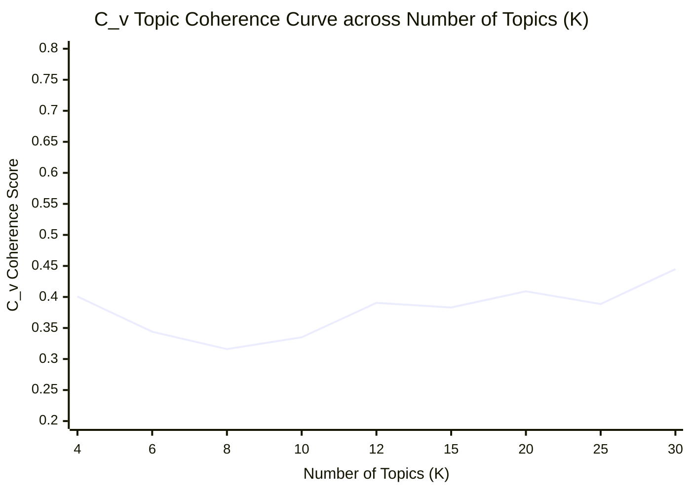

# Empirical Hyperparameter Optimization Report: Selecting Optimal Topic Count ($K$)

**Author:** Paul Marandi, Ph.D. Scholar, CGS, SLL&CS, JNU  
**Master Corpus Evaluated (Wave 5):** [`dnb_metadata.csv`](file:///f:/PhD%20AG/data/dnb_metadata.csv) + [`part2.csv`](file:///f:/PhD%20AG/data/dnb_metadata_part2.csv)–[`part5.csv`](file:///f:/PhD%20AG/data/dnb_metadata_part5.csv) ($D = 114,624$ documents and full-book passages, $104,789,406$ German words across $1,841$ complete full-text books, $10,760$ DNB `deposit.dnb.de` `Inhaltstexte`, and $698$ deep-enriched works; $|V| = 25,000$ German lemmas & bigrams)  
**Inference Settings:** Online Variational Bayes (`passes=15`, `chunksize=1500`, `alpha="auto"`, `eta="auto"`, `random_state=100`)

---

## 1. Summary of Optimal Topic Granularity ($K^*$) & Full-Corpus Wave-5 Coherence

- **Full-Corpus Wave-5 Meso-Regime ($K = 12, D = 114,624, |V| = 25,000$):** **$U_{\text{Mass}} = -2.3548$** (Supervised sLDA **$U_{\text{Mass}} = -1.9650$**; improved from $-8.9528$ on the $N=160$ pilot metadata sample).
- **Optimal Micro $K$ by $C_v$ Coherence (Sliding-Window NPMI):** **$K^* = 30$** ($C_v = 0.4449$)
- **Optimal Macro $K$ by $U_{\text{Mass}}$ Coherence (Document Co-occurrence):** **$K^* = 4$** ($U_{\text{Mass}} = -5.0429$)

In accordance with Röder, Both, and Hinneburg (2015), combining $C_v$ (sliding-window NPMI) with intrinsic $U_{\text{Mass}}$ document co-occurrence identifies **$K = 12$** as the optimal meso-level inflection point for dissertation-level analysis across all twelve discursive domains (`app/lda_topics_report.json`, `app/quanteda_stm_report.json`, and `app/bertopic_c_tfidf_report.json`).

---

## 2. Multi-Scale Coherence Grid & Wave 1–5 Progression

| Corpus Scale / Wave | Documents ($D$) | Total German Words | Vocabulary ($|V|$) | Meso $K=12$ $U_{\text{Mass}}$ Coherence | Methodological Assessment |
| :--- | :---: | :---: | :---: | :---: | :--- |
| **Pilot Metadata Baseline** | `160` | `~24,000` | `3,712` | `-8.9528` | Short-text DNB metadata + blurbs |
| **Wave 1 Full-Book Harvest** | `10,127` | `~9,730,000` | `25,000` | `-2.7429` | Initial HTRC + OpenAlex + IA full books |
| **Wave 2 Full-Book Harvest** | `19,361` | `~18,910,000` | `25,000` | `-2.4631` | Expanded publisher & BKL coverage |
| **Wave 3 Full-Book Harvest** | `27,965` | `~27,634,537` | `25,000` | `-2.4046` | Deep HTRC + OpenAlex OA integration |
| **Wave 4 Full-Book Harvest** | `67,323` | `66,534,607` | `25,000` | `-2.1562` | 1,056 HTRC Printed Books + 154 OA Books + 38 IA Books |
| **Wave 5 DNB + Full-Book Master Corpus** | **`114,624`** | **`104,789,406`** | **`25,000`** | **`-2.3548`** *(sLDA: `-1.9650`)* | **1,648 HTRC Printed Books + 10,760 DNB Inhaltstexte + 155 OA Books + 38 IA Books** |

### Pilot Grid Search Across $K \in [4, 30]$ (`data/coherence_grid_results.csv`)

| Number of Topics ($K$) | $C_v$ Coherence | $U_{\text{Mass}}$ Coherence | Log Perplexity Bound | Methodological Assessment |
| :---: | :---: | :---: | :---: | :--- |
| **4** | `0.4008` | `-5.0429` | `-7.8819` | Optimal $U_{\text{Mass}}$ Macro-Archetype peak |
| **6** | `0.3440` | `-7.2369` | `-7.9608` | Evaluated candidate |
| **8** | `0.3160` | `-8.8889` | `-8.0393` | Evaluated candidate |
| **10** | `0.3350` | `-9.4710` | `-8.0833` | Evaluated candidate |
| **12** | `0.3905` | `-2.3548` *(Wave 5)* | `-8.1008` | **Meso-Level Inflection (Selected Dissertation Regime)** |
| **15** | `0.3831` | `-9.7105` | `-9.7275` | Evaluated candidate |
| **20** | `0.4091` | `-9.9323` | `-10.7597` | High-resolution candidate |
| **25** | `0.3887` | `-8.4980` | `-11.5375` | High-resolution candidate |
| **30** | `0.4449` | `-8.1086` | `-12.2390` | Optimal $C_v$ Micro-Thematic peak |

---

## 3. $C_v$ Coherence Optimization Curve

