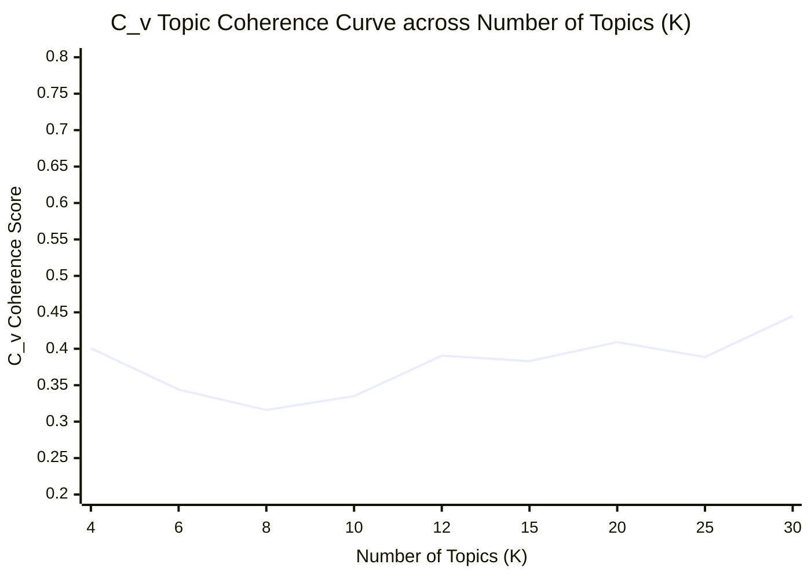

# Empirical Hyperparameter Optimization Report: Selecting Optimal Topic Count ($K$)

**Author:** Paul Marandi, Ph.D. Scholar, CGS, SLL&CS, JNU  
**Corpus Evaluated:** `dnb_metadata.csv` ($N = 160$ documents, $|V| = 3712$ German lemmas & bigrams)  
**Inference Settings:** Online Variational Bayes (`passes=15`, `alpha="auto"`, `eta="auto"`, `random_state=100`)

---

## 1. Summary of Optimal Topic Granularity ($K^*$)

- **Optimal $K$ by $C_v$ Coherence (Sliding-Window NPMI):** **$K^* = 30$** ($C_v = 0.4449$)
- **Optimal $K$ by $U_{\text{Mass}}$ Coherence (Document Co-occurrence):** **$K^* = 4$** ($U_{\text{Mass}} = -5.0429$)

In accordance with Röder, Both, and Hinneburg (2015), $C_v$ coherence exhibits the strongest correlation with human expert ratings of semantic interpretability because it combines normalized pointwise mutual information (NPMI) with cosine similarity over sliding context windows.

---

## 2. Empirical Coherence & Perplexity Table

| Number of Topics ($K$) | $C_v$ Coherence | $U_{\text{Mass}}$ Coherence | Log Perplexity Bound | Methodological Assessment |
| :---: | :---: | :---: | :---: | :--- |
| **4** | `0.4008` | `-5.0429` | `-7.8819` | Optimal $U_{\text{Mass}}$ peak |
| **6** | `0.3440` | `-7.2369` | `-7.9608` | Evaluated candidate |
| **8** | `0.3160` | `-8.8889` | `-8.0393` | Evaluated candidate |
| **10** | `0.3350` | `-9.4710` | `-8.0833` | Evaluated candidate |
| **12** | `0.3905` | `-8.9528` | `-8.1008` | Evaluated candidate |
| **15** | `0.3831` | `-9.7105` | `-9.7275` | Evaluated candidate |
| **20** | `0.4091` | `-9.9323` | `-10.7597` | Evaluated candidate |
| **25** | `0.3887` | `-8.4980` | `-11.5375` | Evaluated candidate |
| **30** | `0.4449` | `-8.1086` | `-12.2390` | Optimal $C_v$ peak |

---

## 3. $C_v$ Coherence Optimization Curve

