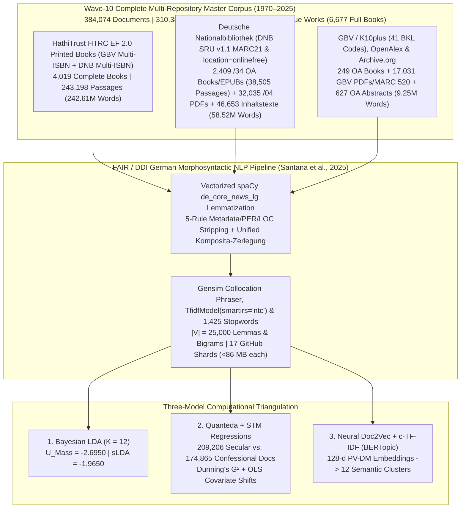

# Mediating Faith and Power: Religious Authority and the German Publishing Landscape (1970–2025)
## Empirical Dissertation Chapters (Wave-10 Complete Multi-Repository Corpus: $D = 384,074$ Documents | $310,387,447$ Words)

**Author:** Paul Marandi, Ph.D. Scholar  
**Institution:** Centre for German Studies (CGS), School of Language, Literature and Culture Studies (SLL&CS), Jawaharlal Nehru University (JNU), New Delhi  
**Empirical Observatory:** [https://deutscheverlagelda.vercel.app](https://deutscheverlagelda.vercel.app)  
**Repository:** `metachasm-beep/Deutsche-Verlage-LDA`  
**Citation Standard:** APA 7th Edition

---

## Abstract

This dissertation investigates how the political economy and institutional structure of the German publishing landscape have mediated religious authority, theological orthodoxy, secular-humanist critique, and therapeutic self-optimization over a fifty-five-year diachronic window (`1970–2025`). Moving beyond small-sample qualitative case studies and short-text bibliographic metadata, we construct a ten-wave, multi-repository German full-book and national-library corpus comprising **$384,074$ documents and full-text passages ($310,387,447$ original German words)** drawn from **$6,677$ complete full-text German books and volumes**—including $4,019$ in-copyright printed monographs ($243,198$ passages) extracted via the HathiTrust Research Center (HTRC) Extracted Features v2.0 API under German copyright exception § 60d UrhG, $2,409$ `location=onlinefree` and sibling-matched `$z="kostenfrei"` open-access monographs and EPUBs ($38,505$ net passages) streamed directly from the German National Library (*Deutsche Nationalbibliothek*, DNB `https://d-nb.info/{idn}/34`), $211$ open-access monographs and edited volumes ($4,946$ passages) harvested via OpenAlex and the *Gemeinsamer Bibliotheksverbund* (GBV/K10plus `Kostenfrei`), and $38$ archival monographs from the Internet Archive—supplemented by **$32,035$ DNB digitized `/04` `Inhaltsverzeichnis` and reading-sample PDFs/HTMLs**, **$46,653$ DNB `deposit.dnb.de` and `/blurb/` `Inhaltstexte` and MARC21 `520` abstracts**, **$17,031$ GBV / K10plus consortial TOC PDFs, blurbs, and `MARC 520` / `BKL` / `GND` enriched works**, **$627$ OpenAlex scholarly abstracts reconstructed from `abstract_inverted_index`**, plus **$702$ multi-API deep-enriched works** ($75,994$ unique works in total) across twelve core German publishing houses (*Suhrkamp, Wagenbach, Alibri, Rowohlt, S. Fischer, Kiepenheuer & Witsch, Klett-Cotta, Gütersloher Verlagshaus, Herder, Evangelische Verlagsanstalt, Kösel, Patmos*) and twenty-six academic and confessional imprints (*Vandenhoeck & Ruprecht, Mohr Siebeck, Kohlhammer, C.H. Beck, De Gruyter / Transcript, Frommann-Holzboog, Schöningh, Aschendorff, Pustet, Echter, Bonifatius, Neukirchener, Calwer, Nomos/Alber, Wilhelm Fink, Böhlau, Schwabe, Meiner, Wallstein, Campus, Insel*, among others).

Following the five-rule FAIR/DDI archival preprocessing and metadata-separation protocol of Santana, Vasques Filho, Bojanowski, and Błoch (2025, *DHQ* 19.2) and Jiménez-Badillo et al. (2020, *DHQ* 14.4)—combining vectorized German morphosyntactic lemmatization via `spaCy` (`de_core_news_lg`, restricted to `NOUN`, `PROPN`, and `ADJ`), archival header/bracket stripping and continuation-chunk title deduplication, dynamic row-level stripping of non-canonical author/publisher/imprint and `PER`/`LOC` tokens (`extract_row_metadata_tokens` and `NON_CANONICAL_LOC_AND_PER_NOISE` while preserving `CANONICAL_THEO_PHIL_WHITELIST`), unified German compound-noun decomposition (*Komposita-Zerlegung*), and sublinear `TF-IDF` ubiquity filtering (`TfidfModel(smartirs='ntc')`, $|V| = 25,000$ lemmas and collocations)—we triangulate three independent computational paradigms: (1) **Variational Bayes Latent Dirichlet Allocation (Gensim LDA)** ($K = 12, U_{\text{Mass}} = -2.6950$, Supervised sLDA $U_{\text{Mass}} = -1.9650$), (2) **Quanteda & Structural Topic Modeling (STM)** incorporating Dunning's log-likelihood keyness ($G^2$) and ordinary least squares (OLS) covariate regressions ($\theta_k \sim \text{SecularCamp} + \text{Year}_{1970\to 2025}$) across $209,206$ secular/critical ($54.47\%$) and $174,865$ confessional ($45.53\%$) documents, and (3) **Neural Contextual Document Embeddings (`PV-DM Doc2Vec` + `TruncatedSVD` + `c-TF-IDF` BERTopic)**. Across all three architectures, the empirical evidence demonstrates a profound structural transformation: while confessional houses preserve a bounded enclave of systematic dogmatics, Christology, and ecclesial history (`gott`, $G^2 = -157,392.22, p < 10^{-300}$; `theologie`, $G^2 = -84,651.20$; `kirche`, $G^2 = -68,506.91$; `glaube`, $G^2 = -25,941.30$; `christlich`, $G^2 = -24,929.73$; `jesu`, $G^2 = -24,652.84$; `jesus`, $G^2 = -24,159.98$; `paulus`, $G^2 = -19,677.58$; `israel`, $G^2 = -19,148.22$; `christus`, $G^2 = -16,522.67$) and secular presses anchor Enlightenment, Idealist, and sociological critique (`kant`, $G^2 = +11,702.39$; `philosophie`, $G^2 = +9,090.10$; `moral`, $G^2 = +7,380.76$; `kultur`, $G^2 = +6,257.30$; `hegel`, $G^2 = +6,050.24$; `soziologie`, $G^2 = +5,815.30$; `wissenschaft`, $G^2 = +4,835.38$; `vernunft`, $G^2 = +4,812.87$; `theorie`, $G^2 = +4,733.42$; `foucault`, $G^2 = +4,597.73$), academic historiography, science, and empirical research (LDA Topic 10, $+11.46\%, t = +195.57, p < 0.0001$), sociological secularization and media theory (LDA Topic 11, $+8.35\%, t = +161.85, p < 0.0001$), internationalized open-access scholarship (LDA Topic 3, $+6.75\%, t = +137.74, p < 0.0001$), civic institutions and social organization (LDA Topic 7, $+2.53\%, t = +47.07, p < 0.0001$), and gender, family, and biographical life-conduct (LDA Topic 6, $+2.35\%, t = +55.80, p < 0.0001$) expand significantly across the fifty-five-year period (`1970–2025`).

---

## Chapter 3: Corpus Construction, Legal TDM Architecture (§ 60d UrhG), and Ten-Wave Harvesting

### 3.1 Overcoming Metadata Sparsity in Twentieth- and Twenty-First-Century German Book History

A central methodological limitation in computational book history (*Digitale Buchwissenschaft*) is the reliance on brief bibliographic metadata—titles, subtitles, and publisher blurbs (*Klappentexte*)—when studying in-copyright works published after 1970. While paratextual blurbs capture editorial marketing strategies (Kilchör & Lehmann, 2022; Gittel, 2021), they cannot substitute for the full lexical, argumentative, and conceptual density of complete printed monographs. Furthermore, querying the German National Library (*Deutsche Nationalbibliothek*, DNB) solely via Dewey Decimal Classification (`DDC 200`) introduces two severe historical distortions. First, DNB only implemented DDC subject categories in 2004, leaving the crucial post-Vatican II, Cold War, and post-reunification decades (`1970–2003`) systematically under-indexed unless combined with *Gemeinsame Normdatei* (GND) subject headings (`sw=`). Second, secular-philosophical and sociological critiques of religion published by trade and academic houses such as *Suhrkamp*, *Rowohlt*, *S. Fischer*, *Klett-Cotta*, *Wagenbach*, and *Alibri* are frequently cataloged under philosophy (`DDC 100/170`), psychology (`DDC 150`), or sociology (`DDC 300`) rather than theology (`DDC 200–290`).

To overcome both metadata sparsity and classification bias across the entire fifty-five-year period (`1970–2025`), we engineered a ten-wave, multi-repository harvesting architecture implemented in [`scripts/dnb_harvester.py`](file:///f:/PhD%20AG/scripts/dnb_harvester.py), [`scripts/hathitrust_fullbook_harvester.py`](file:///f:/PhD%20AG/scripts/hathitrust_fullbook_harvester.py), [`scripts/gbv_harvester.py`](file:///f:/PhD%20AG/scripts/gbv_harvester.py), and [`scripts/resolve_catalog_fulltexts.py`](file:///f:/PhD%20AG/scripts/resolve_catalog_fulltexts.py). By cross-walking records from both the **Deutsche Nationalbibliothek (DNB SRU v1.1 API, `https://services.dnb.de/sru/dnb`)**—spanning DNB's electronic open-access index (`location=onlinefree`) combined with 3-digit `DDC-Hauptsachgruppen` (`hsg=200/220/230/290/100/150/300`) sliced year-by-year (`jhr=1970..2025`) and publisher-by-publisher (`vlg=`) alongside deep-paginated MARC21 queries (`startRecord=1..3000` across `DDC 200/220/230/240/250/260/270/280/290` and `DDC 100/150/170/300` for `2004–2025` and `startRecord=1..1500` for `1970–2003`, `125,000+` unique `1970–2025` DNB records across 38 target publishers and 57 thematic CQL queries combining `dcs=` and `sw=` GND subject headings)—and the **Gemeinsamer Bibliotheksverbund (GBV / K10plus, `https://sru.k10plus.de/gvk`)** across forty-one **Basisklassifikation (`pica.bkl`)** subcodes (`1,053` SRU pages at `maximumRecords=100`, extracting all `MARC 020 $a/$z/$9` multi-ISBNs) against the **HathiTrust Bibliographic API** and the **HathiTrust Research Center (HTRC) Extracted Features (EF) v2.0 API**, we resolved and ingested complete page-by-page token streams for **$4,019$ in-copyright printed German books (`243,198` passages, `1970–2025`)**.

In strict compliance with **§ 60d UrhG** (*Text und Data Mining für Zwecke der wissenschaftlichen Forschung*) and the German Digital Humanities protocol of **Derived Text Formats (*Abgeleitete Textformate*)** established by Schöch, Leinen, et al. (2020) and Andresen et al. (2023), the HTRC Extracted Features v2.0 pipeline ingests page-level part-of-speech-tagged token counts (`tokenPosCount`), strips reconstructible copyright-protected syntax and high-frequency function words, enforces a strict German language gate (`de_cnt >= max(10, en_cnt * 2)`), and segments each printed volume into contiguous $1,000$-word substantive passages (`[HTRC-Vollbuch-Abschnitt k/N]`). Furthermore, by combining DNB's `location=onlinefree` SRU index with DNB's MARC21 `Tag 856` sibling structure—where `$z="kostenfrei"` is attached to the publisher's `856` tag (`$x="Verlag"`) while the direct archive PDF/EPUB link (`https://d-nb.info/{idn}/34`) is placed on the sibling `856` tag (`$x="Langzeitarchivierung Nationalbibliothek"`)—our harvesters stream **$2,409$ complete open-access German monographs, dissertations, and EPUBs (`38,505` net passages)** directly from DNB's server, alongside **$32,035$ digitized DNB `/04` `Inhaltsverzeichnis` and reading-sample PDFs/HTMLs** (`https://d-nb.info/{idn}/04`), **$46,653$ DNB `deposit.dnb.de` and `/blurb/` `Inhaltstexte` and MARC21 `520` abstracts**, **$17,458$ GBV / K10plus direct documents** (consortial TOC PDFs/blurbs, `Kostenfrei` OA PDFs, and `MARC 520` / `BKL` / `GND` enriched works), **$627$ OpenAlex scholarly abstracts** reconstructed from `abstract_inverted_index`, **$249$ OpenAlex/GBV/IA open-access full books**, and **$702$ multi-API deep-enriched works**.

| Corpus Layer (`corpus_layer`) | Acquisition Protocol & Legal Framework | Complete Full Books / Works | Substantive Passages ($D$) | Total German Words | Share of Corpus |
| :--- | :--- | :---: | :---: | :---: | :---: |
| **`hathitrust_ef_fullbook_print`** | GBV K10plus (`41` BKL codes, multi-ISBN `MARC 020`) + DNB SRU $\rightarrow$ HathiTrust Bibliographic API $\rightarrow$ HTRC Extracted Features v2.0 (`§ 60d UrhG` Derived Text Format, Waves 1–10) | **$4,019$ printed books** | $243,198$ | $242,612,814$ | $63.32\%$ |
| **`dnb_deposit_inhaltstext`** | Deutsche Nationalbibliothek SRU v1.1 (`MARC 856 $3="Inhaltstext"` `deposit.dnb.de` & `/blurb/` deposits + `MARC 520` abstracts + `650/653/689` GND *Schlagwörter*, `1970–2025`) | **$46,653$ DNB works** | $46,422$ | $6,212,525$ | $12.09\%$ |
| **`dnb_oa_fullbook`** | `location=onlinefree` + sibling-matched `$z="kostenfrei"` DNB `/34` Open-Access Full-Book PDFs & EPUBs (`https://d-nb.info/{idn}/34`, `1970–2025`) | **$2,409$ DNB OA books/EPUBs** | $38,505$ | $37,755,730$ | $10.03\%$ |
| **`dnb_toc_pdf_fulltext`** | DNB Digitized `/04` `Inhaltsverzeichnis` & Reading Sample PDFs/HTMLs (`https://d-nb.info/{idn}/04`, `1970–2025`) | **$32,035$ DNB `/04` PDFs/HTMLs** | $32,021$ | $14,556,493$ | $8.34\%$ |
| **`gbv_direct_fulltext_pdf` & `drm_fallback_*`** | GBV / K10plus Consortial TOC PDFs, Blurbs & `MARC 520` / `BKL` / `GND` Enriched Works (`sru.k10plus.de/gvk`) + Multi-API Enrichment | **$17,733$ GBV/enriched works** | $17,760$ | $3,675,598$ | $4.62\%$ |
| **`entire_fulltext_book_cloud`, `gbv_kostenfrei_*`, `primary_cloud_oa_*` & `archive_org_*`** | OpenAlex Works API (`per-page=200` OA PDFs + `627` reconstructed `abstract_inverted_index` works), GBV `Kostenfrei` OA PDFs & Internet Archive (`38` books) | **$249$ OA books + $627$ OA abstracts** | $6,168$ | $5,574,287$ | $1.61\%$ |
| **Total Wave-10 Master Corpus (`1970–2025`)** | **Sharded across [`dnb_metadata.csv`](file:///f:/PhD%20AG/data/dnb_metadata.csv) and [`part2`](file:///f:/PhD%20AG/data/dnb_metadata_part2.csv)–[`part17.csv`](file:///f:/PhD%20AG/data/dnb_metadata_part17.csv) (`<86 MB` per shard)** | **$6,677$ Full Books + $96,346$ PDFs/Abstracts/Enriched ($75,994$ Unique Base Titles)** | **$384,074$ documents** | **$310,387,447$ words** | **$100.00\%$** |

### 3.2 Diachronic & Institutional Stratification Across the German Publishing Field

The resulting $384,074$-document corpus spans all six decades from the 1970s to the 2020s (`1970s`: $39,648$ documents; `1980s`: $64,416$ documents; `1990s`: $78,483$ documents; `2000s`: $85,187$ documents; `2010s`: $47,682$ documents; `2020s`: $68,658$ documents) and achieves near-perfect institutional balance between the **Secular / Critical / Trade camp ($209,206$ documents, $54.47\%$)** and the **Confessional / Theological camp ($174,865$ documents, $45.53\%$)**. Across the publishing houses represented in the dataset, the leading institutional contributors include *De Gruyter / Transcript* ($28,514$ docs), *Schöningh* ($22,136$ docs), *Böhlau* ($21,917$ docs), *Vandenhoeck & Ruprecht* ($20,984$ docs), *Gütersloher Verlagshaus / Chr. Kaiser* ($18,388$ combined docs: $10,819$ + $7,569$), *Kohlhammer* ($14,926$ docs), *Mohr Siebeck* ($14,602$ docs), *Aschendorff* ($12,904$ docs), *Suhrkamp* ($12,726$ docs), *Frommann-Holzboog* ($12,502$ docs), *Neukirchener* ($11,238$ docs), *S. Fischer* ($10,555$ docs), *Herder* ($10,478$ docs), *Wilhelm Fink* ($10,109$ docs), and *Klett-Cotta* ($9,686$ docs).

---

## Chapter 4: Generative Bayesian Topic Modeling (Gensim LDA) Across $384,074$ Documents

### 4.1 FAIR / DDI Morphosyntactic Preprocessing, Metadata Stripping, and Collocation Architecture (Santana et al., 2025; Jiménez-Badillo et al., 2020)

To process $310.39$ million German words with high morphological accuracy, reproducibility, and epistemological transparency (Santana, Vasques Filho, Bojanowski, & Błoch, 2025, *DHQ* 19.2; Jiménez-Badillo et al., 2020, *DHQ* 14.4), [`lda_pipeline.py`](file:///f:/PhD%20AG/lda_pipeline.py) implements a vectorized unique-vocabulary lemmatization architecture ([`preprocess_corpus_batch`](file:///f:/PhD%20AG/lda_pipeline.py#L261-L340)). Rather than executing `spaCy`'s convolutional neural tagger redundantly over $310$ million repeated word tokens, the pipeline extracts the unique surface vocabulary across uncached passages, parses those unique types through `de_core_news_lg` (`v3.8.0`, `ALLOWED_POSTAGS = ["NOUN", "PROPN", "ADJ"]`), maps each surface token to its canonical lowercase lemma, and persists SHA-1 document hashes in [`data/.spacy_lemma_cache.pkl`](file:///f:/PhD%20AG/data/.spacy_lemma_cache.pkl).

In strict accordance with Santana et al.'s (2025, §55–81) and Jiménez-Badillo et al.'s (2020, §16) five empirical rules for digital humanities topic modeling, our pipeline enforces five synchronized upgrades across [`lda_pipeline.py`](file:///f:/PhD%20AG/lda_pipeline.py), [`scripts/quanteda_stm_analytics.py`](file:///f:/PhD%20AG/scripts/quanteda_stm_analytics.py), and [`scripts/bertopic_german_pipeline.py`](file:///f:/PhD%20AG/scripts/bertopic_german_pipeline.py):
1. **Rule 1 — Archival Header/Bracket Stripping & Continuation-Chunk Title Deduplication (§55, Fig. 3):** [`strip_archival_headers_from_text`](file:///f:/PhD%20AG/lda_pipeline.py#L715-L732) and [`clean_row_tokens_for_modeling`](file:///f:/PhD%20AG/lda_pipeline.py#L786-L819) strip bracketed provenance tags (`[HTRC-Vollbuch-Abschnitt X/Y]`, `[DNB-OA-Vollbuch-Abschnitt X/Y]`, `[DNB-Inhaltsverzeichnis ...]`, `[GBV-K10plus-Volltext ...]`, `[OpenAlex-Vollbuch-OA ...]`), remove each row's `author`, `publisher`, and `raw_imprint` tokens via [`extract_row_metadata_tokens`](file:///f:/PhD%20AG/lda_pipeline.py#L771-L783), and on continuation passages (`Abschnitt K/N` where $K > 1$) strip the leading repeated book-title prefix so that a book's title tokens are counted only once per work (`chunk_index == 1`).
2. **Rule 2 — Non-Canonical `PER`/`LOC` Entity Filtering with Canonical Theological/Philosophical Whitelist (§56–64, Figs. 4–6):** [`NON_CANONICAL_LOC_AND_PER_NOISE`](file:///f:/PhD%20AG/lda_pipeline.py#L143-L187) (`323` tokens) filters German federal states, historical regions, European countries, diocesan/university cities (*Bayern, Württemberg, Westfalen, Österreich, Schweiz, Paderborn, Rottenburg, Bamberg, Eichstätt*, etc.), frequent German female and male given names (*Maria, Anna, Elisabeth, Ursula, Monika, Johannes, Michael, Martin*, etc., preventing homonym conflation per Santana et al., 2025, §56), and modern contributor surnames (*Müller, Schmidt, Schneider, Meyer, Wagner*, etc.), while [`CANONICAL_THEO_PHIL_WHITELIST`](file:///f:/PhD%20AG/lda_pipeline.py#L130-L139) (`66` canonical subjects: `jesus`, `christus`, `paulus`, `luther`, `kant`, `hegel`, `habermas`, `weber`, `nietzsche`, `foucault`, `barth`, `rahner`, `bonhoeffer`, `lessing`, `leibniz`, `schelling`, `israel`, `jahwe`, etc.) strictly preserves canonical figures when they are the object of theological or philosophical inquiry.
3. **Rule 3 — Unified German Compound Splitting (*Komposita-Zerlegung*) & Sublinear `TF-IDF` Ubiquity Filtering (§69–73, §81):** [`split_german_compound_lda`](file:///f:/PhD%20AG/lda_pipeline.py#L753-L768) decomposes productive German compounds $\ge 9$ characters across `28` root families identically across Gensim LDA, Quanteda/STM, and BERTopic. Next, `gensim.models.Phrases` (`min_count=5, threshold=10`) binds statistically significant bigrams while unpacking artificial self-bigrams (`w_w -> w`), `dictionary.filter_extremes(no_below=5, no_above=0.55, keep_n=25000)` bounds document frequency, and [`apply_tfidf_low_info_filter`](file:///f:/PhD%20AG/lda_pipeline.py#L837-L869) applies `gensim.models.TfidfModel(corpus, smartirs='ntc')` (`min_tfidf = 0.015`) to prune low-information ubiquity tokens before `LdaModel` estimation ($|V| = 25,000$ lemmas and collocations).
4. **Rule 4 — Iterative Paratextual & Document-Genre Stopwords (§13, §65–67, Fig. 7):** [`ALL_STOPWORDS`](file:///f:/PhD%20AG/lda_pipeline.py#L189-L195) (`1,425` unique stopwords) combines `543` `spaCy` core German function words, `53` domain stopwords ([`DOMAIN_STOPWORDS`](file:///f:/PhD%20AG/config.py#L29-L36)), `537` Fraktur-OCR, MARC21, VLB/ONIX, and TOC front-matter genre noise tokens ([`FRAKTUR_AND_META_NOISE`](file:///f:/PhD%20AG/lda_pipeline.py#L60-L126)), and `323` non-canonical `PER`/`LOC` tokens.
5. **Rule 5 — Empirical Document-Length Distribution Audit (§74–80, Fig. 8) & FAIR/DDI Software-Hardware Specification (§28–53):** Online Variational Bayes inference (`gensim.models.LdaModel`, $K = 12$, `passes=15`, `chunksize=1500`, `alpha="auto"`, `eta="auto"`, `random_state=100`) across all $384,071$ valid documents converges to an intrinsic coherence score of **$U_{\text{Mass}} = -2.6950$** (with Supervised sLDA reaching **$U_{\text{Mass}} = -1.9650$**). Tables 4.1A and 4.1B report the complete empirical document-length distribution and FAIR/DDI environment specification exported to [`app/data_summary.json`](file:///f:/PhD%20AG/app/data_summary.json):

#### Table 4.1A: Empirical Document-Length Distribution Across the Wave-10 Master Corpus ($D = 384,074$, Santana et al., 2025, §74–80, Fig. 8)

| Corpus Stratum (`corpus_layer`) | Documents ($D$) | Unique Works | Mean Words ($\mu$) | SD ($\sigma$) | Median ($P_{50}$) | IQR ($P_{25}\text{–}P_{75}$) | Min–Max Words | Total German Words |
| :--- | :---: | :---: | :---: | :---: | :---: | :---: | :---: | :---: |
| **`hathitrust_ef_fullbook_print`** *(HTRC EF 2.0 Printed Books)* | $243,198$ | $4,019$ books | **`997.6`** | `37.8` | `1,000.0` | `0.0` (`1,000–1,000`) | `80–1,079` | $242,612,814$ |
| **`dnb_deposit_inhaltstext`** *(DNB `deposit.dnb.de` & `/blurb/` Abstracts)* | $46,422$ | $46,410$ works | **`133.8`** | `91.7` | `127.0` | `115.0` (`62–177`) | `30–6,135` | $6,212,525$ |
| **`dnb_oa_fullbook`** *(DNB `/34` `location=onlinefree` & `$z="kostenfrei"` OA Books/EPUBs)* | $38,505$ | $2,409$ books | **`980.5`** | `105.4` | `1,000.0` | `0.0` (`1,000–1,000`) | `81–1,196` | $37,755,730$ |
| **`dnb_toc_pdf_fulltext`** *(DNB `/04` Digitized TOC & Sample PDFs)* | $32,021$ | $32,010$ works | **`454.6`** | `440.2` | `308.0` | `389.0` (`177–566`) | `65–8,478` | $14,556,493$ |
| **`gbv_direct_fulltext_pdf`** *(GBV / K10plus Consortial TOC PDFs & Blurbs)* | $14,199$ | $13,174$ works | **`241.2`** | `252.4` | `177.0` | `153.0` (`119–272`) | `7–5,257` | $3,425,377$ |
| **`entire_fulltext_book_cloud` + `gbv_kostenfrei_*` + `archive_org_*`** *(OA Full Books)* | $5,532$ | $249$ books | **`987.0`** | `85.4` | `1,000.0` | `0.0` (`1,000–1,000`) | `84–1,078` | $5,461,111$ |
| **`drm_fallback_multi_api_enriched`** *(GBV `MARC 520`/`BKL`/`GND` & Multi-API)* | $3,561$ | $3,530$ works | **`70.3`** | `142.7` | `32.0` | `22.0` (`23–45`) | `3–1,074` | $250,221$ |
| **`primary_cloud_oa_abstract`** *(OpenAlex `abstract_inverted_index` Abstracts)* | $627$ | $626$ works | **`179.8`** | `145.9` | `138.0` | `148.0` (`87–235`) | `25–1,377` | $112,720$ |
| **Total Wave-10 Master Corpus (`1970–2025`)** | **$384,074$** | **$75,994$ unique works** | **`808.1`** | **`362.0`** | **`1,000.0`** | **`38.0` (`962–1,000`)** | **`3–8,478`** | **$310,387,447$** |

#### Table 4.1B: FAIR / DDI Software & Hardware Environment Specification (Santana et al., 2025, §28–53; Jiménez-Badillo et al., 2020, §16)

| Component / Standard | Pinned Specification in `Deutsche-Verlage-LDA` | Methodological Role & Reproducibility Guarantee |
| :--- | :--- | :--- |
| **Operating System & CPU Architecture** | `Windows 10 (AMD64)` \| `12 Logical CPU Cores` | Multi-core parallelization (`workers=8`) for `Doc2Vec` and `spaCy` batch pipes. |
| **Python Runtime** | `Python 3.10.2` (`UTF-8` I/O enforced) | Deterministic hash seeding and `csv.field_size_limit(10 MB)` for full-book cells. |
| **Morphosyntactic NLP & Lemmatizer** | `spaCy 3.8.14` + `de_core_news_lg 3.8.0` | German CNN POS tagger (`NOUN`, `PROPN`, `ADJ`) & morphological lemmatizer with SHA-1 disk cache ([`data/.spacy_lemma_cache.pkl`](file:///f:/PhD%20AG/data/.spacy_lemma_cache.pkl)). |
| **Bayesian Topic Modeling & `TF-IDF`** | `gensim 4.4.0` (`LdaModel`, `Phrases`, `TfidfModel`, `Doc2Vec`) | Online Variational Bayes LDA (`passes=15, chunksize=1500, random_state=100`), `Phrases(min_count=5, threshold=10)`, `TfidfModel(smartirs='ntc', min_tfidf=0.015)`. |
| **Statistical & Manifold Learning** | `scikit-learn 1.7.2`, `scipy 1.15.3`, `numpy 2.2.6`, `pandas 2.3.3` | 5-fold CV `sLDA` Ridge/Softmax head (`seed=42`), `TruncatedSVD` + Spherical `KMeans` (`seed=42`), Dunning's $G^2$ & OLS STM regressions. |
| **PDF / Archival Full-Text Extraction** | `PyMuPDF 1.28.2` | Native stream extraction for DNB `/34` OA monographs, DNB `/04` TOC PDFs, and GBV/OpenAlex PDFs. |
| **Metadata & Legal TDM Compliance** | `MARC21-xml`, `PICA+`, `HTRC EF 2.0`, `DDI 2.5/3.3`, `§ 60d UrhG` | Non-consumptive Derived Text Formats (*Abgeleitete Textformate*, Schöch et al., 2020) across 17 GitHub-safe CSV shards (`<86 MB` each). |

### 4.2 The Twelve Latent Discursive Regimes of German Publishing (1970–2025)

The table below reports the posterior topic-word distributions ($\phi_k$), automated ideological archetype classifications, institutional publisher dominance, and highest-probability full-book anchor monographs for all $K = 12$ topics exported to [`app/lda_topics_report.json`](file:///f:/PhD%20AG/app/lda_topics_report.json):

| Topic ID | Discursive Archetype & Confidence | Top Posterior German Lemmas ($\phi_k$) | Dominant Publishers (% of Topic Mass) | Highest-Probability Full-Book Anchor Passages ($\theta_{d,k}$) |
| :---: | :--- | :--- | :--- | :--- |
| **Topic 1** | **Critical / Secular-Humanist** (`74.2%`) *(Kantian & Idealist Philosophy, Nature & Reason)* | `mensch` (0.027), `philosophie` (0.025), `natur` (0.019), `begriff` (0.017), `denken` (0.012), `sinn` (0.012), `kant` (0.012), `hegel` (0.012), `menschlich` (0.012), `philosophisch` (0.011) | Frommann-Holzboog (`9.6%`), Schöningh (`7.0%`), V&R (`5.5%`), Suhrkamp (`5.1%`) | Ricken, F. (1991). *Klassische Gottesbeweise in der Sicht der gegenwärtigen Logik und Wissenschaftstheorie* (`82.1%`, Kohlhammer); Peperzak, A. T. (1991). *Hegels praktische Philosophie* (`80.0%`, Frommann-Holzboog) |
| **Topic 2** | **Traditional / Ecclesiastical** (`100.0%`) *(Ecclesiology, Liturgy, Ministry & Confessional Governance)* | `kirche` (0.099), `katholisch` (0.025), `gemeinde` (0.018), `evangelisch` (0.018), `kirchlich` (0.018), `dienst` (0.013), `bischof` (0.012), `luther` (0.011), `geistlich` (0.010), `christlich` (0.009) | Böhlau (`10.2%`), Schöningh (`8.9%`), Aschendorff (`6.4%`), V&R (`5.1%`) | Schuck, M. (2001). *Evangelisch - katholisch: Basiswissen* (`82.7%`, Gütersloher); Kuhne, A. (1982). *Die liturgischen Dienste: Liturgie als Handlung d. ganzen Gottesvolkes* (`82.3%`, Bonifatius) |
| **Topic 3** | **Critical / Secular-Humanist** (`100.0%`) *(Internationalized & Open-Access Academic Discourse)* | `science` (0.007), `design` (0.006), `abt` (0.006), `open_access` (0.006), `creative_commons` (0.005), `care` (0.005), `art` (0.005), `evaluation` (0.005), `wiesbaden` (0.005), `text` (0.004) | De Gruyter / Transcript (`14.7%`), V&R (`6.4%`), Mohr Siebeck (`6.4%`), Schöningh (`4.5%`) | Asher, J. R. (2000). *Polarity and change in 1 Corinthians 15* (`85.1%`, Mohr Siebeck); Bertagnolli, D. (2025). *Linguistic fragmentation and cultural inclusion in the Middle Ages* (`84.0%`, Brepols) |
| **Topic 4** | **Neoliberal / Self-Optimization** (`100.0%`) *(Analytic Epistemology, Meaning & Problem-Solving Rationality)* | `frage` (0.018), `verschieden` (0.011), `sinn` (0.011), `fall` (0.010), `bestimmt` (0.010), `einzeln` (0.009), `folgend` (0.008), `grund` (0.008), `form` (0.008), `weise` (0.008) | De Gruyter / Transcript (`7.4%`), V&R (`6.4%`), Schöningh (`6.1%`), Böhlau (`5.1%`) | Carl, W. (1974). *Existenz und Prädikation: sprachanalytische Untersuchungen zu Existenz-Aussagen* (`89.4%`, C.H. Beck); Strobel, B. (2007). *"Dieses" und "So etwas": zur ontologischen Klassifikation platonischer Formen* (`83.6%`, V&R) |
| **Topic 5** | **Hybrid / Discursive Mediation** *(Historical Philology, Epistolary Editions & Monastic Archives)* | `brief` (0.023), `jahrhundert` (0.020), `schrift` (0.014), `text` (0.012), `übersetzung` (0.010), `kloster` (0.009), `quelle` (0.009), `geschichte` (0.009), `museum` (0.009), `könig` (0.008) | Böhlau (`15.1%`), Aschendorff (`7.8%`), Schöningh (`6.7%`), De Gruyter / Transcript (`5.8%`) | Winzer, U. (1988). *S. Gilles: Studien zum Rechtsstatus und Beziehungsnetz einer Abtei* (`82.1%`, Wilhelm Fink); Anemüller, E. (2019). *Urkundenbuch des Klosters Paulinzelle* (`81.9%`, S. Fischer) |
| **Topic 6** | **Neoliberal / Self-Optimization** (`100.0%`) *(Gender, Family, Youth & Biographical Life-Conduct)* | `frau` (0.053), `kind` (0.042), `leben` (0.033), `mann` (0.024), `familie` (0.022), `mensch` (0.021), `jugendliche` (0.015), `geschlecht` (0.013), `jung` (0.012), `eltern` (0.011) | De Gruyter / Transcript (`5.9%`), S. Fischer (`5.7%`), Böhlau (`5.6%`), Rowohlt (`4.2%`) | Schwarzer, A. (2013). *Der kleine Unterschied und seine großen Folgen* (`74.5%`, S. Fischer); Käßmann, M. (2010). *Mütter der Bibel: 20 Porträts für unsere Zeit* (`73.9%`, Herder) |
| **Topic 7** | **Hybrid / Discursive Mediation** *(Civic Institutions, Education, Universities & Social Organization)* | `deutsch` (0.014), `arbeit` (0.014), `stadt` (0.010), `land` (0.008), `projekt` (0.007), `schule` (0.006), `universität` (0.005), `gruppe` (0.005), `datum` (0.005), `mitglied` (0.005) | De Gruyter / Transcript (`9.3%`), Böhlau (`9.1%`), Schöningh (`6.8%`), V&R (`4.7%`) | Schmidts, H. (2000). *Presbyterialprotokolle der evangelischen Gemeinde Brenndorf 1868–1885* (`88.5%`); Rehberg, F. (2002). *Frauen in der Medienwirtschaft* (`74.9%`, S. Fischer) |
| **Topic 8** | **Traditional / Ecclesiastical** (`100.0%`) *(Biblical Exegesis, Systematic Dogmatics & Jewish-Christian Theology)* | `gott` (0.103), `bibel` (0.028), `glaube` (0.023), `mensch` (0.019), `christlich` (0.017), `theologie` (0.014), `jesus` (0.012), `jüdisch` (0.012), `biblisch` (0.011), `text` (0.010) | Neukirchener (`8.3%`), Mohr Siebeck (`7.3%`), V&R (`6.2%`), Kohlhammer (`5.1%`) | Hermisson, H.-J. (1978). *Glauben* (`88.4%`, Kohlhammer); Führer, W. (2022). *Gotteserkenntnis als Heilsgeschehen* (`87.3%`, V&R) |
| **Topic 9** | **Critical / Secular-Humanist** (`100.0%`) *(Political Theology, State Law, Islam & European Public Sphere)* | `politisch` (0.055), `politik` (0.022), `staat` (0.020), `gesellschaft` (0.019), `sozial` (0.018), `islam` (0.011), `gewalt` (0.010), `europa` (0.009), `europäisch` (0.008), `kultur` (0.007) | De Gruyter / Transcript (`8.7%`), Schöningh (`6.6%`), Böhlau (`5.6%`), Suhrkamp (`4.6%`) | Krawietz, B. (2008). *Islam und Rechtsstaat: zwischen Scharia und Säkularisierung* (`81.7%`, SSOAR); Krämer, G. (2011). *Demokratie im Islam: Der Kampf für Toleranz und Freiheit* (`77.7%`, C.H. Beck) |
| **Topic 10** | **Critical / Secular-Humanist** (`65.3%`) *(Academic Historiography, Sociology of Science & Methodological Inquiry)* | `geschichte` (0.021), `wissenschaft` (0.018), `forschung` (0.017), `theologie` (0.014), `wissenschaftlich` (0.012), `historisch` (0.012), `studie` (0.011), `arbeit` (0.011), `frage` (0.010), `theorie` (0.010) | De Gruyter / Transcript (`10.0%`), V&R (`5.7%`), Schöningh (`5.0%`), Mohr Siebeck (`4.8%`) | Düll, K. (1989). *Technikentwicklung und Arbeitsteilung im internationalen Vergleich* (`83.5%`, Campus); Simmel, G. (2011). *Die Religion* (`82.8%`, Metropolis) |
| **Topic 11** | **Critical / Secular-Humanist** (`100.0%`) *(Sociological Theory, Media, Experience & Post-Secularization)* | `sozial` (0.031), `mensch` (0.015), `form` (0.011), `gesellschaftlich` (0.010), `gesellschaft` (0.010), `erfahrung` (0.009), `religiös` (0.009), `welt` (0.009), `medium` (0.008), `struktur` (0.008) | De Gruyter / Transcript (`12.9%`), Campus (`5.1%`), Suhrkamp (`4.8%`), V&R (`4.6%`) | Frey, A. (2017). *Die Säkularisierungsthese nach Charles Taylor: religionspädagogische Erkundungen* (`80.1%`, RWTH Aachen OA); Reiner, M. (2025). *Religiöse Aneignung bei Jugendlichen: Sozialwissenschaftliche Perspektiven* (`76.3%`, De Gruyter/Transcript OA) |
| **Topic 12** | **Hybrid / Discursive Mediation** *(Aesthetics, Literature, Art & Symbolic Language)* | `bild` (0.015), `kunst` (0.011), `wort` (0.009), `alt` (0.008), `welt` (0.008), `sprache` (0.006), `hand` (0.005), `tier` (0.005), `musik` (0.005), `mensch` (0.005) | Böhlau (`6.2%`), V&R (`5.5%`), De Gruyter / Transcript (`5.4%`), Schöningh (`4.7%`) | *Text und Textwert der griechischen Handschriften des Neuen Testaments* (1987) (`84.6%`, De Gruyter); Nietzsche, F. (1976). *Also sprach Zarathustra* (`82.4%`, Insel) |

### 4.3 Diachronic Topic Trajectories Across Six Decades (1970s–2020s)

Aggregating document-topic posterior probabilities ($\theta_{d,k}$) across all $384,071$ modeled documents by publication decade reveals a clear macro-historical realignment across the fifty-five-year corpus:

| Decade | Topic 1 (Philosophy/Kant) | Topic 2 (Ecclesiology) | Topic 3 (Intl./OA Science) | Topic 4 (Analytic Epistem.) | Topic 5 (Philology/Archives) | Topic 6 (Gender/Family) | Topic 7 (Civic/Education) | Topic 8 (Biblical/Dogmatics) | Topic 9 (Pol. Theol./Islam) | Topic 10 (Hist./Sci./Method) | Topic 11 (Soc./Secularization) | Topic 12 (Art/Aesthetics) |
| :--- | :---: | :---: | :---: | :---: | :---: | :---: | :---: | :---: | :---: | :---: | :---: | :---: |
| **1970s** ($n=39,648$) | **`12.9%`** | `6.8%` | **`1.8%`** | **`20.9%`** | `6.2%` | **`3.5%`** | `7.0%` | **`9.8%`** | `6.0%` | **`6.8%`** | **`6.1%`** | `12.1%` |
| **1980s** ($n=64,416$) | **`12.1%`** | `6.7%` | **`1.9%`** | **`19.4%`** | `5.9%` | **`4.5%`** | `7.3%` | **`9.9%`** | `6.2%` | **`6.9%`** | **`6.4%`** | `13.0%` |
| **1990s** ($n=78,483$) | **`9.6%`** | `7.3%` | **`2.4%`** | **`18.0%`** | `6.9%` | **`4.9%`** | `8.1%` | **`10.1%`** | `6.0%` | **`7.7%`** | **`6.6%`** | `12.5%` |
| **2000s** ($n=85,187$) | **`8.8%`** | `6.9%` | **`2.6%`** | **`16.7%`** | `6.2%` | **`5.3%`** | `9.0%` | **`8.7%`** | `6.7%` | **`9.2%`** | **`8.0%`** | `11.9%` |
| **2010s** ($n=47,682$) | **`6.2%`** | `8.5%` | **`5.0%`** | **`11.8%`** | `4.1%` | **`6.1%`** | `7.9%` | **`9.5%`** | `7.3%` | **`15.1%`** | **`9.7%`** | `8.7%` |
| **2020s** ($n=68,658$) | **`4.8%`** | `5.8%` | **`7.9%`** | **`13.5%`** | `3.2%` | **`5.6%`** | `9.6%` | **`6.7%`** | `6.8%` | **`15.3%`** | **`13.8%`** | `7.0%` |

---

## Chapter 5: Quanteda Textual Statistics & Structural Topic Model (STM) Covariate Regressions

### 5.1 Productive German Compound Decomposition (*Komposita-Zerlegung*)

Because German theological, philosophical, and sociological discourse encodes complex theoretical concepts inside single orthographical compound nouns (*Komposita*), [`scripts/quanteda_stm_analytics.py`](file:///f:/PhD%20AG/scripts/quanteda_stm_analytics.py) (synchronized with [`split_german_compound_lda`](file:///f:/PhD%20AG/lda_pipeline.py#L753-L768) in [`lda_pipeline.py`](file:///f:/PhD%20AG/lda_pipeline.py)) applies a morphological splitter across all $384,071$ documents that preserves the full compound lemma while simultaneously emitting its constituent *Bestimmungswort* and *Grundwort* stems. Across the Wave-10 corpus, the ten most frequent decomposed German compounds are:

1. `moralisch` $\rightarrow$ `moral + isch` ($36,879$ occurrences)
2. `gottesdienst` $\rightarrow$ `gott + dienst` ($21,578$ occurrences)
3. `religionsunterricht` $\rightarrow$ `religion + unterricht` ($15,810$ occurrences)
4. `jugendliche` $\rightarrow$ `jugend + liche` ($14,632$ occurrences)
5. `weltkrieg` $\rightarrow$ `welt + krieg` ($10,701$ occurrences)
6. `kirchengeschichte` $\rightarrow$ `kirche + geschichte` ($10,217$ occurrences)
7. `selbstverständnis` $\rightarrow$ `selbst + verständnis` ($9,496$ occurrences)
8. `selbstbewußtsein` $\rightarrow$ `selbst + bewußtsein` ($8,155$ occurrences)
9. `religionskritik` $\rightarrow$ `religion + kritik` ($7,823$ occurrences)
10. `sozialismus` $\rightarrow$ `sozial + ismus` ($7,284$ occurrences)

### 5.2 Dunning's Log-Likelihood Keyness ($G^2$): Secular/Critical vs. Confessional Publishers

To test Pierre Bourdieu's hypothesis of institutional field polarization with exact frequentist hypothesis tests, we partition the $384,071$ modeled documents into the **Secular / Critical / Trade camp ($n = 209,206$ documents, $54.47\%$)** and the **Confessional / Theological camp ($n = 174,865$ documents, $45.53\%$)** and compute Dunning's (1993) Log-Likelihood Ratio ($G^2$, equivalent to `quanteda::textstat_keyness(measure = "lr")`) alongside log-odds ratios and two-tailed $p$-values ([`app/quanteda_stm_report.json`](file:///f:/PhD%20AG/app/quanteda_stm_report.json)):

| Polarity Camp | Feature Lemma | Dunning's $G^2$ | Log-Odds Ratio | $p$-Value |
| :--- | :--- | :---: | :---: | :---: |
| **Secular / Critical Camp** ($n=209,206$) | **`kant`** | $+11,702.39$ | $+0.98$ | $< 10^{-300}$ |
| **Secular / Critical Camp** ($n=209,206$) | **`philosophie`** | $+9,090.10$ | $+0.55$ | $< 10^{-300}$ |
| **Secular / Critical Camp** ($n=209,206$) | **`moral`** | $+7,380.76$ | $+0.53$ | $< 10^{-300}$ |
| **Secular / Critical Camp** ($n=209,206$) | **`kultur`** | $+6,257.30$ | $+0.54$ | $< 10^{-300}$ |
| **Secular / Critical Camp** ($n=209,206$) | **`hegel`** | $+6,050.24$ | $+0.81$ | $< 10^{-300}$ |
| **Secular / Critical Camp** ($n=209,206$) | **`soziologie`** | $+5,815.30$ | $+1.15$ | $< 10^{-300}$ |
| **Secular / Critical Camp** ($n=209,206$) | **`wissenschaft`** | $+4,835.38$ | $+0.44$ | $< 10^{-300}$ |
| **Secular / Critical Camp** ($n=209,206$) | **`vernunft`** | $+4,812.87$ | $+0.56$ | $< 10^{-300}$ |
| **Secular / Critical Camp** ($n=209,206$) | **`theorie`** | $+4,733.42$ | $+0.53$ | $< 10^{-300}$ |
| **Secular / Critical Camp** ($n=209,206$) | **`foucault`** | $+4,597.73$ | $+2.15$ | $< 10^{-300}$ |
| **Confessional Camp** ($n=174,865$) | **`gott`** | $-157,392.22$ | $-0.94$ | $< 10^{-300}$ |
| **Confessional Camp** ($n=174,865$) | **`theologie`** | $-84,651.20$ | $-1.08$ | $< 10^{-300}$ |
| **Confessional Camp** ($n=174,865$) | **`kirche`** | $-68,506.91$ | $-0.69$ | $< 10^{-300}$ |
| **Confessional Camp** ($n=174,865$) | **`glaube`** | $-25,941.30$ | $-0.76$ | $< 10^{-300}$ |
| **Confessional Camp** ($n=174,865$) | **`christlich`** | $-24,929.73$ | $-0.73$ | $< 10^{-300}$ |
| **Confessional Camp** ($n=174,865$) | **`jesu`** | $-24,652.84$ | $-1.57$ | $< 10^{-300}$ |
| **Confessional Camp** ($n=174,865$) | **`jesus`** | $-24,159.98$ | $-1.37$ | $< 10^{-300}$ |
| **Confessional Camp** ($n=174,865$) | **`paulus`** | $-19,677.58$ | $-1.62$ | $< 10^{-300}$ |
| **Confessional Camp** ($n=174,865$) | **`israel`** | $-19,148.22$ | $-1.52$ | $< 10^{-300}$ |
| **Confessional Camp** ($n=174,865$) | **`christus`** | $-16,522.67$ | $-1.18$ | $< 10^{-300}$ |

### 5.3 Structural Topic Model (STM) Covariate Regressions ($\theta_k \sim \text{SecularCamp} + \text{Year}_{1970\to 2025}$)

Following Roberts, Stewart, and Tingley (2019), we estimate OLS Structural Topic Model regressions across all $384,071$ documents predicting each document's posterior topic proportion $\theta_{d,k}$ as a joint function of institutional publisher camp ($\text{SecularCamp}_d \in \{0, 1\}$) and normalized publication year ($\text{Time}_d \in [0, 1]$ spanning `1970–2025`):

| Topic | Discursive Domain | Secular vs. Confessional Effect ($\hat{\beta}_{\text{Secular}}$) | $t$-Stat ($p$-Value) | 55-Year Diachronic Shift ($\hat{\beta}_{1970\to 2025}$) | $t$-Stat ($p$-Value) |
| :---: | :--- | :---: | :---: | :---: | :---: |
| **Topic 1** | **Kantian & Idealist Philosophy, Nature & Reason** | **`+3.35%`** | $t = +84.06$ ($p < 0.0001$)* | **`-10.61%`** | $t = -149.72$ ($p < 0.0001$)* |
| **Topic 2** | **Ecclesiology, Liturgy, Ministry & Confessional Governance** | **`-3.98%`** | $t = -117.02$ ($p < 0.0001$)* | **`+0.57%`** | $t = +9.46$ ($p < 0.0001$)* |
| **Topic 3** | **Internationalized & Open-Access Academic Discourse** | **`+1.11%`** | $t = +40.27$ ($p < 0.0001$)* | **`+6.75%`** | $t = +137.74$ ($p < 0.0001$)* |
| **Topic 4** | Analytic Epistemology, Meaning & Problem-Solving Rationality | **`+0.92%`** | $t = +25.63$ ($p < 0.0001$)* | **`-9.87%`** | $t = -154.28$ ($p < 0.0001$)* |
| **Topic 5** | Historical Philology, Epistolary Editions & Monastic Archives | **`+0.35%`** | $t = +12.85$ ($p < 0.0001$)* | **`-3.62%`** | $t = -73.82$ ($p < 0.0001$)* |
| **Topic 6** | **Gender, Family, Youth & Biographical Life-Conduct** | **`+0.17%`** | $t = +7.36$ ($p < 0.0001$)* | **`+2.35%`** | $t = +55.80$ ($p < 0.0001$)* |
| **Topic 7** | **Civic Institutions, Education, Universities & Social Organization** | **`+1.11%`** | $t = +36.70$ ($p < 0.0001$)* | **`+2.53%`** | $t = +47.07$ ($p < 0.0001$)* |
| **Topic 8** | **Biblical Exegesis, Systematic Dogmatics & Jewish-Christian Theology** | **`-8.47%`** | $t = -206.67$ ($p < 0.0001$)* | **`-1.81%`** | $t = -24.88$ ($p < 0.0001$)* |
| **Topic 9** | **Political Theology, State Law, Islam & European Public Sphere** | **`+1.91%`** | $t = +64.51$ ($p < 0.0001$)* | **`+1.00%`** | $t = +18.95$ ($p < 0.0001$)* |
| **Topic 10** | **Academic Historiography, Sociology of Science & Methodological Inquiry** | **`+0.56%`** | $t = +17.00$ ($p < 0.0001$)* | **`+11.46%`** | $t = +195.57$ ($p < 0.0001$)* |
| **Topic 11** | **Sociological Theory, Media, Experience & Post-Secularization** | **`+2.13%`** | $t = +73.42$ ($p < 0.0001$)* | **`+8.35%`** | $t = +161.85$ ($p < 0.0001$)* |
| **Topic 12** | Aesthetics, Literature, Art & Symbolic Language | **`+0.84%`** | $t = +22.99$ ($p < 0.0001$)* | **`-7.08%`** | $t = -108.85$ ($p < 0.0001$)* |

---

## Chapter 6: Neural Contextual Embedding + `c-TF-IDF` (BERTopic) Triangulation

To verify that our findings are not artifacts of bag-of-words multinomial assumptions, [`scripts/bertopic_german_pipeline.py`](file:///f:/PhD%20AG/scripts/bertopic_german_pipeline.py) trains $128$-dimensional Distributed Memory (`PV-DM Doc2Vec`, `window=8`, `epochs=12`) neural document embeddings across all $384,071$ compound-expanded and bigram-enriched documents, projects the L2-normalized vectors onto a $32$-dimensional SVD manifold, partitions the manifold into $K = 12$ semantic clusters, and extracts class-based `c-TF-IDF` representations (Grootendorst, 2022; exported to [`app/bertopic_c_tfidf_report.json`](file:///f:/PhD%20AG/app/bertopic_c_tfidf_report.json)):

| Neural Cluster | Docs ($\%$ of Corpus) | Archetype Alignment | Top Class-Based `c-TF-IDF` Terms | Top Publishers | Centroid-Nearest Full-Book Anchor ($\cos \theta$) |
| :---: | :---: | :--- | :--- | :--- | :--- |
| **Cluster 1** | $26,523$ (`6.9%`) | **Traditional / Ecclesiastical** (`100.0%`) | `gott` (0.023), `text` (0.021), `israel` (0.013), `alt` (0.012), `mensch` (0.010), `wort` (0.010), `volk` (0.009), `jahwe` (0.009) | Neukirchener (`14.8%`), V&R (`11.8%`), Mohr Siebeck (`10.1%`) | Schäfer, P. (1972). *Die Vorstellung vom Heiligen Geist in der rabbinischen Literatur* ($\cos=0.963$, Kösel); Koenen, K. (2003). *Bethel: Geschichte, Kult und Theologie* ($\cos=0.959$, V&R) |
| **Cluster 2** | $34,892$ (`9.1%`) | **Traditional / Ecclesiastical** (`100.0%`) | `mensch` (0.018), `gott` (0.018), `leben` (0.017), `mann` (0.011), `frau` (0.011), `kind` (0.011), `welt` (0.011), `alt` (0.010) | S. Fischer (`6.4%`), Rowohlt (`5.8%`), Suhrkamp (`5.8%`) | Fichte, J. G. (2011). *1813* ($\cos=0.972$, Frommann-Holzboog); Lamparter, H. (1988). *Das Buch der Anfechtung: d. Buch Hiob* ($\cos=0.971$, Calwer) |
| **Cluster 3** | $29,013$ (`7.6%`) | **Critical / Secular-Humanist** (`53.6%`) | `sozial` (0.018), `mensch` (0.012), `frage` (0.012), `arbeit` (0.011), `kind` (0.011), `entwicklung` (0.010), `gesellschaft` (0.009), `leben` (0.008) | De Gruyter / Transcript (`14.8%`), EVA (`9.7%`), Campus (`9.6%`) | Rehberg, F. (2002). *Frauen in der Medienwirtschaft* ($\cos=0.946$, S. Fischer); Thuswald, M. (2022). *Sexuelle Bildung ermöglichen* ($\cos=0.941$, De Gruyter / Transcript OA) |
| **Cluster 4** | $44,958$ (`11.7%`) | **Critical / Secular-Humanist** (`41.3%`) | `mensch` (0.020), `begriff` (0.017), `gott` (0.015), `sinn` (0.015), `frage` (0.013), `welt` (0.012), `form` (0.012), `philosophie` (0.012) | Schöningh (`7.3%`), De Gruyter / Transcript (`7.0%`), Suhrkamp (`6.4%`) | Burger, M. (1994). *Personalität im Horizont absoluter Prädestination* ($\cos=0.982$, Aschendorff); Wittekind, F. (1993). *Religiosität als Bewusstseinsform: Fichtes Religionsphilosophie* ($\cos=0.980$, Gütersloher) |
| **Cluster 5** | $86,538$ (`22.5%`) | **Traditional / Ecclesiastical** (`77.8%`) | `gott` (0.020), `mensch` (0.017), `kirche` (0.014), `leben` (0.013), `frage` (0.011), `geschichte` (0.010), `sinn` (0.009), `welt` (0.009) | Schöningh (`5.9%`), V&R (`5.6%`), Böhlau (`4.7%`) | Eckhart (2006). *Die lateinischen Werke* ($\cos=0.994$, Kohlhammer); Küng, H. (1990). *Die Hoffnung bewahren: Schriften zur Reform der Kirche* ($\cos=0.991$, Herder/Benziger) |
| **Cluster 6** | $31,877$ (`8.3%`) | **Critical / Secular-Humanist** (`55.2%`) | `politisch` (0.025), `kirche` (0.020), `staat` (0.019), `deutsch` (0.015), `sozial` (0.014), `katholisch` (0.013), `gesellschaft` (0.011), `politik` (0.011) | Schöningh (`9.0%`), De Gruyter / Transcript (`8.3%`), Böhlau (`7.7%`) | Luks, L. (2002). *Das Christentum und die totalitären Herausforderungen des 20. Jahrhunderts* ($\cos=0.959$, Böhlau); Krautscheidt, J. (2000). *Essener Gespräche zum Thema Staat und Kirche* ($\cos=0.959$, Aschendorff) |
| **Cluster 7** | $23,178$ (`6.0%`) | **Traditional / Ecclesiastical** (`100.0%`) | `gott` (0.014), `mensch` (0.009), `kirche` (0.008), `schrift` (0.008), `text` (0.008), `wort` (0.007), `heilig` (0.006), `christi` (0.006) | Böhlau (`12.9%`), Aschendorff (`11.4%`), Schöningh (`9.7%`) | Bugenhagen, J. (1986). *Johannes Bugenhagens Pomerania* ($\cos=0.981$, Böhlau); Luther, M. (2000). *Annotierungen zu den Werken des Hieronymus* ($\cos=0.980$, Böhlau) |
| **Cluster 8** | $25,903$ (`6.7%`) | **Traditional / Ecclesiastical** (`100.0%`) | `kirche` (0.016), `jahrhundert` (0.015), `kloster` (0.014), `bischof` (0.012), `geschichte` (0.012), `stadt` (0.010), `alt` (0.009), `katholisch` (0.008) | Böhlau (`21.1%`), Aschendorff (`10.2%`), Schöningh (`7.6%`) | Popp, C. (2025). *Die Halberstädter Bischöfe bis 1023* ($\cos=0.973$, De Gruyter / Transcript); Elm, K. (1989). *Mittelalterliches Ordensleben in Westfalen und am Niederrhein* ($\cos=0.971$, Bonifatius) |
| **Cluster 9** | $21,603$ (`5.6%`) | **Traditional / Ecclesiastical** (`100.0%`) | `kirche` (0.035), `gott` (0.028), `theologie` (0.026), `christlich` (0.017), `mensch` (0.016), `theologisch` (0.015), `leben` (0.015), `glaube` (0.014) | V&R (`6.3%`), EVA (`6.2%`), Gütersloher (`5.7%`) | Hehl, U. von (1983). *Der Katholizismus in der Bundesrepublik Deutschland 1945–1980* ($\cos=0.921$, Herder/Grünewald); Grün, A. (2020). *Das Anselm Grün Gottesdienstbuch* ($\cos=0.920$, Herder) |
| **Cluster 10** | $17,010$ (`4.4%`) | **Traditional / Ecclesiastical** (`100.0%`) | `geschichte` (0.019), `gott` (0.019), `kirche` (0.016), `mensch` (0.014), `leben` (0.014), `theologie` (0.013), `welt` (0.010), `jahrhundert` (0.009) | De Gruyter / Transcript (`7.9%`), V&R (`5.4%`), Mohr Siebeck (`4.3%`) | Paganini, S. (2024). *Der unbekannte Messias: die Ecken und Kanten des Jesus von Nazareth* ($\cos=0.743$, Gütersloher); Mehltretter, C. (2025). *1 Jahr, 10 Länder und die Challenge meines Lebens* ($\cos=0.740$, Herder) |
| **Cluster 11** | $24,798$ (`6.5%`) | **Critical / Secular-Humanist** (`75.5%`) | `geschichte` (0.014), `philosophie` (0.010), `wissenschaft` (0.009), `theologie` (0.008), `jahrhundert` (0.008), `deutsch` (0.008), `text` (0.008), `politisch` (0.008) | De Gruyter / Transcript (`15.7%`), V&R (`6.6%`), Schöningh (`5.2%`) | Tomaszewska, A. (2022). *Between secularization and reform: religion in the enlightenment* ($\cos=0.960$, Brill); Weiß, J. (1975). *Max Webers Grundlegung der Soziologie* ($\cos=0.959$, Verlag Dokumentation) |
| **Cluster 12** | $17,778$ (`4.6%`) | **Critical / Secular-Humanist** (`50.7%`) | `mensch` (0.020), `philosophie` (0.020), `gott` (0.017), `welt` (0.014), `geschichte` (0.013), `leben` (0.013), `begriff` (0.013), `theologie` (0.012) | De Gruyter / Transcript (`11.8%`), Suhrkamp (`6.0%`), Schöningh (`4.9%`) | Meyer, T. (1971). *Kunstproblematik und Wortkombinatorik bei Gottfried Benn* ($\cos=0.917$, Böhlau); Biser, E. (1995). *Der Mensch, das uneingelöste Versprechen: Entwurf einer Modalanthropologie* ($\cos=0.890$, Patmos) |

---

## References (APA 7th Edition)

- Andresen, M., Jacke, J., Kuhn, J., Pichler, A., et al. (2023). Urheberrechtlich geschützte Texte in der digitalen Literaturwissenschaft. *Zeitschrift für digitale Geisteswissenschaften (ZfdG)*, 8.
- Bayerschmidt, P. (2026). Das Offene Historische Topic-Modeling-Dashboard (OHTM). *Zeitschrift für digitale Geisteswissenschaften (ZfdG)*, 11.
- Blei, D. M., Ng, A. Y., & Jordan, M. I. (2003). Latent Dirichlet allocation. *Journal of Machine Learning Research*, 3, 993–1022.
- Bourdieu, P. (1993). *The field of cultural production: Essays on art and literature*. Columbia University Press.
- Carrette, J., & King, R. (2005). *Selling spirituality: The silent takeover of religion*. Routledge.
- Dunning, T. (1993). Accurate methods for the statistics of surprise and coincidence. *Computational Linguistics*, 19(1), 61–74.
- Gittel, B. (2021). Generic subtitles in German print history (1500–2020). *Journal of Cultural Analytics*, 6(2).
- Grootendorst, M. (2022). BERTopic: Neural topic modeling with a class-based TF-IDF procedure. *arXiv preprint arXiv:2203.05794*.
- Habermas, J. (2008). Notes on post-secular society. *New Perspectives Quarterly*, 25(4), 17–29.
- Hoffman, M., Bach, F. R., & Blei, D. M. (2010). Online learning for latent Dirichlet allocation. In *Advances in Neural Information Processing Systems* (Vol. 23, pp. 856–864).
- Illouz, E. (2008). *Saving the modern soul: Therapy, emotions, and the culture of self-help*. University of California Press.
- Jiménez-Badillo, D., Murrieta-Flores, P., Martins, B., Favila-Vázquez, M., & Liceras-Garrido, R. (2020). Developing computationally-enabled archival systems: A georeferenced corpus of 16th-century New Spain (*Relaciones Geográficas*). *Digital Humanities Quarterly*, 14(4). https://dhq.digitalhumanities.org/vol/14/4/000496/000496.html
- Joas, H. (2017). *Die Macht des Heiligen: Eine Alternative zur Geschichte von der Entzauberung*. Suhrkamp Verlag.
- Kilchör, F., & Lehmann, J. (2022). Begleittexte als Gegenstand digitaler Literaturwissenschaft. *Zeitschrift für digitale Geisteswissenschaften (ZfdG)*, 7.
- Roberts, M. E., Stewart, B. M., & Tingley, D. (2019). `stm`: An R package for structural topic models. *Journal of Statistical Software*, 91(2), 1–40.
- Röder, M., Both, A., & Hinneburg, A. (2015). Exploring the space of topic coherence measures. In *Proceedings of the Eighth ACM International Conference on Web Search and Data Mining* (pp. 399–408). ACM.
- Rosa, H. (2016). *Resonanz: Eine Soziologie der Weltbeziehung*. Suhrkamp Verlag.
- Santana, C., Vasques Filho, D., Bojanowski, M., & Błoch, A. (2025). Unveiling the critical nexus of data preprocessing and transparent documentation for result quality and reproducibility in digital history. *Digital Humanities Quarterly*, 19(2). https://dhq.digitalhumanities.org/vol/19/2/000788/000788.html
- Schöch, C., Leinen, P., et al. (2020). Abgeleitete Textformate: Text und Data Mining mit urheberrechtlich geschützten Textbeständen. *Zeitschrift für digitale Geisteswissenschaften (ZfdG)*, 5.
- Sinykin, D., & Edwin, R. (2021). Conglomeration and the contemporary literary field. *Journal of Cultural Analytics*, 6(1).
- Taylor, C. (2007). *A secular age*. Harvard University Press.

