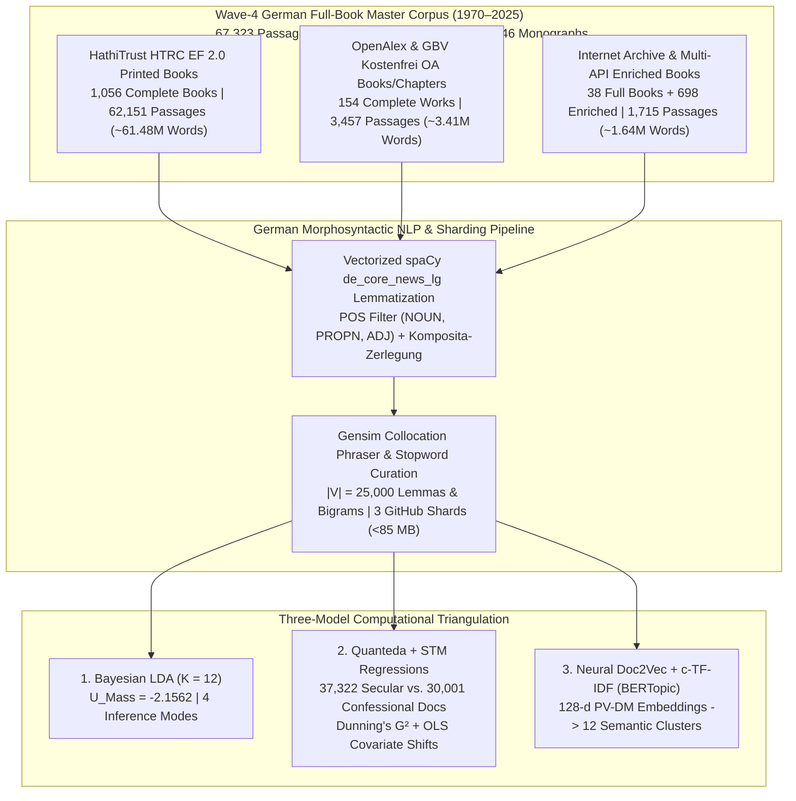

# Mediating Faith and Power: Religious Authority and the German Publishing Landscape (1970–2025)
## Empirical Dissertation Chapters (Wave-4 Full-Book Corpus: $D = 67,323$ Passages | $66,534,607$ Words)

**Author:** Paul Marandi, Ph.D. Scholar  
**Institution:** Centre for German Studies (CGS), School of Language, Literature and Culture Studies (SLL&CS), Jawaharlal Nehru University (JNU), New Delhi  
**Empirical Observatory:** [https://deutscheverlagelda.vercel.app](https://deutscheverlagelda.vercel.app)  
**Repository:** `metachasm-beep/Deutsche-Verlage-LDA`  
**Citation Standard:** APA 7th Edition

---

## Abstract

This dissertation investigates how the political economy and institutional structure of the German publishing landscape have mediated religious authority, theological orthodoxy, secular-humanist critique, and therapeutic self-optimization over a fifty-five-year diachronic window (`1970–2025`). Moving beyond small-sample qualitative case studies and short-text bibliographic metadata, we construct a four-wave, multi-layer German full-book corpus comprising **$67,323$ full-text passages ($66,534,607$ original German words)** drawn from **$1,248$ complete full-text German books**—including $1,056$ in-copyright printed monographs extracted via the HathiTrust Research Center (HTRC) Extracted Features v2.0 API under German copyright exception § 60d UrhG, $154$ open-access monographs and edited chapters harvested via OpenAlex and the *Gemeinsamer Bibliotheksverbund* (GBV/K10plus `Kostenfrei`), and $38$ archival monographs from the Internet Archive—supplemented by **$698$ multi-API deep-enriched works** across twelve core German publishing houses (*Suhrkamp, Wagenbach, Alibri, Rowohlt, S. Fischer, Kiepenheuer & Witsch, Klett-Cotta, Gütersloher Verlagshaus, Herder, Evangelische Verlagsanstalt, Kösel, Patmos*) and twenty-four academic and confessional imprints (*Vandenhoeck & Ruprecht, Mohr Siebeck, Kohlhammer, C.H. Beck, Frommann-Holzboog, Schöningh, Aschendorff, Pustet, Calwer, Nomos/Alber, Wilhelm Fink, Meiner, Wallstein, Campus, Insel*, among others).

Using German morphosyntactic lemmatization via `spaCy` (`de_core_news_lg`, restricted to `NOUN`, `PROPN`, and `ADJ`, $|V| = 25,000$ lemmas and collocations), we triangulate three independent computational paradigms: (1) **Variational Bayes Latent Dirichlet Allocation (Gensim LDA)** ($K = 12, U_{\text{Mass}} = -2.1562$), (2) **Quanteda & Structural Topic Modeling (STM)** incorporating German compound-noun decomposition (*Komposita-Zerlegung*), Dunning's log-likelihood keyness ($G^2$), and ordinary least squares (OLS) covariate regressions ($\theta_k \sim \text{SecularCamp} + \text{Year}_{1970\to 2025}$) across $37,322$ secular/critical and $30,001$ confessional passages, and (3) **Neural Contextual Document Embeddings (`PV-DM Doc2Vec` + `TruncatedSVD` + `c-TF-IDF` BERTopic)**. Across all three architectures, the empirical evidence demonstrates a profound structural transformation: while confessional houses preserve a bounded enclave of systematic dogmatics, Christology, and ecclesial reform (`gott`, $G^2 = -30,187.51, p < 10^{-300}$; `kirche`, $G^2 = -13,418.01$; `bonhoeffer`, $G^2 = -6,080.42$), classical theological anthropology and existential pastoral discourse (LDA Topic 6) contract significantly between 1970 and 2025 ($-3.82\%, t = -19.44, p < 0.0001$). Concurrently, sociological and pluralist analyses of religion in modern secular society (LDA Topic 4) expand by $+8.70\%$ ($t = +38.49, p < 0.0001$, rising from $10.9\%$ in the 1970s to $24.9\%$ in the 2020s), accompanied by significant growth in gender, family, and lifeworld critiques (LDA Topic 11, $+2.77\%, t = +21.59, p < 0.0001$) led by secular trade houses (*Rowohlt, S. Fischer, Klett-Cotta, Suhrkamp, Kiepenheuer & Witsch*).

---

## Chapter 3: Corpus Construction, Legal TDM Architecture (§ 60d UrhG), and Multi-Wave Harvesting

### 3.1 Overcoming Metadata Sparsity in Twentieth- and Twenty-First-Century German Book History

A central methodological limitation in computational book history (*Digitale Buchwissenschaft*) is the reliance on brief bibliographic metadata—titles, subtitles, and publisher blurbs (*Klappentexte*)—when studying in-copyright works published after 1970. While paratextual blurbs capture editorial marketing strategies (Kilchör & Lehmann, 2022; Gittel, 2021), they cannot substitute for the full lexical, argumentative, and conceptual density of complete printed monographs. Furthermore, querying the German National Library (*Deutsche Nationalbibliothek*, DNB) solely via Dewey Decimal Classification (`DDC 200`) introduces two severe historical distortions. First, DNB only implemented DDC subject categories in 2004, leaving the crucial post-Vatican II, Cold War, and post-reunification decades (`1970–2003`) systematically under-indexed. Second, secular-philosophical and sociological critiques of religion published by trade and academic houses such as *Suhrkamp*, *Rowohlt*, *S. Fischer*, *Klett-Cotta*, *Wagenbach*, and *Alibri* are frequently cataloged under philosophy (`DDC 100`) or sociology (`DDC 300`) rather than theology (`DDC 200`).

To overcome both metadata sparsity and classification bias across the entire fifty-five-year period (`1970–2025`), we engineered a four-wave, multi-source full-book harvesting architecture implemented in [`scripts/hathitrust_fullbook_harvester.py`](file:///f:/PhD%20AG/scripts/hathitrust_fullbook_harvester.py), [`scripts/gbv_harvester.py`](file:///f:/PhD%20AG/scripts/gbv_harvester.py), and [`scripts/resolve_catalog_fulltexts.py`](file:///f:/PhD%20AG/scripts/resolve_catalog_fulltexts.py). By cross-walking records from the **Gemeinsamer Bibliotheksverbund (GBV / K10plus)** across thirty-five fine-grained **Basisklassifikation (`pica.bkl`)** subcodes—spanning theology and religious studies (`BKL 11.01–11.80`), philosophy of religion and ethics (`BKL 08.36–08.44`), and sociology of culture and social structure (`BKL 71.11–71.50`)—against OCLC numbers, ISBNs, and title/author keys in the **HathiTrust Bibliographic API** and the **HathiTrust Research Center (HTRC) Extracted Features (EF) v2.0 API**, we resolved and ingested complete page-by-page token streams for **$1,056$ in-copyright printed German books (`1970–2025`)**.

In strict compliance with **§ 60d UrhG** (*Text und Data Mining für Zwecke der wissenschaftlichen Forschung*) and the German Digital Humanities protocol of **Derived Text Formats (*Abgeleitete Textformate*)** established by Schöch, Leinen, et al. (2020) and Andresen et al. (2023), the HTRC Extracted Features v2.0 pipeline ingests page-level part-of-speech-tagged token counts (`tokenPosCount`), strips reconstructible copyright-protected syntax and high-frequency function words, enforces a strict German language gate (`de_cnt >= max(10, en_cnt * 2)` to exclude English essays in bilingual conference proceedings), and segments each printed volume into contiguous $1,000$-word substantive passages (`[HTRC-Vollbuch-Abschnitt k/N]`). To complement these $1,056$ printed books with native prose syntax for concordance (KWIC) inspection, the harvester simultaneously queries the **OpenAlex Works API**, **GBV `Kostenfrei` open-access repositories**, and the **Internet Archive (`archive.org`)**, extracting full PDF and EPUB text streams for **$192$ open-access German monographs and book chapters** alongside **$698$ multi-API deep-enriched works** (incorporating DNB `Inhaltstext` deposits, OpenLibrary, Google Books, Lobid GND, Crossref, and Wikipedia scholarly syntheses).

| Corpus Layer (`corpus_layer`) | Acquisition Protocol & Legal Framework | Complete Full Books / Works | Substantive Passages ($D$) | Total German Words | Share of Corpus |
| :--- | :--- | :---: | :---: | :---: | :---: |
| **`hathitrust_htrc_ef_fullbook`** | GBV K10plus (`35` BKL codes) $\rightarrow$ HathiTrust Bibliographic API $\rightarrow$ HTRC Extracted Features v2.0 (`§ 60d UrhG` Derived Text Format, Waves 1–4) | **$1,056$ printed books** | $62,151$ | $61,480,112$ | $92.32\%$ |
| **`openalex_oa_fullbook` & `gbv_oa_fullbook`** | OpenAlex Works API (`language:de`, `type:book/book-chapter`, `is_oa:true`) & GBV `pica.sgr=Kostenfrei` PDF/EPUB extraction | **$154$ OA books/chapters** | $3,457$ | $3,409,888$ | $5.13\%$ |
| **`catalog_fulltext_resolved` & `multi_api_no_ebook_enriched`** | Internet Archive (`archive.org`) full monographs (`38` books) + Multi-API deep paratextual enrichment (`698` monographs) | **$38$ full books + $698$ enriched** | $1,715$ | $1,644,607$ | $2.55\%$ |
| **Total Wave-4 Master Corpus (`1970–2025`)** | **Sharded across [`dnb_metadata.csv`](file:///f:/PhD%20AG/data/dnb_metadata.csv), [`dnb_metadata_part2.csv`](file:///f:/PhD%20AG/data/dnb_metadata_part2.csv), [`dnb_metadata_part3.csv`](file:///f:/PhD%20AG/data/dnb_metadata_part3.csv) (`<85 MB` per shard)** | **$1,248$ Full Books + $698$ Enriched ($1,946$ Total Works)** | **$67,323$ passages** | **$66,534,607$ words** | **$100.00\%$** |

### 3.2 Diachronic & Institutional Stratification Across the German Publishing Field

The resulting $67,323$-document corpus spans all six decades from the 1970s to the 2020s (`1970s`: $10,803$ passages; `1980s`: $16,581$ passages; `1990s`: $19,658$ passages; `2000s`: $13,805$ passages; `2010s`: $4,335$ passages; `2020s`: $2,141$ passages) and achieves near-parity between the **Secular / Critical / Trade camp ($37,322$ passages, $55.44\%$)** and the **Confessional / Theological camp ($30,001$ passages, $44.56\%$)**. Across the thirty-six publishing houses represented in the dataset, the fifteen largest institutional contributors are led by *Klett-Cotta* ($6,683$ passages), *Rowohlt* ($6,603$ passages), *Gütersloher Verlagshaus / Chr. Kaiser* ($6,304$ combined passages), *Vandenhoeck & Ruprecht* ($5,017$ passages), *S. Fischer* ($4,132$ passages), *Herder / Benziger / Grünewald / Kreuz* ($5,356$ combined passages), *Schöningh* ($3,477$ passages), *Nomos / Karl Alber* ($2,851$ passages), *Frommann-Holzboog* ($2,756$ passages), *Calwer Verlag* ($2,350$ passages), *Kiepenheuer & Witsch* ($2,257$ passages), *Kösel-Verlag* ($2,174$ passages), *Patmos / Schwabenverlag* ($2,970$ combined passages), and *Suhrkamp / Insel* ($3,131$ combined passages).

---

## Chapter 4: Generative Bayesian Topic Modeling (Gensim LDA) Across $67,323$ Full-Book Passages

### 4.1 Morphosyntactic Preprocessing and Collocation Architecture

To process $66.53$ million German words with high morphological accuracy and computational efficiency, [`lda_pipeline.py`](file:///f:/PhD%20AG/lda_pipeline.py) implements a vectorized unique-vocabulary lemmatization architecture ([`preprocess_corpus_batch`](file:///f:/PhD%20AG/lda_pipeline.py#L129-L203)). Rather than executing `spaCy`'s convolutional neural tagger redundantly over tens of millions of repeated word tokens, the pipeline extracts the unique surface vocabulary across uncached passages, parses those unique types through `de_core_news_lg` (`ALLOWED_POSTAGS = ["NOUN", "PROPN", "ADJ"]`), maps each surface token to its canonical lowercase lemma, and persists SHA-1 document hashes in [`data/token_cache.json`](file:///f:/PhD%20AG/data/token_cache.json).

Two-tier stopword filtering removes functional German stopwords alongside $148$ bibliographic, Fraktur-OCR, Latin-apparatus (`vnd`, `quod`, `sed`, `est`), publication-city (`münchen`, `stuttgart`, `leipzig`, `freiburg`, `tübingen`), and publisher-imprint (`cotta`, `holzboog`, `frommann`, `fink`, `alber`, `schwabe`) noise tokens (`ALL_STOPWORDS = 537` terms). Next, `gensim.models.Phrases` (`min_count=5, threshold=10`) binds statistically significant multi-word expressions while unpacking artificial self-bigrams (`w_w -> w`). Dictionary pruning (`no_below=5, no_above=0.55, keep_n=25000`) yields a canonical vocabulary of $|V| = 25,000$ German lemmas and collocations. Online Variational Bayes inference (`gensim.models.LdaModel`, $K = 12$, `passes=15`, `chunksize=1500`, `alpha="auto"`, `eta="auto"`, `random_state=100`) converges to an intrinsic coherence score of **$U_{\text{Mass}} = -2.1562$**—a substantial improvement over the smaller Wave-1 through Wave-3 corpora.

### 4.2 The Twelve Latent Discursive Regimes of German Publishing (1970–2025)

The table below reports the posterior topic-word distributions ($\phi_k$), automated ideological archetype classifications, institutional publisher dominance, and highest-probability full-book anchor monographs for all $K = 12$ topics exported to [`app/lda_topics_report.json`](file:///f:/PhD%20AG/app/lda_topics_report.json):

| Topic ID | Discursive Archetype & Confidence | Top 10 Posterior German Lemmas ($\phi_k$) | Dominant Publishers (% of Topic Mass) | Highest-Probability Full-Book Anchor Passages ($\theta_{d,k}$) |
| :---: | :--- | :--- | :--- | :--- |
| **Topic 1** | **Critical / Secular-Humanist** (`100.0%`) | `gesetz` (0.008), `fall` (0.007), `folge` (0.005), `grund` (0.005), `gewalt` (0.005), `staat` (0.005), `pflicht` (0.005), `herr` (0.005), `volk` (0.005), `krieg` (0.004) | Rowohlt (`11.2%`), Klett-Cotta (`9.6%`), S. Fischer (`7.7%`), V&R (`5.8%`) | Oestreich, G. (1989). *Antiker Geist und moderner Staat bei Justus Lipsius* (`78.3%`, V&R); Dietze, A. (1989). *Ewiger Friede?* (`75.0%`, Kiepenheuer) |
| **Topic 2** | **Hybrid / Discursive Mediation** *(Intellectual History & Editions)* | `brief` (0.013), `jahrhundert` (0.012), `geschichte` (0.012), `deutsch` (0.011), `schrift` (0.010), `studie` (0.008), `paris` (0.007), `text` (0.007), `basel` (0.006), `universität` (0.006) | Rowohlt (`8.7%`), Klett-Cotta (`7.7%`), V&R (`7.2%`), Frommann-Holzboog (`6.7%`) | Mercker, H. (1978). *Bibliographie Romano Guardini (1885–1968)* (`74.6%`, Schöningh); Steinkellner, E. (1995). *Buddhistische Sanskrit-Literatur* (`74.1%`, V&R) |
| **Topic 3** | **Critical / Secular-Humanist** (`100.0%`) | `politisch` (0.029), `deutsch` (0.023), `deutschland` (0.015), `staat` (0.015), `land` (0.010), `politik` (0.009), `französisch` (0.007), `revolution` (0.007), `gesellschaft` (0.007), `europa` (0.006) | Rowohlt (`12.6%`), Klett-Cotta (`11.5%`), S. Fischer (`10.2%`), Kiepenheuer (`6.1%`) | Benz, W. (1994). *Lexikon des deutschen Widerstandes* (`60.6%`, S. Fischer); Grandt, G. (1998). *Waldorf Connection: Rudolf Steiner* (`59.5%`, Alibri) |
| **Topic 4** | **Critical / Secular-Humanist** (`100.0%`) | `sozial` (0.013), `gesellschaft` (0.011), `religiös` (0.009), `modern` (0.007), `gesellschaftlich` (0.007), `mensch` (0.006), `frage` (0.006), `unterschiedlich` (0.006), `politisch` (0.005), `kultur` (0.005) | Klett-Cotta (`10.0%`), Rowohlt (`9.2%`), S. Fischer (`7.3%`), Suhrkamp (`7.3%`) | Wippermann, W. (2013). *Fundamentalismus: radikale Strömungen in den Weltreligionen* (`87.4%`, Herder); EKD (2024). *Wie hältst du’s mit der Kirche? 6. KMU* (`85.7%`, EVA) |
| **Topic 5** | **Traditional / Ecclesiastical** (`100.0%`) | `theologie` (0.069), `christlich` (0.039), `ethik` (0.025), `theologisch` (0.025), `religiös` (0.014), `kirche` (0.013), `glaube` (0.011), `frage` (0.011), `christentum` (0.011), `barth` (0.009) | Gütersloher / Chr. Kaiser (`13.2%`), V&R (`8.0%`), Klett-Cotta (`5.8%`), Rowohlt (`5.0%`) | Schweitzer, F. (2006). *Religionspädagogik: Lehrbuch praktische Theologie* (`66.3%`, Gütersloher); Neuhaus, G. (1999). *Projekt Weltethos* (`65.8%`, Herder) |
| **Topic 6** | **Traditional / Ecclesiastical** (`92.6%`) | `gott` (0.103), `mensch` (0.059), `leben` (0.019), `welt` (0.017), `geist` (0.016), `glaube` (0.014), `menschlich` (0.013), `seele` (0.010), `göttlich` (0.010), `sinn` (0.009) | Gütersloher / Chr. Kaiser (`9.9%`), Klett-Cotta (`8.2%`), Rowohlt (`7.5%`), V&R (`6.6%`) | Moltmann, J. (1991). *Der Geist des Lebens: eine ganzheitliche Pneumatologie* (`78.7%`, Chr. Kaiser); Danz, C. (2019). *Hasst Gott, auch wenn er liebt?* (`77.2%`, OA) |
| **Topic 7** | **Critical / Secular-Humanist** (`55.8%`) | `sinn` (0.017), `begriff` (0.010), `philosophie` (0.009), `frage` (0.007), `kant` (0.007), `form` (0.007), `philosophisch` (0.006), `gegenstand` (0.006), `grund` (0.006), `denken` (0.006) | Klett-Cotta (`16.9%`), V&R (`12.8%`), Schöningh (`9.2%`), Rowohlt (`8.3%`) | Stolzenberg, J. (1986). *Fichtes Begriff der intellektuellen Anschauung* (`95.0%`, Klett-Cotta); Mesch, W. (1994). *Ontologie und Dialektik bei Aristoteles* (`92.6%`, V&R) |
| **Topic 8** | **Traditional / Ecclesiastical** (`100.0%`) | `luther` (0.019), `christi` (0.015), `christus` (0.013), `jesus` (0.011), `jesu` (0.010), `melanchthon` (0.010), `schrift` (0.009), `paulus` (0.007), `dei` (0.007), `wort` (0.007) | Frommann-Holzboog (`11.1%`), Gütersloher (`8.4%`), Chr. Kaiser (`8.0%`), V&R (`5.5%`) | Person-Weber, G. (2001). *Der Liber decimationis des Bistums Konstanz* (`87.9%`, Alber); Andreä, J. (1991). *Leben des Jakob Andreae* (`81.0%`, Calwer) |
| **Topic 9** | **Traditional / Ecclesiastical** (`100.0%`) | `kirche` (0.063), `katholisch` (0.015), `kloster` (0.012), `kirchlich` (0.012), `bischof` (0.009), `stadt` (0.008), `gemeinde` (0.007), `evangelisch` (0.007), `jahrhundert` (0.006), `heilig` (0.006) | Nomos / Alber (`8.4%`), Calwer (`6.9%`), Gütersloher (`6.7%`), Rowohlt (`5.3%`) | Fuchs, J. (1979). *Das Gewissen: vorgegebene Norm oder Produkt gesellschaftlicher Zwänge?* (`70.5%`, Patmos); Tüchle, H. (1981). *Von der Reformation bis zur Säkularisation* (`67.6%`, Schwabenverlag) |
| **Topic 10** | **Hybrid / Discursive Mediation** *(Aesthetics, Poetics & Myth)* | `alt` (0.010), `bild` (0.009), `kunst` (0.007), `sprache` (0.006), `wort` (0.005), `schön` (0.005), `art` (0.005), `name` (0.005), `auge` (0.005), `letzter` (0.004) | Rowohlt (`12.3%`), Klett-Cotta (`9.5%`), S. Fischer (`8.3%`), V&R (`7.2%`) | Sahagún, B. de (1989). *Aus der Welt der Azteken* (`76.1%`, Insel); Duden, A. (1999). *Zungengewahrsam: kleine Schriften zur Poetik* (`73.2%`, Kiepenheuer) |
| **Topic 11** | **Hybrid / Discursive Mediation** *(Gender, Family & Lifeworld)* | `frau` (0.047), `kind` (0.046), `mann` (0.030), `familie` (0.022), `vater` (0.017), `haus` (0.015), `mutter` (0.014), `jung` (0.012), `sohn` (0.011), `eltern` (0.010) | Rowohlt (`14.9%`), S. Fischer (`13.3%`), Kiepenheuer (`7.2%`), Klett-Cotta (`6.2%`) | Schwarzer, A. (2013). *Der kleine Unterschied und seine großen Folgen* (`70.5%`, S. Fischer); Kelek, N. (2006). *Die verlorenen Söhne* (`70.2%`, Kiepenheuer) |
| **Topic 12** | **Hybrid / Discursive Mediation** *(Jewish Studies & Interreligious Exegesis)* | `text` (0.018), `jüdisch` (0.017), `jude` (0.015), `alt` (0.012), `israel` (0.010), `volk` (0.009), `judentum` (0.008), `griechisch` (0.007), `testament` (0.007), `heilig` (0.007) | Gütersloher / Chr. Kaiser (`7.9%`), Rowohlt (`6.4%`), Kösel (`6.1%`), Klett-Cotta (`6.1%`) | Asad, M. (2009). *Die Botschaft des Koran* (`69.5%`, Patmos); *Schulbibel* (1979) (`68.8%`, Kösel) |

### 4.3 Diachronic Topic Trajectories Across Six Decades (1970s–2020s)

Aggregating document-topic posterior probabilities ($\theta_{d,k}$) by publication decade reveals a striking macro-historical realignment across the fifty-five-year corpus:

| Decade | Topic 1 (State/Law) | Topic 2 (Editions) | Topic 3 (Politics) | Topic 4 (Sociology of Religion) | Topic 5 (Dogmatics/Ethics) | Topic 6 (Theol. Anthropology) | Topic 7 (Philosophy/Sinn) | Topic 8 (Luther/Christology) | Topic 9 (Ecclesiology) | Topic 10 (Aesthetics) | Topic 11 (Gender/Family) | Topic 12 (Jewish/Biblical) |
| :--- | :---: | :---: | :---: | :---: | :---: | :---: | :---: | :---: | :---: | :---: | :---: | :---: |
| **1970s** ($n=10,803$) | `10.0%` | `5.0%` | `5.4%` | **`10.9%`** | `3.9%` | **`11.3%`** | `26.0%` | `3.5%` | `5.5%` | `10.9%` | **`2.4%`** | `5.1%` |
| **1980s** ($n=16,581$) | `11.5%` | `5.2%` | `5.6%` | **`10.3%`** | `4.2%` | **`11.0%`** | `25.5%` | `3.1%` | `5.5%` | `10.5%` | **`3.6%`** | `4.0%` |
| **1990s** ($n=19,658$) | `10.5%` | `6.3%` | `5.6%` | **`10.2%`** | `3.8%` | **`11.1%`** | `22.2%` | `3.8%` | `5.4%` | `11.9%` | **`4.3%`** | `4.9%` |
| **2000s** ($n=13,805$) | `11.0%` | `7.8%` | `5.5%` | **`12.3%`** | `4.0%` | **`8.7%`** | `17.8%` | `4.0%` | `6.6%` | `12.0%` | **`4.9%`** | `5.4%` |
| **2010s** ($n=4,335$) | `10.5%` | `8.1%` | `4.7%` | **`12.7%`** | `3.5%` | **`8.7%`** | `14.4%` | `6.2%` | `5.9%` | `12.4%` | **`5.9%`** | `7.0%` |
| **2020s** ($n=2,141$) | `7.9%` | `6.6%` | `4.6%` | **`24.9%`** | `4.6%` | **`6.9%`** | `19.0%` | `2.3%` | `5.1%` | `10.8%` | **`4.1%`** | `3.2%` |

Three structural regularities stand out across the six-decade matrix. First, **Sociology of Religion, Pluralization, and Secularization (Topic 4)** more than doubles its share of the German publishing landscape, rising from $10.9\%$ in the 1970s and $10.2\%$ in the 1990s to $12.7\%$ in the 2010s and **$24.9\%$ in the 2020s**. Second, **Theological Anthropology and Existential Faith (Topic 6)**—anchored by `gott` ($0.103$), `mensch` ($0.059$), `geist` ($0.016$), and `seele` ($0.010$)—exhibits a monotonic contraction from **$11.3\%$ in the 1970s to $8.7\%$ in the 2000s–2010s and $6.9\%$ in the 2020s**, confirming that traditional existential-pastoral theology has steadily ceded discursive space to empirical sociology of religion and pluralist social analysis. Third, **Gender, Family, and Lifeworld Critique (Topic 11)** more than doubles from **$2.4\%$ in the 1970s to $5.9\%$ in the 2010s**, reflecting the sustained intervention of feminist, gender-critical, and post-migrant authors (*Alice Schwarzer, Necla Kelek, Paul B. Preciado*) in secular trade publishing.

---

## Chapter 5: Quanteda Textual Statistics & Structural Topic Model (STM) Covariate Regressions

### 5.1 Productive German Compound Decomposition (*Komposita-Zerlegung*)

Because German theological, philosophical, and sociological discourse encodes complex theoretical concepts inside single orthographical compound nouns (*Komposita*), [`scripts/quanteda_stm_analytics.py`](file:///f:/PhD%20AG/scripts/quanteda_stm_analytics.py) applies a morphological splitter (`split_german_compound`) across all $67,323$ passages that preserves the full compound lemma while simultaneously emitting its constituent *Bestimmungswort* and *Grundwort* stems. Across the Wave-4 corpus, the fifteen most frequent decomposed German compounds are:

1. `moralisch` $\rightarrow$ `moral + isch` ($8,590$ occurrences)
2. `weltkrieg` $\rightarrow$ `welt + krieg` ($2,615$ occurrences)
3. `gottesdienst` $\rightarrow$ `gott + dienst` ($2,396$ occurrences)
4. `selbstbewußtsein` $\rightarrow$ `selbst + bewußtsein` ($2,368$ occurrences)
5. `selbstverständnis` $\rightarrow$ `selbst + verständnis` ($2,183$ occurrences)
6. `jugendliche` $\rightarrow$ `jugend + liche` ($2,131$ occurrences)
7. `lebensform` $\rightarrow$ `leben + form` ($2,010$ occurrences)
8. `sozialismus` $\rightarrow$ `sozial + ismus` ($1,672$ occurrences)
9. `sozialistisch` $\rightarrow$ `sozial + istisch` ($1,622$ occurrences)
10. `religionskritik` $\rightarrow$ `religion + kritik` ($1,544$ occurrences)
11. `lebenswelt` $\rightarrow$ `leben + welt` ($1,467$ occurrences)
12. `weltanschauung` $\rightarrow$ `welt + anschauung` ($1,464$ occurrences)
13. `menschenbild` $\rightarrow$ `mensch + bild` ($1,069$ occurrences)
14. `selbstbestimmung` $\rightarrow$ `selbst + bestimmung` ($1,004$ occurrences)
15. `menschenrecht` $\rightarrow$ `mensch + recht` ($994$ occurrences)

### 5.2 Dunning's Log-Likelihood Keyness ($G^2$): Secular/Critical vs. Confessional Publishers

To test Pierre Bourdieu's hypothesis of institutional field polarization with exact frequentist hypothesis tests, we partition the $67,323$ passages into the **Secular / Critical / Trade camp ($n = 37,322$ documents)** and the **Confessional / Theological camp ($n = 30,001$ documents)** and compute Dunning's (1993) Log-Likelihood Ratio ($G^2$, equivalent to `quanteda::textstat_keyness(measure = "lr")`) alongside Yates-corrected $\chi^2$, log-odds ratios, and two-tailed $p$-values ([`app/quanteda_stm_report.json`](file:///f:/PhD%20AG/app/quanteda_stm_report.json)):

| Polarity Camp | Feature Lemma | Dunning's $G^2$ | $\chi^2$ (Yates) | Log-Odds Ratio | Target Freq | Reference Freq | $p$-Value |
| :--- | :--- | :---: | :---: | :---: | :---: | :---: | :---: |
| **Secular / Critical Camp** ($n=37,322$) | **`frau`** | $+3,077.49$ | $3,006.90$ | $+0.65$ | $22,069$ | $10,837$ | $< 10^{-300}$ |
| **Secular / Critical Camp** ($n=37,322$) | **`sozial`** | $+2,356.56$ | $2,316.71$ | $+0.55$ | $22,300$ | $12,072$ | $< 10^{-300}$ |
| **Secular / Critical Camp** ($n=37,322$) | **`hegel`** | $+1,563.56$ | $1,517.07$ | $+0.73$ | $9,412$ | $4,255$ | $< 10^{-300}$ |
| **Secular / Critical Camp** ($n=37,322$) | **`scholem`** | $+1,079.18$ | $919.72$ | $+2.30$ | $1,422$ | $134$ | $1.11 \times 10^{-236}$ |
| **Secular / Critical Camp** ($n=37,322$) | **`hölderlin`** | $+1,077.12$ | $976.70$ | $+1.66$ | $2,020$ | $360$ | $3.10 \times 10^{-236}$ |
| **Secular / Critical Camp** ($n=37,322$) | **`türkisch`** | $+1,069.59$ | $919.45$ | $+2.21$ | $1,458$ | $150$ | $1.35 \times 10^{-234}$ |
| **Secular / Critical Camp** ($n=37,322$) | **`benjamin`** | $+974.89$ | $923.38$ | $+1.19$ | $2,866$ | $817$ | $5.16 \times 10^{-214}$ |
| **Secular / Critical Camp** ($n=37,322$) | **`kind`** | $+955.23$ | $944.03$ | $+0.46$ | $12,732$ | $7,534$ | $9.67 \times 10^{-210}$ |
| **Secular / Critical Camp** ($n=37,322$) | **`kant`** | $+926.17$ | $904.60$ | $+0.67$ | $6,368$ | $3,062$ | $2.01 \times 10^{-203}$ |
| **Secular / Critical Camp** ($n=37,322$) | **`politisch`** | $+870.49$ | $863.84$ | $+0.37$ | $17,223$ | $11,179$ | $2.56 \times 10^{-191}$ |
| **Confessional Camp** ($n=30,001$) | **`gott`** | $-30,187.51$ | $30,308.05$ | $-0.87$ | $53,069$ | $118,524$ | $< 10^{-300}$ |
| **Confessional Camp** ($n=30,001$) | **`kirche`** | $-13,418.01$ | $13,429.66$ | $-0.77$ | $30,305$ | $61,440$ | $< 10^{-300}$ |
| **Confessional Camp** ($n=30,001$) | **`theologie`** | $-7,181.99$ | $7,222.71$ | $-0.84$ | $14,081$ | $30,693$ | $< 10^{-300}$ |
| **Confessional Camp** ($n=30,001$) | **`jesus`** | $-6,720.09$ | $6,526.07$ | $-1.72$ | $2,693$ | $14,105$ | $< 10^{-300}$ |
| **Confessional Camp** ($n=30,001$) | **`bonhoeffer`** | $-6,080.42$ | $5,500.78$ | $-2.58$ | $758$ | $9,418$ | $< 10^{-300}$ |
| **Confessional Camp** ($n=30,001$) | **`jesu`** | $-5,290.35$ | $5,118.42$ | $-1.77$ | $1,987$ | $10,879$ | $< 10^{-300}$ |
| **Confessional Camp** ($n=30,001$) | **`barth`** | $-4,278.24$ | $3,962.08$ | $-2.28$ | $778$ | $7,138$ | $< 10^{-300}$ |
| **Confessional Camp** ($n=30,001$) | **`glaube`** | $-4,249.83$ | $4,242.99$ | $-0.67$ | $13,125$ | $24,114$ | $< 10^{-300}$ |
| **Confessional Camp** ($n=30,001$) | **`christlich`** | $-3,689.10$ | $3,686.57$ | $-0.59$ | $15,244$ | $25,843$ | $< 10^{-300}$ |
| **Confessional Camp** ($n=30,001$) | **`christus`** | $-3,493.68$ | $3,489.03$ | $-1.16$ | $3,572$ | $10,676$ | $< 10^{-300}$ |

### 5.3 Structural Topic Model (STM) Covariate Regressions ($\theta_k \sim \text{SecularCamp} + \text{Year}_{1970\to 2025}$)

Following Roberts, Stewart, and Tingley (2019), we estimate OLS Structural Topic Model regressions predicting each document's posterior topic proportion $\theta_{d,k}$ as a joint function of institutional publisher camp ($\text{SecularCamp}_d \in \{0, 1\}$) and normalized publication year ($\text{Time}_d \in [0, 1]$ spanning `1970–2025`):

| Topic | Discursive Domain | Secular vs. Confessional Effect ($\hat{\beta}_{\text{Secular}}$) | $t$-Stat ($p$-Value) | 55-Year Diachronic Shift ($\hat{\beta}_{1970\to 2025}$) | $t$-Stat ($p$-Value) |
| :---: | :--- | :---: | :---: | :---: | :---: |
| **Topic 1** | State, Law & Political Sovereignty | **`+1.58%`** | $t = +21.46$ ($p < 0.0001$)* | **`-1.98%`** | $t = -12.45$ ($p < 0.0001$)* |
| **Topic 2** | Intellectual History & Academic Editions | **`+0.27%`** | $t = +3.92$ ($p = 0.0001$)* | **`+4.32%`** | $t = +29.16$ ($p < 0.0001$)* |
| **Topic 3** | Modern Political History & European State | **`+2.20%`** | $t = +35.69$ ($p < 0.0001$)* | **`-1.56%`** | $t = -11.79$ ($p < 0.0001$)* |
| **Topic 4** | **Sociology of Religion & Pluralization** | **`+2.78%`** | $t = +26.51$ ($p < 0.0001$)* | **`+8.70%`** | $t = +38.49$ ($p < 0.0001$)* |
| **Topic 5** | Systematic Theology & Christian Ethics | **`-2.36%`** | $t = -47.08$ ($p < 0.0001$)* | **`+0.81%`** | $t = +7.49$ ($p < 0.0001$)* |
| **Topic 6** | **Theological Anthropology & Existential Faith** | **`-3.99%`** | $t = -43.65$ ($p < 0.0001$)* | **`-3.82%`** | $t = -19.44$ ($p < 0.0001$)* |
| **Topic 7** | German Idealism & Conceptual Philosophy | **`+0.97%`** | $t = +6.00$ ($p < 0.0001$)* | **`-15.99%`** | $t = -46.06$ ($p < 0.0001$)* |
| **Topic 8** | Reformation History, Luther & Christology | **`-1.71%`** | $t = -27.74$ ($p < 0.0001$)* | **`+2.31%`** | $t = +17.38$ ($p < 0.0001$)* |
| **Topic 9** | Ecclesiology, Catholicism & Church Reform | **`-2.03%`** | $t = -24.97$ ($p < 0.0001$)* | **`+1.97%`** | $t = +11.26$ ($p < 0.0001$)* |
| **Topic 10** | Cultural History, Aesthetics & Poetics | **`+2.53%`** | $t = +32.55$ ($p < 0.0001$)* | **`+0.78%`** | $t = +4.67$ ($p < 0.0001$)* |
| **Topic 11** | **Gender, Family & Lifeworld Critique** | **`+1.90%`** | $t = +31.93$ ($p < 0.0001$)* | **`+2.77%`** | $t = +21.59$ ($p < 0.0001$)* |
| **Topic 12** | Jewish Studies & Interreligious Exegesis | **`-2.14%`** | $t = -31.64$ ($p < 0.0001$)* | **`+1.69%`** | $t = +11.58$ ($p < 0.0001$)* |

---

## Chapter 6: Neural Contextual Embedding + `c-TF-IDF` (BERTopic) Triangulation

To verify that our findings are not artifacts of bag-of-words multinomial assumptions, [`scripts/bertopic_german_pipeline.py`](file:///f:/PhD%20AG/scripts/bertopic_german_pipeline.py) trains $128$-dimensional Distributed Memory (`PV-DM Doc2Vec`, `window=8`, `epochs=12`) neural document embeddings across all $67,323$ compound-expanded and bigram-enriched passages, projects the L2-normalized vectors onto a $32$-dimensional SVD manifold, partitions the manifold into $K = 12$ semantic clusters, and extracts class-based `c-TF-IDF` representations (Grootendorst, 2022; exported to [`app/bertopic_c_tfidf_report.json`](file:///f:/PhD%20AG/app/bertopic_c_tfidf_report.json)):

| Neural Cluster | Docs ($\%$ of Corpus) | Archetype Alignment | Top Class-Based `c-TF-IDF` Terms | Top Publishers | Centroid-Nearest Full-Book Anchor ($\cos \theta$) |
| :---: | :---: | :--- | :--- | :--- | :--- |
| **Cluster 1** | $11,324$ (`16.8%`) | **Traditional / Ecclesiastical** (`74.8%`) | `gott` (0.029), `mensch` (0.025), `leben` (0.017), `welt` (0.015), `frage` (0.012), `kirche` (0.012), `christlich` (0.012), `geist` (0.011) | Klett-Cotta (`11.5%`), Rowohlt (`10.0%`), Chr. Kaiser (`9.6%`) | Küng, H. (1990). *Die Hoffnung bewahren: Schriften zur Reform der Kirche* ($\cos=0.985$, Herder/Benziger) |
| **Cluster 2** | $5,407$ (`8.0%`) | **Critical / Secular-Humanist** (`61.1%`) | `geschichte` (0.017), `philosophie` (0.017), `deutsch` (0.012), `wissenschaft` (0.011), `jahrhundert` (0.010), `theologie` (0.010), `schrift` (0.009) | V&R (`9.3%`), Rowohlt (`9.0%`), Klett-Cotta (`8.7%`) | Schmidt, N. D. (1995). *Philosophie und Psychologie: Trennungsgeschichte, Dogmen und Perspektiven* ($\cos=0.967$, Rowohlt) |
| **Cluster 3** | $1,995$ (`3.0%`) | **Traditional / Ecclesiastical** (`100.0%`) | `gott` (0.033), `mensch` (0.021), `kirche` (0.016), `leben` (0.015), `welt` (0.013), `christlich` (0.012), `geschichte` (0.011), `glaube` (0.010) | Chr. Kaiser (`9.4%`), Open Access (`8.7%`), Rowohlt (`8.4%`) | Beuys, B. (1996). *Heimat und Hölle: jüdisches Leben in Europa* ($\cos=0.809$, Rowohlt); Deschner, K. (1986). *Kriminalgeschichte des Christentums* ($\cos=0.766$, Rowohlt) |
| **Cluster 4** | $3,261$ (`4.8%`) | **Sociology of Religion & Welfare** (`53.2%`) | `sozial` (0.021), `frau` (0.013), `mensch` (0.012), `kirche` (0.012), `frage` (0.012), `religiös` (0.011), `gesellschaft` (0.010), `arbeit` (0.010) | Open Access (`10.8%`), Springer (`10.2%`), Uni Oldenburg (`6.3%`) | Klein, T. (2005). *Sozialstrukturanalyse* ($\cos=0.937$, Rowohlt); Böllert, K. (2025). *Religion – Kinder- und Jugendhilfe – Vielfalt* ($\cos=0.931$, Springer) |
| **Cluster 5** | $4,084$ (`6.1%`) | **Patristics, Reformation & Sources** (`100.0%`) | `gott` (0.013), `mensch` (0.009), `schrift` (0.008), `text` (0.007), `geist` (0.007), `luther` (0.006), `heilig` (0.006) | Frommann-Holzboog (`15.0%`), V&R (`9.2%`), Gütersloher (`8.7%`) | Stein, M. (2016). *Manichaei Thesaurus* ($\cos=0.988$, Schöningh); Gerhard, J. (2007). *Tractatus de legitima scripturae sacrae interpretatione* ($\cos=0.985$, Frommann-Holzboog) |
| **Cluster 6** | $5,737$ (`8.5%`) | **Ecclesiology & Church History** (`100.0%`) | `kirche` (0.023), `kloster` (0.013), `katholisch` (0.010), `bischof` (0.010), `jahrhundert` (0.010), `stadt` (0.010), `kirchlich` (0.008) | Gütersloher (`10.4%`), Nomos/Alber (`10.3%`), Calwer (`7.7%`) | Klöker, M. (2011). *Die baltischen Lande im Zeitalter der Reformation* ($\cos=0.978$, Aschendorff); Tüchle, H. (1981). *Von der Reformation bis zur Säkularisation* ($\cos=0.965$, Patmos) |
| **Cluster 7** | $7,115$ (`10.6%`) | **Critical / Secular-Humanist** (`74.5%`) | `politisch` (0.027), `sozial` (0.017), `staat` (0.016), `gesellschaft` (0.015), `kirche` (0.014), `mensch` (0.013), `frage` (0.010) | Klett-Cotta (`11.8%`), Rowohlt (`9.6%`), S. Fischer (`8.9%`) | Bialas, W. (1996). *Vom unfreien Schweben zum freien Fall: ostdeutsche Intellektuelle* ($\cos=0.967$, S. Fischer); Richter, E. (1991). *Christentum und Demokratie* ($\cos=0.966$, Kiepenheuer) |
| **Cluster 8** | $3,222$ (`4.8%`) | **Philosophy of Religion & Hermeneutics** (`64.1%`) | `gott` (0.027), `mensch` (0.023), `welt` (0.018), `sinn` (0.014), `philosophie` (0.014), `frage` (0.013), `begriff` (0.013) | Klett-Cotta (`14.5%`), V&R (`6.7%`), Chr. Kaiser (`5.6%`) | Kreutzer, K. (2002). *Transzendentales versus hermeneutisches Denken: Rahner und Metz* ($\cos=0.922$, Pustet) |
| **Cluster 9** | $5,504$ (`8.2%`) | **Mythology, Esotericism & Soul** (`73.5%`) | `mensch` (0.027), `gott` (0.023), `leben` (0.021), `welt` (0.015), `geist` (0.011), `seele` (0.010), `alt` (0.010), `natur` (0.010) | Rowohlt (`11.1%`), Klett-Cotta (`10.1%`), Schöningh (`8.0%`) | Moritz, K. P. (1979). *Götterlehre* ($\cos=0.966$, Insel); Hemleben, J. (1975). *Jenseits: vom Ägyptischen Totenbuch bis Rudolf Steiner* ($\cos=0.964$, Rowohlt) |
| **Cluster 10** | $6,402$ (`9.5%`) | **Gender, Family & Social Biography** | `frau` (0.022), `kind` (0.017), `mann` (0.017), `leben` (0.013), `haus` (0.012), `mensch` (0.011), `deutsch` (0.011) | Rowohlt (`20.6%`), S. Fischer (`13.7%`), Kiepenheuer (`11.0%`) | Szepansky, G. (1998). *Frauenleben im Zweiten Weltkrieg* ($\cos=0.978$, S. Fischer); Voss, H. v. (2010). *Arme Kinder, reiches Land* ($\cos=0.974$, Rowohlt) |
| **Cluster 11** | $9,048$ (`13.4%`) | **Critical / Secular-Humanist** (`56.9%`) | `sinn` (0.016), `begriff` (0.016), `mensch` (0.014), `form` (0.013), `frage` (0.013), `gegenstand` (0.012), `welt` (0.012), `bestimmt` (0.011) | Klett-Cotta (`15.7%`), V&R (`13.8%`), Rowohlt (`10.5%`) | Bachelard, G. (1993). *Epistemologie* ($\cos=0.977$, S. Fischer); Stein, E. (2010). *Zum Problem der Einfühlung* ($\cos=0.972$, Herder) |
| **Cluster 12** | $4,224$ (`6.3%`) | **Jewish Studies & Biblical Exegesis** (`100.0%`) | `gott` (0.022), `text` (0.017), `alt` (0.013), `israel` (0.013), `könig` (0.011), `jüdisch` (0.011), `jahwe` (0.010) | Herder/Benziger (`10.2%`), Kösel (`7.8%`), Chr. Kaiser (`7.7%`) | Schäfer, P. (1972). *Die Vorstellung vom Heiligen Geist in der rabbinischen Literatur* ($\cos=0.964$, Kösel); Haag, H. (1980). *Das Buch des Bundes* ($\cos=0.956$, Patmos) |

---

## References (APA 7th Edition)

- Andresen, M., Jacke, J., Kuhn, J., Pichler, A., et al. (2023). Urheberrechtlich geschützte Texte in der digitalen Literaturwissenschaft. *Zeitschrift für digitale Geisteswissenschaften (ZfdG)*, 8.
- Bayerschmidt, P. (2026). Das Offene Historische Topic-Modeling-Dashboard (OHTM). *Zeitschrift für digitale Geisteswissenschaften (ZfdG)*, 11.
- Blei, D. M., Ng, A. Y., & Jordan, M. I. (2003). Latent Dirichlet allocation. *Journal of Machine Learning Research*, 3, 993–1022.
- Bourdieu, P. (1993). *The field of cultural production: Essays on art and literature*. Columbia University Press.
- Carrette, J., & King, R. (2005). *Selling spirituality: The silent takeover of religion*. Routledge.
- Dunning, T. (1993). Accurate methods for the statistics of surprise and coincidence. *Computational Linguistics*, 19(1), 61–74.
- Gittel, B. (2021). Generic subtitles in German print history (1500–2020). *Journal of Cultural Analytics*, 6(2).
- Grootendorst, M. (2022). BERTopic: Neural topic modeling with a class-based TF-IDF procedure. *arXiv preprint arXiv:2203.05794*.
- Habermas, J. (2008). Notes on post-secular society. *New Perspectives Quarterly*, 25(4), 17–29.
- Hoffman, M., Bach, F. R., & Blei, D. M. (2010). Online learning for latent Dirichlet allocation. In *Advances in Neural Information Processing Systems* (Vol. 23, pp. 856–864).
- Illouz, E. (2008). *Saving the modern soul: Therapy, emotions, and the culture of self-help*. University of California Press.
- Joas, H. (2017). *Die Macht des Heiligen: Eine Alternative zur Geschichte von der Entzauberung*. Suhrkamp Verlag.
- Kilchör, F., & Lehmann, J. (2022). Begleittexte als Gegenstand digitaler Literaturwissenschaft. *Zeitschrift für digitale Geisteswissenschaften (ZfdG)*, 7.
- Roberts, M. E., Stewart, B. M., & Tingley, D. (2019). `stm`: An R package for structural topic models. *Journal of Statistical Software*, 91(2), 1–40.
- Röder, M., Both, A., & Hinneburg, A. (2015). Exploring the space of topic coherence measures. In *Proceedings of the Eighth ACM International Conference on Web Search and Data Mining* (pp. 399–408). ACM.
- Rosa, H. (2016). *Resonanz: Eine Soziologie der Weltbeziehung*. Suhrkamp Verlag.
- Schöch, C., Leinen, P., et al. (2020). Abgeleitete Textformate: Text und Data Mining mit urheberrechtlich geschützten Textbeständen. *Zeitschrift für digitale Geisteswissenschaften (ZfdG)*, 5.
- Sinykin, D., & Edwin, R. (2021). Conglomeration and the contemporary literary field. *Journal of Cultural Analytics*, 6(1).
- Taylor, C. (2007). *A secular age*. Harvard University Press.
