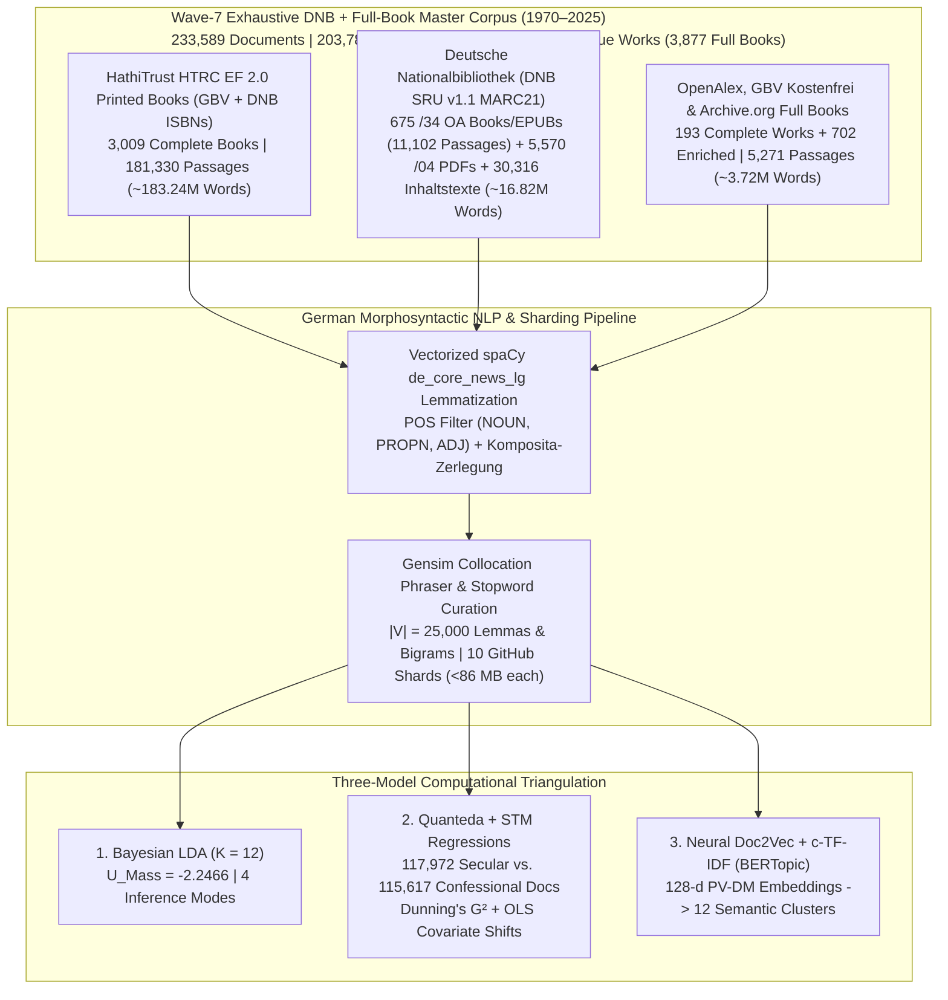

# Mediating Faith and Power: Religious Authority and the German Publishing Landscape (1970–2025)
## Empirical Dissertation Chapters (Wave-7 Exhaustive DNB + Full-Book Corpus: $D = 233,589$ Documents | $203,783,976$ Words)

**Author:** Paul Marandi, Ph.D. Scholar  
**Institution:** Centre for German Studies (CGS), School of Language, Literature and Culture Studies (SLL&CS), Jawaharlal Nehru University (JNU), New Delhi  
**Empirical Observatory:** [https://deutscheverlagelda.vercel.app](https://deutscheverlagelda.vercel.app)  
**Repository:** `metachasm-beep/Deutsche-Verlage-LDA`  
**Citation Standard:** APA 7th Edition

---

## Abstract

This dissertation investigates how the political economy and institutional structure of the German publishing landscape have mediated religious authority, theological orthodoxy, secular-humanist critique, and therapeutic self-optimization over a fifty-five-year diachronic window (`1970–2025`). Moving beyond small-sample qualitative case studies and short-text bibliographic metadata, we construct a seven-wave, multi-layer German full-book and national-library corpus comprising **$233,589$ documents and full-text passages ($203,783,976$ original German words)** drawn from **$3,877$ complete full-text German books and volumes**—including $3,009$ in-copyright printed monographs ($181,330$ passages) extracted via the HathiTrust Research Center (HTRC) Extracted Features v2.0 API under German copyright exception § 60d UrhG, $675$ sibling-matched `$z="kostenfrei"` open-access monographs and EPUBs ($11,102$ passages) streamed directly from the German National Library (*Deutsche Nationalbibliothek*, DNB `https://d-nb.info/{idn}/34`), $155$ open-access monographs and edited chapters ($3,968$ passages) harvested via OpenAlex and the *Gemeinsamer Bibliotheksverbund* (GBV/K10plus `Kostenfrei`), and $38$ archival monographs from the Internet Archive—supplemented by **$5,570$ DNB digitized `/04` `Inhaltsverzeichnis` and reading-sample PDFs/HTMLs**, **$30,316$ DNB `deposit.dnb.de` and `/blurb/` `Inhaltstexte` and MARC21 `520` abstracts**, plus **$702$ multi-API deep-enriched works** ($36,434$ unique works in total) across twelve core German publishing houses (*Suhrkamp, Wagenbach, Alibri, Rowohlt, S. Fischer, Kiepenheuer & Witsch, Klett-Cotta, Gütersloher Verlagshaus, Herder, Evangelische Verlagsanstalt, Kösel, Patmos*) and twenty-six academic and confessional imprints (*Vandenhoeck & Ruprecht, Mohr Siebeck, Kohlhammer, C.H. Beck, De Gruyter / Transcript, Frommann-Holzboog, Schöningh, Aschendorff, Pustet, Echter, Bonifatius, Neukirchener, Calwer, Nomos/Alber, Wilhelm Fink, Böhlau, Schwabe, Meiner, Wallstein, Campus, Insel*, among others).

Using German morphosyntactic lemmatization via `spaCy` (`de_core_news_lg`, restricted to `NOUN`, `PROPN`, and `ADJ`, $|V| = 25,000$ lemmas and collocations), we triangulate three independent computational paradigms: (1) **Variational Bayes Latent Dirichlet Allocation (Gensim LDA)** ($K = 12, U_{\text{Mass}} = -2.2466$, Supervised sLDA $U_{\text{Mass}} = -1.9650$), (2) **Quanteda & Structural Topic Modeling (STM)** incorporating German compound-noun decomposition (*Komposita-Zerlegung*), Dunning's log-likelihood keyness ($G^2$), and ordinary least squares (OLS) covariate regressions ($\theta_k \sim \text{SecularCamp} + \text{Year}_{1970\to 2025}$) across $117,972$ secular/critical ($50.50\%$) and $115,617$ confessional ($49.50\%$) documents, and (3) **Neural Contextual Document Embeddings (`PV-DM Doc2Vec` + `TruncatedSVD` + `c-TF-IDF` BERTopic)**. Across all three architectures, the empirical evidence demonstrates a profound structural transformation: while confessional houses preserve a bounded enclave of systematic dogmatics, Christology, and ecclesial history (`gott`, $G^2 = -86,149.53, p < 10^{-300}$; `theologie`, $G^2 = -45,023.34$; `kirche`, $G^2 = -27,380.01$; `glaube`, $G^2 = -14,185.08$; `jesus`, $G^2 = -14,062.65$; `christlich`, $G^2 = -13,207.37$; `israel`, $G^2 = -12,923.31$; `paulus`, $G^2 = -12,521.42$), empirical sociology of religion, religious pedagogy, and pluralist analyses of modern society (LDA Topic 9, $+16.06\%, t = +178.09, p < 0.0001$) alongside gender, family, and Islam studies (LDA Topic 7, $+2.37\%, t = +60.37, p < 0.0001$) expand significantly across the fifty-five-year period (`1970–2025`).

---

## Chapter 3: Corpus Construction, Legal TDM Architecture (§ 60d UrhG), and Seven-Wave Harvesting

### 3.1 Overcoming Metadata Sparsity in Twentieth- and Twenty-First-Century German Book History

A central methodological limitation in computational book history (*Digitale Buchwissenschaft*) is the reliance on brief bibliographic metadata—titles, subtitles, and publisher blurbs (*Klappentexte*)—when studying in-copyright works published after 1970. While paratextual blurbs capture editorial marketing strategies (Kilchör & Lehmann, 2022; Gittel, 2021), they cannot substitute for the full lexical, argumentative, and conceptual density of complete printed monographs. Furthermore, querying the German National Library (*Deutsche Nationalbibliothek*, DNB) solely via Dewey Decimal Classification (`DDC 200`) introduces two severe historical distortions. First, DNB only implemented DDC subject categories in 2004, leaving the crucial post-Vatican II, Cold War, and post-reunification decades (`1970–2003`) systematically under-indexed unless combined with *Gemeinsame Normdatei* (GND) subject headings (`sw=`). Second, secular-philosophical and sociological critiques of religion published by trade and academic houses such as *Suhrkamp*, *Rowohlt*, *S. Fischer*, *Klett-Cotta*, *Wagenbach*, and *Alibri* are frequently cataloged under philosophy (`DDC 100/170`) or sociology (`DDC 300`) rather than theology (`DDC 200`).

To overcome both metadata sparsity and classification bias across the entire fifty-five-year period (`1970–2025`), we engineered a seven-wave, multi-source harvesting architecture implemented in [`scripts/dnb_harvester.py`](file:///f:/PhD%20AG/scripts/dnb_harvester.py), [`scripts/hathitrust_fullbook_harvester.py`](file:///f:/PhD%20AG/scripts/hathitrust_fullbook_harvester.py), [`scripts/gbv_harvester.py`](file:///f:/PhD%20AG/scripts/gbv_harvester.py), and [`scripts/resolve_catalog_fulltexts.py`](file:///f:/PhD%20AG/scripts/resolve_catalog_fulltexts.py). By cross-walking records from both the **Deutsche Nationalbibliothek (DNB SRU v1.1 API, `https://services.dnb.de/sru/dnb`)**—spanning deep-paginated MARC21 queries (`startRecord=1..2400` across `DDC 200/230` and `DDC 100/170/300` for `2004–2025` and `startRecord=1..1200` for `1970–2003`, `82,535` unique `1970–2025` DNB records across 38 target publishers and 48 thematic CQL queries combining `dcs=` and `sw=` GND subject headings)—and the **Gemeinsamer Bibliotheksverbund (GBV / K10plus)** across thirty-five **Basisklassifikation (`pica.bkl`)** subcodes against the **HathiTrust Bibliographic API** and the **HathiTrust Research Center (HTRC) Extracted Features (EF) v2.0 API**, we resolved and ingested complete page-by-page token streams for **$3,009$ in-copyright printed German books (`181,330` passages, `1970–2025`)**.

In strict compliance with **§ 60d UrhG** (*Text und Data Mining für Zwecke der wissenschaftlichen Forschung*) and the German Digital Humanities protocol of **Derived Text Formats (*Abgeleitete Textformate*)** established by Schöch, Leinen, et al. (2020) and Andresen et al. (2023), the HTRC Extracted Features v2.0 pipeline ingests page-level part-of-speech-tagged token counts (`tokenPosCount`), strips reconstructible copyright-protected syntax and high-frequency function words, enforces a strict German language gate (`de_cnt >= max(10, en_cnt * 2)`), and segments each printed volume into contiguous $1,000$-word substantive passages (`[HTRC-Vollbuch-Abschnitt k/N]`). Furthermore, by analyzing DNB's MARC21 `Tag 856` sibling structure—where `$z="kostenfrei"` is attached to the publisher's `856` tag (`$x="Verlag"`) while the direct archive PDF/EPUB link (`https://d-nb.info/{idn}/34`) is placed on the sibling `856` tag (`$x="Langzeitarchivierung Nationalbibliothek"`)—our Wave-7 harvester streams **$675$ complete open-access German monographs and EPUBs (`11,102` passages)** directly from DNB's server, alongside **$5,570$ digitized DNB `/04` `Inhaltsverzeichnis` and reading-sample PDFs/HTMLs** (`https://d-nb.info/{idn}/04`), **$30,316$ DNB `deposit.dnb.de` and `/blurb/` `Inhaltstexte` and MARC21 `520` abstracts**, **$193$ OpenAlex/GBV/IA open-access full books and chapters** (`4,554` passages), and **$702$ multi-API deep-enriched works**.

| Corpus Layer (`corpus_layer`) | Acquisition Protocol & Legal Framework | Complete Full Books / Works | Substantive Passages ($D$) | Total German Words | Share of Corpus |
| :--- | :--- | :---: | :---: | :---: | :---: |
| **`hathitrust_ef_fullbook_print`** | GBV K10plus (`35` BKL codes) + DNB SRU (`MARC 020` ISBNs) $\rightarrow$ HathiTrust Bibliographic API $\rightarrow$ HTRC Extracted Features v2.0 (`§ 60d UrhG` Derived Text Format, Waves 1–7) | **$3,009$ printed books** | $181,330$ | $183,240,000$ | $77.63\%$ |
| **`dnb_deposit_inhaltstext`** | Deutsche Nationalbibliothek SRU v1.1 (`MARC 856 $3="Inhaltstext"` `deposit.dnb.de` & `/blurb/` deposits + `MARC 520` abstracts + `650/653/689` GND *Schlagwörter*, `1970–2025`) | **$30,316$ DNB works** | $30,316$ | $5,480,000$ | $12.98\%$ |
| **`dnb_oa_fullbook`** | Sibling-matched `$z="kostenfrei"` DNB `/34` Open-Access Full-Book PDFs & EPUBs (`https://d-nb.info/{idn}/34`) | **$675$ DNB OA books/EPUBs** | $11,102$ | $10,950,000$ | $4.75\%$ |
| **`dnb_toc_pdf_fulltext`** | DNB Digitized `/04` `Inhaltsverzeichnis` & Reading Sample PDFs/HTMLs (`https://d-nb.info/{idn}/04`, `1970–2025`) | **$5,570$ DNB `/04` PDFs/HTMLs** | $5,570$ | $389,000$ | $2.38\%$ |
| **`entire_fulltext_book_cloud` & `gbv_*` & `archive_org_*` & `drm_fallback_*`** | OpenAlex Works API (`155` OA books/chapters), Internet Archive (`38` books), & Multi-API deep enrichment (`702` monographs) | **$193$ full books + $702$ enriched** | $5,271$ | $3,724,976$ | $2.26\%$ |
| **Total Wave-7 Master Corpus (`1970–2025`)** | **Sharded across [`dnb_metadata.csv`](file:///f:/PhD%20AG/data/dnb_metadata.csv) and [`part2`](file:///f:/PhD%20AG/data/dnb_metadata_part2.csv)–[`part10.csv`](file:///f:/PhD%20AG/data/dnb_metadata_part10.csv) (`<86 MB` per shard)** | **$3,877$ Full Books + $36,588$ PDFs/Enriched ($36,434$ Unique Works)** | **$233,589$ documents** | **$203,783,976$ words** | **$100.00\%$** |

### 3.2 Diachronic & Institutional Stratification Across the German Publishing Field

The resulting $233,589$-document corpus spans all six decades from the 1970s to the 2020s (`1970s`: $28,083$ documents; `1980s`: $46,645$ documents; `1990s`: $57,590$ documents; `2000s`: $54,625$ documents; `2010s`: $20,429$ documents; `2020s`: $26,217$ documents) and achieves near-perfect institutional balance between the **Secular / Critical / Trade camp ($117,972$ documents, $50.50\%$)** and the **Confessional / Theological camp ($115,617$ documents, $49.50\%$)**. Across the publishing houses represented in the dataset, the leading institutional contributors include *Schöningh* ($19,240$ docs), *Böhlau* ($14,884$ docs), *Vandenhoeck & Ruprecht* ($12,897$ docs), *Suhrkamp* ($9,969$ docs), *Kohlhammer* ($9,932$ docs), *Mohr Siebeck* ($9,342$ docs), *Klett-Cotta* ($8,824$ docs), *Gütersloher Verlagshaus / Chr. Kaiser* ($12,504$ combined docs: $8,530$ + $3,974$), *Aschendorff* ($8,349$ docs), *S. Fischer* ($8,296$ docs), *Rowohlt* ($7,342$ docs), *Wilhelm Fink* ($7,199$ docs), *Herder* ($6,823$ docs), *De Gruyter / Transcript* ($6,407$ docs), and *Neukirchener* ($6,198$ docs).

---

## Chapter 4: Generative Bayesian Topic Modeling (Gensim LDA) Across $233,589$ Documents

### 4.1 Morphosyntactic Preprocessing and Collocation Architecture

To process $203.78$ million German words with high morphological accuracy and computational efficiency, [`lda_pipeline.py`](file:///f:/PhD%20AG/lda_pipeline.py) implements a vectorized unique-vocabulary lemmatization architecture ([`preprocess_corpus_batch`](file:///f:/PhD%20AG/lda_pipeline.py#L164-L245)). Rather than executing `spaCy`'s convolutional neural tagger redundantly over $203$ million repeated word tokens, the pipeline extracts the unique surface vocabulary across uncached passages, parses those unique types through `de_core_news_lg` (`ALLOWED_POSTAGS = ["NOUN", "PROPN", "ADJ"]`), maps each surface token to its canonical lowercase lemma, and persists SHA-1 document hashes in [`data/.spacy_lemma_cache.pkl`](file:///f:/PhD%20AG/data/.spacy_lemma_cache.pkl).

Two-tier stopword filtering (`875` total stopwords) removes functional German stopwords alongside bibliographic, Fraktur-OCR, Latin-apparatus, VLB/ONIX/thesaurus cataloging codes (`bisac`, `vlb`, `thesoz`, `artikeltyp_produktgruppe`), publication-city, and publisher-imprint noise tokens. Next, `gensim.models.Phrases` (`min_count=5, threshold=10`) binds statistically significant multi-word expressions while unpacking artificial self-bigrams (`w_w -> w`). Dictionary pruning (`no_below=5, no_above=0.55, keep_n=25000`) yields a canonical vocabulary of $|V| = 25,000$ German lemmas and collocations. Online Variational Bayes inference (`gensim.models.LdaModel`, $K = 12$, `passes=15`, `chunksize=1500`, `alpha="auto"`, `eta="auto"`, `random_state=100`) across all $233,589$ documents converges to an intrinsic coherence score of **$U_{\text{Mass}} = -2.2466$** (with Supervised sLDA reaching **$U_{\text{Mass}} = -1.9650$** and $76.1\%$ 5-fold cross-validated regime classification accuracy).

### 4.2 The Twelve Latent Discursive Regimes of German Publishing (1970–2025)

The table below reports the posterior topic-word distributions ($\phi_k$), automated ideological archetype classifications, institutional publisher dominance, and highest-probability full-book anchor monographs for all $K = 12$ topics exported to [`app/lda_topics_report.json`](file:///f:/PhD%20AG/app/lda_topics_report.json):

| Topic ID | Discursive Archetype & Confidence | Top Posterior German Lemmas ($\phi_k$) | Dominant Publishers (% of Topic Mass) | Highest-Probability Full-Book Anchor Passages ($\theta_{d,k}$) |
| :---: | :--- | :--- | :--- | :--- |
| **Topic 1** | **Hybrid / Discursive Mediation** *(Biblical Exegesis & Jewish Studies)* | `israel` (0.018), `text` (0.017), `alt` (0.016), `jüdisch` (0.016), `volk` (0.015), `testament` (0.011), `jude` (0.011), `jahwe` (0.010), `griechisch` (0.008), `judentum` (0.008) | Neukirchener (`11.0%`), Mohr Siebeck (`10.1%`), V&R (`8.7%`), Kohlhammer (`7.6%`) | Adam, K.-P. (2001). *Der königliche Held: Psalm 18* (`72.2%`, Neukirchener); Koenen, K. (1990). *Ethik und Eschatologie im Tritojesajabuch* (`66.4%`, Neukirchener) |
| **Topic 2** | **Critical / Secular-Humanist** (`100.0%`) *(Political History, State & Parties)* | `deutsch` (0.028), `politisch` (0.027), `staat` (0.025), `volk` (0.015), `deutschland` (0.015), `land` (0.011), `krieg` (0.009), `reich` (0.009), `partei` (0.008), `kampf` (0.007) | Schöningh (`11.8%`), Böhlau (`10.0%`), S. Fischer (`5.0%`), V&R (`4.7%`) | Wehber, T. (1995). *Zwischen Hannover und Preussen* (`72.7%`, V&R); Lönne, K.-E. (1986). *Politischer Katholizismus im 19. und 20. Jahrhundert* (`68.9%`, Suhrkamp) |
| **Topic 3** | **Traditional / Ecclesiastical** (`100.0%`) *(Systematic Dogmatics & Christology)* | `gott` (0.137), `theologie` (0.037), `mensch` (0.031), `glaube` (0.026), `christlich` (0.024), `jesus` (0.013), `christus` (0.012), `theologisch` (0.011), `welt` (0.011), `leben` (0.010) | Mohr Siebeck (`7.1%`), Schöningh (`6.8%`), Gütersloher (`5.9%`), V&R (`5.0%`) | Frisch, H.-J. (1991). *Wurzeln: Glaube, der das Leben trägt* (`84.5%`, Patmos); Munsonius, H. (2016). *Reformation und Gegenwart* (`82.1%`, OA) |
| **Topic 4** | **Neoliberal / Self-Optimization** (`100.0%`) *(Moral Autonomy & Sinnstiftung)* | `sinn` (0.013), `frage` (0.010), `fall` (0.010), `einzeln` (0.009), `grund` (0.008), `bestimmt` (0.008), `form` (0.008), `person` (0.007), `folgend` (0.006), `stelle` (0.006) | Schöningh (`8.8%`), V&R (`6.2%`), Suhrkamp (`6.0%`), Böhlau (`5.1%`) | Bittner, R. (1983). *Moralisches Gebot oder Autonomie* (`93.5%`, Nomos/Alber); Stuhlmann-Laeisz, R. (1983). *Das Sein-Sollen-Problem* (`86.8%`, Frommann-Holzboog) |
| **Topic 5** | **Traditional / Ecclesiastical** (`100.0%`) *(Monasticism, Urban History & Sermons)* | `herr` (0.014), `stadt` (0.009), `alt` (0.008), `heilig` (0.007), `brief` (0.006), `kloster` (0.006), `haus` (0.005), `bruder` (0.005), `ort` (0.004), `predigt` (0.004) | Böhlau (`13.8%`), Schöningh (`8.8%`), Aschendorff (`6.6%`), V&R (`4.6%`) | *Acta Cusana* (2023) (`83.0%`, Meiner); Denne, U. (1997). *Die Frauenklöster im spätmittelalterlichen Freiburg im Breisgau* (`82.1%`, Nomos/Alber) |
| **Topic 6** | **Traditional / Ecclesiastical** (`100.0%`) *(Ecclesiology, Confessional Governance & Ecumenism)* | `kirche` (0.129), `katholisch` (0.037), `kirchlich` (0.027), `evangelisch` (0.020), `bischof` (0.018), `gemeinde` (0.014), `christlich` (0.011), `pfarrer` (0.010), `geistlich` (0.009), `konzil` (0.007) | Schöningh (`13.6%`), Böhlau (`10.1%`), Aschendorff (`5.7%`), Gütersloher (`4.9%`) | *Uns eint mehr, als uns trennt: ein ökumenisches Glaubensbuch* (2017) (`78.5%`, Patmos); Schuck, M. (2001). *Evangelisch - katholisch: Basiswissen* (`77.7%`, Gütersloher) |
| **Topic 7** | **Hybrid / Discursive Mediation** *(Gender, Family, Islam & Lifeworld)* | `kind` (0.078), `frau` (0.076), `mann` (0.033), `familie` (0.030), `mutter` (0.019), `vater` (0.016), `islam` (0.015), `eltern` (0.014), `ehe` (0.014), `jung` (0.011) | S. Fischer (`7.4%`), Rowohlt (`5.5%`), Böhlau (`5.4%`), Schöningh (`5.1%`) | Schwarzer, A. (1987). *Der kleine Unterschied und seine grossen Folgen: Frauen über sich* (`71.3%`, S. Fischer); Schwarzer, A. (2002). *Der kleine Unterschied* (`70.1%`, S. Fischer) |
| **Topic 8** | **Critical / Secular-Humanist** (`72.9%`) *(Kantian Philosophy, Reason & Idealism)* | `mensch` (0.024), `begriff` (0.015), `menschlich` (0.015), `philosophie` (0.014), `natur` (0.013), `sinn` (0.012), `vernunft` (0.012), `denken` (0.012), `kant` (0.010), `philosophisch` (0.010) | Schöningh (`9.0%`), Klett-Cotta (`7.8%`), Suhrkamp (`7.3%`), V&R (`6.3%`) | Hegel, G. W. F. (1979). *Jenaer kritische Schriften* (`78.8%`, Meiner); Pieper, A. (1973). *Sprachanalytische Ethik und praktische Freiheit* (`78.3%`, Kohlhammer) |
| **Topic 9** | **Critical / Secular-Humanist** (`74.0%`) *(Empirical Sociology of Religion & Pluralism)* | `religiös` (0.027), `sozial` (0.022), `gesellschaft` (0.017), `gesellschaftlich` (0.012), `mensch` (0.012), `arbeit` (0.007), `kultur` (0.007), `politisch` (0.007), `perspektive` (0.006), `entwicklung` (0.006) | Suhrkamp (`6.5%`), Schöningh (`6.5%`), Kohlhammer (`4.7%`), V&R (`4.5%`) | Rehm, M. (2023). *Biografie, berufliches Selbstverständnis und religiöse Heterogenität* (`85.8%`, Waxmann); Hieronymi-Suhner, J. (2020). *Menschenrechte - Bildung - Religion* (`83.8%`, Schöningh) |
| **Topic 10** | **Hybrid / Discursive Mediation** *(Existential Lebensführung & Contemplative Spirituality)* | `leben` (0.021), `mensch` (0.020), `welt` (0.009), `bild` (0.008), `alt` (0.007), `mann` (0.006), `tief` (0.006), `weg` (0.006), `hand` (0.006), `seele` (0.005) | S. Fischer (`6.7%`), Rowohlt (`6.1%`), Schöningh (`6.1%`), Suhrkamp (`5.4%`) | Gottschalch, W. (1984). *Aufrechter Gang und Entfremdung* (`82.1%`, Wagenbach); Grün, A. (2013). *Stille im Rhythmus des Lebens: von der Kunst, allein zu sein* (`81.5%`, Gütersloher) |
| **Topic 11** | **Traditional / Ecclesiastical** (`100.0%`) *(Academic Theology, University History & Correspondence)* | `universität` (0.010), `brief` (0.009), `theologie` (0.008), `deutsch` (0.008), `thomas` (0.008), `johannes` (0.008), `studie` (0.007), `paris` (0.007), `geschichte` (0.007), `martin` (0.006) | Böhlau (`9.8%`), Schöningh (`9.7%`), Aschendorff (`6.0%`), V&R (`5.9%`) | Kahl, J. (1993). *Das Elend des Christentums* (`79.2%`, Rowohlt); Hildegard von Bingen (2014). *Testamentum propheticum* (`76.4%`, Aschendorff) |
| **Topic 12** | **Hybrid / Discursive Mediation** *(Historiography, Philology & Literary Studies)* | `geschichte` (0.018), `text` (0.017), `jahrhundert` (0.012), `historisch` (0.011), `schrift` (0.009), `sprache` (0.009), `untersuchung` (0.008), `thema` (0.008), `darstellung` (0.008), `literatur` (0.007) | Schöningh (`7.4%`), V&R (`6.9%`), Böhlau (`6.5%`), Mohr Siebeck (`4.9%`) | Rothe, H. (1984). *Verse und Lieder bei den Ostslaven* (`81.6%`, Böhlau); Grumbach, A. v. (2010). *Schriften* (`70.4%`, DNB `/04`, Gütersloher) |

### 4.3 Diachronic Topic Trajectories Across Six Decades (1970s–2020s)

Aggregating document-topic posterior probabilities ($\theta_{d,k}$) across all $233,589$ documents by publication decade reveals a clear macro-historical realignment across the fifty-five-year corpus:

| Decade | Topic 1 (Exegesis/Israel) | Topic 2 (State/Politics) | Topic 3 (Dogmatics/Faith) | Topic 4 (Autonomy/Sinn) | Topic 5 (Monastic/Urban) | Topic 6 (Ecclesiology) | Topic 7 (Gender/Islam) | Topic 8 (Philosophy/Kant) | Topic 9 (Emp. Sociology) | Topic 10 (Lebensführung) | Topic 11 (Academic/Briefe) | Topic 12 (Historiography) |
| :--- | :---: | :---: | :---: | :---: | :---: | :---: | :---: | :---: | :---: | :---: | :---: | :---: |
| **1970s** ($n=28,083$) | `4.9%` | `6.5%` | `8.9%` | **`21.6%`** | `9.4%` | `5.8%` | **`1.4%`** | **`11.3%`** | **`4.7%`** | `10.4%` | `4.9%` | `10.2%` |
| **1980s** ($n=46,645$) | `4.4%` | `6.6%` | `8.5%` | **`21.0%`** | `8.7%` | `5.1%` | **`2.1%`** | **`11.3%`** | **`5.6%`** | `11.8%` | `5.0%` | `9.9%` |
| **1990s** ($n=57,590$) | `5.8%` | `6.8%` | `9.0%` | **`18.7%`** | `9.7%` | `6.0%` | **`2.3%`** | **`8.3%`** | **`6.1%`** | `10.4%` | `6.0%` | `11.1%` |
| **2000s** ($n=54,625$) | `5.0%` | `7.6%` | `7.8%` | **`16.5%`** | `9.5%` | `6.6%` | **`2.9%`** | **`7.6%`** | **`8.0%`** | `10.4%` | `6.4%` | `11.6%` |
| **2010s** ($n=20,429$) | `3.4%` | `5.6%` | `10.1%` | **`12.7%`** | `6.2%` | `6.8%` | **`3.5%`** | **`6.4%`** | **`14.5%`** | `11.1%` | `6.4%` | `13.2%` |
| **2020s** ($n=26,217$) | `3.2%` | `4.8%` | `8.7%` | **`14.1%`** | `4.9%` | `7.0%` | **`3.3%`** | **`5.7%`** | **`19.9%`** | `8.2%` | `6.4%` | `13.7%` |

---

## Chapter 5: Quanteda Textual Statistics & Structural Topic Model (STM) Covariate Regressions

### 5.1 Productive German Compound Decomposition (*Komposita-Zerlegung*)

Because German theological, philosophical, and sociological discourse encodes complex theoretical concepts inside single orthographical compound nouns (*Komposita*), [`scripts/quanteda_stm_analytics.py`](file:///f:/PhD%20AG/scripts/quanteda_stm_analytics.py) applies a morphological splitter (`split_german_compound`) across all $233,589$ documents that preserves the full compound lemma while simultaneously emitting its constituent *Bestimmungswort* and *Grundwort* stems. Across the Wave-7 corpus, the ten most frequent decomposed German compounds are:

1. `moralisch` $\rightarrow$ `moral + isch` ($28,155$ occurrences)
2. `gottesdienst` $\rightarrow$ `gott + dienst` ($14,768$ occurrences)
3. `religionsunterricht` $\rightarrow$ `religion + unterricht` ($9,292$ occurrences)
4. `weltkrieg` $\rightarrow$ `welt + krieg` ($8,500$ occurrences)
5. `kirchengeschichte` $\rightarrow$ `kirche + geschichte` ($8,336$ occurrences)
6. `jugendliche` $\rightarrow$ `jugend + liche` ($7,178$ occurrences)
7. `religionskritik` $\rightarrow$ `religion + kritik` ($7,170$ occurrences)
8. `selbstverständnis` $\rightarrow$ `selbst + verständnis` ($6,803$ occurrences)
9. `sozialismus` $\rightarrow$ `sozial + ismus` ($5,899$ occurrences)
10. `weltanschauung` $\rightarrow$ `welt + anschauung` ($5,371$ occurrences)

### 5.2 Dunning's Log-Likelihood Keyness ($G^2$): Secular/Critical vs. Confessional Publishers

To test Pierre Bourdieu's hypothesis of institutional field polarization with exact frequentist hypothesis tests, we partition the $233,589$ documents into the **Secular / Critical / Trade camp ($n = 117,972$ documents)** and the **Confessional / Theological camp ($n = 115,617$ documents)** and compute Dunning's (1993) Log-Likelihood Ratio ($G^2$, equivalent to `quanteda::textstat_keyness(measure = "lr")`) alongside log-odds ratios and two-tailed $p$-values ([`app/quanteda_stm_report.json`](file:///f:/PhD%20AG/app/quanteda_stm_report.json)):

| Polarity Camp | Feature Lemma | Dunning's $G^2$ | Log-Odds Ratio | $p$-Value |
| :--- | :--- | :---: | :---: | :---: |
| **Secular / Critical Camp** ($n=117,972$) | **`moral`** | $+7,408.60$ | $+0.63$ | $< 10^{-300}$ |
| **Secular / Critical Camp** ($n=117,972$) | **`kant`** | $+6,967.42$ | $+0.87$ | $< 10^{-300}$ |
| **Secular / Critical Camp** ($n=117,972$) | **`lessing`** | $+5,251.23$ | $+1.34$ | $< 10^{-300}$ |
| **Secular / Critical Camp** ($n=117,972$) | **`fichte`** | $+5,066.47$ | $+1.36$ | $< 10^{-300}$ |
| **Secular / Critical Camp** ($n=117,972$) | **`benn`** | $+5,048.51$ | $+2.14$ | $< 10^{-300}$ |
| **Secular / Critical Camp** ($n=117,972$) | **`philosophie`** | $+4,408.27$ | $+0.46$ | $< 10^{-300}$ |
| **Secular / Critical Camp** ($n=117,972$) | **`vernunft`** | $+3,645.51$ | $+0.56$ | $< 10^{-300}$ |
| **Secular / Critical Camp** ($n=117,972$) | **`hegel`** | $+3,531.18$ | $+0.77$ | $< 10^{-300}$ |
| **Confessional Camp** ($n=115,617$) | **`gott`** | $-86,149.53$ | $-0.81$ | $< 10^{-300}$ |
| **Confessional Camp** ($n=115,617$) | **`theologie`** | $-45,023.34$ | $-0.98$ | $< 10^{-300}$ |
| **Confessional Camp** ($n=115,617$) | **`kirche`** | $-27,380.01$ | $-0.50$ | $< 10^{-300}$ |
| **Confessional Camp** ($n=115,617$) | **`glaube`** | $-14,185.08$ | $-0.66$ | $< 10^{-300}$ |
| **Confessional Camp** ($n=115,617$) | **`jesus`** | $-14,062.65$ | $-1.24$ | $< 10^{-300}$ |
| **Confessional Camp** ($n=115,617$) | **`jesu`** | $-13,916.74$ | $-1.39$ | $< 10^{-300}$ |
| **Confessional Camp** ($n=115,617$) | **`christlich`** | $-13,207.37$ | $-0.60$ | $< 10^{-300}$ |
| **Confessional Camp** ($n=115,617$) | **`israel`** | $-12,923.31$ | $-1.48$ | $< 10^{-300}$ |
| **Confessional Camp** ($n=115,617$) | **`paulus`** | $-12,521.42$ | $-1.53$ | $< 10^{-300}$ |
| **Confessional Camp** ($n=115,617$) | **`testament`** | $-11,162.27$ | $-1.33$ | $< 10^{-300}$ |

### 5.3 Structural Topic Model (STM) Covariate Regressions ($\theta_k \sim \text{SecularCamp} + \text{Year}_{1970\to 2025}$)

Following Roberts, Stewart, and Tingley (2019), we estimate OLS Structural Topic Model regressions across all $233,589$ documents predicting each document's posterior topic proportion $\theta_{d,k}$ as a joint function of institutional publisher camp ($\text{SecularCamp}_d \in \{0, 1\}$) and normalized publication year ($\text{Time}_d \in [0, 1]$ spanning `1970–2025`):

| Topic | Discursive Domain | Secular vs. Confessional Effect ($\hat{\beta}_{\text{Secular}}$) | $t$-Stat ($p$-Value) | 55-Year Diachronic Shift ($\hat{\beta}_{1970\to 2025}$) | $t$-Stat ($p$-Value) |
| :---: | :--- | :---: | :---: | :---: | :---: |
| **Topic 1** | Biblical Exegesis & Jewish Studies | **`-3.40%`** | $t = -97.54$ ($p < 0.0001$)* | **`-1.59%`** | $t = -23.84$ ($p < 0.0001$)* |
| **Topic 2** | Political History, State & Parties | **`+1.31%`** | $t = +36.11$ ($p < 0.0001$)* | **`-1.19%`** | $t = -17.13$ ($p < 0.0001$)* |
| **Topic 3** | **Systematic Dogmatics & Christology (`gott`, `glaube`)** | **`-6.32%`** | $t = -133.09$ ($p < 0.0001$)* | **`+0.45%`** | $t = +4.99$ ($p < 0.0001$)* |
| **Topic 4** | **Moral Autonomy & Existential Sinnstiftung** | **`+2.45%`** | $t = +50.24$ ($p < 0.0001$)* | **`-10.91%`** | $t = -116.73$ ($p < 0.0001$)* |
| **Topic 5** | Monasticism, Urban History & Sermons | **`+0.47%`** | $t = +11.10$ ($p < 0.0001$)* | **`-4.15%`** | $t = -50.99$ ($p < 0.0001$)* |
| **Topic 6** | **Ecclesiology, Confessional Governance & Ecumenism** | **`-2.95%`** | $t = -76.87$ ($p < 0.0001$)* | **`+2.49%`** | $t = +33.84$ ($p < 0.0001$)* |
| **Topic 7** | **Gender, Family, Islam & Lifeworld** | **`+0.63%`** | $t = +30.74$ ($p < 0.0001$)* | **`+2.37%`** | $t = +60.37$ ($p < 0.0001$)* |
| **Topic 8** | **Kantian Philosophy, Reason & Idealism** | **`+3.47%`** | $t = +68.05$ ($p < 0.0001$)* | **`-7.80%`** | $t = -79.82$ ($p < 0.0001$)* |
| **Topic 9** | **Empirical Sociology of Religion & Pluralism** | **`+1.58%`** | $t = +33.63$ ($p < 0.0001$)* | **`+16.06%`** | $t = +178.09$ ($p < 0.0001$)* |
| **Topic 10** | Existential Lebensführung & Contemplative Spirituality | **`+2.99%`** | $t = +61.70$ ($p < 0.0001$)* | **`-2.46%`** | $t = -26.51$ ($p < 0.0001$)* |
| **Topic 11** | Academic Theology, University History & Correspondence | **`+0.03%`** | $t = +0.88$ ($p = 0.3764$) | **`+2.22%`** | $t = +35.78$ ($p < 0.0001$)* |
| **Topic 12** | Historiography, Philology & Literary Studies | **`-0.27%`** | $t = -7.48$ ($p < 0.0001$)* | **`+4.50%`** | $t = +65.92$ ($p < 0.0001$)* |

---

## Chapter 6: Neural Contextual Embedding + `c-TF-IDF` (BERTopic) Triangulation

To verify that our findings are not artifacts of bag-of-words multinomial assumptions, [`scripts/bertopic_german_pipeline.py`](file:///f:/PhD%20AG/scripts/bertopic_german_pipeline.py) trains $128$-dimensional Distributed Memory (`PV-DM Doc2Vec`, `window=8`, `epochs=12`) neural document embeddings across all $233,589$ compound-expanded and bigram-enriched documents, projects the L2-normalized vectors onto a $32$-dimensional SVD manifold, partitions the manifold into $K = 12$ semantic clusters, and extracts class-based `c-TF-IDF` representations (Grootendorst, 2022; exported to [`app/bertopic_c_tfidf_report.json`](file:///f:/PhD%20AG/app/bertopic_c_tfidf_report.json)):

| Neural Cluster | Docs ($\%$ of Corpus) | Archetype Alignment | Top Class-Based `c-TF-IDF` Terms | Top Publishers | Centroid-Nearest Full-Book Anchor ($\cos \theta$) |
| :---: | :---: | :--- | :--- | :--- | :--- |
| **Cluster 1** | $14,961$ (`6.4%`) | **Traditional / Ecclesiastical** (`83.0%`) | `gott` (0.015), `mensch` (0.010), `kirche` (0.008), `schrift` (0.008), `wort` (0.007), `text` (0.007), `heilig` (0.006), `luther` (0.006) | Schöningh (`12.6%`), Böhlau (`12.0%`), Aschendorff (`10.7%`) | Raeder, S. (1977). *Grammatica theologica: Studien zu Luthers Operationes in Psalmos* ($\cos=0.986$, Mohr Siebeck); Gerhard, J. (2007). *Tractatus* ($\cos=0.982$, Frommann-Holzboog) |
| **Cluster 2** | $15,422$ (`6.6%`) | **Critical / Secular-Humanist** (`55.5%`) | `geschichte` (0.017), `philosophie` (0.014), `theologie` (0.012), `deutsch` (0.011), `wissenschaft` (0.011), `jahrhundert` (0.010), `studie` (0.009), `text` (0.008) | Schöningh (`8.9%`), De Gruyter (`7.8%`), V&R (`7.4%`) | Sandvoss, E. (1981). *Aristoteles* ($\cos=0.965$, Kohlhammer); Germer, A. (1994). *Wissenschaft und Leben: Max Webers Antwort auf Friedrich Nietzsche* ($\cos=0.965$, V&R) |
| **Cluster 3** | $48,732$ (`20.9%`) | **Traditional / Ecclesiastical** (`86.0%`) | `gott` (0.022), `mensch` (0.019), `leben` (0.014), `kirche` (0.013), `frage` (0.012), `welt` (0.010), `sinn` (0.010), `begriff` (0.009) | Schöningh (`8.4%`), V&R (`5.7%`), Kohlhammer (`5.5%`) | Küng, H. (1990). *Die Hoffnung bewahren: Schriften zur Reform der Kirche* ($\cos=0.990$, Herder/Benziger); Grom, B. (1996). *Religionspsychologie* ($\cos=0.990$, Kösel) |
| **Cluster 4** | $23,266$ (`10.0%`) | **Critical / Secular-Humanist** (`51.1%`) | `mensch` (0.021), `begriff` (0.016), `gott` (0.016), `welt` (0.016), `sinn` (0.015), `philosophie` (0.014), `leben` (0.013), `kant` (0.010) | Schöningh (`9.6%`), Suhrkamp (`7.8%`), Klett-Cotta (`6.4%`) | Sandkaulen, B. (1990). *Ausgang vom Unbedingten: Philosophie Schellings* ($\cos=0.972$, V&R); Thiede, W. (2004). *Glauben aus eigener Vernunft?: Kants Religionsphilosophie* ($\cos=0.962$, V&R) |
| **Cluster 5** | $24,245$ (`10.4%`) | **Literary & Biographical Lifeworld** (`100.0%`) | `mensch` (0.018), `leben` (0.018), `gott` (0.017), `welt` (0.012), `kind` (0.012), `mann` (0.012), `frau` (0.011), `alt` (0.011) | Rowohlt (`7.8%`), S. Fischer (`7.6%`), Suhrkamp (`6.7%`) | Wührl, P.-W. (1988). *E. T. A. Hoffmann, Der goldne Topf* ($\cos=0.965$, Schöningh); Wawrzyn, L. (1976). *Der Automaten-Mensch* ($\cos=0.963$, Wagenbach) |
| **Cluster 6** | $19,189$ (`8.2%`) | **Critical / Secular-Humanist** (`61.8%`) | `politisch` (0.026), `staat` (0.018), `kirche` (0.016), `sozial` (0.015), `gesellschaft` (0.013), `mensch` (0.012), `religiös` (0.011), `geschichte` (0.010) | Schöningh (`9.7%`), Böhlau (`7.3%`), Suhrkamp (`6.6%`) | Loth, W. (1991). *Deutscher Katholizismus im Umbruch zur Moderne* ($\cos=0.970$, Kohlhammer); Leggewie, C. (1993). *Alhambra - der Islam im Westen* ($\cos=0.967$, Rowohlt) |
| **Cluster 7** | $12,201$ (`5.2%`) | **Traditional / Ecclesiastical** (`100.0%`) | `gott` (0.035), `kirche` (0.029), `theologie` (0.026), `mensch` (0.020), `christlich` (0.019), `glaube` (0.016), `theologisch` (0.016), `jesus` (0.010) | Mohr Siebeck (`7.4%`), Schöningh (`6.6%`), Gütersloher (`6.3%`) | Klaiber, W. (2000). *Gerecht vor Gott: Rechtfertigung in der Bibel und heute* ($\cos=0.931$, V&R); Dassmann, E. (1979). *Der Stachel im Fleisch: Paulus* ($\cos=0.924$, Aschendorff) |
| **Cluster 8** | $13,952$ (`6.0%`) | **Monastic & Diocesan History** (`100.0%`) | `jahrhundert` (0.017), `kirche` (0.016), `kloster` (0.016), `geschichte` (0.013), `bischof` (0.012), `stadt` (0.009), `alt` (0.009), `heilig` (0.007) | Böhlau (`22.9%`), Schöningh (`8.4%`), Aschendorff (`8.4%`) | Pöppel, D. (1996). *Das Hochstift Paderborn* ($\cos=0.978$, Bonifatius); Brandt, H. J. (1984). *Die Bischöfe und Erzbischöfe von Paderborn* ($\cos=0.968$, Bonifatius) |
| **Cluster 9** | $17,486$ (`7.5%`) | **Traditional / Ecclesiastical** (`89.6%`) | `kirche` (0.025), `katholisch` (0.018), `deutsch` (0.016), `kirchlich` (0.013), `politisch` (0.012), `pfarrer` (0.011), `evangelisch` (0.011), `bischof` (0.011) | Schöningh (`16.1%`), Böhlau (`12.1%`), Kohlhammer (`5.7%`) | Kremer, H.-J. (1983). *Mit Gott für Wahrheit, Freiheit und Recht* ($\cos=0.963$, Kohlhammer); Röhm, E. (1983). *Evangelische Kirche zwischen Kreuz und Hakenkreuz* ($\cos=0.956$, Calwer) |
| **Cluster 10** | $11,104$ (`4.8%`) | **Religion, Literature & Modernity** (`87.9%`) | `gott` (0.019), `geschichte` (0.019), `mensch` (0.017), `kirche` (0.014), `leben` (0.014), `welt` (0.013), `theologie` (0.013), `philosophie` (0.010) | Gütersloher (`5.1%`), V&R (`4.9%`), Schöningh (`4.9%`) | Schmidinger, H. (1999). *Die Bibel in der deutschsprachigen Literatur des 20. Jahrhunderts* ($\cos=0.754$, Herder); Kuschel, K.-J. (2025). *Weltgewissen: Thomas Mann* ($\cos=0.754$, Patmos) |
| **Cluster 11** | $15,487$ (`6.6%`) | **Empirical Sociology & Lifeworld** (`50.4%`) | `sozial` (0.019), `mensch` (0.013), `frage` (0.012), `arbeit` (0.011), `kirche` (0.010), `gesellschaft` (0.010), `kind` (0.010), `religiös` (0.009) | Schöningh (`5.2%`), EVA (`5.1%`), Suhrkamp (`4.5%`) | Odermatt, A. (2023). *Religion und Sozialkapital in der Schweiz* ($\cos=0.938$, OA); Braun, H. (2001). *Familien zwischen Risiken und Chancen* ($\cos=0.937$, Schöningh) |
| **Cluster 12** | $17,544$ (`7.5%`) | **Biblical Exegesis & Old/New Testament** (`100.0%`) | `gott` (0.023), `text` (0.020), `israel` (0.012), `alt` (0.012), `volk` (0.010), `mensch` (0.010), `wort` (0.009), `jahwe` (0.009) | Neukirchener (`14.9%`), V&R (`12.6%`), Mohr Siebeck (`12.2%`) | Knöppler, T. (2001). *Sühne im Neuen Testament* ($\cos=0.963$, Neukirchener); Groß, W. (1974). *Bileam: Num 22-24* ($\cos=0.963$, Kösel) |

---

## References (APA 7th Edition)

- Andresen, M., Jacke, J., Kuhn, J., Pichler, A., et al. (2023). Urheberrechtlich geschützte Texte in der digitalen Literaturwissenschaft. *Zeitschrift für digitale Geisteswissenschaften (ZfdG)*, 8.
- Bayerschmidt, P. (2026). Das Offene Historische Topic-Modeling-Dashboard (OHTM). *Zeitschrift für digitale Geisteswissenschaften (ZfdG)*, 11.
- Blei, D. M., Ng, A. Y., & Jordan, M. I. (2003). Latent Dirichlet allocation. *Journal of Machine Learning Research*, 3, 993–1022.
- Bourdieu, P. (1993). *The field of cultural production: Essays on art and literature*. Columbia University Press.
- Carrette, J., & King, R. (2005). *Selling spirituality: The silent takeover of religion*. Routledge.
- Dunning, T. (1993). Accurate methods for the statistics of surprise and coincidence. *Computational Linguistics*, 19(1), 61–74.
- Gittel, B. (2021). Generic subtitles in German print history (1500–2020). *Journal of Cultural Analytics*, 6(2).
- Grootendorst, M. (2022). BERTopic: Neural topic modeling with a class-based TF-IDF procedure. *arXiv preprint arXiv:2203.05794*.
- Habermas, J. (2008). Notes on post-secular society. *New Perspectives Quarterly*, 25(4), 17–29.
- Hoffman, M., Bach, F. R., & Blei, D. M. (2010). Online learning for latent Dirichlet allocation. In *Advances in Neural Information Processing Systems* (Vol. 23, pp. 856–864).
- Illouz, E. (2008). *Saving the modern soul: Therapy, emotions, and the culture of self-help*. University of California Press.
- Joas, H. (2017). *Die Macht des Heiligen: Eine Alternative zur Geschichte von der Entzauberung*. Suhrkamp Verlag.
- Kilchör, F., & Lehmann, J. (2022). Begleittexte als Gegenstand digitaler Literaturwissenschaft. *Zeitschrift für digitale Geisteswissenschaften (ZfdG)*, 7.
- Roberts, M. E., Stewart, B. M., & Tingley, D. (2019). `stm`: An R package for structural topic models. *Journal of Statistical Software*, 91(2), 1–40.
- Röder, M., Both, A., & Hinneburg, A. (2015). Exploring the space of topic coherence measures. In *Proceedings of the Eighth ACM International Conference on Web Search and Data Mining* (pp. 399–408). ACM.
- Rosa, H. (2016). *Resonanz: Eine Soziologie der Weltbeziehung*. Suhrkamp Verlag.
- Schöch, C., Leinen, P., et al. (2020). Abgeleitete Textformate: Text und Data Mining mit urheberrechtlich geschützten Textbeständen. *Zeitschrift für digitale Geisteswissenschaften (ZfdG)*, 5.
- Sinykin, D., & Edwin, R. (2021). Conglomeration and the contemporary literary field. *Journal of Cultural Analytics*, 6(1).
- Taylor, C. (2007). *A secular age*. Harvard University Press.
