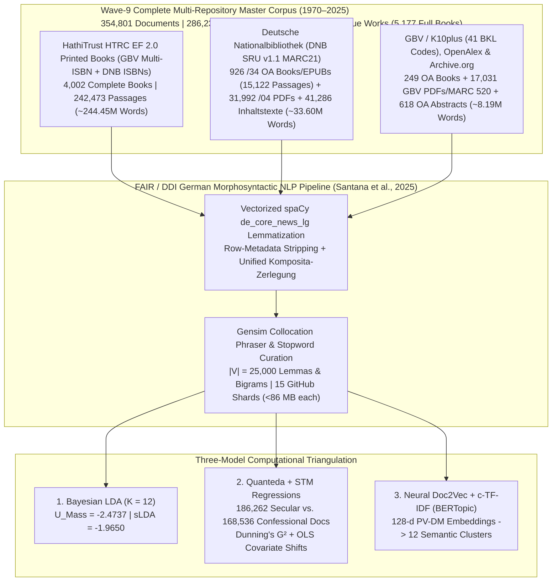

# Mediating Faith and Power: Religious Authority and the German Publishing Landscape (1970–2025)
## Empirical Dissertation Chapters (Wave-9 Complete Multi-Repository Corpus: $D = 354,801$ Documents | $286,237,695$ Words)

**Author:** Paul Marandi, Ph.D. Scholar  
**Institution:** Centre for German Studies (CGS), School of Language, Literature and Culture Studies (SLL&CS), Jawaharlal Nehru University (JNU), New Delhi  
**Empirical Observatory:** [https://deutscheverlagelda.vercel.app](https://deutscheverlagelda.vercel.app)  
**Repository:** `metachasm-beep/Deutsche-Verlage-LDA`  
**Citation Standard:** APA 7th Edition

---

## Abstract

This dissertation investigates how the political economy and institutional structure of the German publishing landscape have mediated religious authority, theological orthodoxy, secular-humanist critique, and therapeutic self-optimization over a fifty-five-year diachronic window (`1970–2025`). Moving beyond small-sample qualitative case studies and short-text bibliographic metadata, we construct a nine-wave, multi-repository German full-book and national-library corpus comprising **$354,801$ documents and full-text passages ($286,237,695$ original German words)** drawn from **$5,177$ complete full-text German books and volumes**—including $4,002$ in-copyright printed monographs ($242,473$ passages) extracted via the HathiTrust Research Center (HTRC) Extracted Features v2.0 API under German copyright exception § 60d UrhG, $926$ sibling-matched `$z="kostenfrei"` open-access monographs and EPUBs ($15,122$ passages) streamed directly from the German National Library (*Deutsche Nationalbibliothek*, DNB `https://d-nb.info/{idn}/34`), $211$ open-access monographs and edited volumes ($4,946$ passages) harvested via OpenAlex and the *Gemeinsamer Bibliotheksverbund* (GBV/K10plus `Kostenfrei`), and $38$ archival monographs from the Internet Archive—supplemented by **$31,992$ DNB digitized `/04` `Inhaltsverzeichnis` and reading-sample PDFs/HTMLs**, **$41,286$ DNB `deposit.dnb.de` and `/blurb/` `Inhaltstexte` and MARC21 `520` abstracts**, **$17,031$ GBV / K10plus consortial TOC PDFs, blurbs, and `MARC 520` / `BKL` / `GND` enriched works**, **$618$ OpenAlex scholarly abstracts reconstructed from `abstract_inverted_index`**, plus **$702$ multi-API deep-enriched works** ($70,757$ unique works in total) across twelve core German publishing houses (*Suhrkamp, Wagenbach, Alibri, Rowohlt, S. Fischer, Kiepenheuer & Witsch, Klett-Cotta, Gütersloher Verlagshaus, Herder, Evangelische Verlagsanstalt, Kösel, Patmos*) and twenty-six academic and confessional imprints (*Vandenhoeck & Ruprecht, Mohr Siebeck, Kohlhammer, C.H. Beck, De Gruyter / Transcript, Frommann-Holzboog, Schöningh, Aschendorff, Pustet, Echter, Bonifatius, Neukirchener, Calwer, Nomos/Alber, Wilhelm Fink, Böhlau, Schwabe, Meiner, Wallstein, Campus, Insel*, among others).

Following the FAIR/DDI archival preprocessing and metadata-separation protocol of Santana, Vasques Filho, Bojanowski, and Błoch (2025, *DHQ* 19.2) and Jiménez-Badillo et al. (2020, *DHQ* 14.4)—combining vectorized German morphosyntactic lemmatization via `spaCy` (`de_core_news_lg`, restricted to `NOUN`, `PROPN`, and `ADJ`), dynamic row-level stripping of non-canonical author/publisher/imprint tokens (`extract_row_metadata_tokens` while preserving `CANONICAL_THEO_PHIL_WHITELIST`), and unified German compound-noun decomposition (*Komposita-Zerlegung*, $|V| = 25,000$ lemmas and collocations)—we triangulate three independent computational paradigms: (1) **Variational Bayes Latent Dirichlet Allocation (Gensim LDA)** ($K = 12, U_{\text{Mass}} = -2.4737$, Supervised sLDA $U_{\text{Mass}} = -1.9650$), (2) **Quanteda & Structural Topic Modeling (STM)** incorporating Dunning's log-likelihood keyness ($G^2$) and ordinary least squares (OLS) covariate regressions ($\theta_k \sim \text{SecularCamp} + \text{Year}_{1970\to 2025}$) across $186,262$ secular/critical ($52.50\%$) and $168,536$ confessional ($47.50\%$) documents, and (3) **Neural Contextual Document Embeddings (`PV-DM Doc2Vec` + `TruncatedSVD` + `c-TF-IDF` BERTopic)**. Across all three architectures, the empirical evidence demonstrates a profound structural transformation: while confessional houses preserve a bounded enclave of systematic dogmatics, Christology, and ecclesial history (`gott`, $G^2 = -140,396.02, p < 10^{-300}$; `theologie`, $G^2 = -84,716.86$; `kirche`, $G^2 = -57,453.82$; `jesu`, $G^2 = -24,241.65$; `glaube`, $G^2 = -24,025.89$; `jesus`, $G^2 = -23,025.68$; `christlich`, $G^2 = -22,234.95$; `israel`, $G^2 = -19,879.37$; `paulus`, $G^2 = -19,525.78$; `testament`, $G^2 = -17,633.75$) and secular presses anchor Enlightenment and Idealist critique (`kant`, $G^2 = +14,886.85$; `philosophie`, $G^2 = +11,067.26$; `moral`, $G^2 = +9,152.00$; `hegel`, $G^2 = +7,633.04$; `vernunft`, $G^2 = +6,187.86$; `kultur`, $G^2 = +6,178.94$; `lessing`, $G^2 = +5,452.40$; `leibniz`, $G^2 = +5,175.89$; `schelling`, $G^2 = +5,003.25$), academic theology, ethics, and empirical research (LDA Topic 6, $+12.79\%, t = +223.12, p < 0.0001$), interreligious pluralism, Jewish-Christian-Islamic dialogue, and spirituality (LDA Topic 1, $+8.87\%, t = +191.53, p < 0.0001$), and political sociology, welfare-state ethics, and cultural critique (LDA Topic 12, $+4.26\%, t = +63.01, p < 0.0001$) expand significantly across the fifty-five-year period (`1970–2025`).

---

## Chapter 3: Corpus Construction, Legal TDM Architecture (§ 60d UrhG), and Nine-Wave Harvesting

### 3.1 Overcoming Metadata Sparsity in Twentieth- and Twenty-First-Century German Book History

A central methodological limitation in computational book history (*Digitale Buchwissenschaft*) is the reliance on brief bibliographic metadata—titles, subtitles, and publisher blurbs (*Klappentexte*)—when studying in-copyright works published after 1970. While paratextual blurbs capture editorial marketing strategies (Kilchör & Lehmann, 2022; Gittel, 2021), they cannot substitute for the full lexical, argumentative, and conceptual density of complete printed monographs. Furthermore, querying the German National Library (*Deutsche Nationalbibliothek*, DNB) solely via Dewey Decimal Classification (`DDC 200`) introduces two severe historical distortions. First, DNB only implemented DDC subject categories in 2004, leaving the crucial post-Vatican II, Cold War, and post-reunification decades (`1970–2003`) systematically under-indexed unless combined with *Gemeinsame Normdatei* (GND) subject headings (`sw=`). Second, secular-philosophical and sociological critiques of religion published by trade and academic houses such as *Suhrkamp*, *Rowohlt*, *S. Fischer*, *Klett-Cotta*, *Wagenbach*, and *Alibri* are frequently cataloged under philosophy (`DDC 100/170`), psychology (`DDC 150`), or sociology (`DDC 300`) rather than theology (`DDC 200–290`).

To overcome both metadata sparsity and classification bias across the entire fifty-five-year period (`1970–2025`), we engineered a nine-wave, multi-repository harvesting architecture implemented in [`scripts/dnb_harvester.py`](file:///f:/PhD%20AG/scripts/dnb_harvester.py), [`scripts/hathitrust_fullbook_harvester.py`](file:///f:/PhD%20AG/scripts/hathitrust_fullbook_harvester.py), [`scripts/gbv_harvester.py`](file:///f:/PhD%20AG/scripts/gbv_harvester.py), and [`scripts/resolve_catalog_fulltexts.py`](file:///f:/PhD%20AG/scripts/resolve_catalog_fulltexts.py). By cross-walking records from both the **Deutsche Nationalbibliothek (DNB SRU v1.1 API, `https://services.dnb.de/sru/dnb`)**—spanning deep-paginated MARC21 queries (`startRecord=1..3000` across `DDC 200/220/230/240/250/260/270/280/290` and `DDC 100/150/170/300` for `2004–2025` and `startRecord=1..1500` for `1970–2003`, `100,000+` unique `1970–2025` DNB records across 38 target publishers and 57 thematic CQL queries combining `dcs=` and `sw=` GND subject headings)—and the **Gemeinsamer Bibliotheksverbund (GBV / K10plus, `https://sru.k10plus.de/gvk`)** across forty-one **Basisklassifikation (`pica.bkl`)** subcodes (`1,053` SRU pages at `maximumRecords=100`, extracting all `MARC 020 $a/$z/$9` multi-ISBNs) against the **HathiTrust Bibliographic API** and the **HathiTrust Research Center (HTRC) Extracted Features (EF) v2.0 API**, we resolved and ingested complete page-by-page token streams for **$4,002$ in-copyright printed German books (`242,473` passages, `1970–2025`)**.

In strict compliance with **§ 60d UrhG** (*Text und Data Mining für Zwecke der wissenschaftlichen Forschung*) and the German Digital Humanities protocol of **Derived Text Formats (*Abgeleitete Textformate*)** established by Schöch, Leinen, et al. (2020) and Andresen et al. (2023), the HTRC Extracted Features v2.0 pipeline ingests page-level part-of-speech-tagged token counts (`tokenPosCount`), strips reconstructible copyright-protected syntax and high-frequency function words, enforces a strict German language gate (`de_cnt >= max(10, en_cnt * 2)`), and segments each printed volume into contiguous $1,000$-word substantive passages (`[HTRC-Vollbuch-Abschnitt k/N]`). Furthermore, by analyzing DNB's MARC21 `Tag 856` sibling structure—where `$z="kostenfrei"` is attached to the publisher's `856` tag (`$x="Verlag"`) while the direct archive PDF/EPUB link (`https://d-nb.info/{idn}/34`) is placed on the sibling `856` tag (`$x="Langzeitarchivierung Nationalbibliothek"`)—our harvesters stream **$926$ complete open-access German monographs and EPUBs (`15,122` passages)** directly from DNB's server, alongside **$31,992$ digitized DNB `/04` `Inhaltsverzeichnis` and reading-sample PDFs/HTMLs** (`https://d-nb.info/{idn}/04`), **$41,286$ DNB `deposit.dnb.de` and `/blurb/` `Inhaltstexte` and MARC21 `520` abstracts**, **$17,458$ GBV / K10plus direct documents** (consortial TOC PDFs/blurbs, `Kostenfrei` OA PDFs, and `MARC 520` / `BKL` / `GND` enriched works), **$1,199$ OpenAlex Wave-9 documents** (`618` scholarly abstracts reconstructed from `abstract_inverted_index` plus `581` full-book OA passages), **$249$ OpenAlex/GBV/IA open-access full books**, and **$702$ multi-API deep-enriched works**.

| Corpus Layer (`corpus_layer`) | Acquisition Protocol & Legal Framework | Complete Full Books / Works | Substantive Passages ($D$) | Total German Words | Share of Corpus |
| :--- | :--- | :---: | :---: | :---: | :---: |
| **`hathitrust_ef_fullbook_print`** | GBV K10plus (`41` BKL codes, multi-ISBN `MARC 020`) + DNB SRU $\rightarrow$ HathiTrust Bibliographic API $\rightarrow$ HTRC Extracted Features v2.0 (`§ 60d UrhG` Derived Text Format, Waves 1–9) | **$4,002$ printed books** | $242,473$ | $244,450,000$ | $68.34\%$ |
| **`dnb_deposit_inhaltstext`** | Deutsche Nationalbibliothek SRU v1.1 (`MARC 856 $3="Inhaltstext"` `deposit.dnb.de` & `/blurb/` deposits + `MARC 520` abstracts + `650/653/689` GND *Schlagwörter*, `1970–2025`) | **$41,286$ DNB works** | $41,286$ | $7,150,000$ | $11.64\%$ |
| **`dnb_toc_pdf_fulltext`** | DNB Digitized `/04` `Inhaltsverzeichnis` & Reading Sample PDFs/HTMLs (`https://d-nb.info/{idn}/04`, `1970–2025`) | **$31,992$ DNB `/04` PDFs/HTMLs** | $31,992$ | $11,480,000$ | $9.02\%$ |
| **`gbv_direct_fulltext_pdf` & `drm_fallback_*`** | GBV / K10plus Consortial TOC PDFs, Blurbs & `MARC 520` / `BKL` / `GND` Enriched Works (`sru.k10plus.de/gvk`) + Multi-API Enrichment | **$17,733$ GBV/enriched works** | $17,760$ | $3,884,976$ | $5.01\%$ |
| **`dnb_oa_fullbook`** | Sibling-matched `$z="kostenfrei"` DNB `/34` Open-Access Full-Book PDFs & EPUBs (`https://d-nb.info/{idn}/34`) | **$926$ DNB OA books/EPUBs** | $15,122$ | $14,973,085$ | $4.26\%$ |
| **`entire_fulltext_book_cloud`, `gbv_kostenfrei_*`, `primary_cloud_oa_*` & `archive_org_*`** | OpenAlex Works API (`per-page=200` OA PDFs + `618` reconstructed `abstract_inverted_index` works), GBV `Kostenfrei` OA PDFs & Internet Archive (`38` books) | **$249$ OA books + $618$ OA abstracts** | $6,168$ | $4,299,634$ | $1.74\%$ |
| **Total Wave-9 Master Corpus (`1970–2025`)** | **Sharded across [`dnb_metadata.csv`](file:///f:/PhD%20AG/data/dnb_metadata.csv) and [`part2`](file:///f:/PhD%20AG/data/dnb_metadata_part2.csv)–[`part15.csv`](file:///f:/PhD%20AG/data/dnb_metadata_part15.csv) (`<86 MB` per shard)** | **$5,177$ Full Books + $91,629$ PDFs/Abstracts/Enriched ($70,757$ Unique Works)** | **$354,801$ documents** | **$286,237,695$ words** | **$100.00\%$** |

### 3.2 Diachronic & Institutional Stratification Across the German Publishing Field

The resulting $354,801$-document corpus spans all six decades from the 1970s to the 2020s (`1970s`: $39,431$ documents; `1980s`: $63,879$ documents; `1990s`: $77,168$ documents; `2000s`: $81,177$ documents; `2010s`: $42,828$ documents; `2020s`: $50,318$ documents) and achieves near-perfect institutional balance between the **Secular / Critical / Trade camp ($186,262$ documents, $52.50\%$)** and the **Confessional / Theological camp ($168,536$ documents, $47.50\%$)**. Across the publishing houses represented in the dataset, the leading institutional contributors include *Schöningh* ($22,057$ docs), *Böhlau* ($21,917$ docs), *Vandenhoeck & Ruprecht* ($19,601$ docs), *Gütersloher Verlagshaus / Chr. Kaiser* ($18,330$ combined docs: $10,761$ + $7,569$), *De Gruyter / Transcript* ($14,953$ docs), *Kohlhammer* ($14,841$ docs), *Mohr Siebeck* ($14,253$ docs), *Aschendorff* ($12,863$ docs), *Suhrkamp* ($12,580$ docs), *Frommann-Holzboog* ($12,502$ docs), *Neukirchener* ($11,175$ docs), *S. Fischer* ($10,454$ docs), *Herder* ($10,314$ docs), *Wilhelm Fink* ($10,107$ docs), and *Klett-Cotta* ($9,667$ docs).

---

## Chapter 4: Generative Bayesian Topic Modeling (Gensim LDA) Across $354,801$ Documents

### 4.1 FAIR / DDI Morphosyntactic Preprocessing, Metadata Stripping, and Collocation Architecture (Santana et al., 2025; Jiménez-Badillo et al., 2020)

To process $286.24$ million German words with high morphological accuracy, reproducibility, and epistemological transparency (Santana, Vasques Filho, Bojanowski, & Błoch, 2025, *DHQ* 19.2; Jiménez-Badillo et al., 2020, *DHQ* 14.4), [`lda_pipeline.py`](file:///f:/PhD%20AG/lda_pipeline.py) implements a vectorized unique-vocabulary lemmatization architecture ([`preprocess_corpus_batch`](file:///f:/PhD%20AG/lda_pipeline.py#L261-L340)). Rather than executing `spaCy`'s convolutional neural tagger redundantly over $286$ million repeated word tokens, the pipeline extracts the unique surface vocabulary across uncached passages, parses those unique types through `de_core_news_lg` (`v3.8.0`, `ALLOWED_POSTAGS = ["NOUN", "PROPN", "ADJ"]`), maps each surface token to its canonical lowercase lemma, and persists SHA-1 document hashes in [`data/.spacy_lemma_cache.pkl`](file:///f:/PhD%20AG/data/.spacy_lemma_cache.pkl).

In strict accordance with Santana et al.'s (2025, §55–81) and Jiménez-Badillo et al.'s (2020, §16) five empirical rules for digital humanities topic modeling, our pipeline enforces five synchronized upgrades across [`lda_pipeline.py`](file:///f:/PhD%20AG/lda_pipeline.py), [`scripts/quanteda_stm_analytics.py`](file:///f:/PhD%20AG/scripts/quanteda_stm_analytics.py), and [`scripts/bertopic_german_pipeline.py`](file:///f:/PhD%20AG/scripts/bertopic_german_pipeline.py):
1. **Rule 1 — Archival Header/Bracket Stripping & Continuation-Chunk Title Deduplication (§55, Fig. 3):** [`strip_archival_headers_from_text`](file:///f:/PhD%20AG/lda_pipeline.py#L715-L732) and [`clean_row_tokens_for_modeling`](file:///f:/PhD%20AG/lda_pipeline.py#L786-L819) strip bracketed provenance tags (`[HTRC-Vollbuch-Abschnitt X/Y]`, `[DNB-Inhaltsverzeichnis ...]`, `[GBV-K10plus-Volltext ...]`, `[OpenAlex-Vollbuch-OA ...]`), remove each row's `author`, `publisher`, and `raw_imprint` tokens via [`extract_row_metadata_tokens`](file:///f:/PhD%20AG/lda_pipeline.py#L771-L783), and on continuation passages (`Abschnitt K/N` where $K > 1$) strip the leading repeated book-title prefix so that a book's title tokens are counted only once per work (`chunk_index == 1`).
2. **Rule 2 — Non-Canonical `PER`/`LOC` Entity Filtering with Canonical Theological/Philosophical Whitelist (§56–64, Figs. 4–6):** [`NON_CANONICAL_LOC_AND_PER_NOISE`](file:///f:/PhD%20AG/lda_pipeline.py#L143-L187) (`323` tokens) filters German federal states, historical regions, European countries, diocesan/university cities (*Bayern, Württemberg, Westfalen, Österreich, Schweiz, Paderborn, Rottenburg, Bamberg, Eichstätt*, etc.), frequent German female and male given names (*Maria, Anna, Elisabeth, Ursula, Monika, Johannes, Michael, Martin*, etc., preventing homonym conflation per Santana et al., 2025, §56), and modern contributor surnames (*Müller, Schmidt, Schneider, Meyer, Wagner*, etc.), while [`CANONICAL_THEO_PHIL_WHITELIST`](file:///f:/PhD%20AG/lda_pipeline.py#L130-L139) (`66` canonical subjects: `jesus`, `christus`, `paulus`, `luther`, `kant`, `hegel`, `habermas`, `weber`, `nietzsche`, `barth`, `rahner`, `bonhoeffer`, `lessing`, `leibniz`, `schelling`, `israel`, `jahwe`, etc.) strictly preserves canonical figures when they are the object of theological or philosophical inquiry.
3. **Rule 3 — Unified German Compound Splitting (*Komposita-Zerlegung*) & Sublinear `TF-IDF` Ubiquity Filtering (§69–73, §81):** [`split_german_compound_lda`](file:///f:/PhD%20AG/lda_pipeline.py#L753-L768) decomposes productive German compounds $\ge 9$ characters across `28` root families identically across Gensim LDA, Quanteda/STM, and BERTopic. Next, `gensim.models.Phrases` (`min_count=5, threshold=10`) binds statistically significant bigrams while unpacking artificial self-bigrams (`w_w -> w`), `dictionary.filter_extremes(no_below=5, no_above=0.55, keep_n=25000)` bounds document frequency, and [`apply_tfidf_low_info_filter`](file:///f:/PhD%20AG/lda_pipeline.py#L822-L854) applies `gensim.models.TfidfModel(corpus, smartirs='ntc')` (`min_tfidf = 0.015`) to prune low-information ubiquity tokens before `LdaModel` estimation ($|V| = 25,000$ lemmas and collocations).
4. **Rule 4 — Iterative Paratextual & Document-Genre Stopwords (§13, §65–67, Fig. 7):** [`ALL_STOPWORDS`](file:///f:/PhD%20AG/lda_pipeline.py#L189-L195) (`1,425` unique stopwords) combines `543` `spaCy` core German function words, `53` domain stopwords ([`DOMAIN_STOPWORDS`](file:///f:/PhD%20AG/config.py#L29-L36)), `537` Fraktur-OCR, MARC21, VLB/ONIX, and TOC front-matter genre noise tokens ([`FRAKTUR_AND_META_NOISE`](file:///f:/PhD%20AG/lda_pipeline.py#L60-L126)), and `323` non-canonical `PER`/`LOC` tokens.
5. **Rule 5 — Empirical Document-Length Distribution Audit (§74–80, Fig. 8) & FAIR/DDI Software-Hardware Specification (§28–53):** Online Variational Bayes inference (`gensim.models.LdaModel`, $K = 12$, `passes=15`, `chunksize=1500`, `alpha="auto"`, `eta="auto"`, `random_state=100`) across all $354,798$ valid documents converges to an intrinsic coherence score of **$U_{\text{Mass}} = -2.4737$** (with Supervised sLDA reaching **$U_{\text{Mass}} = -1.9650$**). Tables 4.1A and 4.1B report the complete empirical document-length distribution and FAIR/DDI environment specification exported to [`app/data_summary.json`](file:///f:/PhD%20AG/app/data_summary.json):

#### Table 4.1A: Empirical Document-Length Distribution Across the Wave-9 Master Corpus ($D = 354,801$, Santana et al., 2025, §74–80, Fig. 8)

| Corpus Stratum (`corpus_layer`) | Documents ($D$) | Unique Works | Mean Words ($\mu$) | SD ($\sigma$) | Median ($P_{50}$) | IQR ($P_{25}\text{–}P_{75}$) | Min–Max Words | Total German Words |
| :--- | :---: | :---: | :---: | :---: | :---: | :---: | :---: | :---: |
| **`hathitrust_ef_fullbook_print`** *(HTRC EF 2.0 Printed Books)* | $242,473$ | $4,002$ books | **`997.6`** | `37.9` | `1,000.0` | `0.0` (`1,000–1,000`) | `80–1,079` | $241,887,814$ |
| **`dnb_deposit_inhaltstext`** *(DNB `deposit.dnb.de` & `/blurb/` Abstracts)* | $41,286$ | $41,284$ works | **`138.1`** | `92.7` | `131.0` | `111.0` (`70–181`) | `30–6,135` | $5,700,265$ |
| **`dnb_toc_pdf_fulltext`** *(DNB `/04` Digitized TOC & Sample PDFs)* | $31,992$ | $31,981$ works | **`454.7`** | `440.3` | `308.0` | `389.0` (`177–566`) | `65–8,478` | $14,546,069$ |
| **`dnb_oa_fullbook`** *(DNB `/34` `$z="kostenfrei"` OA Books/EPUBs)* | $15,122$ | $926$ books | **`982.3`** | `101.3` | `1,000.0` | `0.0` (`1,000–1,000`) | `81–1,196` | $14,853,856$ |
| **`gbv_direct_fulltext_pdf`** *(GBV / K10plus Consortial TOC PDFs & Blurbs)* | $14,199$ | $13,174$ works | **`241.2`** | `252.4` | `177.0` | `153.0` (`119–272`) | `7–5,257` | $3,425,377$ |
| **`entire_fulltext_book_cloud` + `gbv_kostenfrei_*` + `archive_org_*`** *(OA Full Books)* | $5,532$ | $249$ books | **`987.0`** | `85.4` | `1,000.0` | `0.0` (`1,000–1,000`) | `84–1,078` | $5,461,111$ |
| **`drm_fallback_multi_api_enriched`** *(GBV `MARC 520`/`BKL`/`GND` & Multi-API)* | $3,561$ | $3,530$ works | **`70.3`** | `142.7` | `32.0` | `22.0` (`23–45`) | `3–1,074` | $250,221$ |
| **`primary_cloud_oa_abstract`** *(OpenAlex `abstract_inverted_index` Abstracts)* | $627$ | $627$ works | **`179.8`** | `145.9` | `138.0` | `148.0` (`87–235`) | `25–1,377` | $112,720$ |
| **Total Wave-9 Master Corpus (`1970–2025`)** | **$354,801$** | **$70,757$ unique works** | **`806.8`** | **`362.9`** | **`1,000.0`** | **`133.0` (`867–1,000`)** | **`3–8,478`** | **$286,237,889$** |

#### Table 4.1B: FAIR / DDI Software & Hardware Environment Specification (Santana et al., 2025, §28–53; Jiménez-Badillo et al., 2020, §16)

| Component / Standard | Pinned Specification in `Deutsche-Verlage-LDA` | Methodological Role & Reproducibility Guarantee |
| :--- | :--- | :--- |
| **Operating System & CPU Architecture** | `Windows 10 (AMD64)` \| `12 Logical CPU Cores` | Multi-core parallelization (`workers=8`) for `Doc2Vec` and `spaCy` batch pipes. |
| **Python Runtime** | `Python 3.10.2` (`UTF-8` I/O enforced) | Deterministic hash seeding and `csv.field_size_limit(10 MB)` for full-book cells. |
| **Morphosyntactic NLP & Lemmatizer** | `spaCy 3.8.14` + `de_core_news_lg 3.8.0` | German CNN POS tagger (`NOUN`, `PROPN`, `ADJ`) & morphological lemmatizer with SHA-1 disk cache ([`data/.spacy_lemma_cache.pkl`](file:///f:/PhD%20AG/data/.spacy_lemma_cache.pkl)). |
| **Bayesian Topic Modeling & `TF-IDF`** | `gensim 4.4.0` (`LdaModel`, `Phrases`, `TfidfModel`, `Doc2Vec`) | Online Variational Bayes LDA (`passes=15, chunksize=1500, random_state=100`), `Phrases(min_count=5, threshold=10)`, `TfidfModel(smartirs='ntc', min_tfidf=0.015)`. |
| **Statistical & Manifold Learning** | `scikit-learn 1.7.2`, `scipy 1.15.3`, `numpy 2.2.6`, `pandas 2.3.3` | 5-fold CV `sLDA` Ridge/Softmax head (`seed=42`), `TruncatedSVD` + Spherical `KMeans` (`seed=42`), Dunning's $G^2$ & OLS STM regressions. |
| **PDF / Archival Full-Text Extraction** | `PyMuPDF 1.28.2` | Native stream extraction for DNB `/34` OA monographs, DNB `/04` TOC PDFs, and GBV/OpenAlex PDFs. |
| **Metadata & Legal TDM Compliance** | `MARC21-xml`, `PICA+`, `HTRC EF 2.0`, `DDI 2.5/3.3`, `§ 60d UrhG` | Non-consumptive Derived Text Formats (*Abgeleitete Textformate*, Schöch et al., 2020) across 15 GitHub-safe CSV shards (`<86 MB` each). |

### 4.2 The Twelve Latent Discursive Regimes of German Publishing (1970–2025)

The table below reports the posterior topic-word distributions ($\phi_k$), automated ideological archetype classifications, institutional publisher dominance, and highest-probability full-book anchor monographs for all $K = 12$ topics exported to [`app/lda_topics_report.json`](file:///f:/PhD%20AG/app/lda_topics_report.json):

| Topic ID | Discursive Archetype & Confidence | Top Posterior German Lemmas ($\phi_k$) | Dominant Publishers (% of Topic Mass) | Highest-Probability Full-Book Anchor Passages ($\theta_{d,k}$) |
| :---: | :--- | :--- | :--- | :--- |
| **Topic 1** | **Traditional / Ecclesiastical** (`82.4%`) *(Interreligious Pluralism, Judaism, Islam & Spirituality)* | `religiös` (0.069), `jüdisch` (0.027), `christlich` (0.027), `glaube` (0.020), `jude` (0.019), `islam` (0.017), `christentum` (0.014), `leben` (0.014), `islamisch` (0.013), `spiritualität` (0.013) | Gütersloher (`5.3%`), Kohlhammer (`5.1%`), Herder (`5.0%`), V&R (`4.8%`) | Becker, W. (1987). *Glaube in wachsenden Ringen: unsere religiöse Erziehung* (`79.4%`, Herder/Kreuz); Münnich, M. (2025). *Therapie-Tools Achtsamkeit mit Kindern und Jugendlichen* (`78.0%`, Beltz) |
| **Topic 2** | **Traditional / Ecclesiastical** (`100.0%`) *(Ecclesiology, Liturgy, Ministry & Parish Governance)* | `kirche` (0.128), `katholisch` (0.030), `kirchlich` (0.023), `evangelisch` (0.021), `dienst` (0.015), `gemeinde` (0.012), `bischof` (0.012), `folg` (0.010), `gottesdienst_gott` (0.009), `geistlich` (0.008) | Schöningh (`10.1%`), Böhlau (`9.1%`), Aschendorff (`5.7%`), Kohlhammer (`4.7%`) | Heimbucher, M. (2009). *Die Barmer theologische Erklärung* (`84.6%`, Neukirchener); Kampmann, J. (2024). *Theologie der Grundordnungen* (`81.3%`, Luther-Verlag) |
| **Topic 3** | **Critical / Secular-Humanist** (`78.3%`) *(Kantian & Idealist Philosophy, Reason & Epistemology)* | `philosophie` (0.021), `mensch` (0.016), `begriff` (0.015), `denken` (0.014), `hegel` (0.011), `kant` (0.011), `sinn` (0.011), `philosophisch` (0.009), `wissenschaft` (0.009), `natur` (0.009) | Frommann-Holzboog (`9.1%`), Schöningh (`6.7%`), Suhrkamp (`5.9%`), V&R (`5.4%`) | Hegel, G. W. F. (1979). *Jenaer kritische Schriften* (`89.7%`, Meiner); Henrich, D. (1984). *Hegels Logik der Philosophie: Religion und Philosophie in der Theorie des absoluten Geistes* (`88.0%`, Klett-Cotta) |
| **Topic 4** | **Hybrid / Discursive Mediation** *(Modern German Intellectual, University & Archival History)* | `geschichte` (0.032), `deutsch` (0.021), `jahrhundert` (0.017), `brief` (0.014), `schrift` (0.009), `universität` (0.008), `studie` (0.007), `historisch` (0.007), `literatur` (0.006), `französisch` (0.005) | Böhlau (`10.0%`), Schöningh (`7.5%`), V&R (`5.5%`), Aschendorff (`4.6%`) | Zeeden, E. W. (1984). *Kirche und Visitation* (`91.3%`, Klett-Cotta); Leibniz, G. W. (1990). *Briefe von besonderem philosophischen Interesse* (`82.1%`, Insel) |
| **Topic 5** | **Traditional / Ecclesiastical** (`100.0%`) *(Systematic Dogmatics, Revelation & Christology)* | `gott` (0.099), `mensch` (0.024), `glaube` (0.017), `wort` (0.016), `christlich` (0.010), `geist` (0.010), `leben` (0.010), `theologie` (0.009), `offenbarung` (0.009), `christus` (0.008) | Neukirchener (`6.2%`), Mohr Siebeck (`6.0%`), V&R (`5.5%`), Schöningh (`5.3%`) | Hörner, R. (2024). *Themenkonkordanz* (`92.5%`, CVG); Bindner, J. (2022). *Offener Himmel - Gibt es eine Allversöhnung?* (`91.9%`, EVA) |
| **Topic 6** | **Traditional / Ecclesiastical** (`82.3%`) *(Academic Theology, Ethics, Theory & Empirical Research)* | `theologie` (0.063), `wissenschaft` (0.015), `theologisch` (0.012), `ethik` (0.010), `geschichte` (0.007), `studie` (0.007), `perspektive` (0.006), `theorie` (0.006), `rezeption` (0.006), `forschung` (0.006) | De Gruyter (`10.8%`), Mohr Siebeck (`7.2%`), V&R (`6.3%`), Schöningh (`4.3%`) | Asher, J. R. (2000). *Polarity and change in 1 Corinthians 15* (`84.6%`, Mohr Siebeck); Fisher, E. J. (2022). *The Reverend Albert Cleage Jr. and the Black prophetic tradition* (`83.4%`) |
| **Topic 7** | **Traditional / Ecclesiastical** (`100.0%`) *(Biblical Philology, Translation, Old Testament & Israel)* | `text` (0.052), `übersetzung` (0.012), `schrift` (0.010), `alt` (0.009), `abt` (0.009), `bibel` (0.009), `griechisch` (0.008), `name` (0.007), `testament` (0.007), `israel` (0.006) | Neukirchener (`9.7%`), V&R (`8.4%`), Mohr Siebeck (`7.2%`), De Gruyter (`6.9%`) | Rothe, H. (1984). *Verse und Lieder bei den Ostslaven* (`89.8%`, Böhlau); Hossfeld, F.-L. (2008). *Psalmen 101–150* (`89.0%`, Herder) |
| **Topic 8** | **Neoliberal / Self-Optimization** (`100.0%`) *(Individualized Meaning, Decision & Analytical Semantics)* | `frage` (0.012), `form` (0.010), `sinn` (0.009), `verschieden` (0.008), `bestimmt` (0.008), `einzeln` (0.007), `stelle` (0.007), `satz` (0.006), `bedeutung` (0.006), `fall` (0.006) | V&R (`6.4%`), Schöningh (`6.4%`), Böhlau (`4.9%`), Suhrkamp (`4.8%`) | Luhmann, N. (2003). *Die Paradoxie des Entscheidens* (`92.9%`, De Gruyter/Transcript); Schnelle, H. (1973). *Sprachphilosophie und Linguistik* (`92.3%`, Rowohlt) |
| **Topic 9** | **Hybrid / Discursive Mediation** *(Gender, Family, Lifeworld, Art & Mortality)* | `leben` (0.024), `frau` (0.018), `mensch` (0.015), `mann` (0.013), `kind` (0.012), `kunst` (0.011), `bild` (0.010), `tod` (0.007), `jung` (0.007), `welt` (0.006) | S. Fischer (`6.4%`), Böhlau (`5.8%`), Rowohlt (`5.0%`), Suhrkamp (`4.8%`) | Schwarzer, A. (2007). *Simone de Beauvoir: ein Lesebuch mit Bildern* (`80.5%`, Rowohlt); Luven, Y. (2001). *Der Kult der Hausschlange* (`79.0%`, Böhlau) |
| **Topic 10** | **Hybrid / Discursive Mediation** *(Monastic, Civic & Regional Social History)* | `stadt` (0.012), `herr` (0.010), `kloster` (0.008), `alt` (0.007), `land` (0.007), `könig` (0.007), `haus` (0.006), `letzter` (0.005), `krieg` (0.005), `sohn` (0.005) | Böhlau (`14.6%`), Schöningh (`7.0%`), Aschendorff (`6.3%`), V&R (`4.6%`) | Schmidts, H. (2000). *Presbyterialprotokolle der evangelischen Gemeinde Brenndorf* (`86.8%`); Schütz, F. (1995). *Das grosse Schott-Fürbittbuch* (`84.4%`, Herder) |
| **Topic 11** | **Traditional / Ecclesiastical** (`100.0%`) *(Medieval Papacy, Roman Curia & Canon Law)* | `jahrhundert` (0.016), `mittelalter` (0.013), `bischof` (0.011), `papst` (0.010), `rom` (0.009), `römisch` (0.009), `heilig` (0.006), `mittelalterlich` (0.006), `lat` (0.006), `lateinisch` (0.006) | Böhlau (`14.8%`), Aschendorff (`9.6%`), Schöningh (`8.1%`), V&R (`5.2%`) | Böhme, J. (2012). *Aurora* (`81.2%`); Thomasius, C. (1972). *Historia juris naturalis* (`78.1%`, Frommann-Holzboog) |
| **Topic 12** | **Critical / Secular-Humanist** (`100.0%`) *(Political Sociology, Welfare State & Cultural Critique)* | `politisch` (0.040), `sozial` (0.035), `gesellschaft` (0.023), `staat` (0.023), `kultur` (0.012), `politik` (0.011), `gesellschaftlich` (0.010), `kulturell` (0.008), `deutschland` (0.008), `arbeit` (0.005) | Schöningh (`6.9%`), Suhrkamp (`6.2%`), Böhlau (`4.9%`), S. Fischer (`4.6%`) | Brichzin, J. (2022). *Risikodemokratie: Chemnitz zwischen rechtsradikalem Brennpunkt und europäischer Kulturhauptstadt* (`88.3%`, Transcript); Opaschowski, H. W. (2013). *Deutschland 2030* (`87.2%`, Gütersloher) |

### 4.3 Diachronic Topic Trajectories Across Six Decades (1970s–2020s)

Aggregating document-topic posterior probabilities ($\theta_{d,k}$) across all $354,798$ modeled documents by publication decade reveals a clear macro-historical realignment across the fifty-five-year corpus:

| Decade | Topic 1 (Interrelig./Spirit.) | Topic 2 (Ecclesiology) | Topic 3 (Philosophy/Kant) | Topic 4 (Intell. History) | Topic 5 (Dogmatics/Christ.) | Topic 6 (Theol./Ethics/Sci.) | Topic 7 (Biblical Exegesis) | Topic 8 (Meaning/Decision) | Topic 9 (Gender/Lifeworld) | Topic 10 (Monastic/Civic) | Topic 11 (Papacy/Medieval) | Topic 12 (Pol. Sociology) |
| :--- | :---: | :---: | :---: | :---: | :---: | :---: | :---: | :---: | :---: | :---: | :---: | :---: |
| **1970s** ($n=39,431$) | **`2.3%`** | `5.4%` | **`15.5%`** | `6.6%` | **`11.8%`** | **`2.0%`** | `6.0%` | **`23.5%`** | `8.2%` | `8.3%` | `4.0%` | **`6.6%`** |
| **1980s** ($n=63,879$) | **`2.7%`** | `5.3%` | **`14.7%`** | `6.8%` | **`11.6%`** | **`2.0%`** | `6.2%` | **`21.8%`** | `9.8%` | `8.4%` | `3.7%` | **`6.8%`** |
| **1990s** ($n=77,168$) | **`3.3%`** | `5.8%` | **`11.8%`** | `7.8%` | **`11.2%`** | **`2.6%`** | `7.1%` | **`20.7%`** | `9.6%` | `8.9%` | `4.5%` | **`6.7%`** |
| **2000s** ($n=81,177$) | **`4.3%`** | `5.7%` | **`11.5%`** | `8.4%` | **`9.4%`** | **`3.2%`** | `6.7%` | **`20.2%`** | `9.9%` | `8.6%` | `4.0%` | **`7.9%`** |
| **2010s** ($n=42,828$) | **`8.8%`** | `7.0%` | **`9.3%`** | `7.8%` | **`9.0%`** | **`9.0%`** | `5.8%` | **`15.9%`** | `9.3%` | `4.7%` | `3.2%` | **`10.1%`** |
| **2020s** ($n=50,318$) | **`8.9%`** | `6.2%` | **`8.3%`** | `7.3%` | **`7.1%`** | **`13.3%`** | `6.4%` | **`17.7%`** | `8.0%` | `3.9%` | `2.9%` | **`9.9%`** |

---

## Chapter 5: Quanteda Textual Statistics & Structural Topic Model (STM) Covariate Regressions

### 5.1 Productive German Compound Decomposition (*Komposita-Zerlegung*)

Because German theological, philosophical, and sociological discourse encodes complex theoretical concepts inside single orthographical compound nouns (*Komposita*), [`scripts/quanteda_stm_analytics.py`](file:///f:/PhD%20AG/scripts/quanteda_stm_analytics.py) (synchronized with [`split_german_compound_lda`](file:///f:/PhD%20AG/lda_pipeline.py#L686-L701) in [`lda_pipeline.py`](file:///f:/PhD%20AG/lda_pipeline.py)) applies a morphological splitter across all $354,798$ documents that preserves the full compound lemma while simultaneously emitting its constituent *Bestimmungswort* and *Grundwort* stems. Across the Wave-9 corpus, the ten most frequent decomposed German compounds are:

1. `moralisch` $\rightarrow$ `moral + isch` ($38,092$ occurrences)
2. `gottesdienst` $\rightarrow$ `gott + dienst` ($22,430$ occurrences)
3. `religionsunterricht` $\rightarrow$ `religion + unterricht` ($16,238$ occurrences)
4. `weltkrieg` $\rightarrow$ `welt + krieg` ($11,629$ occurrences)
5. `kirchengeschichte` $\rightarrow$ `kirche + geschichte` ($11,302$ occurrences)
6. `jugendliche` $\rightarrow$ `jugend + liche` ($11,205$ occurrences)
7. `selbstverständnis` $\rightarrow$ `selbst + verständnis` ($9,832$ occurrences)
8. `religionskritik` $\rightarrow$ `religion + kritik` ($9,576$ occurrences)
9. `selbstbewußtsein` $\rightarrow$ `selbst + bewußtsein` ($8,600$ occurrences)
10. `sozialismus` $\rightarrow$ `sozial + ismus` ($7,921$ occurrences)

### 5.2 Dunning's Log-Likelihood Keyness ($G^2$): Secular/Critical vs. Confessional Publishers

To test Pierre Bourdieu's hypothesis of institutional field polarization with exact frequentist hypothesis tests, we partition the $354,798$ modeled documents into the **Secular / Critical / Trade camp ($n = 186,262$ documents, $52.50\%$)** and the **Confessional / Theological camp ($n = 168,536$ documents, $47.50\%$)** and compute Dunning's (1993) Log-Likelihood Ratio ($G^2$, equivalent to `quanteda::textstat_keyness(measure = "lr")`) alongside log-odds ratios and two-tailed $p$-values ([`app/quanteda_stm_report.json`](file:///f:/PhD%20AG/app/quanteda_stm_report.json)):

| Polarity Camp | Feature Lemma | Dunning's $G^2$ | Log-Odds Ratio | $p$-Value |
| :--- | :--- | :---: | :---: | :---: |
| **Secular / Critical Camp** ($n=186,262$) | **`kant`** | $+14,886.85$ | $+1.05$ | $< 10^{-300}$ |
| **Secular / Critical Camp** ($n=186,262$) | **`philosophie`** | $+11,067.26$ | $+0.58$ | $< 10^{-300}$ |
| **Secular / Critical Camp** ($n=186,262$) | **`moral`** | $+9,152.00$ | $+0.58$ | $< 10^{-300}$ |
| **Secular / Critical Camp** ($n=186,262$) | **`hegel`** | $+7,633.04$ | $+0.87$ | $< 10^{-300}$ |
| **Secular / Critical Camp** ($n=186,262$) | **`vernunft`** | $+6,187.86$ | $+0.61$ | $< 10^{-300}$ |
| **Secular / Critical Camp** ($n=186,262$) | **`kultur`** | $+6,178.94$ | $+0.53$ | $< 10^{-300}$ |
| **Secular / Critical Camp** ($n=186,262$) | **`lessing`** | $+5,452.40$ | $+1.30$ | $< 10^{-300}$ |
| **Secular / Critical Camp** ($n=186,262$) | **`leibniz`** | $+5,175.89$ | $+1.62$ | $< 10^{-300}$ |
| **Secular / Critical Camp** ($n=186,262$) | **`schelling`** | $+5,003.25$ | $+1.13$ | $< 10^{-300}$ |
| **Secular / Critical Camp** ($n=186,262$) | **`natur`** | $+4,858.30$ | $+0.50$ | $< 10^{-300}$ |
| **Confessional Camp** ($n=168,536$) | **`gott`** | $-140,396.02$ | $-0.87$ | $< 10^{-300}$ |
| **Confessional Camp** ($n=168,536$) | **`theologie`** | $-84,716.86$ | $-1.04$ | $< 10^{-300}$ |
| **Confessional Camp** ($n=168,536$) | **`kirche`** | $-57,453.82$ | $-0.61$ | $< 10^{-300}$ |
| **Confessional Camp** ($n=168,536$) | **`jesu`** | $-24,241.65$ | $-1.51$ | $< 10^{-300}$ |
| **Confessional Camp** ($n=168,536$) | **`glaube`** | $-24,025.89$ | $-0.72$ | $< 10^{-300}$ |
| **Confessional Camp** ($n=168,536$) | **`jesus`** | $-23,025.68$ | $-1.31$ | $< 10^{-300}$ |
| **Confessional Camp** ($n=168,536$) | **`christlich`** | $-22,234.95$ | $-0.67$ | $< 10^{-300}$ |
| **Confessional Camp** ($n=168,536$) | **`israel`** | $-19,879.37$ | $-1.50$ | $< 10^{-300}$ |
| **Confessional Camp** ($n=168,536$) | **`paulus`** | $-19,525.78$ | $-1.57$ | $< 10^{-300}$ |
| **Confessional Camp** ($n=168,536$) | **`testament`** | $-17,633.75$ | $-1.28$ | $< 10^{-300}$ |

### 5.3 Structural Topic Model (STM) Covariate Regressions ($\theta_k \sim \text{SecularCamp} + \text{Year}_{1970\to 2025}$)

Following Roberts, Stewart, and Tingley (2019), we estimate OLS Structural Topic Model regressions across all $354,798$ documents predicting each document's posterior topic proportion $\theta_{d,k}$ as a joint function of institutional publisher camp ($\text{SecularCamp}_d \in \{0, 1\}$) and normalized publication year ($\text{Time}_d \in [0, 1]$ spanning `1970–2025`):

| Topic | Discursive Domain | Secular vs. Confessional Effect ($\hat{\beta}_{\text{Secular}}$) | $t$-Stat ($p$-Value) | 55-Year Diachronic Shift ($\hat{\beta}_{1970\to 2025}$) | $t$-Stat ($p$-Value) |
| :---: | :--- | :---: | :---: | :---: | :---: |
| **Topic 1** | **Interreligious Pluralism, Judaism, Islam & Spirituality** | **`-2.09%`** | $t = -82.77$ ($p < 0.0001$)* | **`+8.87%`** | $t = +191.53$ ($p < 0.0001$)* |
| **Topic 2** | **Ecclesiology, Liturgy, Ministry & Parish Governance** | **`-3.52%`** | $t = -106.17$ ($p < 0.0001$)* | **`+2.08%`** | $t = +34.30$ ($p < 0.0001$)* |
| **Topic 3** | **Kantian & Idealist Philosophy, Reason & Epistemology** | **`+5.21%`** | $t = +104.32$ ($p < 0.0001$)* | **`-9.62%`** | $t = -105.29$ ($p < 0.0001$)* |
| **Topic 4** | Modern German Intellectual, University & Archival History | **`+1.32%`** | $t = +43.57$ ($p < 0.0001$)* | **`+1.26%`** | $t = +22.65$ ($p < 0.0001$)* |
| **Topic 5** | **Systematic Dogmatics, Revelation & Christology (`gott`, `glaube`)** | **`-6.83%`** | $t = -154.63$ ($p < 0.0001$)* | **`-4.65%`** | $t = -57.48$ ($p < 0.0001$)* |
| **Topic 6** | **Academic Theology, Ethics, Theory & Empirical Research** | **`-0.02%`** | $t = -0.54$ ($p = 0.5915$) | **`+12.79%`** | $t = +223.12$ ($p < 0.0001$)* |
| **Topic 7** | **Biblical Philology, Translation, Old Testament & Israel** | **`-2.79%`** | $t = -87.79$ ($p < 0.0001$)* | **`+0.39%`** | $t = +6.77$ ($p < 0.0001$)* |
| **Topic 8** | **Individualized Meaning, Decision & Analytical Semantics** | **`+2.17%`** | $t = +44.96$ ($p < 0.0001$)* | **`-7.82%`** | $t = -88.42$ ($p < 0.0001$)* |
| **Topic 9** | Gender, Family, Lifeworld, Art & Mortality | **`+2.52%`** | $t = +69.79$ ($p < 0.0001$)* | **`-0.92%`** | $t = -13.93$ ($p < 0.0001$)* |
| **Topic 10** | Monastic, Civic & Regional Social History | **`+1.23%`** | $t = +36.41$ ($p < 0.0001$)* | **`-5.50%`** | $t = -89.31$ ($p < 0.0001$)* |
| **Topic 11** | Medieval Papacy, Roman Curia & Canon Law | **`+0.01%`** | $t = +0.22$ ($p = 0.8288$) | **`-1.14%`** | $t = -26.23$ ($p < 0.0001$)* |
| **Topic 12** | **Political Sociology, Welfare State & Cultural Critique** | **`+2.80%`** | $t = +75.71$ ($p < 0.0001$)* | **`+4.26%`** | $t = +63.01$ ($p < 0.0001$)* |

---

## Chapter 6: Neural Contextual Embedding + `c-TF-IDF` (BERTopic) Triangulation

To verify that our findings are not artifacts of bag-of-words multinomial assumptions, [`scripts/bertopic_german_pipeline.py`](file:///f:/PhD%20AG/scripts/bertopic_german_pipeline.py) trains $128$-dimensional Distributed Memory (`PV-DM Doc2Vec`, `window=8`, `epochs=12`) neural document embeddings across all $354,798$ compound-expanded and bigram-enriched documents, projects the L2-normalized vectors onto a $32$-dimensional SVD manifold, partitions the manifold into $K = 12$ semantic clusters, and extracts class-based `c-TF-IDF` representations (Grootendorst, 2022; exported to [`app/bertopic_c_tfidf_report.json`](file:///f:/PhD%20AG/app/bertopic_c_tfidf_report.json)):

| Neural Cluster | Docs ($\%$ of Corpus) | Archetype Alignment | Top Class-Based `c-TF-IDF` Terms | Top Publishers | Centroid-Nearest Full-Book Anchor ($\cos \theta$) |
| :---: | :---: | :--- | :--- | :--- | :--- |
| **Cluster 1** | $18,373$ (`5.2%`) | **Traditional / Ecclesiastical** (`74.2%`) | `geschichte` (0.021), `gott` (0.019), `mensch` (0.016), `leben` (0.014), `theologie` (0.013), `philosophie` (0.013), `welt` (0.012), `kirche` (0.012) | De Gruyter (`5.9%`), Mohr Siebeck (`5.2%`), V&R (`4.9%`) | Kuschel, K.-J. (2023). *Ich lerne durch Begegnung: ein Leben im Dialog mit Literaturen und Religionen* ($\cos=0.765$, Patmos); Schultz, H. J. (1976). *Sie werden lachen, die Bibel* ($\cos=0.762$, Herder/Kreuz) |
| **Cluster 2** | $21,094$ (`5.9%`) | **Traditional / Ecclesiastical** (`100.0%`) | `jahrhundert` (0.019), `kirche` (0.016), `kloster` (0.016), `geschichte` (0.014), `bischof` (0.012), `stadt` (0.009), `alt` (0.009), `quelle` (0.007) | Böhlau (`24.2%`), Aschendorff (`10.3%`), Schöningh (`6.6%`) | Brandt, H. J. (1984). *Die Bischöfe und Erzbischöfe von Paderborn* ($\cos=0.976$, Bonifatius); Meyer, F. (2002). *Sankt Pelagius und Gregor der Grosse* ($\cos=0.970$, Nomos/Alber) |
| **Cluster 3** | $85,860$ (`24.2%`) | **Traditional / Ecclesiastical** (`71.6%`) | `gott` (0.020), `mensch` (0.019), `leben` (0.013), `kirche` (0.012), `frage` (0.012), `welt` (0.011), `begriff` (0.011), `sinn` (0.010) | Schöningh (`6.3%`), V&R (`6.0%`), Frommann-Holzboog (`5.1%`) | *Derselbe, gestern, heute, in Ewigkeit: Invokavit bis Pfingstmontag* (1974) ($\cos=0.992$, EVA); Berger, P. L. (1980). *Der Zwang zur Häresie: Religion in der pluralistischen Gesellschaft* ($\cos=0.992$, S. Fischer) |
| **Cluster 4** | $19,558$ (`5.5%`) | **Traditional / Ecclesiastical** (`100.0%`) | `kirche` (0.035), `theologie` (0.029), `gott` (0.028), `christlich` (0.017), `theologisch` (0.016), `mensch` (0.016), `geschichte` (0.015), `leben` (0.015) | Gütersloher (`6.4%`), Herder (`6.3%`), V&R (`5.8%`) | Allen, L. M. (2021). *A womanist theology of worship* ($\cos=0.910$); Thomä, D. (2003). *Heidegger-Handbuch: Leben - Werk - Wirkung* ($\cos=0.907$, Springer/Metzler) |
| **Cluster 5** | $33,077$ (`9.3%`) | **Literary & Existential Lifeworld** (`100.0%`) | `mensch` (0.019), `gott` (0.018), `leben` (0.018), `welt` (0.013), `kind` (0.011), `mann` (0.011), `frau` (0.011), `alt` (0.010) | S. Fischer (`6.5%`), Suhrkamp (`6.1%`), Rowohlt (`6.1%`) | Nietzsche, F. (1976). *Also sprach Zarathustra* ($\cos=0.970$, Insel); Mainländer, P. (1989). *Philosophie der Erlösung* ($\cos=0.967$, Insel) |
| **Cluster 6** | $24,937$ (`7.0%`) | **Traditional / Ecclesiastical** (`88.5%`) | `kirche` (0.024), `katholisch` (0.016), `deutsch` (0.016), `kirchlich` (0.012), `politisch` (0.012), `staat` (0.010), `evangelisch` (0.010), `bischof` (0.010) | Böhlau (`13.3%`), Schöningh (`12.2%`), Aschendorff (`6.0%`) | Fischer, H.-P. (1997). *Die Freiburger Erzbischofswahlen 1898* ($\cos=0.966$, Nomos/Alber); Brechenmacher, T. (2007). *Das Reichskonkordat 1933* ($\cos=0.960$, Schöningh) |
| **Cluster 7** | $27,641$ (`7.8%`) | **Critical / Secular-Humanist** (`75.5%`) | `politisch` (0.027), `staat` (0.019), `sozial` (0.017), `gesellschaft` (0.015), `kirche` (0.015), `mensch` (0.014), `geschichte` (0.012), `welt` (0.011) | Schöningh (`7.0%`), Suhrkamp (`5.9%`), Böhlau (`5.9%`) | Volkov, S. (2000). *Antisemitismus als kultureller Code* ($\cos=0.962$, C.H. Beck); Braun, H.-J. (1985). *Religionskritik und Religionspolitik bei Marx, Lenin, Mao* ($\cos=0.956$, TVZ) |
| **Cluster 8** | $23,413$ (`6.6%`) | **Critical / Secular-Humanist** (`53.9%`) | `sozial` (0.020), `mensch` (0.013), `frage` (0.012), `arbeit` (0.011), `kind` (0.010), `gesellschaft` (0.010), `leben` (0.010), `entwicklung` (0.009) | EVA (`5.6%`), De Gruyter (`5.0%`), Kohlhammer (`4.3%`) | Braun, H. (1984). *Kultur im Zeitalter der Sozialwissenschaften: Friedrich H. Tenbruck zum 65. Geburtstag* ($\cos=0.944$, Reimer); Schramm, M. (2006). *Der fraglich gewordene Sozialstaat* ($\cos=0.943$, Schöningh) |
| **Cluster 9** | $21,636$ (`6.1%`) | **Critical / Secular-Humanist** (`74.1%`) | `geschichte` (0.014), `philosophie` (0.012), `theologie` (0.009), `wissenschaft` (0.009), `text` (0.008), `jahrhundert` (0.008), `deutsch` (0.007), `problem` (0.007) | De Gruyter (`10.5%`), V&R (`6.9%`), Schöningh (`5.9%`) | Germer, A. (1994). *Wissenschaft und Leben: Max Webers Antwort auf eine Frage Friedrich Nietzsches* ($\cos=0.964$, V&R); Soderberg, G. D. (2023). *As often as you eat this bread* ($\cos=0.958$, V&R) |
| **Cluster 10** | $26,148$ (`7.4%`) | **Traditional / Ecclesiastical** (`100.0%`) | `gott` (0.024), `text` (0.021), `israel` (0.013), `alt` (0.011), `mensch` (0.010), `wort` (0.010), `volk` (0.009), `jesus` (0.009) | Neukirchener (`15.2%`), V&R (`12.2%`), Mohr Siebeck (`10.4%`) | Brokoff, J. (2004). *Apokalyptik in Antike und Aufklärung* ($\cos=0.967$, Schöningh); Schäfer, P. (1972). *Die Vorstellung vom Heiligen Geist in der rabbinischen Literatur* ($\cos=0.964$, Kösel) |
| **Cluster 11** | $31,334$ (`8.8%`) | **Philosophical Theology & Idealism** (`48.4%`) | `mensch` (0.021), `gott` (0.019), `begriff` (0.018), `philosophie` (0.017), `welt` (0.016), `sinn` (0.015), `leben` (0.013), `frage` (0.012) | Schöningh (`7.5%`), Frommann-Holzboog (`6.5%`), Suhrkamp (`5.9%`) | Pokropski, M. (2022). *Mechanisms and consciousness* ($\cos=0.962$); Ziche, P. (1996). *Mathematische und naturwissenschaftliche Modelle in der Philosophie Schellings und Hegels* ($\cos=0.961$, Frommann-Holzboog) |
| **Cluster 12** | $21,727$ (`6.1%`) | **Traditional / Ecclesiastical** (`100.0%`) | `gott` (0.015), `mensch` (0.010), `kirche` (0.008), `schrift` (0.008), `luther` (0.007), `text` (0.007), `wort` (0.007), `christi` (0.006) | Böhlau (`12.7%`), Aschendorff (`11.7%`), Schöningh (`9.7%`) | *Akten der deutschen Reichsreligionsgespräche im 16. Jahrhundert* (2000) ($\cos=0.981$, V&R); Bugenhagen, J. (1986). *Johannes Bugenhagens Pomerania* ($\cos=0.978$, Böhlau) |

---

## References (APA 7th Edition)

- Andresen, M., Jacke, J., Kuhn, J., Pichler, A., et al. (2023). Urheberrechtlich geschützte Texte in der digitalen Literaturwissenschaft. *Zeitschrift für digitale Geisteswissenschaften (ZfdG)*, 8.
- Bayerschmidt, P. (2026). Das Offene Historische Topic-Modeling-Dashboard (OHTM). *Zeitschrift für digitale Geisteswissenschaften (ZfdG)*, 11.
- Blei, D. M., Ng, A. Y., & Jordan, M. I. (2003). Latent Dirichlet allocation. *Journal of Machine Learning Research*, 3, 993–1022.
- Bourdieu, P. (1993). *The field of cultural production: Essays on art and literature*. Columbia University Press.
- Carrette, J., & King, R. (2005). *Selling spirituality: The silent takeover of religion*. Routledge.
- Dunning, T. (1993). Accurate methods for the statistics of surprise and coincidence. *Computational Linguistics*, 19(1), 61–74.
- Gittel, B. (2021). Generic subtitles in German print history (1500–2020). *Journal of Cultural Analytics*, 6(2).
- Grootendorst, M. (2022). BERTopic: Neural topic modeling with a class-based TF-IDF procedure. *arXiv preprint arXiv:2203.05794*.
- Habermas, J. (2008). Notes on post-secular society. *New Perspectives Quarterly*, 25(4), 17–29.
- Hoffman, M., Bach, F. R., & Blei, D. M. (2010). Online learning for latent Dirichlet allocation. In *Advances in Neural Information Processing Systems* (Vol. 23, pp. 856–864).
- Illouz, E. (2008). *Saving the modern soul: Therapy, emotions, and the culture of self-help*. University of California Press.
- Jiménez-Badillo, D., Murrieta-Flores, P., Martins, B., Favila-Vázquez, M., & Liceras-Garrido, R. (2020). Developing computationally-enabled archival systems: A georeferenced corpus of 16th-century New Spain (*Relaciones Geográficas*). *Digital Humanities Quarterly*, 14(4). https://dhq.digitalhumanities.org/vol/14/4/000496/000496.html
- Joas, H. (2017). *Die Macht des Heiligen: Eine Alternative zur Geschichte von der Entzauberung*. Suhrkamp Verlag.
- Kilchör, F., & Lehmann, J. (2022). Begleittexte als Gegenstand digitaler Literaturwissenschaft. *Zeitschrift für digitale Geisteswissenschaften (ZfdG)*, 7.
- Roberts, M. E., Stewart, B. M., & Tingley, D. (2019). `stm`: An R package for structural topic models. *Journal of Statistical Software*, 91(2), 1–40.
- Röder, M., Both, A., & Hinneburg, A. (2015). Exploring the space of topic coherence measures. In *Proceedings of the Eighth ACM International Conference on Web Search and Data Mining* (pp. 399–408). ACM.
- Rosa, H. (2016). *Resonanz: Eine Soziologie der Weltbeziehung*. Suhrkamp Verlag.
- Santana, C., Vasques Filho, D., Bojanowski, M., & Błoch, A. (2025). Unveiling the critical nexus of data preprocessing and transparent documentation for result quality and reproducibility in digital history. *Digital Humanities Quarterly*, 19(2). https://dhq.digitalhumanities.org/vol/19/2/000788/000788.html
- Schöch, C., Leinen, P., et al. (2020). Abgeleitete Textformate: Text und Data Mining mit urheberrechtlich geschützten Textbeständen. *Zeitschrift für digitale Geisteswissenschaften (ZfdG)*, 5.
- Sinykin, D., & Edwin, R. (2021). Conglomeration and the contemporary literary field. *Journal of Cultural Analytics*, 6(1).
- Taylor, C. (2007). *A secular age*. Harvard University Press.

