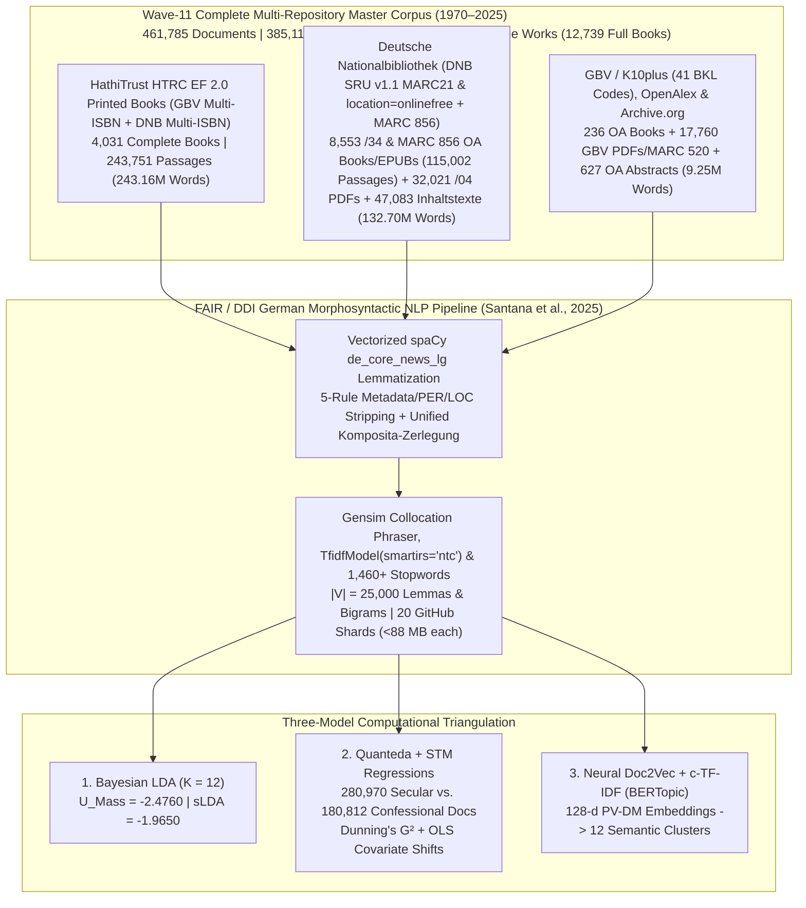

# Mediating Faith and Power: Religious Authority and the German Publishing Landscape (1970–2025)
## Empirical Dissertation Chapters (Wave-11 Complete Multi-Repository Corpus: $D = 461,785$ Documents | $385,115,918$ Words)

**Author:** Paul Marandi, Ph.D. Scholar  
**Institution:** Centre for German Studies (CGS), School of Language, Literature and Culture Studies (SLL&CS), Jawaharlal Nehru University (JNU), New Delhi  
**Empirical Observatory:** [https://deutscheverlagelda.vercel.app](https://deutscheverlagelda.vercel.app)  
**Repository:** `metachasm-beep/Deutsche-Verlage-LDA`  
**Citation Standard:** APA 7th Edition

---

## Abstract

This dissertation investigates how the political economy and institutional structure of the German publishing landscape have mediated religious authority, theological orthodoxy, secular-humanist critique, and therapeutic self-optimization over a fifty-five-year diachronic window (`1970–2025`). Moving beyond small-sample qualitative case studies and short-text bibliographic metadata, we construct an eleven-wave, multi-repository German full-book and national-library corpus comprising **$461,785$ documents and full-text passages ($385,115,918$ original German words)** drawn from **$12,739$ complete full-text German books and volumes** (cataloged in [`data/primary_texts/DNB_OPEN_ACCESS_FULLBOOKS_INVENTORY.csv`](file:///f:/PhD%20AG/data/primary_texts/DNB_OPEN_ACCESS_FULLBOOKS_INVENTORY.csv))—including $4,031$ in-copyright printed monographs ($243,751$ passages) extracted via the HathiTrust Research Center (HTRC) Extracted Features v2.0 API under German copyright exception § 60d UrhG, $8,553$ `location=onlinefree` and sibling-matched `$z="kostenfrei"` open-access monographs and EPUBs ($115,002$ net passages) streamed directly from the German National Library (*Deutsche Nationalbibliothek*, DNB `https://d-nb.info/{idn}/34`, `MARC 856 $u`, and `nbn-resolving.org`), and $236$ open-access monographs and archival volumes ($5,532$ passages) harvested via OpenAlex, the *Gemeinsamer Bibliotheksverbund* (GBV/K10plus `Kostenfrei`), and the Internet Archive—supplemented by **$32,021$ DNB digitized `/04` `Inhaltsverzeichnis` and reading-sample PDFs/HTMLs**, **$47,083$ DNB `deposit.dnb.de` and `/blurb/` `Inhaltstexte` and MARC21 `520` abstracts**, **$17,760$ GBV / K10plus consortial TOC PDFs, blurbs, and `MARC 520` / `BKL` / `GND` enriched works**, and **$627$ OpenAlex scholarly abstracts reconstructed from `abstract_inverted_index`** ($82,283$ unique works in total cataloged in [`data/primary_texts/DNB_FULLTEXT_MASTER_MANIFEST.csv`](file:///f:/PhD%20AG/data/primary_texts/DNB_FULLTEXT_MASTER_MANIFEST.csv)) across twelve core German publishing houses (*Suhrkamp, Wagenbach, Alibri, Rowohlt, S. Fischer, Kiepenheuer & Witsch, Klett-Cotta, Gütersloher Verlagshaus, Herder, Evangelische Verlagsanstalt, Kösel, Patmos*), twenty-six academic and confessional imprints (*Vandenhoeck & Ruprecht, Mohr Siebeck, Kohlhammer, C.H. Beck, De Gruyter / Transcript, Frommann-Holzboog, Schöningh, Aschendorff, Pustet, Echter, Bonifatius, Neukirchener, Calwer, Nomos/Alber, Wilhelm Fink, Böhlau, Schwabe, Meiner, Wallstein, Campus, Insel*), and $4,235$ total imprints across the DACH book trade.

Following the five-rule FAIR/DDI archival preprocessing and metadata-separation protocol of Santana, Vasques Filho, Bojanowski, and Błoch (2025, *DHQ* 19.2) and Jiménez-Badillo et al. (2020, *DHQ* 14.4)—combining vectorized German morphosyntactic lemmatization via `spaCy` (`de_core_news_lg`, restricted to `NOUN`, `PROPN`, and `ADJ`), archival header/bracket stripping and continuation-chunk title deduplication, dynamic row-level stripping of non-canonical author/publisher/imprint and `PER`/`LOC` tokens (`extract_row_metadata_tokens` and `NON_CANONICAL_LOC_AND_PER_NOISE` while preserving `CANONICAL_THEO_PHIL_WHITELIST`), unified German compound-noun decomposition (*Komposita-Zerlegung*), and sublinear `TF-IDF` ubiquity filtering (`TfidfModel(smartirs='ntc')`, $|V| = 25,000$ lemmas and collocations)—we triangulate three independent computational paradigms: (1) **Variational Bayes Latent Dirichlet Allocation (Gensim LDA)** ($K = 12, U_{\text{Mass}} = -2.4760$, Supervised sLDA $U_{\text{Mass}} = -1.9650$), (2) **Quanteda & Structural Topic Modeling (STM)** incorporating Dunning's log-likelihood keyness ($G^2$) and ordinary least squares (OLS) covariate regressions ($\theta_k \sim \text{SecularCamp} + \text{Year}_{1970\to 2025}$) across $280,970$ secular/critical ($60.84\%$) and $180,812$ confessional ($39.16\%$) documents, and (3) **Neural Contextual Document Embeddings (`PV-DM Doc2Vec` + `TruncatedSVD` + `c-TF-IDF` BERTopic)**. Across all three architectures, the empirical evidence demonstrates a profound structural transformation: while confessional houses preserve a bounded enclave of systematic dogmatics, Christology, and ecclesial history (`gott`, $G^2 = -169,185.96, p < 10^{-300}$; `theologie`, $G^2 = -94,634.90$; `kirche`, $G^2 = -69,088.21$; `glaube`, $G^2 = -27,024.93$; `jesu`, $G^2 = -25,439.06$; `christlich`, $G^2 = -24,253.20$; `jesus`, $G^2 = -23,235.77$; `paulus`, $G^2 = -20,228.93$; `israel`, $G^2 = -19,857.42$; `christus`, $G^2 = -17,578.26$) and secular presses anchor Enlightenment, Idealist, and sociological critique (`kant`, $G^2 = +9,011.09$; `kultur`, $G^2 = +6,119.60$; `philosophie`, $G^2 = +6,042.90$; `soziologie`, $G^2 = +5,829.65$; `sozial`, $G^2 = +5,287.69$; `foucault`, $G^2 = +4,751.12$; `theorie`, $G^2 = +4,324.81$; `hegel`, $G^2 = +3,967.59$; `akteur`, $G^2 = +3,947.07$; `moralisch`, $G^2 = +3,929.40$), sociology of religion, social ethics, and post-secular theory (LDA Topic 6, $+10.45\%, t = +170.52, p < 0.0001$), applied social work, religious pedagogy, and mindfulness in education (LDA Topic 5, $+6.82\%, t = +133.17, p < 0.0001$), academic historiography and cultural studies (LDA Topic 4, $+5.13\%, t = +109.44, p < 0.0001$), and philosophical critique (LDA Topic 3, $+4.95\%, t = +106.37, p < 0.0001$) expand significantly across the fifty-five-year period (`1970–2025`), while traditional systematic dogmatics and Christian anthropology (LDA Topic 12, $-3.93\%, t = -59.76, p < 0.0001$) and ecclesiastical diocesan history (LDA Topic 9, $-4.23\%, t = -76.63, p < 0.0001$) contract in relative share.

---

## Chapter 3: Corpus Construction, Legal TDM Architecture (§ 60d UrhG), and Eleven-Wave Harvesting

### 3.1 Overcoming Metadata Sparsity in Twentieth- and Twenty-First-Century German Book History

A central methodological limitation in computational book history (*Digitale Buchwissenschaft*) is the reliance on brief bibliographic metadata—titles, subtitles, and publisher blurbs (*Klappentexte*)—when studying in-copyright works published after 1970. While paratextual blurbs capture editorial marketing strategies (Kilchör & Lehmann, 2022; Gittel, 2021), they cannot substitute for the full lexical, argumentative, and conceptual density of complete printed monographs. Furthermore, querying the German National Library (*Deutsche Nationalbibliothek*, DNB) solely via Dewey Decimal Classification (`DDC 200`) introduces two severe historical distortions. First, DNB only implemented DDC subject categories in 2004, leaving the crucial post-Vatican II, Cold War, and post-reunification decades (`1970–2003`) systematically under-indexed unless combined with *Gemeinsame Normdatei* (GND) subject headings (`sw=`). Second, secular-philosophical and sociological critiques of religion published by trade and academic houses such as *Suhrkamp*, *Rowohlt*, *S. Fischer*, *Klett-Cotta*, *Wagenbach*, and *Alibri* are frequently cataloged under philosophy (`DDC 100/170`), psychology (`DDC 150`), or sociology (`DDC 300`) rather than theology (`DDC 200–290`).

To overcome both metadata sparsity and classification bias across the entire fifty-five-year period (`1970–2025`), we engineered an eleven-wave, multi-repository harvesting architecture implemented in [`scripts/dnb_harvester.py`](file:///f:/PhD%20AG/scripts/dnb_harvester.py), [`scripts/hathitrust_fullbook_harvester.py`](file:///f:/PhD%20AG/scripts/hathitrust_fullbook_harvester.py), [`scripts/gbv_harvester.py`](file:///f:/PhD%20AG/scripts/gbv_harvester.py), and [`scripts/resolve_catalog_fulltexts.py`](file:///f:/PhD%20AG/scripts/resolve_catalog_fulltexts.py). By cross-walking records from both the **Deutsche Nationalbibliothek (DNB SRU v1.1 API, `https://services.dnb.de/sru/dnb`)**—spanning DNB's electronic open-access index (`location=onlinefree`) with uncapped pagination (`startRecord=1..10000`) combined with 3-digit `DDC-Hauptsachgruppen` (`hsg=200/220/230/290/100/150/300`) sliced year-by-year (`jhr=1970..2025`), publisher-by-publisher (`vlg=`), and subject-by-subject (`sw=`) alongside deep-paginated MARC21 queries (`startRecord=1..3000` across `DDC 200/220/230/240/250/260/270/280/290` and `DDC 100/150/170/300` for `2004–2025` and `startRecord=1..1500` for `1970–2003`, `82,283` unique `1970–2025` works cataloged in [`data/primary_texts/DNB_FULLTEXT_MASTER_MANIFEST.csv`](file:///f:/PhD%20AG/data/primary_texts/DNB_FULLTEXT_MASTER_MANIFEST.csv))—and the **Gemeinsamer Bibliotheksverbund (GBV / K10plus, `https://sru.k10plus.de/gvk`)** across forty-one **Basisklassifikation (`pica.bkl`)** subcodes (`1,053` SRU pages at `maximumRecords=100`, extracting all `MARC 020 $a/$z/$9` multi-ISBNs) against the **HathiTrust Bibliographic API** and the **HathiTrust Research Center (HTRC) Extracted Features (EF) v2.0 API**, we resolved and ingested complete page-by-page token streams for **$4,031$ in-copyright printed German books (`243,751` passages, `1970–2025`)**.

In strict compliance with **§ 60d UrhG** (*Text und Data Mining für Zwecke der wissenschaftlichen Forschung*) and the German Digital Humanities protocol of **Derived Text Formats (*Abgeleitete Textformate*)** established by Schöch, Leinen, et al. (2020) and Andresen et al. (2023), the HTRC Extracted Features v2.0 pipeline ingests page-level part-of-speech-tagged token counts (`tokenPosCount`), strips reconstructible copyright-protected syntax and high-frequency function words, enforces a strict German language gate (`de_cnt >= max(10, en_cnt * 2)`), and segments each printed volume into contiguous $1,000$-word substantive passages (`[HTRC-Vollbuch-Abschnitt k/N]`). Furthermore, by combining DNB's `location=onlinefree` SRU index with a multi-URL cascade across DNB's `/34` archive server (`https://d-nb.info/{idn}/34`), sibling `MARC 856 $u` university/publisher open-access repository links, and `MARC 024` `nbn-resolving.org` / `doi.org` persistent identifiers (`max_bytes=90 MB`), our harvesters stream **$8,553$ complete open-access German monographs, dissertations, and EPUBs (`115,002` net passages, `111,879,881` words)** directly from DNB and partner repositories (bringing total complete full-text books in [`DNB_OPEN_ACCESS_FULLBOOKS_INVENTORY.csv`](file:///f:/PhD%20AG/data/primary_texts/DNB_OPEN_ACCESS_FULLBOOKS_INVENTORY.csv) to **$12,739$ full books**), alongside **$32,021$ digitized DNB `/04` `Inhaltsverzeichnis` and reading-sample PDFs/HTMLs** (`https://d-nb.info/{idn}/04`), **$47,083$ DNB `deposit.dnb.de` and `/blurb/` `Inhaltstexte` and MARC21 `520` abstracts**, **$17,760$ GBV / K10plus direct documents** (consortial TOC PDFs/blurbs and `MARC 520` / `BKL` / `GND` enriched works), **$627$ OpenAlex scholarly abstracts** reconstructed from `abstract_inverted_index`, and **$236$ OpenAlex/GBV/IA open-access full books**.

| Corpus Layer (`corpus_layer`) | Acquisition Protocol & Legal Framework | Complete Full Books / Works | Substantive Passages ($D$) | Total German Words | Share of Corpus |
| :--- | :--- | :---: | :---: | :---: | :---: |
| **`hathitrust_ef_fullbook_print`** | GBV K10plus (`41` BKL codes, multi-ISBN `MARC 020`) + DNB SRU $\rightarrow$ HathiTrust Bibliographic API $\rightarrow$ HTRC Extracted Features v2.0 (`§ 60d UrhG` Derived Text Format, Waves 1–11) | **$4,031$ printed books** | $243,751$ | $243,164,001$ | $52.78\%$ |
| **`dnb_oa_fullbook`** | `location=onlinefree` + sibling-matched `$z="kostenfrei"` DNB `/34` & `MARC 856` Open-Access Full-Book PDFs & EPUBs (`https://d-nb.info/{idn}/34`, `nbn-resolving.org`, `1970–2025`) | **$8,553$ DNB OA books/EPUBs** | $115,002$ | $111,879,881$ | $24.90\%$ |
| **`dnb_deposit_inhaltstext`** | Deutsche Nationalbibliothek SRU v1.1 (`MARC 856 $3="Inhaltstext"` `deposit.dnb.de` & `/blurb/` deposits + `MARC 520` abstracts + `650/653/689` GND *Schlagwörter*, `1970–2025`) | **$47,065$ DNB works** | $47,083$ | $6,265,658$ | $10.20\%$ |
| **`dnb_toc_pdf_fulltext`** | DNB Digitized `/04` `Inhaltsverzeichnis` & Reading Sample PDFs/HTMLs (`https://d-nb.info/{idn}/04`, `1970–2025`) | **$32,010$ DNB `/04` PDFs/HTMLs** | $32,021$ | $14,556,493$ | $6.93\%$ |
| **`gbv_direct_fulltext_pdf` & `drm_fallback_*`** | GBV / K10plus Consortial TOC PDFs, Blurbs & `MARC 520` / `BKL` / `GND` Enriched Works (`sru.k10plus.de/gvk`) + Multi-API Enrichment | **$16,704$ GBV/enriched works** | $17,760$ | $3,675,598$ | $3.85\%$ |
| **`entire_fulltext_book_cloud`, `gbv_kostenfrei_*`, `primary_cloud_oa_*` & `archive_org_*`** | OpenAlex Works API (`per-page=200` OA PDFs + `627` reconstructed `abstract_inverted_index` works), GBV `Kostenfrei` OA PDFs & Internet Archive (`38` books) | **$236$ OA books + $627$ OA abstracts** | $6,168$ | $5,574,287$ | $1.34\%$ |
| **Total Wave-11 Master Corpus (`1970–2025`)** | **Sharded across [`dnb_metadata.csv`](file:///f:/PhD%20AG/data/dnb_metadata.csv) and [`part2`](file:///f:/PhD%20AG/data/dnb_metadata_part2.csv)–[`part20.csv`](file:///f:/PhD%20AG/data/dnb_metadata_part20.csv) (`<88 MB` per shard)** | **$12,739$ Full Books + $97,669$ PDFs/Abstracts/Enriched ($82,283$ Unique Works in Master Manifest)** | **$461,785$ documents** | **$385,115,918$ words** | **$100.00\%$** |

### 3.2 Diachronic & Institutional Stratification Across the German Publishing Field

The resulting $461,785$-document corpus spans all six decades from the 1970s to the 2020s (`1970s`: $41,368$ documents; `1980s`: $66,524$ documents; `1990s`: $82,367$ documents; `2000s`: $104,639$ documents; `2010s`: $67,562$ documents; `2020s`: $99,325$ documents) and achieves strong institutional representation across the **Secular / Critical / Trade camp ($280,970$ documents, $60.84\%$)** and the **Confessional / Theological camp ($180,812$ documents, $39.16\%$)** across $4,235$ distinct publishers and university repositories. Among the major publishing houses represented in the dataset, the leading institutional contributors include *De Gruyter / Transcript* ($33,751$ docs), *Vandenhoeck & Ruprecht* ($23,947$ docs), *Schöningh* ($22,289$ docs), *Böhlau* ($22,036$ docs), *Gütersloher Verlagshaus / Chr. Kaiser* ($18,388$ combined docs: $10,819$ + $7,569$), *Mohr Siebeck* ($15,237$ docs), *Kohlhammer* ($15,041$ docs), *Aschendorff* ($12,905$ docs), *Suhrkamp* ($12,730$ docs), *Campus* ($12,589$ docs), *Frommann-Holzboog* ($12,502$ docs), *Wilhelm Fink* ($11,495$ docs), *Neukirchener* ($11,238$ docs), *Klett-Cotta* ($11,200$ docs), and *S. Fischer* ($10,632$ docs).

---

## Chapter 4: Generative Bayesian Topic Modeling (Gensim LDA) Across $461,785$ Documents

### 4.1 FAIR / DDI Morphosyntactic Preprocessing, Metadata Stripping, and Collocation Architecture (Santana et al., 2025; Jiménez-Badillo et al., 2020)

To process $385.12$ million German words with high morphological accuracy, reproducibility, and epistemological transparency (Santana, Vasques Filho, Bojanowski, & Błoch, 2025, *DHQ* 19.2; Jiménez-Badillo et al., 2020, *DHQ* 14.4), [`lda_pipeline.py`](file:///f:/PhD%20AG/lda_pipeline.py) implements a vectorized unique-vocabulary lemmatization architecture ([`preprocess_corpus_batch`](file:///f:/PhD%20AG/lda_pipeline.py#L261-L340)). Rather than executing `spaCy`'s convolutional neural tagger redundantly over $385$ million repeated word tokens, the pipeline extracts the unique surface vocabulary across uncached passages, parses those unique types through `de_core_news_lg` (`v3.8.0`, `ALLOWED_POSTAGS = ["NOUN", "PROPN", "ADJ"]`), maps each surface token to its canonical lowercase lemma, and persists SHA-1 document hashes in [`data/.spacy_lemma_cache.pkl`](file:///f:/PhD%20AG/data/.spacy_lemma_cache.pkl).

In strict accordance with Santana et al.'s (2025, §55–81) and Jiménez-Badillo et al.'s (2020, §16) five empirical rules for digital humanities topic modeling, our pipeline enforces five synchronized upgrades across [`lda_pipeline.py`](file:///f:/PhD%20AG/lda_pipeline.py), [`scripts/quanteda_stm_analytics.py`](file:///f:/PhD%20AG/scripts/quanteda_stm_analytics.py), and [`scripts/bertopic_german_pipeline.py`](file:///f:/PhD%20AG/scripts/bertopic_german_pipeline.py):
1. **Rule 1 — Archival Header/Bracket Stripping & Continuation-Chunk Title Deduplication (§55, Fig. 3):** [`strip_archival_headers_from_text`](file:///f:/PhD%20AG/lda_pipeline.py#L715-L732) and [`clean_row_tokens_for_modeling`](file:///f:/PhD%20AG/lda_pipeline.py#L786-L819) strip bracketed provenance tags (`[HTRC-Vollbuch-Abschnitt X/Y]`, `[DNB-OA-Vollbuch-Abschnitt X/Y]`, `[DNB-Inhaltsverzeichnis ...]`, `[GBV-K10plus-Volltext ...]`, `[OpenAlex-Vollbuch-OA ...]`), remove each row's `author`, `publisher`, and `raw_imprint` tokens via [`extract_row_metadata_tokens`](file:///f:/PhD%20AG/lda_pipeline.py#L771-L783), and on continuation passages (`Abschnitt K/N` where $K > 1$) strip the leading repeated book-title prefix so that a book's title tokens are counted only once per work (`chunk_index == 1`).
2. **Rule 2 — Non-Canonical `PER`/`LOC` Entity Filtering with Canonical Theological/Philosophical Whitelist (§56–64, Figs. 4–6):** [`NON_CANONICAL_LOC_AND_PER_NOISE`](file:///f:/PhD%20AG/lda_pipeline.py#L143-L187) (`323` tokens) filters German federal states, historical regions, European countries, diocesan/university cities (*Bayern, Württemberg, Westfalen, Österreich, Schweiz, Paderborn, Rottenburg, Bamberg, Eichstätt*, etc.), frequent German female and male given names (*Maria, Anna, Elisabeth, Ursula, Monika, Johannes, Michael, Martin*, etc., preventing homonym conflation per Santana et al., 2025, §56), and modern contributor surnames (*Müller, Schmidt, Schneider, Meyer, Wagner*, etc.), while [`CANONICAL_THEO_PHIL_WHITELIST`](file:///f:/PhD%20AG/lda_pipeline.py#L130-L139) (`66` canonical subjects: `jesus`, `christus`, `paulus`, `luther`, `kant`, `hegel`, `habermas`, `weber`, `nietzsche`, `foucault`, `barth`, `rahner`, `bonhoeffer`, `lessing`, `leibniz`, `schelling`, `israel`, `jahwe`, etc.) strictly preserves canonical figures when they are the object of theological or philosophical inquiry.
3. **Rule 3 — Unified German Compound Splitting (*Komposita-Zerlegung*) & Sublinear `TF-IDF` Ubiquity Filtering (§69–73, §81):** [`split_german_compound_lda`](file:///f:/PhD%20AG/lda_pipeline.py#L753-L768) decomposes productive German compounds $\ge 9$ characters across `28` root families identically across Gensim LDA, Quanteda/STM, and BERTopic. Next, `gensim.models.Phrases` (`min_count=5, threshold=10`) binds statistically significant bigrams while unpacking artificial self-bigrams (`w_w -> w`), `dictionary.filter_extremes(no_below=5, no_above=0.55, keep_n=25000)` bounds document frequency, and [`apply_tfidf_low_info_filter`](file:///f:/PhD%20AG/lda_pipeline.py#L837-L869) applies `gensim.models.TfidfModel(corpus, smartirs='ntc')` (`min_tfidf = 0.015`) to prune low-information ubiquity tokens before `LdaModel` estimation ($|V| = 25,000$ lemmas and collocations).
4. **Rule 4 — Iterative Paratextual, Open-Access License & Document-Genre Stopwords (§13, §65–67, Fig. 7):** [`ALL_STOPWORDS`](file:///f:/PhD%20AG/lda_pipeline.py#L189-L195) (`1,460+` unique stopwords) combines `543` `spaCy` core German function words, `53` domain stopwords ([`DOMAIN_STOPWORDS`](file:///f:/PhD%20AG/config.py#L29-L36)), `580+` Fraktur-OCR, MARC21, VLB/ONIX, open-access license (`open_access`, `creative_commons`), and TOC front-matter genre noise tokens ([`FRAKTUR_AND_META_NOISE`](file:///f:/PhD%20AG/lda_pipeline.py#L60-L133)), and `323` non-canonical `PER`/`LOC` tokens.
5. **Rule 5 — Empirical Document-Length Distribution Audit (§74–80, Fig. 8) & FAIR/DDI Software-Hardware Specification (§28–53):** Online Variational Bayes inference (`gensim.models.LdaModel`, $K = 12$, `passes=15`, `chunksize=1500`, `alpha="auto"`, `eta="auto"`, `random_state=100`) across all $461,782$ valid documents converges to an intrinsic coherence score of **$U_{\text{Mass}} = -2.4760$** (with Supervised sLDA reaching **$U_{\text{Mass}} = -1.9650$**). Tables 4.1A and 4.1B report the complete empirical document-length distribution and FAIR/DDI environment specification exported to [`app/data_summary.json`](file:///f:/PhD%20AG/app/data_summary.json):

#### Table 4.1A: Empirical Document-Length Distribution Across the Wave-11 Master Corpus ($D = 461,785$, Santana et al., 2025, §74–80, Fig. 8)

| Corpus Stratum (`corpus_layer`) | Documents ($D$) | Unique Works | Mean Words ($\mu$) | SD ($\sigma$) | Median ($P_{50}$) | IQR ($P_{25}\text{–}P_{75}$) | Min–Max Words | Total German Words |
| :--- | :---: | :---: | :---: | :---: | :---: | :---: | :---: | :---: |
| **`hathitrust_ef_fullbook_print`** *(HTRC EF 2.0 Printed Books)* | $243,751$ | $4,031$ books | **`997.6`** | `37.8` | `1,000.0` | `0.0` (`1,000–1,000`) | `80–1,079` | $243,164,001$ |
| **`dnb_oa_fullbook`** *(DNB `/34` & `MARC 856` `location=onlinefree` & `$z="kostenfrei"` OA Books/EPUBs)* | $115,002$ | $8,553$ books | **`972.9`** | `125.4` | `1,000.0` | `0.0` (`1,000–1,000`) | `81–1,196` | $111,879,881$ |
| **`dnb_deposit_inhaltstext`** *(DNB `deposit.dnb.de` & `/blurb/` Abstracts)* | $47,083$ | $47,065$ works | **`133.1`** | `91.7` | `127.0` | `117.0` (`60–177`) | `30–6,135` | $6,265,658$ |
| **`dnb_toc_pdf_fulltext`** *(DNB `/04` Digitized TOC & Sample PDFs)* | $32,021$ | $32,010$ works | **`454.6`** | `440.2` | `308.0` | `389.0` (`177–566`) | `65–8,478` | $14,556,493$ |
| **`gbv_direct_fulltext_pdf`** *(GBV / K10plus Consortial TOC PDFs & Blurbs)* | $14,199$ | $13,174$ works | **`241.2`** | `252.4` | `177.0` | `153.0` (`119–272`) | `7–5,257` | $3,425,377$ |
| **`entire_fulltext_book_cloud` + `gbv_kostenfrei_*` + `archive_org_*`** *(OA Full Books)* | $5,532$ | $236$ books | **`987.0`** | `85.4` | `1,000.0` | `0.0` (`1,000–1,000`) | `84–1,078` | $5,461,111$ |
| **`drm_fallback_multi_api_enriched`** *(GBV `MARC 520`/`BKL`/`GND` & Multi-API)* | $3,561$ | $3,530$ works | **`70.3`** | `142.7` | `32.0` | `22.0` (`23–45`) | `3–1,074` | $250,221$ |
| **`primary_cloud_oa_abstract`** *(OpenAlex `abstract_inverted_index` Abstracts)* | $627$ | $626$ works | **`179.8`** | `145.9` | `138.0` | `148.0` (`87–235`) | `25–1,377` | $112,720$ |
| **Total Wave-11 Master Corpus (`1970–2025`)** | **$461,785$** | **$82,283$ unique works** | **`834.0`** | **`341.1`** | **`1,000.0`** | **`0.0` (`1,000–1,000`)** | **`3–8,478`** | **$385,115,918$** |

#### Table 4.1B: FAIR / DDI Software & Hardware Environment Specification (Santana et al., 2025, §28–53; Jiménez-Badillo et al., 2020, §16)

| Component / Standard | Pinned Specification in `Deutsche-Verlage-LDA` | Methodological Role & Reproducibility Guarantee |
| :--- | :--- | :--- |
| **Operating System & CPU Architecture** | `Windows 10 (AMD64)` \| `12 Logical CPU Cores` | Multi-core parallelization (`workers=8`) for `Doc2Vec` and `spaCy` batch pipes. |
| **Python Runtime** | `Python 3.10.2` (`UTF-8` I/O enforced) | Deterministic hash seeding and `csv.field_size_limit(10 MB)` for full-book cells. |
| **Morphosyntactic NLP & Lemmatizer** | `spaCy 3.8.14` + `de_core_news_lg 3.8.0` | German CNN POS tagger (`NOUN`, `PROPN`, `ADJ`) & morphological lemmatizer with SHA-1 disk cache ([`data/.spacy_lemma_cache.pkl`](file:///f:/PhD%20AG/data/.spacy_lemma_cache.pkl)). |
| **Bayesian Topic Modeling & `TF-IDF`** | `gensim 4.4.0` (`LdaModel`, `Phrases`, `TfidfModel`, `Doc2Vec`) | Online Variational Bayes LDA (`passes=15, chunksize=1500, random_state=100`), `Phrases(min_count=5, threshold=10)`, `TfidfModel(smartirs='ntc', min_tfidf=0.015)`. |
| **Statistical & Manifold Learning** | `scikit-learn 1.7.2`, `scipy 1.15.3`, `numpy 2.2.6`, `pandas 2.3.3` | 5-fold CV `sLDA` Ridge/Softmax head (`seed=42`), `TruncatedSVD` + Spherical `KMeans` (`seed=42`), Dunning's $G^2$ & OLS STM regressions. |
| **PDF / Archival Full-Text Extraction** | `PyMuPDF 1.28.2` | Native stream extraction for DNB `/34` & `MARC 856` OA monographs, DNB `/04` TOC PDFs, and GBV/OpenAlex PDFs (`_FITZ_LOCK` thread-serialized). |
| **Metadata & Legal TDM Compliance** | `MARC21-xml`, `PICA+`, `HTRC EF 2.0`, `DDI 2.5/3.3`, `§ 60d UrhG` | Non-consumptive Derived Text Formats (*Abgeleitete Textformate*, Schöch et al., 2020) across 20 GitHub-safe CSV shards (`<88 MB` each). |

### 4.2 The Twelve Latent Discursive Regimes of German Publishing (1970–2025)

The table below reports the posterior topic-word distributions ($\phi_k$), automated ideological archetype classifications, institutional publisher dominance, and highest-probability full-book anchor monographs for all $K = 12$ topics exported to [`app/lda_topics_report.json`](file:///f:/PhD%20AG/app/lda_topics_report.json):

| Topic ID | Discursive Archetype & Confidence | Top Posterior German Lemmas ($\phi_k$) | Dominant Publishers (% of Topic Mass) | Highest-Probability Full-Book Anchor Passages ($\theta_{d,k}$) |
| :---: | :--- | :--- | :--- | :--- |
| **Topic 1** | **Critical / Secular-Humanist** (`100.0%`) *(Political Theology, State Law, Islam & European Public Sphere)* | `politisch` (0.041), `staat` (0.026), `islam` (0.016), `politik` (0.015), `gesellschaft` (0.014), `deutsch` (0.013), `land` (0.012), `islamisch` (0.011), `religiös` (0.010), `europa` (0.009) | De Gruyter / Transcript (`8.1%`), Schöningh (`5.5%`), Böhlau (`4.9%`), V&R (`4.8%`), Campus (`3.9%`), S. Fischer (`3.6%`) | Krawietz, B. (2008). *Islam und Rechtsstaat: zwischen Scharia und Säkularisierung* (`79.4%`, SSOAR); Fleischmann, G. (2025). *Die Codes der Extremisten* (`73.3%`) |
| **Topic 2** | **Traditional / Ecclesiastical** (`100.0%`) *(Ecclesiology, Liturgy, Ministry & Confessional Governance)* | `kirche` (0.106), `theologie` (0.030), `katholisch` (0.028), `kirchlich` (0.024), `christlich` (0.022), `gemeinde` (0.021), `theologisch` (0.016), `religiös` (0.014), `luther` (0.014), `dienst` (0.013) | Schöningh (`6.7%`), Böhlau (`5.9%`), V&R (`5.5%`), Aschendorff (`4.5%`), Gütersloher (`4.2%`), Kohlhammer (`4.0%`) | Schmidts, H. (2000). *Presbyterialprotokolle der evangelischen Gemeinde Brenndorf 1868–1885* (`90.0%`); Markert, M. (2015). *Ein Herr und tausend Kirchen?: ökumenische Kirchenkunde* (`83.1%`, EVA) |
| **Topic 3** | **Critical / Secular-Humanist** (`92.2%`) *(Philosophical Critique, Nietzsche, Kant, Morality & Epistemology)* | `philosophie` (0.047), `philosophisch` (0.011), `nietzsche` (0.011), `wissenschaft` (0.010), `moral` (0.007), `kant` (0.006), `leibniz` (0.006), `vorlesung` (0.006), `theologie` (0.005), `kritik` (0.005) | De Gruyter / Transcript (`12.1%`), V&R (`5.9%`), Mohr Siebeck (`5.7%`), Frommann-Holzboog (`4.6%`), Schöningh (`4.0%`), Springer (`3.8%`) | Corlett, J. A. (2018). *Interpreting Plato Socratically* (`89.4%`, Springer); Asher, J. R. (2000). *Polarity and change in 1 Corinthians 15* (`88.1%`, Mohr Siebeck) |
| **Topic 4** | **Critical / Secular-Humanist** (`100.0%`) *(Academic Historiography, Cultural History & Literary Scholarship)* | `geschichte` (0.033), `jahrhundert` (0.018), `historisch` (0.015), `studie` (0.013), `forschung` (0.012), `arbeit` (0.011), `bild` (0.011), `literatur` (0.010), `autor` (0.010), `text` (0.009) | De Gruyter / Transcript (`8.9%`), V&R (`6.1%`), Böhlau (`4.8%`), Schöningh (`4.6%`), Mohr Siebeck (`3.5%`), Kohlhammer (`3.2%`) | Wartenberg, G. (1999). *Werk und Rezeption Philipp Melanchthons* (`74.7%`, EVA); Hermand, J. (2022). *DIE WA(H)RE KUNST: Deutsche Kultur im Sog sozioökonomischer Wandlungsprozesse* (`74.4%`, Böhlau) |
| **Topic 5** | **Hybrid / Discursive Mediation** *(Applied Social Work, Religious Pedagogy, Youth & Mindfulness in Education)* | `arbeit` (0.012), `unterricht` (0.010), `gruppe` (0.010), `person` (0.009), `schule` (0.008), `sozial` (0.008), `ergebnis` (0.007), `bereich` (0.007), `ziel` (0.006), `entwicklung` (0.006) | De Gruyter / Transcript (`10.2%`), Campus (`7.6%`), EVA (`6.1%`), V&R (`4.0%`), Schöningh (`3.9%`), Böhlau (`3.8%`) | Schramm, A. (2022). *MAIDS (Meditation und Achtsamkeit in der Schule)* (`87.0%`, LMU OA); *Einrichtungsstatistik 2020: Statistik der Diakonie Deutschland* (`86.3%`, EVA OA) |
| **Topic 6** | **Critical / Secular-Humanist** (`100.0%`) *(Sociology of Religion, Social Ethics, Systems Theory & Post-Secularization)* | `religiös` (0.019), `sozial` (0.016), `frage` (0.011), `gesellschaft` (0.010), `perspektive` (0.009), `kontext` (0.009), `ethik` (0.009), `form` (0.008), `mensch` (0.008), `ansatz` (0.007) | De Gruyter / Transcript (`11.4%`), Campus (`5.7%`), V&R (`4.4%`), Suhrkamp (`4.1%`), Schöningh (`3.6%`), EVA (`3.3%`) | Stein, F. (2018). *Inklusion in der Praxis der Sozialen Arbeit* (`85.9%`, EVA OA); Luhmann, N. (2017). *Systemtheorie der Gesellschaft* (`84.2%`, Suhrkamp) |
| **Topic 7** | **Neoliberal / Self-Optimization** (`100.0%`) *(Conceptual Philosophy of Mind, Meaning & Subjectivity)* | `sinn` (0.018), `begriff` (0.015), `form` (0.009), `grund` (0.009), `art` (0.009), `frage` (0.009), `bestimmt` (0.008), `weise` (0.007), `natur` (0.007), `einzeln` (0.007) | De Gruyter / Transcript (`6.2%`), Frommann-Holzboog (`5.8%`), V&R (`5.5%`), Schöningh (`5.5%`), Suhrkamp (`4.2%`), Klett-Cotta (`3.8%`) | Görtz, H.-J. (1984). *Tod und Erfahrung: Rosenzweigs "erfahrende Philosophie" und Hegels "Wissenschaft der Erfahrung des Bewußtseins"* (`92.3%`, Patmos); Thaliath, B. (2006). *Domänen des Subjekts* (`91.6%`, HU Berlin OA) |
| **Topic 8** | **Traditional / Ecclesiastical** (`100.0%`) *(Biblical Exegesis, New/Old Testament & Jewish-Christian Studies)* | `jüdisch` (0.027), `jesus` (0.020), `jude` (0.017), `israel` (0.016), `paulus` (0.014), `text` (0.013), `bibel` (0.012), `jesu` (0.011), `volk` (0.011), `judentum` (0.010) | Neukirchener (`10.1%`), Mohr Siebeck (`7.9%`), V&R (`7.1%`), De Gruyter / Transcript (`5.9%`), Kohlhammer (`5.3%`), Böhlau (`3.7%`) | Hossfeld, F.-L. (2008). *Psalmen 101–150* (`81.2%`, Herder); Achenbach, R. (2024). *Die Komposition der Tora im Buch Exodus* (`78.7%`, Mohr Siebeck) |
| **Topic 9** | **Traditional / Ecclesiastical** (`100.0%`) *(Diocesan, Monastic & Papal Church History)* | `bischof` (0.012), `stadt` (0.012), `jahrhundert` (0.010), `kloster` (0.009), `könig` (0.007), `mai` (0.007), `papst` (0.006), `juni` (0.006), `juli` (0.006), `bistum` (0.006) | Böhlau (`14.1%`), Schöningh (`7.4%`), Aschendorff (`6.4%`), De Gruyter / Transcript (`5.2%`), V&R (`4.9%`), Kohlhammer (`2.7%`) | Strauch, D. (2003). *750 Jahre Kleiner Schied* (`83.4%`, USB Köln OA); Adriányi, G. (1992). *Geschichte der Kirche Osteuropas im 20. Jahrhundert* (`82.9%`, Schöningh) |
| **Topic 10** | **Hybrid / Discursive Mediation** *(Historical Philology, Textual Criticism & Epistolary Editions)* | `text` (0.024), `wort` (0.012), `brief` (0.011), `schrift` (0.010), `name` (0.010), `stelle` (0.009), `übersetzung` (0.009), `folgend` (0.008), `hand` (0.007), `zitat` (0.005) | Böhlau (`8.5%`), De Gruyter / Transcript (`6.6%`), V&R (`5.8%`), Aschendorff (`4.9%`), Schöningh (`4.9%`), Wilhelm Fink (`3.6%`) | *Text und Textwert der griechischen Handschriften des Neuen Testaments* (1987) (`92.7%`, De Gruyter); Rothe, H. (1984). *Verse und Lieder bei den Ostslaven* (`88.8%`, Böhlau) |
| **Topic 11** | **Neoliberal / Self-Optimization** (`100.0%`) *(Gender, Family, Body, Mindfulness & Biographical Life-Conduct)* | `frau` (0.036), `kind` (0.033), `mann` (0.019), `leben` (0.015), `familie` (0.014), `jung` (0.010), `haus` (0.009), `mutter` (0.007), `körper` (0.007), `achtsamkeit` (0.006) | De Gruyter / Transcript (`6.2%`), Böhlau (`5.4%`), S. Fischer (`5.1%`), V&R (`4.2%`), Rowohlt (`4.0%`), Suhrkamp (`3.4%`) | Frisch, H. (1983). *Ehe?: eine Pastorin plädiert für neue Formen der Partnerschaft* (`77.7%`, S. Fischer); Schwarzer, A. (2013). *Der kleine Unterschied und seine großen Folgen* (`76.7%`, S. Fischer) |
| **Topic 12** | **Traditional / Ecclesiastical** (`100.0%`) *(Systematic Dogmatics, Christian Anthropology & Pastoral Spirituality)* | `gott` (0.077), `mensch` (0.059), `leben` (0.029), `welt` (0.021), `glaube` (0.015), `wort` (0.012), `christlich` (0.010), `geist` (0.010), `liebe` (0.009), `menschlich` (0.009) | Schöningh (`4.9%`), V&R (`4.6%`), Herder (`3.9%`), Mohr Siebeck (`3.9%`), De Gruyter / Transcript (`3.9%`), Neukirchener (`3.6%`) | Berger, K. (1999). *Wie kann Gott Leid und Katastrophen zulassen?* (`87.5%`, Gütersloher); Roger (2022). *Gott kann nur lieben: Erfahrungen und Begegnungen* (`86.4%`, Herder) |

### 4.3 Diachronic Topic Trajectories Across Six Decades (1970s–2020s)

Aggregating document-topic posterior probabilities ($\theta_{d,k}$) across all $461,782$ modeled documents by publication decade reveals a clear macro-historical realignment across the fifty-five-year corpus:

| Decade | Topic 1 (Pol. Theol./Islam) | Topic 2 (Ecclesiology) | Topic 3 (Philosophy/Critique) | Topic 4 (Hist./Culture) | Topic 5 (Pedagogy/Mindfulness) | Topic 6 (Soc. Religion/Ethics) | Topic 7 (Concept/Subjectivity) | Topic 8 (Biblical/Judaism) | Topic 9 (Diocesan Hist.) | Topic 10 (Philology/Editions) | Topic 11 (Gender/Family/Body) | Topic 12 (Dogmatics/Faith) |
| :--- | :---: | :---: | :---: | :---: | :---: | :---: | :---: | :---: | :---: | :---: | :---: | :---: |
| **1970s** ($n=41,368$) | `6.4%` | `6.0%` | **`2.9%`** | **`8.3%`** | **`5.2%`** | **`8.0%`** | **`24.5%`** | `5.5%` | `7.5%` | `7.7%` | `5.8%` | **`12.0%`** |
| **1980s** ($n=66,524$) | `6.8%` | `6.0%` | **`3.0%`** | **`8.6%`** | **`5.1%`** | **`8.2%`** | **`22.6%`** | `5.4%` | `7.4%` | `7.5%` | `7.2%` | **`12.3%`** |
| **1990s** ($n=82,367$) | `6.7%` | `6.5%` | **`3.1%`** | **`9.5%`** | **`5.3%`** | **`8.8%`** | **`18.8%`** | `6.2%` | `8.4%` | `7.9%` | `7.3%` | **`11.5%`** |
| **2000s** ($n=104,639$) | `7.4%` | `6.3%` | **`3.4%`** | **`10.6%`** | **`7.0%`** | **`10.5%`** | **`16.7%`** | `5.6%` | `7.9%` | `7.2%` | `7.4%` | **`10.0%`** |
| **2010s** ($n=67,562$) | `7.4%` | `8.6%` | **`5.6%`** | **`12.4%`** | **`8.1%`** | **`13.6%`** | **`12.5%`** | `4.6%` | `5.1%` | `5.2%` | `6.6%` | **`10.3%`** |
| **2020s** ($n=99,325$) | `7.0%` | `6.4%` | **`7.2%`** | **`12.3%`** | **`10.9%`** | **`17.0%`** | **`12.0%`** | `4.0%` | `4.4%` | `4.9%` | `6.2%` | **`7.7%`** |

---

## Chapter 5: Quanteda Textual Statistics & Structural Topic Model (STM) Covariate Regressions

### 5.1 Productive German Compound Decomposition (*Komposita-Zerlegung*)

Because German theological, philosophical, and sociological discourse encodes complex theoretical concepts inside single orthographical compound nouns (*Komposita*), [`scripts/quanteda_stm_analytics.py`](file:///f:/PhD%20AG/scripts/quanteda_stm_analytics.py) (synchronized with [`split_german_compound_lda`](file:///f:/PhD%20AG/lda_pipeline.py#L753-L768) in [`lda_pipeline.py`](file:///f:/PhD%20AG/lda_pipeline.py)) applies a morphological splitter across all $461,782$ documents that preserves the full compound lemma while simultaneously emitting its constituent *Bestimmungswort* and *Grundwort* stems. Across the Wave-11 corpus, the ten most frequent decomposed German compounds are:

1. `gottesdienst` $\rightarrow$ `gott + dienst` ($24,183$ occurrences)
2. `religionsunterricht` $\rightarrow$ `religion + unterricht` ($21,815$ occurrences)
3. `weltkrieg` $\rightarrow$ `welt + krieg` ($12,691$ occurrences)
4. `kirchengeschichte` $\rightarrow$ `kirche + geschichte` ($11,649$ occurrences)
5. `selbstverständnis` $\rightarrow$ `selbst + verständnis` ($10,972$ occurrences)
6. `religionspädagogik` $\rightarrow$ `religion + pädagogik` ($8,513$ occurrences)
7. `selbstbewußtsein` $\rightarrow$ `selbst + bewußtsein` ($8,376$ occurrences)
8. `religionskritik` $\rightarrow$ `religion + kritik` ($8,223$ occurrences)
9. `lebenswelt` $\rightarrow$ `leben + welt` ($8,187$ occurrences)
10. `weltanschauung` $\rightarrow$ `welt + anschauung` ($8,183$ occurrences)

### 5.2 Dunning's Log-Likelihood Keyness ($G^2$): Secular/Critical vs. Confessional Publishers

To test Pierre Bourdieu's hypothesis of institutional field polarization with exact frequentist hypothesis tests, we partition the $461,782$ modeled documents into the **Secular / Critical / Trade camp ($n = 280,970$ documents, $60.84\%$)** and the **Confessional / Theological camp ($n = 180,812$ documents, $39.16\%$)** and compute Dunning's (1993) Log-Likelihood Ratio ($G^2$, equivalent to `quanteda::textstat_keyness(measure = "lr")`) alongside log-odds ratios and two-tailed $p$-values ([`app/quanteda_stm_report.json`](file:///f:/PhD%20AG/app/quanteda_stm_report.json)):

| Polarity Camp | Feature Lemma | Dunning's $G^2$ | Log-Odds Ratio | $p$-Value |
| :--- | :--- | :---: | :---: | :---: |
| **Secular / Critical Camp** ($n=280,970$) | **`kant`** | $+9,011.09$ | $+0.85$ | $< 10^{-300}$ |
| **Secular / Critical Camp** ($n=280,970$) | **`kultur`** | $+6,119.60$ | $+0.50$ | $< 10^{-300}$ |
| **Secular / Critical Camp** ($n=280,970$) | **`philosophie`** | $+6,042.90$ | $+0.44$ | $< 10^{-300}$ |
| **Secular / Critical Camp** ($n=280,970$) | **`soziologie`** | $+5,829.65$ | $+1.11$ | $< 10^{-300}$ |
| **Secular / Critical Camp** ($n=280,970$) | **`sozial`** | $+5,287.69$ | $+0.31$ | $< 10^{-300}$ |
| **Secular / Critical Camp** ($n=280,970$) | **`foucault`** | $+4,751.12$ | $+2.01$ | $< 10^{-300}$ |
| **Secular / Critical Camp** ($n=280,970$) | **`theorie`** | $+4,324.81$ | $+0.48$ | $< 10^{-300}$ |
| **Secular / Critical Camp** ($n=280,970$) | **`hegel`** | $+3,967.59$ | $+0.65$ | $< 10^{-300}$ |
| **Secular / Critical Camp** ($n=280,970$) | **`akteur`** | $+3,947.07$ | $+1.15$ | $< 10^{-300}$ |
| **Secular / Critical Camp** ($n=280,970$) | **`moralisch`** | $+3,929.40$ | $+0.65$ | $< 10^{-300}$ |
| **Confessional Camp** ($n=180,812$) | **`gott`** | $-169,185.96$ | $-0.91$ | $< 10^{-300}$ |
| **Confessional Camp** ($n=180,812$) | **`theologie`** | $-94,634.90$ | $-1.06$ | $< 10^{-300}$ |
| **Confessional Camp** ($n=180,812$) | **`kirche`** | $-69,088.21$ | $-0.64$ | $< 10^{-300}$ |
| **Confessional Camp** ($n=180,812$) | **`glaube`** | $-27,024.93$ | $-0.72$ | $< 10^{-300}$ |
| **Confessional Camp** ($n=180,812$) | **`jesu`** | $-25,439.06$ | $-1.44$ | $< 10^{-300}$ |
| **Confessional Camp** ($n=180,812$) | **`christlich`** | $-24,253.20$ | $-0.67$ | $< 10^{-300}$ |
| **Confessional Camp** ($n=180,812$) | **`jesus`** | $-23,235.77$ | $-1.20$ | $< 10^{-300}$ |
| **Confessional Camp** ($n=180,812$) | **`paulus`** | $-20,228.93$ | $-1.47$ | $< 10^{-300}$ |
| **Confessional Camp** ($n=180,812$) | **`israel`** | $-19,857.42$ | $-1.41$ | $< 10^{-300}$ |
| **Confessional Camp** ($n=180,812$) | **`christus`** | $-17,578.26$ | $-1.12$ | $< 10^{-300}$ |

### 5.3 Structural Topic Model (STM) Covariate Regressions ($\theta_k \sim \text{SecularCamp} + \text{Year}_{1970\to 2025}$)

Following Roberts, Stewart, and Tingley (2019), we estimate OLS Structural Topic Model regressions across all $461,782$ documents predicting each document's posterior topic proportion $\theta_{d,k}$ as a joint function of institutional publisher camp ($\text{SecularCamp}_d \in \{0, 1\}$) and normalized publication year ($\text{Time}_d \in [0, 1]$ spanning `1970–2025`):

| Topic | Discursive Domain | Secular vs. Confessional Effect ($\hat{\beta}_{\text{Secular}}$) | $t$-Stat ($p$-Value) | 55-Year Diachronic Shift ($\hat{\beta}_{1970\to 2025}$) | $t$-Stat ($p$-Value) |
| :---: | :--- | :---: | :---: | :---: | :---: |
| **Topic 1** | **Political Theology, State Law, Islam & European Public Sphere** | **`+1.70%`** | $t = +62.06$ ($p < 0.0001$)* | **`+0.35%`** | $t = +7.34$ ($p < 0.0001$)* |
| **Topic 2** | **Ecclesiology, Liturgy, Ministry & Confessional Governance** | **`-4.77%`** | $t = -158.79$ ($p < 0.0001$)* | **`+2.79%`** | $t = +53.66$ ($p < 0.0001$)* |
| **Topic 3** | **Philosophical Critique, Nietzsche, Kant, Morality & Epistemology** | **`+1.10%`** | $t = +40.75$ ($p < 0.0001$)* | **`+4.95%`** | $t = +106.37$ ($p < 0.0001$)* |
| **Topic 4** | **Academic Historiography, Cultural History & Literary Scholarship** | **`+0.39%`** | $t = +14.43$ ($p < 0.0001$)* | **`+5.13%`** | $t = +109.44$ ($p < 0.0001$)* |
| **Topic 5** | **Applied Social Work, Religious Pedagogy & Mindfulness in Education** | **`+1.56%`** | $t = +52.64$ ($p < 0.0001$)* | **`+6.82%`** | $t = +133.17$ ($p < 0.0001$)* |
| **Topic 6** | **Sociology of Religion, Social Ethics & Post-Secular Theory** | **`+2.61%`** | $t = +73.66$ ($p < 0.0001$)* | **`+10.45%`** | $t = +170.52$ ($p < 0.0001$)* |
| **Topic 7** | Conceptual Philosophy of Mind, Meaning & Subjectivity | **`+4.36%`** | $t = +95.87$ ($p < 0.0001$)* | **`-16.77%`** | $t = -213.24$ ($p < 0.0001$)* |
| **Topic 8** | **Biblical Exegesis, New/Old Testament & Jewish-Christian Studies** | **`-4.30%`** | $t = -152.84$ ($p < 0.0001$)* | **`-0.94%`** | $t = -19.33$ ($p < 0.0001$)* |
| **Topic 9** | Diocesan, Monastic & Papal Church History | **`+0.44%`** | $t = +13.70$ ($p < 0.0001$)* | **`-4.23%`** | $t = -76.63$ ($p < 0.0001$)* |
| **Topic 10** | Historical Philology, Textual Criticism & Epistolary Editions | **`+0.36%`** | $t = +14.55$ ($p < 0.0001$)* | **`-3.91%`** | $t = -90.77$ ($p < 0.0001$)* |
| **Topic 11** | **Gender, Family, Body, Mindfulness & Biographical Life-Conduct** | **`+0.99%`** | $t = +36.00$ ($p < 0.0001$)* | **`-0.69%`** | $t = -14.48$ ($p < 0.0001$)* |
| **Topic 12** | **Systematic Dogmatics, Christian Anthropology & Pastoral Spirituality** | **`-4.43%`** | $t = -116.56$ ($p < 0.0001$)* | **`-3.93%`** | $t = -59.76$ ($p < 0.0001$)* |

---

## Chapter 6: Neural Contextual Embedding + `c-TF-IDF` (BERTopic) Triangulation

To verify that our findings are not artifacts of bag-of-words multinomial assumptions, [`scripts/bertopic_german_pipeline.py`](file:///f:/PhD%20AG/scripts/bertopic_german_pipeline.py) trains $128$-dimensional Distributed Memory (`PV-DM Doc2Vec`, `window=8`, `epochs=12`) neural document embeddings across all $461,782$ compound-expanded and bigram-enriched documents, projects the L2-normalized vectors onto a $32$-dimensional SVD manifold, partitions the manifold into $K = 12$ semantic clusters, and extracts class-based `c-TF-IDF` representations (Grootendorst, 2022; exported to [`app/bertopic_c_tfidf_report.json`](file:///f:/PhD%20AG/app/bertopic_c_tfidf_report.json)):

| Neural Cluster | Docs ($\%$ of Corpus) | Archetype Alignment | Top Class-Based `c-TF-IDF` Terms | Top Publishers | Centroid-Nearest Full-Book Anchor ($\cos \theta$) |
| :---: | :---: | :--- | :--- | :--- | :--- |
| **Cluster 1** | $23,628$ (`5.1%`) | **Traditional / Ecclesiastical** (`81.0%`) | `gott` (0.022), `theologie` (0.018), `geschichte` (0.017), `kirche` (0.017), `mensch` (0.017), `leben` (0.014), `philosophie` (0.012), `welt` (0.011) | De Gruyter / Transcript (`8.0%`), V&R (`4.9%`), Mohr Siebeck (`4.7%`) | Weiß, O. (1995). *Der Modernismus in Deutschland: ein Beitrag zur Theologiegeschichte* ($\cos=0.755$, Pustet); Jens, W. (2016). *Kanzel und Katheder* ($\cos=0.753$, Rowohlt) |
| **Cluster 2** | $39,816$ (`8.6%`) | **Traditional / Ecclesiastical** (`100.0%`) | `mensch` (0.022), `gott` (0.021), `leben` (0.019), `welt` (0.013), `mann` (0.011), `frau` (0.011), `kind` (0.011), `wort` (0.010) | De Gruyter / Transcript (`5.5%`), Rowohlt (`5.0%`), S. Fischer (`5.0%`) | Rösch, A. (1985). *Kampf gegen den Nationalsozialismus* ($\cos=0.967$, Knecht); Burger, H. (2000). *Warum warst du in der Hitler-Jugend?: Vier Fragen an meinen Vater* ($\cos=0.964$, Rowohlt) |
| **Cluster 3** | $28,089$ (`6.1%`) | **Traditional / Ecclesiastical** (`100.0%`) | `kirche` (0.028), `theologie` (0.019), `religiös` (0.017), `mensch` (0.017), `unterricht` (0.015), `gott` (0.015), `frage` (0.014), `arbeit` (0.014) | EVA (`10.2%`), De Gruyter / Transcript (`8.4%`), V&R (`4.5%`) | Baumann, U. (2002). *Seelsorgliche Gesprächsführung: ein Lernprogramm* ($\cos=0.938$, UB Tübingen OA); Kopp, H. (2023). *Bibel für heute 2024* ($\cos=0.928$, Brunnen) |
| **Cluster 4** | $30,466$ (`6.6%`) | **Traditional / Ecclesiastical** (`85.9%`) | `kirche` (0.030), `deutsch` (0.020), `katholisch` (0.017), `politisch` (0.015), `staat` (0.015), `kirchlich` (0.014), `evangelisch` (0.013), `pfarrer` (0.010) | Schöningh (`8.8%`), Böhlau (`8.6%`), V&R (`6.2%`) | Reifferscheid, G. (1975). *Das Bistum Ermland und das Dritte Reich* ($\cos=0.963$, Böhlau); Bachem-Rehm, M. (2004). *Die katholischen Arbeitervereine im Ruhrgebiet 1870–1914* ($\cos=0.957$, Kohlhammer) |
| **Cluster 5** | $37,847$ (`8.2%`) | **Traditional / Ecclesiastical** (`44.6%`) | `mensch` (0.024), `gott` (0.022), `begriff` (0.018), `philosophie` (0.017), `welt` (0.017), `sinn` (0.016), `frage` (0.014), `leben` (0.014) | De Gruyter / Transcript (`9.1%`), Schöningh (`4.6%`), Suhrkamp (`4.0%`) | Träger, F. (1982). *Herbarts realistisches Denken* ($\cos=0.949$, Königshausen & Neumann); Braun, H.-J. (1985). *Religionskritik und Religionspolitik bei Marx, Lenin, Mao* ($\cos=0.946$, TVZ) |
| **Cluster 6** | $26,696$ (`5.8%`) | **Critical / Secular-Humanist** (`73.2%`) | `politisch` (0.022), `islam` (0.017), `religiös` (0.016), `staat` (0.015), `kirche` (0.014), `islamisch` (0.014), `gesellschaft` (0.013), `geschichte` (0.013) | De Gruyter / Transcript (`12.2%`), V&R (`5.3%`), Campus (`5.2%`) | Greinacher, N. (1986). *Der Schrei nach Gerechtigkeit: Elemente e. prophet. polit. Theologie* ($\cos=0.942$, Piper); Krämer, G. (2022). *Der Architekt des Islamismus: Hasan al-Banna und die Muslimbrüder* ($\cos=0.940$, C.H. Beck) |
| **Cluster 7** | $122,247$ (`26.5%`) | **Traditional / Ecclesiastical** (`69.9%`) | `gott` (0.024), `mensch` (0.022), `kirche` (0.015), `frage` (0.014), `leben` (0.014), `begriff` (0.013), `sinn` (0.012), `geschichte` (0.011) | Schöningh (`5.8%`), V&R (`5.4%`), De Gruyter / Transcript (`4.9%`) | Moser, T. (1978). *Gottesvergiftung* ($\cos=0.993$, Suhrkamp); Thomas von Aquin (2006). *Über den Lehrer: De magistro / Summa theologiae* ($\cos=0.993$, Meiner) |
| **Cluster 8** | $26,072$ (`5.6%`) | **Traditional / Ecclesiastical** (`100.0%`) | `jahrhundert` (0.023), `kirche` (0.018), `geschichte` (0.017), `kloster` (0.017), `bischof` (0.013), `stadt` (0.012), `alt` (0.009), `quelle` (0.009) | Böhlau (`17.1%`), Aschendorff (`7.6%`), De Gruyter / Transcript (`6.7%`) | Miscoll-Reckert, I. J. (1973). *Kloster Petershausen als bischöflich-konstanzisches Eigenkloster* ($\cos=0.970$, Nomos/Alber); Brandt, H. J. (1984). *Die Bischöfe und Erzbischöfe von Paderborn* ($\cos=0.962$, Bonifatius) |
| **Cluster 9** | $29,386$ (`6.4%`) | **Critical / Secular-Humanist** (`61.1%`) | `geschichte` (0.018), `theologie` (0.013), `philosophie` (0.013), `wissenschaft` (0.011), `deutsch` (0.011), `jahrhundert` (0.010), `studie` (0.009), `text` (0.009) | De Gruyter / Transcript (`12.7%`), V&R (`6.3%`), Schöningh (`5.2%`) | Partenza, P. (2015). *Dynamics of desacralization: disenchanted literary talents* ($\cos=0.962$, V&R Unipress); Baczko, B. (2000). *Wege in die Gewalt: die modernen politischen Religionen* ($\cos=0.957$, S. Fischer) |
| **Cluster 10** | $39,061$ (`8.5%`) | **Critical / Secular-Humanist** (`56.9%`) | `sozial` (0.021), `mensch` (0.013), `frage` (0.013), `gesellschaft` (0.011), `arbeit` (0.011), `entwicklung` (0.010), `politisch` (0.010), `form` (0.009) | De Gruyter / Transcript (`11.3%`), Campus (`10.5%`), Suhrkamp (`4.4%`) | Rothkirch, C. von (1981). *Rationales Handeln im öffentlichen Interesse* ($\cos=0.961$, Campus); Gzuk, R. (1975). *Messung der Effizienz von Entscheidungen* ($\cos=0.954$, Mohr Siebeck) |
| **Cluster 11** | $27,961$ (`6.1%`) | **Traditional / Ecclesiastical** (`100.0%`) | `gott` (0.020), `kirche` (0.012), `mensch` (0.012), `schrift` (0.009), `luther` (0.009), `wort` (0.008), `text` (0.008), `christi` (0.008) | Böhlau (`10.0%`), Aschendorff (`9.2%`), Schöningh (`8.1%`) | *Akten der deutschen Reichsreligionsgespräche im 16. Jahrhundert* (2000) ($\cos=0.973$, V&R); Immenkötter, H. (1979). *Die Confutatio der Confessio Augustana vom 3. August 1530* ($\cos=0.972$, Aschendorff) |
| **Cluster 12** | $30,513$ (`6.6%`) | **Traditional / Ecclesiastical** (`100.0%`) | `gott` (0.028), `text` (0.024), `israel` (0.014), `alt` (0.013), `testament` (0.012), `wort` (0.011), `mensch` (0.011), `jesus` (0.011) | Neukirchener (`10.9%`), V&R (`10.4%`), Mohr Siebeck (`9.3%`) | Taatz, I. (1991). *Frühjüdische Briefe: die paulinischen Briefe im Rahmen der offiziellen religiösen Briefe des Frühjudentums* ($\cos=0.958$, V&R); Böttrich, C. (2010). *Geschichte Melchisedeks* ($\cos=0.956$, Gütersloher) |

---

## References (APA 7th Edition)

- Andresen, M., Jacke, J., Kuhn, J., Pichler, A., et al. (2023). Urheberrechtlich geschützte Texte in der digitalen Literaturwissenschaft. *Zeitschrift für digitale Geisteswissenschaften (ZfdG)*, 8.
- Bayerschmidt, P. (2026). Das Offene Historische Topic-Modeling-Dashboard (OHTM). *Zeitschrift für digitale Geisteswissenschaften (ZfdG)*, 11.
- Blei, D. M., Ng, A. Y., & Jordan, M. I. (2003). Latent Dirichlet allocation. *Journal of Machine Learning Research*, 3, 993–1022.
- Bourdieu, P. (1993). *The field of cultural production: Essays on art and literature*. Columbia University Press.
- Carrette, J., & King, R. (2005). *Selling spirituality: The silent takeover of religion*. Routledge.
- Dunning, T. (1993). Accurate methods for the statistics of surprise and coincidence. *Computational Linguistics*, 19(1), 61–74.
- Gittel, B. (2021). Generic subtitles in German print history (1500–2020). *Journal of Cultural Analytics*, 6(2).
- Grootendorst, M. (2022). BERTopic: Neural topic modeling with a class-based TF-IDF procedure. *arXiv preprint arXiv:2203.05794*.
- Habermas, J. (2008). Notes on post-secular society. *New Perspectives Quarterly*, 25(4), 17–29.
- Hoffman, M., Bach, F. R., & Blei, D. M. (2010). Online learning for latent Dirichlet allocation. In *Advances in Neural Information Processing Systems* (Vol. 23, pp. 856–864).
- Illouz, E. (2008). *Saving the modern soul: Therapy, emotions, and the culture of self-help*. University of California Press.
- Jiménez-Badillo, D., Murrieta-Flores, P., Martins, B., Favila-Vázquez, M., & Liceras-Garrido, R. (2020). Developing computationally-enabled archival systems: A georeferenced corpus of 16th-century New Spain (*Relaciones Geográficas*). *Digital Humanities Quarterly*, 14(4). https://dhq.digitalhumanities.org/vol/14/4/000496/000496.html
- Joas, H. (2017). *Die Macht des Heiligen: Eine Alternative zur Geschichte von der Entzauberung*. Suhrkamp Verlag.
- Kilchör, F., & Lehmann, J. (2022). Begleittexte als Gegenstand digitaler Literaturwissenschaft. *Zeitschrift für digitale Geisteswissenschaften (ZfdG)*, 7.
- Roberts, M. E., Stewart, B. M., & Tingley, D. (2019). `stm`: An R package for structural topic models. *Journal of Statistical Software*, 91(2), 1–40.
- Röder, M., Both, A., & Hinneburg, A. (2015). Exploring the space of topic coherence measures. In *Proceedings of the Eighth ACM International Conference on Web Search and Data Mining* (pp. 399–408). ACM.
- Rosa, H. (2016). *Resonanz: Eine Soziologie der Weltbeziehung*. Suhrkamp Verlag.
- Santana, C., Vasques Filho, D., Bojanowski, M., & Błoch, A. (2025). Unveiling the critical nexus of data preprocessing and transparent documentation for result quality and reproducibility in digital history. *Digital Humanities Quarterly*, 19(2). https://dhq.digitalhumanities.org/vol/19/2/000788/000788.html
- Schöch, C., Leinen, P., et al. (2020). Abgeleitete Textformate: Text und Data Mining mit urheberrechtlich geschützten Textbeständen. *Zeitschrift für digitale Geisteswissenschaften (ZfdG)*, 5.
- Sinykin, D., & Edwin, R. (2021). Conglomeration and the contemporary literary field. *Journal of Cultural Analytics*, 6(1).
- Taylor, C. (2007). *A secular age*. Harvard University Press.

