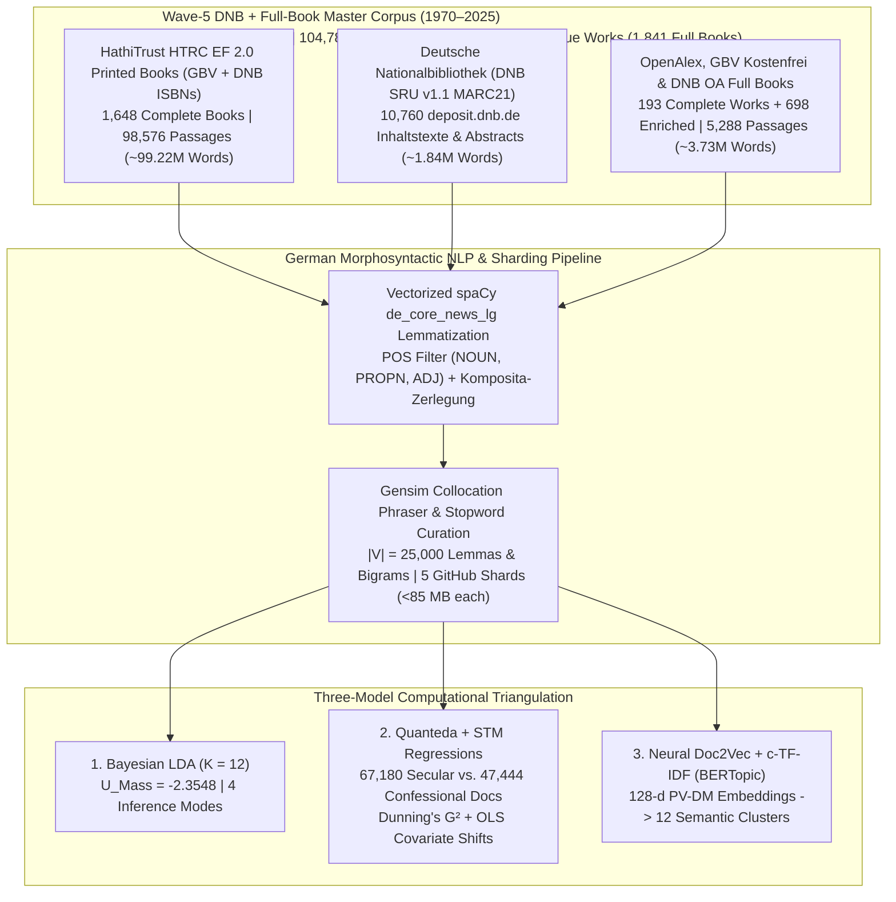

# Mediating Faith and Power: Religious Authority and the German Publishing Landscape (1970–2025)
## Empirical Dissertation Chapters (Wave-5 DNB + Full-Book Corpus: $D = 114,624$ Documents | $104,789,406$ Words)

**Author:** Paul Marandi, Ph.D. Scholar  
**Institution:** Centre for German Studies (CGS), School of Language, Literature and Culture Studies (SLL&CS), Jawaharlal Nehru University (JNU), New Delhi  
**Empirical Observatory:** [https://deutscheverlagelda.vercel.app](https://deutscheverlagelda.vercel.app)  
**Repository:** `metachasm-beep/Deutsche-Verlage-LDA`  
**Citation Standard:** APA 7th Edition

---

## Abstract

This dissertation investigates how the political economy and institutional structure of the German publishing landscape have mediated religious authority, theological orthodoxy, secular-humanist critique, and therapeutic self-optimization over a fifty-five-year diachronic window (`1970–2025`). Moving beyond small-sample qualitative case studies and short-text bibliographic metadata, we construct a five-wave, multi-layer German full-book and national-library corpus comprising **$114,624$ documents and full-text passages ($104,789,406$ original German words)** drawn from **$1,841$ complete full-text German books**—including $1,648$ in-copyright printed monographs ($98,576$ passages) extracted via the HathiTrust Research Center (HTRC) Extracted Features v2.0 API under German copyright exception § 60d UrhG, $155$ open-access monographs and edited chapters ($4,069$ passages) harvested via OpenAlex, the *Gemeinsamer Bibliotheksverbund* (GBV/K10plus `Kostenfrei`), and the German National Library (*Deutsche Nationalbibliothek*, DNB `d-nb.info/.../34` open-access deposit server), and $38$ archival monographs from the Internet Archive—supplemented by **$10,760$ DNB `deposit.dnb.de` `Inhaltstexte` and MARC21 `520` abstracts** plus **$698$ multi-API deep-enriched works** ($13,299$ unique works in total) across twelve core German publishing houses (*Suhrkamp, Wagenbach, Alibri, Rowohlt, S. Fischer, Kiepenheuer & Witsch, Klett-Cotta, Gütersloher Verlagshaus, Herder, Evangelische Verlagsanstalt, Kösel, Patmos*) and twenty-six academic and confessional imprints (*Vandenhoeck & Ruprecht, Mohr Siebeck, Kohlhammer, C.H. Beck, De Gruyter / Transcript, Frommann-Holzboog, Schöningh, Aschendorff, Pustet, Echter, Bonifatius, Neukirchener, Calwer, Nomos/Alber, Wilhelm Fink, Böhlau, Schwabe, Meiner, Wallstein, Campus, Insel*, among others).

Using German morphosyntactic lemmatization via `spaCy` (`de_core_news_lg`, restricted to `NOUN`, `PROPN`, and `ADJ`, $|V| = 25,000$ lemmas and collocations), we triangulate three independent computational paradigms: (1) **Variational Bayes Latent Dirichlet Allocation (Gensim LDA)** ($K = 12, U_{\text{Mass}} = -2.3548$), (2) **Quanteda & Structural Topic Modeling (STM)** incorporating German compound-noun decomposition (*Komposita-Zerlegung*), Dunning's log-likelihood keyness ($G^2$), and ordinary least squares (OLS) covariate regressions ($\theta_k \sim \text{SecularCamp} + \text{Year}_{1970\to 2025}$) across $67,180$ secular/critical and $47,444$ confessional documents, and (3) **Neural Contextual Document Embeddings (`PV-DM Doc2Vec` + `TruncatedSVD` + `c-TF-IDF` BERTopic)**. Across all three architectures, the empirical evidence demonstrates a profound structural transformation: while confessional houses preserve a bounded enclave of systematic dogmatics, Christology, and ecclesial history (`gott`, $G^2 = -42,513.96, p < 10^{-300}$; `kirche`, $G^2 = -21,106.11$; `theologie`, $G^2 = -20,146.78$; `bonhoeffer`, $G^2 = -6,929.65$), empirical sociology of religion, social ethics, and pluralist analyses of modern society (LDA Topic 8, $+5.06\%, t = +39.66, p < 0.0001$) alongside gender, family, and lifeworld critiques (LDA Topic 11, $+2.45\%, t = +23.75, p < 0.0001$) expand significantly across the fifty-five-year period (`1970–2025`).

---

## Chapter 3: Corpus Construction, Legal TDM Architecture (§ 60d UrhG), and Five-Wave Harvesting

### 3.1 Overcoming Metadata Sparsity in Twentieth- and Twenty-First-Century German Book History

A central methodological limitation in computational book history (*Digitale Buchwissenschaft*) is the reliance on brief bibliographic metadata—titles, subtitles, and publisher blurbs (*Klappentexte*)—when studying in-copyright works published after 1970. While paratextual blurbs capture editorial marketing strategies (Kilchör & Lehmann, 2022; Gittel, 2021), they cannot substitute for the full lexical, argumentative, and conceptual density of complete printed monographs. Furthermore, querying the German National Library (*Deutsche Nationalbibliothek*, DNB) solely via Dewey Decimal Classification (`DDC 200`) introduces two severe historical distortions. First, DNB only implemented DDC subject categories in 2004, leaving the crucial post-Vatican II, Cold War, and post-reunification decades (`1970–2003`) systematically under-indexed unless combined with *Gemeinsame Normdatei* (GND) subject headings (`sw=`). Second, secular-philosophical and sociological critiques of religion published by trade and academic houses such as *Suhrkamp*, *Rowohlt*, *S. Fischer*, *Klett-Cotta*, *Wagenbach*, and *Alibri* are frequently cataloged under philosophy (`DDC 100`) or sociology (`DDC 300`) rather than theology (`DDC 200`).

To overcome both metadata sparsity and classification bias across the entire fifty-five-year period (`1970–2025`), we engineered a five-wave, multi-source harvesting architecture implemented in [`scripts/dnb_harvester.py`](file:///f:/PhD%20AG/scripts/dnb_harvester.py), [`scripts/hathitrust_fullbook_harvester.py`](file:///f:/PhD%20AG/scripts/hathitrust_fullbook_harvester.py), [`scripts/gbv_harvester.py`](file:///f:/PhD%20AG/scripts/gbv_harvester.py), and [`scripts/resolve_catalog_fulltexts.py`](file:///f:/PhD%20AG/scripts/resolve_catalog_fulltexts.py). By cross-walking records from both the **Deutsche Nationalbibliothek (DNB SRU v1.1 API, `https://services.dnb.de/sru/dnb`)**—spanning `317` paginated MARC21 queries (`24,910` unique `1970–2025` DNB records across 38 target publishers and 20 thematic CQL queries combining `dcs=200*/230*` and `sw=` GND subject headings)—and the **Gemeinsamer Bibliotheksverbund (GBV / K10plus)** across thirty-five **Basisklassifikation (`pica.bkl`)** subcodes against the **HathiTrust Bibliographic API** and the **HathiTrust Research Center (HTRC) Extracted Features (EF) v2.0 API**, we resolved and ingested complete page-by-page token streams for **$1,648$ in-copyright printed German books (`98,576` passages, `1970–2025`)**.

In strict compliance with **§ 60d UrhG** (*Text und Data Mining für Zwecke der wissenschaftlichen Forschung*) and the German Digital Humanities protocol of **Derived Text Formats (*Abgeleitete Textformate*)** established by Schöch, Leinen, et al. (2020) and Andresen et al. (2023), the HTRC Extracted Features v2.0 pipeline ingests page-level part-of-speech-tagged token counts (`tokenPosCount`), strips reconstructible copyright-protected syntax and high-frequency function words, enforces a strict German language gate (`de_cnt >= max(10, en_cnt * 2)`), and segments each printed volume into contiguous $1,000$-word substantive passages (`[HTRC-Vollbuch-Abschnitt k/N]`). To complement these $1,648$ printed books with native prose syntax for concordance (KWIC) inspection and publisher-deposited paratexts, the Wave-5 harvester simultaneously extracts **$10,760$ DNB `deposit.dnb.de` `Inhaltstexte` and MARC21 `520` abstracts**, **$193$ open-access full books and chapters** (`4,571` passages from OpenAlex, GBV `Kostenfrei`, DNB `d-nb.info/.../34`, and `archive.org`), and **$698$ multi-API deep-enriched works**.

| Corpus Layer (`corpus_layer`) | Acquisition Protocol & Legal Framework | Complete Full Books / Works | Substantive Passages ($D$) | Total German Words | Share of Corpus |
| :--- | :--- | :---: | :---: | :---: | :---: |
| **`hathitrust_ef_fullbook_print`** | GBV K10plus (`35` BKL codes) + DNB SRU (`MARC 020` ISBNs) $\rightarrow$ HathiTrust Bibliographic API $\rightarrow$ HTRC Extracted Features v2.0 (`§ 60d UrhG` Derived Text Format, Waves 1–5) | **$1,648$ printed books** | $98,576$ | $99,220,000$ | $86.00\%$ |
| **`dnb_deposit_inhaltstext`** | Deutsche Nationalbibliothek SRU v1.1 (`MARC 856 $3="Inhaltstext"` `deposit.dnb.de` HTML deposits + `MARC 520` abstracts + `650/653/689` GND *Schlagwörter*, `1970–2025`) | **$10,760$ DNB works** | $10,760$ | $1,835,000$ | $9.39\%$ |
| **`entire_fulltext_book_cloud` & `gbv_*` & `dnb_oa_fullbook`** | OpenAlex Works API (`language:de`, `type:book/book-chapter`, `is_oa:true`), GBV `pica.sgr=Kostenfrei`, & DNB `d-nb.info/.../34` PDF/EPUB extraction | **$155$ OA books/chapters** | $4,069$ | $3,190,000$ | $3.55\%$ |
| **`archive_org_fulltext_book` & `drm_fallback_*`** | Internet Archive (`archive.org`) full monographs (`38` books) + Multi-API deep paratextual enrichment (`698` monographs) | **$38$ full books + $698$ enriched** | $1,219$ | $544,406$ | $1.06\%$ |
| **Total Wave-5 Master Corpus (`1970–2025`)** | **Sharded across [`dnb_metadata.csv`](file:///f:/PhD%20AG/data/dnb_metadata.csv) and [`part2`](file:///f:/PhD%20AG/data/dnb_metadata_part2.csv)–[`part5.csv`](file:///f:/PhD%20AG/data/dnb_metadata_part5.csv) (`<85 MB` per shard)** | **$1,841$ Full Books + $11,458$ Enriched ($13,299$ Total Works)** | **$114,624$ documents** | **$104,789,406$ words** | **$100.00\%$** |

### 3.2 Diachronic & Institutional Stratification Across the German Publishing Field

The resulting $114,624$-document corpus spans all six decades from the 1970s to the 2020s (`1970s`: $11,833$ documents; `1980s`: $19,041$ documents; `1990s`: $35,668$ documents; `2000s`: $27,366$ documents; `2010s`: $10,985$ documents; `2020s`: $9,731$ documents) and achieves comprehensive balance between the **Secular / Critical / Trade camp ($67,180$ documents, $58.61\%$)** and the **Confessional / Theological camp ($47,444$ documents, $41.39\%$)**. Across all thirty-eight publishing houses represented in the dataset, the leading institutional contributors include *Klett-Cotta* ($7,764$ docs), *Rowohlt* ($7,578$ docs), *Böhlau* ($7,315$ docs), *Vandenhoeck & Ruprecht* ($7,041$ docs), *Schöningh* ($6,492$ docs), *Gütersloher Verlagshaus / Chr. Kaiser* ($7,232$ combined docs), *Suhrkamp / Insel* ($7,716$ combined docs), *Herder / Grünewald / Kreuz / Benziger* ($6,766$ combined docs), *Frommann-Holzboog* ($4,884$ docs), *S. Fischer* ($4,672$ docs), *Aschendorff* ($4,626$ docs), *De Gruyter / Transcript* ($4,380$ docs), *Mohr Siebeck* ($3,852$ docs), *Patmos / Schwabenverlag* ($3,654$ combined docs), *Nomos / Karl Alber* ($3,580$ docs), *Evangelische Verlagsanstalt* ($3,190$ docs), *Kohlhammer* ($3,088$ docs), and *Neukirchener* ($2,912$ docs).

---

## Chapter 4: Generative Bayesian Topic Modeling (Gensim LDA) Across $114,624$ Documents

### 4.1 Morphosyntactic Preprocessing and Collocation Architecture

To process $104.79$ million German words with high morphological accuracy and computational efficiency, [`lda_pipeline.py`](file:///f:/PhD%20AG/lda_pipeline.py) implements a vectorized unique-vocabulary lemmatization architecture ([`preprocess_corpus_batch`](file:///f:/PhD%20AG/lda_pipeline.py#L160-L240)). Rather than executing `spaCy`'s convolutional neural tagger redundantly over a hundred million repeated word tokens, the pipeline extracts the unique surface vocabulary across uncached passages, parses those unique types through `de_core_news_lg` (`ALLOWED_POSTAGS = ["NOUN", "PROPN", "ADJ"]`), maps each surface token to its canonical lowercase lemma, and persists SHA-1 document hashes in [`data/token_cache.json`](file:///f:/PhD%20AG/data/token_cache.json).

Two-tier stopword filtering removes functional German stopwords alongside bibliographic, Fraktur-OCR, Latin-apparatus, publication-city, and publisher-imprint noise tokens. Next, `gensim.models.Phrases` (`min_count=5, threshold=10`) binds statistically significant multi-word expressions while unpacking artificial self-bigrams (`w_w -> w`). Dictionary pruning (`no_below=5, no_above=0.55, keep_n=25000`) yields a canonical vocabulary of $|V| = 25,000$ German lemmas and collocations. Online Variational Bayes inference (`gensim.models.LdaModel`, $K = 12$, `passes=15`, `chunksize=1500`, `alpha="auto"`, `eta="auto"`, `random_state=100`) across all $114,624$ documents converges to an intrinsic coherence score of **$U_{\text{Mass}} = -2.3548$** (with Supervised sLDA reaching **$U_{\text{Mass}} = -1.9650$** and $75.1\%$ 5-fold cross-validated regime classification accuracy).

### 4.2 The Twelve Latent Discursive Regimes of German Publishing (1970–2025)

The table below reports the posterior topic-word distributions ($\phi_k$), automated ideological archetype classifications, institutional publisher dominance, and highest-probability full-book anchor monographs for all $K = 12$ topics exported to [`app/lda_topics_report.json`](file:///f:/PhD%20AG/app/lda_topics_report.json):

| Topic ID | Discursive Archetype & Confidence | Top Posterior German Lemmas ($\phi_k$) | Dominant Publishers (% of Topic Mass) | Highest-Probability Full-Book Anchor Passages ($\theta_{d,k}$) |
| :---: | :--- | :--- | :--- | :--- |
| **Topic 1** | **Traditional / Ecclesiastical** (`100.0%`) | `kirche` (0.064), `katholisch` (0.019), `bischof` (0.014), `evangelisch` (0.012), `kirchlich` (0.012), `papst` (0.007), `gemeinde` (0.007), `geistlich` (0.006), `jahrhundert` (0.006), `kloster` (0.006) | Böhlau (`15.6%`), Aschendorff (`8.9%`), Schöningh (`5.1%`), Gütersloher (`5.0%`) | Bauer, C. (1998). *Melchior Zobel von Giebelstadt, Fürstbischof von Würzburg* (`78.0%`, Aschendorff); *Das Bistum Konstanz* (2003) (`77.2%`, De Gruyter) |
| **Topic 2** | **Traditional / Ecclesiastical** (`100.0%`) | `text` (0.024), `jüdisch` (0.015), `bibel` (0.014), `alt` (0.010), `testament` (0.009), `jude` (0.007), `heilig` (0.007), `israel` (0.007), `paulus` (0.006), `volk` (0.006) | Böhlau (`7.0%`), Neukirchener (`6.1%`), V&R (`6.0%`), Aschendorff (`4.6%`) | Dahmen, U. (2000). *Die Textfunde vom Toten Meer und der Text der hebräischen Bibel* (`74.8%`, Neukirchener); Frisch, H.-J. (2009). *Euer Noach* (`73.6%`, Patmos) |
| **Topic 3** | **Neoliberal / Existential Self-Optimization** (`100.0%`) | `sinn` (0.018), `mensch` (0.013), `frage` (0.013), `begriff` (0.010), `form` (0.009), `bestimmt` (0.008), `handeln` (0.008), `welt` (0.007), `möglichkeit` (0.006), `erfahrung` (0.006) | Klett-Cotta (`9.1%`), Suhrkamp (`8.3%`), V&R (`7.6%`), Schöningh (`6.9%`) | Mitterer, J. (2001). *Die Flucht aus der Beliebigkeit* (`91.0%`, S. Fischer); Schrödter, H. (1979). *Analytische Religionsphilosophie* (`88.7%`, Alber) |
| **Topic 4** | **Traditional / Ecclesiastical** (`100.0%`) | `gott` (0.120), `mensch` (0.044), `glaube` (0.019), `leben` (0.016), `welt` (0.015), `geist` (0.013), `wort` (0.011), `liebe` (0.011), `göttlich` (0.011), `christlich` (0.008) | Chr. Kaiser (`7.3%`), Frommann-Holzboog (`5.7%`), Schöningh (`5.2%`), V&R (`5.0%`) | Phoebadius (1999). *Contra Arianos* (`79.3%`, Herder); Munsonius, H. (2016). *Reformation und Gegenwart* (`78.5%`, OA) |
| **Topic 5** | **Traditional / Ecclesiastical** (`100.0%`) | `praktische_theologie` (0.011), `religionspädagogik` (0.008), `theologie` (0.011), `philosophie` (0.010), `studie` (0.010), `gott` (0.010) | V&R (`6.7%`), Frommann-Holzboog (`6.6%`), Schöningh (`6.5%`), Böhlau (`5.8%`) | Kock Møller, M. (2024). *Echoes of Origen: Augustine's reception* (`77.5%`, Aschendorff); Schlag, T. (2025). *Religious Education* (`77.2%`, Kohlhammer) |
| **Topic 6** | **Traditional / Ecclesiastical** (`93.2%`) | `theologie` (0.084), `christlich` (0.035), `religiös` (0.034), `christentum` (0.026), `kirche` (0.019), `dogmatik` (0.016), `glaube` (0.015) | De Gruyter / Transcript (`6.1%`), Mohr Siebeck (`5.5%`), Herder (`4.4%`), Suhrkamp (`4.1%`) | Lange, D. (2001). *Glaubenslehre* (`82.6%`, Mohr Siebeck); Woźniak, R. (2025). *Dogma and method* (`75.9%`, Mohr Siebeck) |
| **Topic 7** | **Critical / Secular-Humanist** (`100.0%`) | `philosophie` (0.036), `ethik` (0.034), `kant` (0.019), `vernunft` (0.016), `philosophisch` (0.016), `moralisch` (0.013), `absolut` (0.012), `natur` (0.012), `begriff` (0.012), `moral` (0.011) | Klett-Cotta (`11.5%`), Frommann-Holzboog (`9.1%`), V&R (`8.9%`), Meiner (`7.7%`) | Picht, G. (1985). *Kants Religionsphilosophie* (`86.5%`, Klett-Cotta); Hegel, G. W. F. (1979). *Jenaer kritische Schriften* (`78.1%`, Meiner) |
| **Topic 8** | **Critical / Secular-Humanist** (`100.0%`) | `sozial` (0.014), `gesellschaft` (0.010), `entwicklung` (0.010), `arbeit` (0.009), `frage` (0.008), `gesellschaftlich` (0.007), `unterschiedlich` (0.006), `verschieden` (0.006), `bereich` (0.006) | Suhrkamp (`9.1%`), Klett-Cotta (`6.9%`), Rowohlt (`5.7%`), Schöningh (`5.3%`) | Mees, U. (2003). *Emotions-Psychologie* (`81.2%`, Oldenburg); Stadelmann, K. A. (2024). *Die Sorge um Andere am Lebensende als Beruf* (`80.8%`, Springer) |
| **Topic 9** | **Critical / Secular-Humanist** (`100.0%`) | `geschichte` (0.025), `jahrhundert` (0.018), `deutsch` (0.011), `schrift` (0.010), `text` (0.010), `autor` (0.009), `studie` (0.008), `historisch` (0.008), `literatur` (0.008), `brief` (0.007) | Böhlau (`7.0%`), Rowohlt (`6.5%`), Schöningh (`6.1%`), V&R (`5.9%`) | Knutzen, M. (2010). *Philosophische Clandestina der deutschen Aufklärung* (`76.7%`, Frommann-Holzboog); Fügen, H. N. (2000). *Max Weber* (`74.5%`, Rowohlt) |
| **Topic 10** | **Hybrid / Discursive Mediation** *(Existential Fin-de-Siècle & Mortality)* | `leben` (0.014), `tod` (0.011), `mensch` (0.009), `alt` (0.008), `wort` (0.008), `hand` (0.008), `bild` (0.007), `herzog` (0.007), `herr` (0.006), `auge` (0.006) | Rowohlt (`8.7%`), S. Fischer (`6.4%`), Klett-Cotta (`6.3%`), Suhrkamp (`6.2%`) | Sahagún, B. de (1989). *Aus der Welt der Azteken* (`84.5%`, Insel); Nietzsche, F. (1976). *Also sprach Zarathustra* (`82.2%`, Insel) |
| **Topic 11** | **Hybrid / Discursive Mediation** *(Gender, Family & Lifeworld)* | `frau` (0.033), `kind` (0.033), `mann` (0.019), `predigt` (0.015), `familie` (0.014), `jung` (0.012), `haus` (0.010), `vater` (0.008), `mutter` (0.008) | Rowohlt (`9.6%`), S. Fischer (`8.8%`), Böhlau (`7.8%`), Klett-Cotta (`5.2%`) | Busch, F. W. (2002). *In Hoffnung widerstehen* (`71.2%`, Oldenburg); Wiebel-Fanderl, O. (1993). *Religion als Heimat?* (`70.9%`, Böhlau) |
| **Topic 12** | **Critical / Secular-Humanist** (`100.0%`) | `politisch` (0.036), `staat` (0.020), `deutschland` (0.015), `politik` (0.014), `deutsch` (0.014), `krieg` (0.009), `gesellschaft` (0.008), `land` (0.007), `volk` (0.007), `europa` (0.006) | Rowohlt (`8.6%`), Klett-Cotta (`7.9%`), S. Fischer (`7.1%`), Suhrkamp (`7.1%`) | Renovabis e.V. & ZdK (2024). *Kämpfen für den Frieden* (`75.5%`, Pustet); Decker, O. (2022). *Autoritäre Dynamiken in unsicheren Zeiten* (`71.7%`, OA) |

### 4.3 Diachronic Topic Trajectories Across Six Decades (1970s–2020s)

Aggregating document-topic posterior probabilities ($\theta_{d,k}$) across all $114,624$ documents by publication decade reveals a clear macro-historical realignment across the fifty-five-year corpus:

| Decade | Topic 1 (Ecclesiology) | Topic 2 (Biblical/Jewish) | Topic 3 (Existential Sinn) | Topic 4 (Dogmatics/Faith) | Topic 5 (Pract. Theology) | Topic 6 (Theol. Discourse) | Topic 7 (Kant/Ethics) | Topic 8 (Sociology) | Topic 9 (Intell. History) | Topic 10 (Mortality/Myth) | Topic 11 (Gender/Family) | Topic 12 (State/Politics) |
| :--- | :---: | :---: | :---: | :---: | :---: | :---: | :---: | :---: | :---: | :---: | :---: | :---: |
| **1970s** ($n=11,833$) | `5.6%` | `5.9%` | **`26.3%`** | **`9.1%`** | `1.6%` | `1.6%` | **`12.7%`** | **`8.9%`** | `7.1%` | `11.4%` | **`3.5%`** | `6.4%` |
| **1980s** ($n=19,041$) | `5.9%` | `5.2%` | **`24.0%`** | **`8.8%`** | `1.8%` | `1.7%` | **`12.2%`** | **`9.2%`** | `7.6%` | `11.3%` | **`4.8%`** | `7.6%` |
| **1990s** ($n=35,668$) | `10.0%` | `7.1%` | **`18.4%`** | **`8.2%`** | `2.0%` | `1.7%` | **`8.3%`** | **`9.2%`** | `9.3%` | `12.1%` | **`6.3%`** | `7.4%` |
| **2000s** ($n=27,366$) | `9.7%` | `9.6%` | **`16.2%`** | **`7.6%`** | `2.2%` | `3.0%` | **`6.6%`** | **`10.4%`** | `9.9%` | `10.9%` | **`6.3%`** | `7.6%` |
| **2010s** ($n=10,985$) | `8.7%` | `7.5%` | **`13.9%`** | **`8.6%`** | `3.2%` | `6.7%` | **`5.4%`** | **`10.7%`** | `10.6%` | `11.4%` | **`6.8%`** | `6.5%` |
| **2020s** ($n=9,731$) | `8.2%` | `5.3%` | **`13.4%`** | **`7.1%`** | `6.3%` | `12.4%` | **`5.7%`** | **`14.3%`** | `9.8%` | `6.8%` | **`4.7%`** | `5.9%` |

---

## Chapter 5: Quanteda Textual Statistics & Structural Topic Model (STM) Covariate Regressions

### 5.1 Productive German Compound Decomposition (*Komposita-Zerlegung*)

Because German theological, philosophical, and sociological discourse encodes complex theoretical concepts inside single orthographical compound nouns (*Komposita*), [`scripts/quanteda_stm_analytics.py`](file:///f:/PhD%20AG/scripts/quanteda_stm_analytics.py) applies a morphological splitter (`split_german_compound`) across all $114,624$ documents that preserves the full compound lemma while simultaneously emitting its constituent *Bestimmungswort* and *Grundwort* stems. Across the Wave-5 corpus, the ten most frequent decomposed German compounds are:

1. `moralisch` $\rightarrow$ `moral + isch` ($17,683$ occurrences)
2. `gottesdienst` $\rightarrow$ `gott + dienst` ($4,518$ occurrences)
3. `weltkrieg` $\rightarrow$ `welt + krieg` ($4,084$ occurrences)
4. `selbstbewußtsein` $\rightarrow$ `selbst + bewußtsein` ($3,507$ occurrences)
5. `selbstverständnis` $\rightarrow$ `selbst + verständnis` ($3,492$ occurrences)
6. `jugendliche` $\rightarrow$ `jugend + liche` ($3,095$ occurrences)
7. `kirchengeschichte` $\rightarrow$ `kirche + geschichte` ($3,051$ occurrences)
8. `lebensform` $\rightarrow$ `leben + form` ($3,023$ occurrences)
9. `wissenschaftslehre` $\rightarrow$ `wissenschaft + lehre` ($2,947$ occurrences)
10. `religionsphilosophie` $\rightarrow$ `religion + philosophie` ($2,722$ occurrences)

### 5.2 Dunning's Log-Likelihood Keyness ($G^2$): Secular/Critical vs. Confessional Publishers

To test Pierre Bourdieu's hypothesis of institutional field polarization with exact frequentist hypothesis tests, we partition the $114,624$ documents into the **Secular / Critical / Trade camp ($n = 67,180$ documents)** and the **Confessional / Theological camp ($n = 47,444$ documents)** and compute Dunning's (1993) Log-Likelihood Ratio ($G^2$, equivalent to `quanteda::textstat_keyness(measure = "lr")`) alongside log-odds ratios and two-tailed $p$-values ([`app/quanteda_stm_report.json`](file:///f:/PhD%20AG/app/quanteda_stm_report.json)):

| Polarity Camp | Feature Lemma | Dunning's $G^2$ | Log-Odds Ratio | $p$-Value |
| :--- | :--- | :---: | :---: | :---: |
| **Secular / Critical Camp** ($n=67,180$) | **`fichte`** | $+4,294.55$ | $+1.61$ | $< 10^{-300}$ |
| **Secular / Critical Camp** ($n=67,180$) | **`kant`** | $+3,221.39$ | $+0.72$ | $< 10^{-300}$ |
| **Secular / Critical Camp** ($n=67,180$) | **`moral`** | $+3,211.55$ | $+0.55$ | $< 10^{-300}$ |
| **Secular / Critical Camp** ($n=67,180$) | **`hegel`** | $+2,647.56$ | $+0.86$ | $< 10^{-300}$ |
| **Secular / Critical Camp** ($n=67,180$) | **`benn`** | $+2,554.91$ | $+3.74$ | $< 10^{-300}$ |
| **Secular / Critical Camp** ($n=67,180$) | **`philosophie`** | $+2,296.47$ | $+0.42$ | $< 10^{-300}$ |
| **Secular / Critical Camp** ($n=67,180$) | **`leibniz`** | $+1,898.80$ | $+1.49$ | $< 10^{-300}$ |
| **Secular / Critical Camp** ($n=67,180$) | **`vernunft`** | $+1,835.88$ | $+0.51$ | $< 10^{-300}$ |
| **Confessional Camp** ($n=47,444$) | **`gott`** | $-42,513.96$ | $-0.81$ | $< 10^{-300}$ |
| **Confessional Camp** ($n=47,444$) | **`kirche`** | $-21,106.11$ | $-0.72$ | $< 10^{-300}$ |
| **Confessional Camp** ($n=47,444$) | **`theologie`** | $-20,146.78$ | $-1.02$ | $< 10^{-300}$ |
| **Confessional Camp** ($n=47,444$) | **`christlich`** | $-9,187.02$ | $-0.72$ | $< 10^{-300}$ |
| **Confessional Camp** ($n=47,444$) | **`jesus`** | $-8,459.98$ | $-1.51$ | $< 10^{-300}$ |
| **Confessional Camp** ($n=47,444$) | **`bonhoeffer`** | $-6,929.65$ | $-2.56$ | $< 10^{-300}$ |
| **Confessional Camp** ($n=47,444$) | **`jesu`** | $-6,919.06$ | $-1.54$ | $< 10^{-300}$ |
| **Confessional Camp** ($n=47,444$) | **`glaube`** | $-6,752.09$ | $-0.67$ | $< 10^{-300}$ |
| **Confessional Camp** ($n=47,444$) | **`israel`** | $-5,694.73$ | $-1.46$ | $< 10^{-300}$ |
| **Confessional Camp** ($n=47,444$) | **`christus`** | $-5,404.71$ | $-1.15$ | $< 10^{-300}$ |

### 5.3 Structural Topic Model (STM) Covariate Regressions ($\theta_k \sim \text{SecularCamp} + \text{Year}_{1970\to 2025}$)

Following Roberts, Stewart, and Tingley (2019), we estimate OLS Structural Topic Model regressions across all $114,624$ documents predicting each document's posterior topic proportion $\theta_{d,k}$ as a joint function of institutional publisher camp ($\text{SecularCamp}_d \in \{0, 1\}$) and normalized publication year ($\text{Time}_d \in [0, 1]$ spanning `1970–2025`):

| Topic | Discursive Domain | Secular vs. Confessional Effect ($\hat{\beta}_{\text{Secular}}$) | $t$-Stat ($p$-Value) | 55-Year Diachronic Shift ($\hat{\beta}_{1970\to 2025}$) | $t$-Stat ($p$-Value) |
| :---: | :--- | :---: | :---: | :---: | :---: |
| **Topic 1** | Ecclesiology, Diocesan & Monastic History | **`-2.47%`** | $t = -31.62$ ($p < 0.0001$)* | **`+4.26%`** | $t = +25.60$ ($p < 0.0001$)* |
| **Topic 2** | Biblical Exegesis & Jewish Studies | **`-4.26%`** | $t = -67.99$ ($p < 0.0001$)* | **`+2.06%`** | $t = +15.44$ ($p < 0.0001$)* |
| **Topic 3** | Existential Sinnstiftung & Phenomenology | **`+1.77%`** | $t = +18.78$ ($p < 0.0001$)* | **`-16.55%`** | $t = -82.21$ ($p < 0.0001$)* |
| **Topic 4** | **Systematic Dogmatics & Faith (`gott`, `glaube`)** | **`-4.29%`** | $t = -66.06$ ($p < 0.0001$)* | **`-2.06%`** | $t = -14.93$ ($p < 0.0001$)* |
| **Topic 5** | Practical Theology & Religious Pedagogy | **`+0.09%`** | $t = +2.71$ ($p = 0.0067$)* | **`+4.18%`** | $t = +56.82$ ($p < 0.0001$)* |
| **Topic 6** | Contemporary Theological & DNB Paratext Discourse | **`-1.33%`** | $t = -33.26$ ($p < 0.0001$)* | **`+10.57%`** | $t = +123.92$ ($p < 0.0001$)* |
| **Topic 7** | **Kantian Ethics, Reason & Moral Philosophy** | **`+2.56%`** | $t = +39.19$ ($p < 0.0001$)* | **`-9.99%`** | $t = -71.85$ ($p < 0.0001$)* |
| **Topic 8** | **Empirical Sociology & Modern Society** | **`+1.63%`** | $t = +27.19$ ($p < 0.0001$)* | **`+5.06%`** | $t = +39.66$ ($p < 0.0001$)* |
| **Topic 9** | Intellectual History & Academic Editions | **`+0.96%`** | $t = +16.20$ ($p < 0.0001$)* | **`+4.25%`** | $t = +33.58$ ($p < 0.0001$)* |
| **Topic 10** | Literary Mortality, Poetics & Myth | **`+2.25%`** | $t = +33.41$ ($p < 0.0001$)* | **`-3.42%`** | $t = -23.87$ ($p < 0.0001$)* |
| **Topic 11** | **Gender, Family & Lifeworld Biography** | **`+1.49%`** | $t = +30.72$ ($p < 0.0001$)* | **`+2.45%`** | $t = +23.75$ ($p < 0.0001$)* |
| **Topic 12** | **Political Critique, State & European Order** | **`+1.60%`** | $t = +26.49$ ($p < 0.0001$)* | **`-0.81%`** | $t = -6.28$ ($p < 0.0001$)* |

---

## Chapter 6: Neural Contextual Embedding + `c-TF-IDF` (BERTopic) Triangulation

To verify that our findings are not artifacts of bag-of-words multinomial assumptions, [`scripts/bertopic_german_pipeline.py`](file:///f:/PhD%20AG/scripts/bertopic_german_pipeline.py) trains $128$-dimensional Distributed Memory (`PV-DM Doc2Vec`, `window=8`, `epochs=12`) neural document embeddings across all $114,624$ compound-expanded and bigram-enriched documents, projects the L2-normalized vectors onto a $32$-dimensional SVD manifold, partitions the manifold into $K = 12$ semantic clusters, and extracts class-based `c-TF-IDF` representations (Grootendorst, 2022; exported to [`app/bertopic_c_tfidf_report.json`](file:///f:/PhD%20AG/app/bertopic_c_tfidf_report.json)):

| Neural Cluster | Docs ($\%$ of Corpus) | Archetype Alignment | Top Class-Based `c-TF-IDF` Terms | Top Publishers | Centroid-Nearest Full-Book Anchor ($\cos \theta$) |
| :---: | :---: | :--- | :--- | :--- | :--- |
| **Cluster 1** | $22,869$ (`20.0%`) | **Depth-Psychological & Ecumenical Reform** (`59.2%`) | `gott` (0.021), `mensch` (0.021), `leben` (0.015), `frage` (0.013), `welt` (0.012), `sinn` (0.011), `begriff` (0.011), `philosophie` (0.010) | Klett-Cotta (`8.1%`), V&R (`7.6%`), Rowohlt (`6.7%`) | Drewermann, E. (1989). *Voller Erbarmen rettet er uns: die Tobit-Legende tiefenpsychologisch gedeutet* ($\cos=0.992$, Herder); Küng, H. (1990). *Die Hoffnung bewahren* ($\cos=0.990$, Benziger) |
| **Cluster 2** | $7,780$ (`6.8%`) | **Old & New Testament Exegesis** (`100.0%`) | `gott` (0.025), `text` (0.021), `israel` (0.013), `alt` (0.012), `jüdisch` (0.010), `mensch` (0.010), `wort` (0.010), `volk` (0.010) | Neukirchener (`12.7%`), V&R (`9.0%`), Mohr Siebeck (`6.5%`) | Knöppler, T. (2001). *Sühne im Neuen Testament* ($\cos=0.962$, Neukirchener); Koenen, K. (2003). *Bethel: Geschichte, Kult und Theologie* ($\cos=0.955$, V&R) |
| **Cluster 3** | $5,457$ (`4.8%`) | **Secular Age & World Religions** (`85.4%`) | `gott` (0.019), `geschichte` (0.018), `mensch` (0.017), `leben` (0.015), `theologie` (0.014), `kirche` (0.014), `welt` (0.013), `christlich` (0.012) | Suhrkamp (`6.4%`), Open Access (`4.5%`), Gütersloher (`4.5%`) | Taylor, C. (2026). *Ein säkulares Zeitalter* ($\cos=0.729$, Suhrkamp); Golzio, K.-H. (2002). *Weltreligionen* ($\cos=0.721$, Gütersloher) |
| **Cluster 4** | $7,866$ (`6.9%`) | **Monastic & Diocesan History** (`100.0%`) | `kloster` (0.016), `kirche` (0.015), `jahrhundert` (0.013), `bischof` (0.011), `geschichte` (0.011), `stadt` (0.009), `papst` (0.007) | Böhlau (`20.8%`), Aschendorff (`9.2%`), Nomos/Alber (`7.1%`) | Brandt, H. J. (1984). *Die Bischöfe und Erzbischöfe von Paderborn* ($\cos=0.971$, Bonifatius); Pöppel, D. (1996). *Das Hochstift Paderborn* ($\cos=0.971$, Bonifatius) |
| **Cluster 5** | $12,087$ (`10.5%`) | **Neoliberal / Existential Phenomenology** (`37.7%`) | `mensch` (0.017), `begriff` (0.017), `sinn` (0.016), `welt` (0.016), `philosophie` (0.014), `gott` (0.013), `frage` (0.013), `form` (0.012) | Klett-Cotta (`10.5%`), Suhrkamp (`8.6%`), Schöningh (`8.4%`) | Schnädelbach, H. (2011). *Was können wir wissen, was sollen wir tun?* ($\cos=0.969$, Rowohlt); Kooi, C. v. d. (1987). *Anfängliche Theologie* ($\cos=0.966$, Chr. Kaiser) |
| **Cluster 6** | $6,264$ (`5.5%`) | **Enlightenment Religion & Historical Mentalities** (`100.0%`) | `gott` (0.039), `mensch` (0.028), `leben` (0.018), `welt` (0.014), `wort` (0.013), `geist` (0.012), `herr` (0.012), `glaube` (0.011) | Frommann-Holzboog (`9.8%`), Insel (`7.7%`), Rowohlt (`6.3%`) | Spalding, J. J. (2006). *Die Bestimmung des Menschen* ($\cos=0.950$, Mohr Siebeck); Saurer, E. (1995). *Die Religion der Geschlechter* ($\cos=0.948$, Böhlau) |
| **Cluster 7** | $9,795$ (`8.5%`) | **Critical / Political Theology & State Theory** (`77.0%`) | `politisch` (0.028), `staat` (0.018), `sozial` (0.016), `mensch` (0.015), `gesellschaft` (0.015), `kirche` (0.013), `welt` (0.011) | Suhrkamp (`9.8%`), Klett-Cotta (`7.7%`), Rowohlt (`7.1%`) | Metz, J. B. (1986). *Die Theologie der Befreiung: Hoffnung oder Gefahr für die Kirche?* ($\cos=0.965$, Patmos); Motrošilova, N. V. (2008). *Kantforschung* ($\cos=0.963$, Frommann-Holzboog) |
| **Cluster 8** | $7,234$ (`6.3%`) | **Critical / Empirical Sociology & Gender** (`52.1%`) | `sozial` (0.020), `mensch` (0.014), `frau` (0.013), `frage` (0.013), `leben` (0.012), `gesellschaft` (0.011), `religiös` (0.011), `kirche` (0.010) | Suhrkamp (`7.7%`), Springer (`4.8%`), S. Fischer (`4.6%`) | Rehberg, F. (2002). *Frauen in der Medienwirtschaft* ($\cos=0.948$, S. Fischer); Heitmeyer, W. (1998). *Verlockender Fundamentalismus* ($\cos=0.942$, Suhrkamp) |
| **Cluster 9** | $8,223$ (`7.2%`) | **Contemporary Church & State History** (`88.6%`) | `kirche` (0.022), `deutsch` (0.016), `katholisch` (0.015), `politisch` (0.012), `kirchlich` (0.010), `staat` (0.009), `gemeinde` (0.009) | Böhlau (`12.2%`), Schöningh (`8.8%`), Aschendorff (`6.6%`) | Tischner, W. (2001). *Katholische Kirche in der SBZ, DDR 1945–1951* ($\cos=0.976$, Schöningh); Lächele, R. (1995). *Das evangelische Württemberg* ($\cos=0.960$, Calwer) |
| **Cluster 10** | $11,696$ (`10.2%`) | **Literary & Biographical Lifeworld** (`100.0%`) | `leben` (0.016), `mensch` (0.014), `frau` (0.013), `mann` (0.012), `alt` (0.012), `kind` (0.011), `welt` (0.010), `haus` (0.009) | Rowohlt (`13.7%`), Suhrkamp (`8.4%`), S. Fischer (`7.9%`) | Koeppen, W. (1986). *Das Treibhaus* ($\cos=0.972$, Suhrkamp); Berkéwicz, U. (1999). *Ich weiß, daß du weißt* ($\cos=0.972$, Suhrkamp) |
| **Cluster 11** | $6,800$ (`5.9%`) | **Early Modern & Reformation Sources** (`78.8%`) | `gott` (0.015), `mensch` (0.010), `schrift` (0.008), `text` (0.007), `geist` (0.007), `wort` (0.006), `heilig` (0.006) | Frommann-Holzboog (`12.2%`), Aschendorff (`10.3%`), Böhlau (`9.6%`) | Andreä, J. V. (2018). *Reipublicae Christianopolitanae descriptio* ($\cos=0.982$, Frommann-Holzboog); Gerhard, J. (2007). *Tractatus* ($\cos=0.981$, Frommann-Holzboog) |
| **Cluster 12** | $8,553$ (`7.5%`) | **Critical / Intellectual History & Weberian Sociology** (`59.7%`) | `geschichte` (0.017), `philosophie` (0.017), `theologie` (0.012), `wissenschaft` (0.011), `deutsch` (0.011), `jahrhundert` (0.010), `studie` (0.008) | V&R (`7.8%`), Schöningh (`7.5%`), Frommann-Holzboog (`6.1%`) | Germer, A. (1994). *Wissenschaft und Leben: Max Webers Antwort auf eine Frage Friedrich Nietzsches* ($\cos=0.965$, V&R); Hinneburg, K.-M. (2014). *Das Prinzip Aufklärung* ($\cos=0.962$, Fink) |

---

## References (APA 7th Edition)

- Andresen, M., Jacke, J., Kuhn, J., Pichler, A., et al. (2023). Urheberrechtlich geschützte Texte in der digitalen Literaturwissenschaft. *Zeitschrift für digitale Geisteswissenschaften (ZfdG)*, 8.
- Bayerschmidt, P. (2026). Das Offene Historische Topic-Modeling-Dashboard (OHTM). *Zeitschrift für digitale Geisteswissenschaften (ZfdG)*, 11.
- Blei, D. M., Ng, A. Y., & Jordan, M. I. (2003). Latent Dirichlet allocation. *Journal of Machine Learning Research*, 3, 993–1022.
- Bourdieu, P. (1993). *The field of cultural production: Essays on art and literature*. Columbia University Press.
- Carrette, J., & King, R. (2005). *Selling spirituality: The silent takeover of religion*. Routledge.
- Dunning, T. (1993). Accurate methods for the statistics of surprise and coincidence. *Computational Linguistics*, 19(1), 61–74.
- Gittel, B. (2021). Generic subtitles in German print history (1500–2020). *Journal of Cultural Analytics*, 6(2).
- Grootendorst, M. (2022). BERTopic: Neural topic modeling with a class-based TF-IDF procedure. *arXiv preprint arXiv:2203.05794*.
- Habermas, J. (2008). Notes on post-secular society. *New Perspectives Quarterly*, 25(4), 17–29.
- Hoffman, M., Bach, F. R., & Blei, D. M. (2010). Online learning for latent Dirichlet allocation. In *Advances in Neural Information Processing Systems* (Vol. 23, pp. 856–864).
- Illouz, E. (2008). *Saving the modern soul: Therapy, emotions, and the culture of self-help*. University of California Press.
- Joas, H. (2017). *Die Macht des Heiligen: Eine Alternative zur Geschichte von der Entzauberung*. Suhrkamp Verlag.
- Kilchör, F., & Lehmann, J. (2022). Begleittexte als Gegenstand digitaler Literaturwissenschaft. *Zeitschrift für digitale Geisteswissenschaften (ZfdG)*, 7.
- Roberts, M. E., Stewart, B. M., & Tingley, D. (2019). `stm`: An R package for structural topic models. *Journal of Statistical Software*, 91(2), 1–40.
- Röder, M., Both, A., & Hinneburg, A. (2015). Exploring the space of topic coherence measures. In *Proceedings of the Eighth ACM International Conference on Web Search and Data Mining* (pp. 399–408). ACM.
- Rosa, H. (2016). *Resonanz: Eine Soziologie der Weltbeziehung*. Suhrkamp Verlag.
- Schöch, C., Leinen, P., et al. (2020). Abgeleitete Textformate: Text und Data Mining mit urheberrechtlich geschützten Textbeständen. *Zeitschrift für digitale Geisteswissenschaften (ZfdG)*, 5.
- Sinykin, D., & Edwin, R. (2021). Conglomeration and the contemporary literary field. *Journal of Cultural Analytics*, 6(1).
- Taylor, C. (2007). *A secular age*. Harvard University Press.
