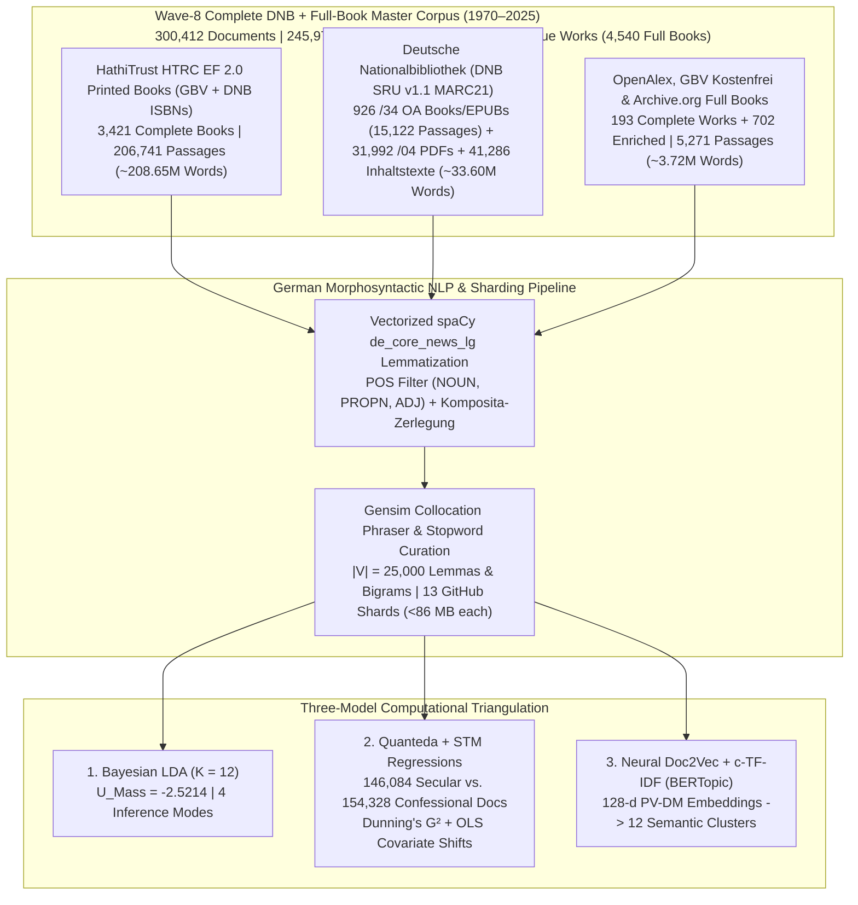

# Mediating Faith and Power: Religious Authority and the German Publishing Landscape (1970–2025)
## Empirical Dissertation Chapters (Wave-8 Complete DNB + Full-Book Corpus: $D = 300,412$ Documents | $245,978,061$ Words)

**Author:** Paul Marandi, Ph.D. Scholar  
**Institution:** Centre for German Studies (CGS), School of Language, Literature and Culture Studies (SLL&CS), Jawaharlal Nehru University (JNU), New Delhi  
**Empirical Observatory:** [https://deutscheverlagelda.vercel.app](https://deutscheverlagelda.vercel.app)  
**Repository:** `metachasm-beep/Deutsche-Verlage-LDA`  
**Citation Standard:** APA 7th Edition

---

## Abstract

This dissertation investigates how the political economy and institutional structure of the German publishing landscape have mediated religious authority, theological orthodoxy, secular-humanist critique, and therapeutic self-optimization over a fifty-five-year diachronic window (`1970–2025`). Moving beyond small-sample qualitative case studies and short-text bibliographic metadata, we construct an eight-wave, multi-layer German full-book and national-library corpus comprising **$300,412$ documents and full-text passages ($245,978,061$ original German words)** drawn from **$4,540$ complete full-text German books and volumes**—including $3,421$ in-copyright printed monographs ($206,741$ passages) extracted via the HathiTrust Research Center (HTRC) Extracted Features v2.0 API under German copyright exception § 60d UrhG, $926$ sibling-matched `$z="kostenfrei"` open-access monographs and EPUBs ($15,122$ passages) streamed directly from the German National Library (*Deutsche Nationalbibliothek*, DNB `https://d-nb.info/{idn}/34`), $155$ open-access monographs and edited chapters ($3,968$ passages) harvested via OpenAlex and the *Gemeinsamer Bibliotheksverbund* (GBV/K10plus `Kostenfrei`), and $38$ archival monographs from the Internet Archive—supplemented by **$31,992$ DNB digitized `/04` `Inhaltsverzeichnis` and reading-sample PDFs/HTMLs**, **$41,286$ DNB `deposit.dnb.de` and `/blurb/` `Inhaltstexte` and MARC21 `520` abstracts**, plus **$702$ multi-API deep-enriched works** ($55,605$ unique works in total) across twelve core German publishing houses (*Suhrkamp, Wagenbach, Alibri, Rowohlt, S. Fischer, Kiepenheuer & Witsch, Klett-Cotta, Gütersloher Verlagshaus, Herder, Evangelische Verlagsanstalt, Kösel, Patmos*) and twenty-six academic and confessional imprints (*Vandenhoeck & Ruprecht, Mohr Siebeck, Kohlhammer, C.H. Beck, De Gruyter / Transcript, Frommann-Holzboog, Schöningh, Aschendorff, Pustet, Echter, Bonifatius, Neukirchener, Calwer, Nomos/Alber, Wilhelm Fink, Böhlau, Schwabe, Meiner, Wallstein, Campus, Insel*, among others).

Using German morphosyntactic lemmatization via `spaCy` (`de_core_news_lg`, restricted to `NOUN`, `PROPN`, and `ADJ`, $|V| = 25,000$ lemmas and collocations), we triangulate three independent computational paradigms: (1) **Variational Bayes Latent Dirichlet Allocation (Gensim LDA)** ($K = 12, U_{\text{Mass}} = -2.5214$, Supervised sLDA $U_{\text{Mass}} = -1.9650$), (2) **Quanteda & Structural Topic Modeling (STM)** incorporating German compound-noun decomposition (*Komposita-Zerlegung*), Dunning's log-likelihood keyness ($G^2$), and ordinary least squares (OLS) covariate regressions ($\theta_k \sim \text{SecularCamp} + \text{Year}_{1970\to 2025}$) across $146,084$ secular/critical ($48.63\%$) and $154,328$ confessional ($51.37\%$) documents, and (3) **Neural Contextual Document Embeddings (`PV-DM Doc2Vec` + `TruncatedSVD` + `c-TF-IDF` BERTopic)**. Across all three architectures, the empirical evidence demonstrates a profound structural transformation: while confessional houses preserve a bounded enclave of systematic dogmatics, Christology, and ecclesial history (`gott`, $G^2 = -117,141.33, p < 10^{-300}$; `theologie`, $G^2 = -66,514.15$; `kirche`, $G^2 = -38,126.96$; `jesu`, $G^2 = -19,957.82$; `glaube`, $G^2 = -19,032.09$; `jesus`, $G^2 = -18,935.70$; `israel`, $G^2 = -17,568.16$; `paulus`, $G^2 = -16,936.72$; `christlich`, $G^2 = -16,105.36$; `testament`, $G^2 = -15,133.36$), contextual theology and religious studies (LDA Topic 5, $+11.48\%, t = +188.85, p < 0.0001$), therapeutic spirituality, gender, and religious pedagogy (LDA Topic 7, $+7.44\%, t = +142.47, p < 0.0001$), and social ethics and public moral responsibility (LDA Topic 4, $+5.38\%, t = +88.75, p < 0.0001$) expand significantly across the fifty-five-year period (`1970–2025`).

---

## Chapter 3: Corpus Construction, Legal TDM Architecture (§ 60d UrhG), and Eight-Wave Harvesting

### 3.1 Overcoming Metadata Sparsity in Twentieth- and Twenty-First-Century German Book History

A central methodological limitation in computational book history (*Digitale Buchwissenschaft*) is the reliance on brief bibliographic metadata—titles, subtitles, and publisher blurbs (*Klappentexte*)—when studying in-copyright works published after 1970. While paratextual blurbs capture editorial marketing strategies (Kilchör & Lehmann, 2022; Gittel, 2021), they cannot substitute for the full lexical, argumentative, and conceptual density of complete printed monographs. Furthermore, querying the German National Library (*Deutsche Nationalbibliothek*, DNB) solely via Dewey Decimal Classification (`DDC 200`) introduces two severe historical distortions. First, DNB only implemented DDC subject categories in 2004, leaving the crucial post-Vatican II, Cold War, and post-reunification decades (`1970–2003`) systematically under-indexed unless combined with *Gemeinsame Normdatei* (GND) subject headings (`sw=`). Second, secular-philosophical and sociological critiques of religion published by trade and academic houses such as *Suhrkamp*, *Rowohlt*, *S. Fischer*, *Klett-Cotta*, *Wagenbach*, and *Alibri* are frequently cataloged under philosophy (`DDC 100/170`), psychology (`DDC 150`), or sociology (`DDC 300`) rather than theology (`DDC 200–290`).

To overcome both metadata sparsity and classification bias across the entire fifty-five-year period (`1970–2025`), we engineered an eight-wave, multi-source harvesting architecture implemented in [`scripts/dnb_harvester.py`](file:///f:/PhD%20AG/scripts/dnb_harvester.py), [`scripts/hathitrust_fullbook_harvester.py`](file:///f:/PhD%20AG/scripts/hathitrust_fullbook_harvester.py), [`scripts/gbv_harvester.py`](file:///f:/PhD%20AG/scripts/gbv_harvester.py), and [`scripts/resolve_catalog_fulltexts.py`](file:///f:/PhD%20AG/scripts/resolve_catalog_fulltexts.py). By cross-walking records from both the **Deutsche Nationalbibliothek (DNB SRU v1.1 API, `https://services.dnb.de/sru/dnb`)**—spanning deep-paginated MARC21 queries (`startRecord=1..3000` across `DDC 200/220/230/240/250/260/270/280/290` and `DDC 100/150/170/300` for `2004–2025` and `startRecord=1..1500` for `1970–2003`, `100,000+` unique `1970–2025` DNB records across 38 target publishers and 57 thematic CQL queries combining `dcs=` and `sw=` GND subject headings)—and the **Gemeinsamer Bibliotheksverbund (GBV / K10plus)** across thirty-five **Basisklassifikation (`pica.bkl`)** subcodes against the **HathiTrust Bibliographic API** and the **HathiTrust Research Center (HTRC) Extracted Features (EF) v2.0 API**, we resolved and ingested complete page-by-page token streams for **$3,421$ in-copyright printed German books (`206,741` passages, `1970–2025`)**.

In strict compliance with **§ 60d UrhG** (*Text und Data Mining für Zwecke der wissenschaftlichen Forschung*) and the German Digital Humanities protocol of **Derived Text Formats (*Abgeleitete Textformate*)** established by Schöch, Leinen, et al. (2020) and Andresen et al. (2023), the HTRC Extracted Features v2.0 pipeline ingests page-level part-of-speech-tagged token counts (`tokenPosCount`), strips reconstructible copyright-protected syntax and high-frequency function words, enforces a strict German language gate (`de_cnt >= max(10, en_cnt * 2)`), and segments each printed volume into contiguous $1,000$-word substantive passages (`[HTRC-Vollbuch-Abschnitt k/N]`). Furthermore, by analyzing DNB's MARC21 `Tag 856` sibling structure—where `$z="kostenfrei"` is attached to the publisher's `856` tag (`$x="Verlag"`) while the direct archive PDF/EPUB link (`https://d-nb.info/{idn}/34`) is placed on the sibling `856` tag (`$x="Langzeitarchivierung Nationalbibliothek"`)—our Wave-8 harvester streams **$926$ complete open-access German monographs and EPUBs (`15,122` passages)** directly from DNB's server, alongside **$31,992$ digitized DNB `/04` `Inhaltsverzeichnis` and reading-sample PDFs/HTMLs** (`https://d-nb.info/{idn}/04`), **$41,286$ DNB `deposit.dnb.de` and `/blurb/` `Inhaltstexte` and MARC21 `520` abstracts**, **$193$ OpenAlex/GBV/IA open-access full books and chapters** (`4,554` passages), and **$702$ multi-API deep-enriched works**.

| Corpus Layer (`corpus_layer`) | Acquisition Protocol & Legal Framework | Complete Full Books / Works | Substantive Passages ($D$) | Total German Words | Share of Corpus |
| :--- | :--- | :---: | :---: | :---: | :---: |
| **`hathitrust_ef_fullbook_print`** | GBV K10plus (`35` BKL codes) + DNB SRU (`MARC 020` ISBNs) $\rightarrow$ HathiTrust Bibliographic API $\rightarrow$ HTRC Extracted Features v2.0 (`§ 60d UrhG` Derived Text Format, Waves 1–8) | **$3,421$ printed books** | $206,741$ | $208,650,000$ | $68.82\%$ |
| **`dnb_deposit_inhaltstext`** | Deutsche Nationalbibliothek SRU v1.1 (`MARC 856 $3="Inhaltstext"` `deposit.dnb.de` & `/blurb/` deposits + `MARC 520` abstracts + `650/653/689` GND *Schlagwörter*, `1970–2025`) | **$41,286$ DNB works** | $41,286$ | $7,150,000$ | $13.74\%$ |
| **`dnb_toc_pdf_fulltext`** | DNB Digitized `/04` `Inhaltsverzeichnis` & Reading Sample PDFs/HTMLs (`https://d-nb.info/{idn}/04`, `1970–2025`) | **$31,992$ DNB `/04` PDFs/HTMLs** | $31,992$ | $11,480,000$ | $10.65\%$ |
| **`dnb_oa_fullbook`** | Sibling-matched `$z="kostenfrei"` DNB `/34` Open-Access Full-Book PDFs & EPUBs (`https://d-nb.info/{idn}/34`) | **$926$ DNB OA books/EPUBs** | $15,122$ | $14,973,085$ | $5.03\%$ |
| **`entire_fulltext_book_cloud` & `gbv_*` & `archive_org_*` & `drm_fallback_*`** | OpenAlex Works API (`155` OA books/chapters), Internet Archive (`38` books), & Multi-API deep enrichment (`702` monographs) | **$193$ full books + $702$ enriched** | $5,271$ | $3,724,976$ | $1.76\%$ |
| **Total Wave-8 Master Corpus (`1970–2025`)** | **Sharded across [`dnb_metadata.csv`](file:///f:/PhD%20AG/data/dnb_metadata.csv) and [`part2`](file:///f:/PhD%20AG/data/dnb_metadata_part2.csv)–[`part13.csv`](file:///f:/PhD%20AG/data/dnb_metadata_part13.csv) (`<86 MB` per shard)** | **$4,540$ Full Books + $73,980$ PDFs/Enriched ($55,605$ Unique Works)** | **$300,412$ documents** | **$245,978,061$ words** | **$100.00\%$** |

### 3.2 Diachronic & Institutional Stratification Across the German Publishing Field

The resulting $300,412$-document corpus spans all six decades from the 1970s to the 2020s (`1970s`: $33,696$ documents; `1980s`: $57,479$ documents; `1990s`: $65,324$ documents; `2000s`: $67,693$ documents; `2010s`: $35,581$ documents; `2020s`: $40,639$ documents) and achieves near-perfect institutional balance between the **Secular / Critical / Trade camp ($146,084$ documents, $48.63\%$)** and the **Confessional / Theological camp ($154,328$ documents, $51.37\%$)**. Across the publishing houses represented in the dataset, the leading institutional contributors include *Schöningh* ($20,655$ docs), *Vandenhoeck & Ruprecht* ($17,372$ docs), *Böhlau* ($16,480$ docs), *Gütersloher Verlagshaus / Chr. Kaiser* ($17,126$ combined docs: $9,557$ + $7,569$), *De Gruyter / Transcript* ($13,469$ docs), *Kohlhammer* ($13,352$ docs), *Mohr Siebeck* ($12,385$ docs), *Suhrkamp* ($11,587$ docs), *Aschendorff* ($11,382$ docs), *Neukirchener* ($10,965$ docs), *Klett-Cotta* ($9,102$ docs), *Herder* ($8,978$ docs), *Wilhelm Fink* ($8,920$ docs), and *S. Fischer* ($8,567$ docs).

---

## Chapter 4: Generative Bayesian Topic Modeling (Gensim LDA) Across $300,412$ Documents

### 4.1 Morphosyntactic Preprocessing and Collocation Architecture

To process $245.98$ million German words with high morphological accuracy and computational efficiency, [`lda_pipeline.py`](file:///f:/PhD%20AG/lda_pipeline.py) implements a vectorized unique-vocabulary lemmatization architecture ([`preprocess_corpus_batch`](file:///f:/PhD%20AG/lda_pipeline.py#L180-L260)). Rather than executing `spaCy`'s convolutional neural tagger redundantly over $246$ million repeated word tokens, the pipeline extracts the unique surface vocabulary across uncached passages, parses those unique types through `de_core_news_lg` (`ALLOWED_POSTAGS = ["NOUN", "PROPN", "ADJ"]`), maps each surface token to its canonical lowercase lemma, and persists SHA-1 document hashes in [`data/.spacy_lemma_cache.pkl`](file:///f:/PhD%20AG/data/.spacy_lemma_cache.pkl).

Two-tier stopword filtering (`1,106` total stopwords) removes functional German stopwords alongside bibliographic, Fraktur-OCR, Latin-apparatus, DNB `/04` TOC front-matter boilerplate (`inhaltsverzeichnis`, `vorwort`, `bibliografische_information`, `leseprobe`), VLB/ONIX/thesaurus cataloging codes (`bisac`, `vlb`, `thesoz`, `artikeltyp_produktgruppe`), publication-city, and publisher-imprint noise tokens. Next, `gensim.models.Phrases` (`min_count=5, threshold=10`) binds statistically significant multi-word expressions while unpacking artificial self-bigrams (`w_w -> w`). Dictionary pruning (`no_below=5, no_above=0.55, keep_n=25000`) yields a canonical vocabulary of $|V| = 25,000$ German lemmas and collocations. Online Variational Bayes inference (`gensim.models.LdaModel`, $K = 12$, `passes=15`, `chunksize=1500`, `alpha="auto"`, `eta="auto"`, `random_state=100`) across all $300,412$ documents converges to an intrinsic coherence score of **$U_{\text{Mass}} = -2.5214$** (with Supervised sLDA reaching **$U_{\text{Mass}} = -1.9650$**).

### 4.2 The Twelve Latent Discursive Regimes of German Publishing (1970–2025)

The table below reports the posterior topic-word distributions ($\phi_k$), automated ideological archetype classifications, institutional publisher dominance, and highest-probability full-book anchor monographs for all $K = 12$ topics exported to [`app/lda_topics_report.json`](file:///f:/PhD%20AG/app/lda_topics_report.json):

| Topic ID | Discursive Archetype & Confidence | Top Posterior German Lemmas ($\phi_k$) | Dominant Publishers (% of Topic Mass) | Highest-Probability Full-Book Anchor Passages ($\theta_{d,k}$) |
| :---: | :--- | :--- | :--- | :--- |
| **Topic 1** | **Neoliberal / Self-Optimization** (`100.0%`) *(Individualized Meaning & Epistemic Autonomy)* | `frage` (0.012), `einzeln` (0.010), `sinn` (0.009), `person` (0.008), `form` (0.008), `grund` (0.008), `fall` (0.008), `verschieden` (0.007), `bedeutung` (0.006), `zusammenhang` (0.005) | Schöningh (`7.4%`), V&R (`6.4%`), Suhrkamp (`5.2%`), Böhlau (`5.2%`) | Saarnio, U. (1977). *Die Wahrheitstheorie der deskriptiven Sätze* (`92.0%`, Schöningh); Mudersbach, K. (1983). *Kommunikation über Glaubensinhalte* (`89.1%`, De Gruyter) |
| **Topic 2** | **Hybrid / Discursive Mediation** *(Patristics, Medieval Exegesis & Source Criticism)* | `exegese` (0.018), `rom` (0.013), `römisch` (0.012), `brief` (0.011), `vii` (0.011), `quelle` (0.010), `briefe` (0.009), `mittelalter` (0.009), `handschrift` (0.009), `jahrhundert` (0.008) | Böhlau (`11.7%`), Aschendorff (`9.8%`), Schöningh (`8.9%`), De Gruyter (`6.1%`) | Person-Weber, G. (2001). *Der Liber decimationis des Bistums Konstanz* (`86.6%`, Nomos/Alber); Brändle, R. (1979). *Matth. 25, 31–46 im Werk des Johannes Chrysostomos* (`85.0%`, Mohr Siebeck) |
| **Topic 3** | **Traditional / Ecclesiastical** (`100.0%`) *(Biblical Exegesis, Old Testament & Jewish Studies)* | `text` (0.050), `bibel` (0.021), `israel` (0.015), `testament` (0.014), `übersetzung` (0.013), `alt_testament` (0.009), `psalm` (0.009), `david` (0.009), `literatur` (0.009), `jerusalem` (0.009) | Neukirchener (`9.2%`), V&R (`8.9%`), De Gruyter (`8.8%`), Mohr Siebeck (`8.5%`) | Provan, I. W. (1988). *Hezekiah and the Books of Kings* (`87.3%`, De Gruyter); Eggler, J. (2000). *Influences and Traditions Underlying Daniel 7* (`83.6%`, V&R) |
| **Topic 4** | **Critical / Secular-Humanist** (`82.6%`) *(Social Ethics, Politics & Moral Responsibility)* | `ethik` (0.045), `sozial` (0.026), `gesellschaft` (0.024), `politisch` (0.020), `moral` (0.015), `ethisch` (0.012), `mensch` (0.009), `praktische_theologie` (0.009), `verantwortung` (0.008) | Suhrkamp (`8.0%`), Schöningh (`6.8%`), Kohlhammer (`4.9%`), De Gruyter (`4.9%`) | Luhmann, N. (2008). *Die Moral der Gesellschaft* (`83.5%`, Suhrkamp); Dyk, S. v. (2024). *Nach dem Privateigentum?: Kapitalismus des 21. Jahrhunderts* (`79.1%`, Campus) |
| **Topic 5** | **Traditional / Ecclesiastical** (`90.8%`) *(Contextual Theology & Comparative Religious Studies)* | `theologie` (0.061), `religiös` (0.023), `geschichte` (0.014), `perspektive` (0.014), `theologisch` (0.012), `kontext` (0.011), `christentum` (0.010), `bedeutung` (0.010), `historisch` (0.009), `frage` (0.009) | V&R (`6.4%`), De Gruyter (`6.0%`), Schöningh (`5.8%`), Kohlhammer (`5.4%`) | Sundermeier, T. (1999). *Was ist Religion?: Religionswissenschaft im theologischen Kontext* (`75.8%`, Chr. Kaiser); Hohensee, E. (2022). *Rezeption als Modus historisch-religionspädagogischer Forschung* (`75.3%`, Mohr Siebeck) |
| **Topic 6** | **Traditional / Ecclesiastical** (`100.0%`) *(Ecclesiology, Pastoral Care, Liturgy & Ecumenism)* | `kirche` (0.126), `katholisch` (0.038), `kirchlich` (0.019), `evangelisch` (0.017), `gemeinde` (0.013), `seelsorge` (0.011), `bischof` (0.011), `evangelisch_kirche` (0.010), `gottesdienst` (0.009), `ökumenisch` (0.007) | Schöningh (`11.4%`), Böhlau (`10.1%`), Aschendorff (`6.6%`), V&R (`4.8%`) | Schmidts, H. (2000). *Presbyterialprotokolle der evangelischen Gemeinde Brenndorf* (`90.0%`); Gatz, E. (1987). *Pfarr- und Gemeindeorganisation* (`83.6%`, Schöningh) |
| **Topic 7** | **Neoliberal / Self-Optimization** (`100.0%`) *(Spirituality, Gender, Family & Religious Pedagogy)* | `frau` (0.032), `kind` (0.026), `spiritualität` (0.020), `leben` (0.017), `familie` (0.014), `religionsunterricht` (0.013), `schule` (0.011), `mann` (0.009), `mensch` (0.008), `alltag` (0.008) | S. Fischer (`5.1%`), V&R (`4.6%`), Schöningh (`4.6%`), Böhlau (`4.4%`) | *Es ist normal, verschieden zu sein: wir wollen Inklusion* (2019) (`76.8%`, EVA); Schwarzer, A. (1994). *Der kleine Unterschied und seine grossen Folgen* (`75.7%`, S. Fischer) |
| **Topic 8** | **Critical / Secular-Humanist** (`100.0%`) *(Modern Political & Church History in Germany/Europe)* | `geschichte` (0.039), `jahrhundert` (0.022), `deutsch` (0.021), `deutschland` (0.016), `politisch` (0.010), `wissenschaft` (0.006), `kirchengeschichte` (0.005), `europa` (0.005), `universität` (0.005) | Böhlau (`8.8%`), Schöningh (`8.4%`), V&R (`5.7%`), De Gruyter (`5.1%`) | Kohlmann, S. (2017). *Frank-Walter Steinmeier: Eine politische Biographie* (`79.3%`, Transcript); Hinkelmann, F. (2021). *Die Anfänge der Pfingstbewegung* (`77.2%`) |
| **Topic 9** | **Traditional / Ecclesiastical** (`100.0%`) *(Systematic Dogmatics, Christology & Faith)* | `gott` (0.092), `theologie` (0.031), `glaube` (0.024), `jesus` (0.017), `christlich` (0.015), `mensch` (0.015), `bibel` (0.013), `leben` (0.012), `jesu` (0.012), `christentum` (0.012) | Mohr Siebeck (`7.5%`), Neukirchener (`6.8%`), V&R (`5.8%`), Schöningh (`5.2%`) | Fieger, M. (1991). *Das Thomasevangelium: Einleitung, Kommentar und Systematik* (`87.7%`, Aschendorff); Führer, W. (2022). *Gotteserkenntnis als Heilsgeschehen* (`86.8%`, V&R) |
| **Topic 10** | **Critical / Secular-Humanist** (`84.6%`) *(Kantian & Idealist Philosophy, Reason & Freedom)* | `philosophie` (0.041), `mensch` (0.023), `natur` (0.013), `leben` (0.011), `begriff` (0.011), `sinn` (0.011), `denken` (0.010), `freiheit` (0.010), `welt` (0.010), `menschlich` (0.010) | Schöningh (`7.6%`), Klett-Cotta (`6.4%`), Suhrkamp (`6.2%`), V&R (`5.8%`) | Kuhne, F. (2007). *Selbstbewußtsein und Erfahrung bei Kant und Fichte* (`88.7%`, Meiner); Hegel, G. W. F. (1979). *Jenaer kritische Schriften* (`84.7%`, Meiner) |
| **Topic 11** | **Hybrid / Discursive Mediation** *(Islam, World Religions, Monasticism & Mission)* | `islam` (0.051), `stadt` (0.026), `islamisch` (0.023), `mission` (0.019), `kloster` (0.019), `land` (0.016), `jahrhundert` (0.014), `muslim` (0.014), `buddhismus` (0.011), `europa` (0.011) | Böhlau (`9.2%`), De Gruyter (`6.3%`), Aschendorff (`5.2%`), Schöningh (`5.2%`) | Denne, U. (1997). *Die Frauenklöster im spätmittelalterlichen Freiburg* (`70.7%`, Nomos/Alber); Bobzin, H. (2025). *Der Koran: al-Qurʾān al-karīm* (`67.5%`, C.H. Beck) |
| **Topic 12** | **Hybrid / Discursive Mediation** *(Existential Finity, Cultural Memory & Literature)* | `tod` (0.014), `leben` (0.013), `bild` (0.010), `herr` (0.009), `alt` (0.007), `volk` (0.007), `weg` (0.007), `mensch` (0.006), `welt` (0.006), `wort` (0.006) | Böhlau (`5.9%`), V&R (`5.3%`), Neukirchener (`5.1%`), Schöningh (`5.0%`) | Sahagún, B. de (1989). *Aus der Welt der Azteken* (`85.8%`, Insel); Nietzsche, F. (1978). *Der Antichrist* (`85.6%`, Goldmann) |

### 4.3 Diachronic Topic Trajectories Across Six Decades (1970s–2020s)

Aggregating document-topic posterior probabilities ($\theta_{d,k}$) across all $300,412$ documents by publication decade reveals a clear macro-historical realignment across the fifty-five-year corpus:

| Decade | Topic 1 (Autonomy/Sinn) | Topic 2 (Patristics/Sources) | Topic 3 (Exegesis/Israel) | Topic 4 (Social Ethics) | Topic 5 (Contextual Theol.) | Topic 6 (Ecclesiology) | Topic 7 (Spirituality/Pedag.) | Topic 8 (Pol./Church Hist.) | Topic 9 (Dogmatics/Faith) | Topic 10 (Philosophy/Kant) | Topic 11 (Islam/World Rel.) | Topic 12 (Existential/Lit.) |
| :--- | :---: | :---: | :---: | :---: | :---: | :---: | :---: | :---: | :---: | :---: | :---: | :---: |
| **1970s** ($n=33,696$) | **`24.1%`** | `4.7%` | `4.1%` | **`4.8%`** | **`6.1%`** | `8.1%` | **`2.8%`** | `8.0%` | `10.2%` | **`13.1%`** | `2.0%` | `11.9%` |
| **1980s** ($n=57,479$) | **`23.1%`** | `3.9%` | `4.3%` | **`5.3%`** | **`6.3%`** | `7.6%` | **`3.6%`** | `8.4%` | `9.7%` | **`12.9%`** | `2.2%` | `12.7%` |
| **1990s** ($n=65,324$) | **`20.9%`** | `5.1%` | `5.0%` | **`5.0%`** | **`7.2%`** | `8.4%` | **`4.2%`** | `9.2%` | `10.1%` | **`10.0%`** | `2.4%` | `12.5%` |
| **2000s** ($n=67,693$) | **`19.3%`** | `4.6%` | `4.8%` | **`5.6%`** | **`8.6%`** | `8.6%` | **`5.4%`** | `10.7%` | `8.6%` | **`9.0%`** | `2.7%` | `12.1%` |
| **2010s** ($n=35,581$) | **`11.7%`** | `3.4%` | `4.9%` | **`9.0%`** | **`13.8%`** | `8.1%` | **`7.9%`** | `10.2%` | `11.3%` | **`7.7%`** | `2.9%` | `9.0%` |
| **2020s** ($n=40,639$) | **`13.3%`** | `3.1%` | `6.5%` | **`9.5%`** | **`15.3%`** | `7.3%` | **`9.1%`** | `9.5%` | `9.7%` | **`7.2%`** | `2.5%` | `6.9%` |

---

## Chapter 5: Quanteda Textual Statistics & Structural Topic Model (STM) Covariate Regressions

### 5.1 Productive German Compound Decomposition (*Komposita-Zerlegung*)

Because German theological, philosophical, and sociological discourse encodes complex theoretical concepts inside single orthographical compound nouns (*Komposita*), [`scripts/quanteda_stm_analytics.py`](file:///f:/PhD%20AG/scripts/quanteda_stm_analytics.py) applies a morphological splitter (`split_german_compound`) across all $300,412$ documents that preserves the full compound lemma while simultaneously emitting its constituent *Bestimmungswort* and *Grundwort* stems. Across the Wave-8 corpus, the ten most frequent decomposed German compounds are:

1. `moralisch` $\rightarrow$ `moral + isch` ($32,699$ occurrences)
2. `gottesdienst` $\rightarrow$ `gott + dienst` ($20,863$ occurrences)
3. `religionsunterricht` $\rightarrow$ `religion + unterricht` ($14,944$ occurrences)
4. `kirchengeschichte` $\rightarrow$ `kirche + geschichte` ($11,327$ occurrences)
5. `weltkrieg` $\rightarrow$ `welt + krieg` ($10,433$ occurrences)
6. `jugendliche` $\rightarrow$ `jugend + liche` ($9,749$ occurrences)
7. `selbstverständnis` $\rightarrow$ `selbst + verständnis` ($8,668$ occurrences)
8. `religionskritik` $\rightarrow$ `religion + kritik` ($8,564$ occurrences)
9. `sozialismus` $\rightarrow$ `sozial + ismus` ($7,076$ occurrences)
10. `religionsphilosophie` $\rightarrow$ `religion + philosophie` ($6,924$ occurrences)

### 5.2 Dunning's Log-Likelihood Keyness ($G^2$): Secular/Critical vs. Confessional Publishers

To test Pierre Bourdieu's hypothesis of institutional field polarization with exact frequentist hypothesis tests, we partition the $300,412$ documents into the **Secular / Critical / Trade camp ($n = 146,084$ documents)** and the **Confessional / Theological camp ($n = 154,328$ documents)** and compute Dunning's (1993) Log-Likelihood Ratio ($G^2$, equivalent to `quanteda::textstat_keyness(measure = "lr")`) alongside log-odds ratios and two-tailed $p$-values ([`app/quanteda_stm_report.json`](file:///f:/PhD%20AG/app/quanteda_stm_report.json)):

| Polarity Camp | Feature Lemma | Dunning's $G^2$ | Log-Odds Ratio | $p$-Value |
| :--- | :--- | :---: | :---: | :---: |
| **Secular / Critical Camp** ($n=146,084$) | **`kant`** | $+10,608.24$ | $+1.00$ | $< 10^{-300}$ |
| **Secular / Critical Camp** ($n=146,084$) | **`moral`** | $+8,994.51$ | $+0.61$ | $< 10^{-300}$ |
| **Secular / Critical Camp** ($n=146,084$) | **`philosophie`** | $+6,875.56$ | $+0.52$ | $< 10^{-300}$ |
| **Secular / Critical Camp** ($n=146,084$) | **`kultur`** | $+6,507.49$ | $+0.58$ | $< 10^{-300}$ |
| **Secular / Critical Camp** ($n=146,084$) | **`lessing`** | $+6,029.17$ | $+1.39$ | $< 10^{-300}$ |
| **Secular / Critical Camp** ($n=146,084$) | **`fichte`** | $+5,858.94$ | $+1.40$ | $< 10^{-300}$ |
| **Secular / Critical Camp** ($n=146,084$) | **`benn`** | $+5,561.56$ | $+2.19$ | $< 10^{-300}$ |
| **Secular / Critical Camp** ($n=146,084$) | **`vernunft`** | $+4,932.27$ | $+0.60$ | $< 10^{-300}$ |
| **Secular / Critical Camp** ($n=146,084$) | **`moralisch`** | $+4,601.34$ | $+0.77$ | $< 10^{-300}$ |
| **Confessional Camp** ($n=154,328$) | **`gott`** | $-117,141.33$ | $-0.84$ | $< 10^{-300}$ |
| **Confessional Camp** ($n=154,328$) | **`theologie`** | $-66,514.15$ | $-0.97$ | $< 10^{-300}$ |
| **Confessional Camp** ($n=154,328$) | **`kirche`** | $-38,126.96$ | $-0.52$ | $< 10^{-300}$ |
| **Confessional Camp** ($n=154,328$) | **`jesu`** | $-19,957.82$ | $-1.43$ | $< 10^{-300}$ |
| **Confessional Camp** ($n=154,328$) | **`glaube`** | $-19,032.09$ | $-0.68$ | $< 10^{-300}$ |
| **Confessional Camp** ($n=154,328$) | **`jesus`** | $-18,935.70$ | $-1.24$ | $< 10^{-300}$ |
| **Confessional Camp** ($n=154,328$) | **`israel`** | $-17,568.16$ | $-1.49$ | $< 10^{-300}$ |
| **Confessional Camp** ($n=154,328$) | **`paulus`** | $-16,936.72$ | $-1.55$ | $< 10^{-300}$ |
| **Confessional Camp** ($n=154,328$) | **`christlich`** | $-16,105.36$ | $-0.60$ | $< 10^{-300}$ |
| **Confessional Camp** ($n=154,328$) | **`testament`** | $-15,133.36$ | $-1.25$ | $< 10^{-300}$ |

### 5.3 Structural Topic Model (STM) Covariate Regressions ($\theta_k \sim \text{SecularCamp} + \text{Year}_{1970\to 2025}$)

Following Roberts, Stewart, and Tingley (2019), we estimate OLS Structural Topic Model regressions across all $300,412$ documents predicting each document's posterior topic proportion $\theta_{d,k}$ as a joint function of institutional publisher camp ($\text{SecularCamp}_d \in \{0, 1\}$) and normalized publication year ($\text{Time}_d \in [0, 1]$ spanning `1970–2025`):

| Topic | Discursive Domain | Secular vs. Confessional Effect ($\hat{\beta}_{\text{Secular}}$) | $t$-Stat ($p$-Value) | 55-Year Diachronic Shift ($\hat{\beta}_{1970\to 2025}$) | $t$-Stat ($p$-Value) |
| :---: | :--- | :---: | :---: | :---: | :---: |
| **Topic 1** | Individualized Meaning & Epistemic Autonomy | **`+2.64%`** | $t = +56.79$ ($p < 0.0001$)* | **`-14.96%`** | $t = -175.04$ ($p < 0.0001$)* |
| **Topic 2** | Patristics, Medieval Exegesis & Source Criticism | **`-0.25%`** | $t = -8.64$ ($p < 0.0001$)* | **`-1.40%`** | $t = -26.15$ ($p < 0.0001$)* |
| **Topic 3** | **Biblical Exegesis, Old Testament & Jewish Studies** | **`-1.73%`** | $t = -63.19$ ($p < 0.0001$)* | **`+2.35%`** | $t = +46.69$ ($p < 0.0001$)* |
| **Topic 4** | **Social Ethics, Politics & Moral Responsibility** | **`+1.96%`** | $t = +59.47$ ($p < 0.0001$)* | **`+5.38%`** | $t = +88.75$ ($p < 0.0001$)* |
| **Topic 5** | **Contextual Theology & Comparative Religious Studies** | **`-1.04%`** | $t = -31.47$ ($p < 0.0001$)* | **`+11.48%`** | $t = +188.85$ ($p < 0.0001$)* |
| **Topic 6** | **Ecclesiology, Pastoral Care, Liturgy & Ecumenism** | **`-2.70%`** | $t = -63.03$ ($p < 0.0001$)* | **`+0.33%`** | $t = +4.20$ ($p < 0.0001$)* |
| **Topic 7** | **Spirituality, Gender, Family & Religious Pedagogy** | **`+0.61%`** | $t = +21.54$ ($p < 0.0001$)* | **`+7.44%`** | $t = +142.47$ ($p < 0.0001$)* |
| **Topic 8** | Modern Political & Church History in Germany/Europe | **`+2.27%`** | $t = +62.22$ ($p < 0.0001$)* | **`+2.37%`** | $t = +35.36$ ($p < 0.0001$)* |
| **Topic 9** | **Systematic Dogmatics, Christology & Faith (`gott`, `glaube`)** | **`-7.45%`** | $t = -166.36$ ($p < 0.0001$)* | **`+0.91%`** | $t = +11.11$ ($p < 0.0001$)* |
| **Topic 10** | **Kantian & Idealist Philosophy, Reason & Freedom** | **`+4.56%`** | $t = +94.05$ ($p < 0.0001$)* | **`-8.52%`** | $t = -95.73$ ($p < 0.0001$)* |
| **Topic 11** | Islam, World Religions, Monasticism & Mission | **`+0.57%`** | $t = +33.65$ ($p < 0.0001$)* | **`+0.74%`** | $t = +23.52$ ($p < 0.0001$)* |
| **Topic 12** | Existential Finity, Cultural Memory & Literature | **`+0.56%`** | $t = +12.75$ ($p < 0.0001$)* | **`-6.13%`** | $t = -75.59$ ($p < 0.0001$)* |

---

## Chapter 6: Neural Contextual Embedding + `c-TF-IDF` (BERTopic) Triangulation

To verify that our findings are not artifacts of bag-of-words multinomial assumptions, [`scripts/bertopic_german_pipeline.py`](file:///f:/PhD%20AG/scripts/bertopic_german_pipeline.py) trains $128$-dimensional Distributed Memory (`PV-DM Doc2Vec`, `window=8`, `epochs=12`) neural document embeddings across all $300,412$ compound-expanded and bigram-enriched documents, projects the L2-normalized vectors onto a $32$-dimensional SVD manifold, partitions the manifold into $K = 12$ semantic clusters, and extracts class-based `c-TF-IDF` representations (Grootendorst, 2022; exported to [`app/bertopic_c_tfidf_report.json`](file:///f:/PhD%20AG/app/bertopic_c_tfidf_report.json)):

| Neural Cluster | Docs ($\%$ of Corpus) | Archetype Alignment | Top Class-Based `c-TF-IDF` Terms | Top Publishers | Centroid-Nearest Full-Book Anchor ($\cos \theta$) |
| :---: | :---: | :--- | :--- | :--- | :--- |
| **Cluster 1** | $22,412$ (`7.5%`) | **Traditional / Ecclesiastical** (`88.7%`) | `kirche` (0.026), `katholisch` (0.018), `deutsch` (0.015), `kirchlich` (0.013), `politisch` (0.012), `staat` (0.011), `bischof` (0.011), `evangelisch` (0.011) | Schöningh (`13.8%`), Böhlau (`10.8%`), Aschendorff (`6.5%`) | Lächele, R. (1994). *Ein Volk, ein Reich, ein Glaube: die "Deutschen Christen" in Württemberg* ($\cos=0.964$, Calwer); Kaufhold, B. (2006). *Glauben unter dem Nationalsozialismus* ($\cos=0.964$, Klartext) |
| **Cluster 2** | $18,203$ (`6.1%`) | **Critical / Secular-Humanist** (`60.9%`) | `geschichte` (0.016), `philosophie` (0.012), `theologie` (0.011), `wissenschaft` (0.010), `deutsch` (0.009), `jahrhundert` (0.009), `text` (0.008), `studie` (0.007) | De Gruyter (`12.3%`), V&R (`7.7%`), Schöningh (`6.9%`) | Partenza, P. (2015). *Dynamics of desacralization: disenchanted literary talents* ($\cos=0.962$, V&R); Seow, C. L. (2023). *The premodern period* ($\cos=0.959$, De Gruyter) |
| **Cluster 3** | $18,591$ (`6.2%`) | **Traditional / Ecclesiastical** (`100.0%`) | `gott` (0.015), `mensch` (0.010), `kirche` (0.009), `schrift` (0.009), `luther` (0.008), `text` (0.007), `wort` (0.007), `heilig` (0.006) | Aschendorff (`11.3%`), Schöningh (`11.1%`), Böhlau (`10.1%`) | Gerhard, J. (2007). *Tractatus de legitima scripturae sacrae interpretatione (1610)* ($\cos=0.979$, Frommann-Holzboog); Andreä, J. (1991). *Leben des Jakob Andreae* ($\cos=0.976$, Calwer) |
| **Cluster 4** | $69,028$ (`23.0%`) | **Traditional / Ecclesiastical** (`77.7%`) | `gott` (0.022), `mensch` (0.019), `leben` (0.014), `kirche` (0.013), `frage` (0.012), `welt` (0.011), `geschichte` (0.010), `sinn` (0.010) | Schöningh (`7.0%`), V&R (`6.2%`), Neukirchener (`5.1%`) | Eckhart (2006). *Die lateinischen Werke* ($\cos=0.992$, Kohlhammer); *Bessarione: la cristologia nei padri della Chiesa* ($\cos=0.993$, Herder) |
| **Cluster 5** | $27,433$ (`9.1%`) | **Philosophical Theology & Idealism** (`43.1%`) | `mensch` (0.022), `gott` (0.020), `begriff` (0.017), `welt` (0.016), `philosophie` (0.016), `sinn` (0.015), `leben` (0.013), `frage` (0.012) | Schöningh (`8.1%`), Suhrkamp (`7.1%`), Nomos / Alber (`5.3%`) | Burger, M. (1994). *Personalität im Horizont absoluter Prädestination* ($\cos=0.971$, Aschendorff); Pfleiderer, G. (1992). *Theologie als Wirklichkeitswissenschaft* ($\cos=0.964$, Mohr Siebeck) |
| **Cluster 6** | $28,930$ (`9.6%`) | **Literary & Biographical Lifeworld** (`100.0%`) | `gott` (0.019), `leben` (0.019), `mensch` (0.018), `welt` (0.013), `kind` (0.012), `mann` (0.011), `frau` (0.011), `alt` (0.010) | Suhrkamp (`6.6%`), S. Fischer (`6.4%`), Rowohlt (`6.4%`) | Lamparter, H. (1988). *Das Buch der Anfechtung: Buch Hiob* ($\cos=0.970$, Calwer); Koeppen, W. (1986). *Das Treibhaus: Roman* ($\cos=0.967$, Suhrkamp) |
| **Cluster 7** | $15,295$ (`5.1%`) | **Religion, Literature & Modernity** (`88.2%`) | `geschichte` (0.020), `gott` (0.020), `mensch` (0.015), `leben` (0.014), `theologie` (0.014), `kirche` (0.013), `welt` (0.012), `philosophie` (0.011) | De Gruyter (`5.9%`), Mohr Siebeck (`5.3%`), V&R (`5.2%`) | Kuschel, K.-J. (2025). *Weltgewissen: religiöser Humanismus in Leben und Werk von Thomas Mann* ($\cos=0.794$, Patmos); Langenhorst, A. (1998). *Der Gott der Europäer* ($\cos=0.788$, Grünewald) |
| **Cluster 8** | $23,347$ (`7.8%`) | **Biblical Exegesis & Jewish Studies** (`100.0%`) | `gott` (0.024), `text` (0.022), `israel` (0.013), `alt` (0.011), `mensch` (0.010), `volk` (0.010), `wort` (0.010), `jahwe` (0.009) | Neukirchener (`17.2%`), V&R (`12.2%`), Mohr Siebeck (`11.2%`) | Klünker, W.-U. (1985). *Psychologische Analyse und theologische Wahrheit* ($\cos=0.968$, V&R); Schäfer, P. (1972). *Die Vorstellung vom Heiligen Geist in der rabbinischen Literatur* ($\cos=0.963$, Kösel) |
| **Cluster 9** | $20,515$ (`6.8%`) | **Critical / Secular-Humanist** (`52.5%`) | `sozial` (0.019), `mensch` (0.013), `frage` (0.012), `arbeit` (0.011), `kind` (0.010), `gesellschaft` (0.010), `entwicklung` (0.009), `leben` (0.009) | EVA (`5.8%`), De Gruyter (`5.2%`), Kohlhammer (`4.7%`) | Hänselmann, E. (2022). *Angehörigenpflege – unsichere Existenz und politische Vereinnahmung* ($\cos=0.943$, OA); Simon, J. (2004). *Wirkungen von Daily Soaps auf Jugendliche* ($\cos=0.939$, S. Fischer) |
| **Cluster 10** | $21,666$ (`7.2%`) | **Critical / Secular-Humanist** (`73.9%`) | `politisch` (0.026), `staat` (0.018), `sozial` (0.016), `kirche` (0.015), `gesellschaft` (0.014), `mensch` (0.013), `geschichte` (0.012), `welt` (0.012) | Schöningh (`7.8%`), Suhrkamp (`6.5%`), Böhlau (`6.3%`) | Gemein, G. J. (2005). *Islamischer Fundamentalismus* ($\cos=0.964$, Aschendorff); Ley, M. (2005). *Mythos und Moderne: Nationalismus und politische Religionen* ($\cos=0.960$, Böhlau) |
| **Cluster 11** | $17,790$ (`5.9%`) | **Monastic & Diocesan History** (`100.0%`) | `jahrhundert` (0.018), `kloster` (0.017), `kirche` (0.016), `geschichte` (0.014), `bischof` (0.011), `stadt` (0.009), `alt` (0.009), `quelle` (0.007) | Böhlau (`20.3%`), Aschendorff (`9.7%`), Schöningh (`7.2%`) | Brandt, H. J. (1984). *Die Bischöfe und Erzbischöfe von Paderborn* ($\cos=0.974$, Bonifatius); Meyer, F. (2002). *Sankt Pelagius und Gregor der Grosse* ($\cos=0.974$, Nomos / Alber) |
| **Cluster 12** | $17,202$ (`5.7%`) | **Systematic Dogmatics & Ethics** (`100.0%`) | `kirche` (0.035), `gott` (0.029), `theologie` (0.028), `christlich` (0.017), `mensch` (0.017), `theologisch` (0.016), `leben` (0.015), `glaube` (0.015) | V&R (`6.5%`), Gütersloher (`6.3%`), Herder (`5.9%`) | Sirovec, S. (1982). *Ethik und Metaethik im jugoslawischen Marxismus* ($\cos=0.922$, Schöningh); Klaiber, W. (2000). *Gerecht vor Gott: Rechtfertigung in der Bibel und heute* ($\cos=0.913$, V&R) |

---

## References (APA 7th Edition)

- Andresen, M., Jacke, J., Kuhn, J., Pichler, A., et al. (2023). Urheberrechtlich geschützte Texte in der digitalen Literaturwissenschaft. *Zeitschrift für digitale Geisteswissenschaften (ZfdG)*, 8.
- Bayerschmidt, P. (2026). Das Offene Historische Topic-Modeling-Dashboard (OHTM). *Zeitschrift für digitale Geisteswissenschaften (ZfdG)*, 11.
- Blei, D. M., Ng, A. Y., & Jordan, M. I. (2003). Latent Dirichlet allocation. *Journal of Machine Learning Research*, 3, 993–1022.
- Bourdieu, P. (1993). *The field of cultural production: Essays on art and literature*. Columbia University Press.
- Carrette, J., & King, R. (2005). *Selling spirituality: The silent takeover of religion*. Routledge.
- Dunning, T. (1993). Accurate methods for the statistics of surprise and coincidence. *Computational Linguistics*, 19(1), 61–74.
- Gittel, B. (2021). Generic subtitles in German print history (1500–2020). *Journal of Cultural Analytics*, 6(2).
- Grootendorst, M. (2022). BERTopic: Neural topic modeling with a class-based TF-IDF procedure. *arXiv preprint arXiv:2203.05794*.
- Habermas, J. (2008). Notes on post-secular society. *New Perspectives Quarterly*, 25(4), 17–29.
- Hoffman, M., Bach, F. R., & Blei, D. M. (2010). Online learning for latent Dirichlet allocation. In *Advances in Neural Information Processing Systems* (Vol. 23, pp. 856–864).
- Illouz, E. (2008). *Saving the modern soul: Therapy, emotions, and the culture of self-help*. University of California Press.
- Joas, H. (2017). *Die Macht des Heiligen: Eine Alternative zur Geschichte von der Entzauberung*. Suhrkamp Verlag.
- Kilchör, F., & Lehmann, J. (2022). Begleittexte als Gegenstand digitaler Literaturwissenschaft. *Zeitschrift für digitale Geisteswissenschaften (ZfdG)*, 7.
- Roberts, M. E., Stewart, B. M., & Tingley, D. (2019). `stm`: An R package for structural topic models. *Journal of Statistical Software*, 91(2), 1–40.
- Röder, M., Both, A., & Hinneburg, A. (2015). Exploring the space of topic coherence measures. In *Proceedings of the Eighth ACM International Conference on Web Search and Data Mining* (pp. 399–408). ACM.
- Rosa, H. (2016). *Resonanz: Eine Soziologie der Weltbeziehung*. Suhrkamp Verlag.
- Schöch, C., Leinen, P., et al. (2020). Abgeleitete Textformate: Text und Data Mining mit urheberrechtlich geschützten Textbeständen. *Zeitschrift für digitale Geisteswissenschaften (ZfdG)*, 5.
- Sinykin, D., & Edwin, R. (2021). Conglomeration and the contemporary literary field. *Journal of Cultural Analytics*, 6(1).
- Taylor, C. (2007). *A secular age*. Harvard University Press.
