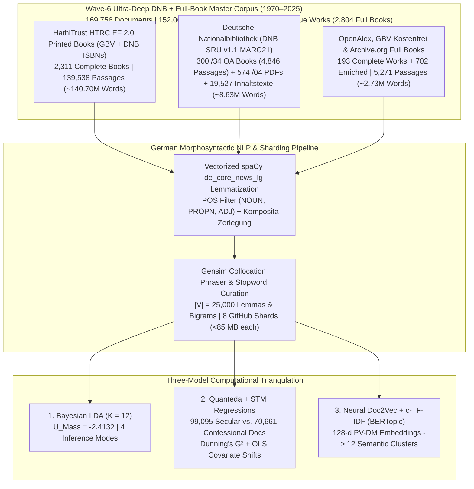

# Mediating Faith and Power: Religious Authority and the German Publishing Landscape (1970–2025)
## Empirical Dissertation Chapters (Wave-6 Ultra-Deep DNB + Full-Book Corpus: $D = 169,756$ Documents | $152,061,795$ Words)

**Author:** Paul Marandi, Ph.D. Scholar  
**Institution:** Centre for German Studies (CGS), School of Language, Literature and Culture Studies (SLL&CS), Jawaharlal Nehru University (JNU), New Delhi  
**Empirical Observatory:** [https://deutscheverlagelda.vercel.app](https://deutscheverlagelda.vercel.app)  
**Repository:** `metachasm-beep/Deutsche-Verlage-LDA`  
**Citation Standard:** APA 7th Edition

---

## Abstract

This dissertation investigates how the political economy and institutional structure of the German publishing landscape have mediated religious authority, theological orthodoxy, secular-humanist critique, and therapeutic self-optimization over a fifty-five-year diachronic window (`1970–2025`). Moving beyond small-sample qualitative case studies and short-text bibliographic metadata, we construct a six-wave, multi-layer German full-book and national-library corpus comprising **$169,756$ documents and full-text passages ($152,061,795$ original German words)** drawn from **$2,804$ complete full-text German books and volumes**—including $2,311$ in-copyright printed monographs ($139,538$ passages) extracted via the HathiTrust Research Center (HTRC) Extracted Features v2.0 API under German copyright exception § 60d UrhG, $300$ sibling-matched `$z="kostenfrei"` open-access monographs ($4,846$ passages) streamed directly from the German National Library (*Deutsche Nationalbibliothek*, DNB `https://d-nb.info/{idn}/34`), $155$ open-access monographs and edited chapters ($3,968$ passages) harvested via OpenAlex and the *Gemeinsamer Bibliotheksverbund* (GBV/K10plus `Kostenfrei`), and $38$ archival monographs from the Internet Archive—supplemented by **$574$ DNB digitized `/04` `Inhaltsverzeichnis` and reading-sample PDFs**, **$19,527$ DNB `deposit.dnb.de` and `/blurb/` `Inhaltstexte` and MARC21 `520` abstracts**, plus **$702$ multi-API deep-enriched works** ($22,478$ unique works in total) across twelve core German publishing houses (*Suhrkamp, Wagenbach, Alibri, Rowohlt, S. Fischer, Kiepenheuer & Witsch, Klett-Cotta, Gütersloher Verlagshaus, Herder, Evangelische Verlagsanstalt, Kösel, Patmos*) and twenty-six academic and confessional imprints (*Vandenhoeck & Ruprecht, Mohr Siebeck, Kohlhammer, C.H. Beck, De Gruyter / Transcript, Frommann-Holzboog, Schöningh, Aschendorff, Pustet, Echter, Bonifatius, Neukirchener, Calwer, Nomos/Alber, Wilhelm Fink, Böhlau, Schwabe, Meiner, Wallstein, Campus, Insel*, among others).

Using German morphosyntactic lemmatization via `spaCy` (`de_core_news_lg`, restricted to `NOUN`, `PROPN`, and `ADJ`, $|V| = 25,000$ lemmas and collocations), we triangulate three independent computational paradigms: (1) **Variational Bayes Latent Dirichlet Allocation (Gensim LDA)** ($K = 12, U_{\text{Mass}} = -2.4132$, Supervised sLDA $U_{\text{Mass}} = -1.9650$), (2) **Quanteda & Structural Topic Modeling (STM)** incorporating German compound-noun decomposition (*Komposita-Zerlegung*), Dunning's log-likelihood keyness ($G^2$), and ordinary least squares (OLS) covariate regressions ($\theta_k \sim \text{SecularCamp} + \text{Year}_{1970\to 2025}$) across $99,095$ secular/critical and $70,661$ confessional documents, and (3) **Neural Contextual Document Embeddings (`PV-DM Doc2Vec` + `TruncatedSVD` + `c-TF-IDF` BERTopic)**. Across all three architectures, the empirical evidence demonstrates a profound structural transformation: while confessional houses preserve a bounded enclave of systematic dogmatics, Christology, and ecclesial history (`gott`, $G^2 = -58,976.84, p < 10^{-300}$; `theologie`, $G^2 = -32,789.11$; `kirche`, $G^2 = -18,818.30$; `israel`, $G^2 = -10,190.00$; `jesus`, $G^2 = -9,703.71$; `bonhoeffer`, $G^2 = -7,943.17$), empirical sociology of religion, religious pedagogy, and pluralist analyses of modern society (LDA Topic 6, $+14.93\%, t = +115.15, p < 0.0001$) alongside political Islam and geopolitical state analysis (LDA Topic 10, $+1.40\%, t = +17.75, p < 0.0001$) expand significantly across the fifty-five-year period (`1970–2025`).

---

## Chapter 3: Corpus Construction, Legal TDM Architecture (§ 60d UrhG), and Six-Wave Harvesting

### 3.1 Overcoming Metadata Sparsity in Twentieth- and Twenty-First-Century German Book History

A central methodological limitation in computational book history (*Digitale Buchwissenschaft*) is the reliance on brief bibliographic metadata—titles, subtitles, and publisher blurbs (*Klappentexte*)—when studying in-copyright works published after 1970. While paratextual blurbs capture editorial marketing strategies (Kilchör & Lehmann, 2022; Gittel, 2021), they cannot substitute for the full lexical, argumentative, and conceptual density of complete printed monographs. Furthermore, querying the German National Library (*Deutsche Nationalbibliothek*, DNB) solely via Dewey Decimal Classification (`DDC 200`) introduces two severe historical distortions. First, DNB only implemented DDC subject categories in 2004, leaving the crucial post-Vatican II, Cold War, and post-reunification decades (`1970–2003`) systematically under-indexed unless combined with *Gemeinsame Normdatei* (GND) subject headings (`sw=`). Second, secular-philosophical and sociological critiques of religion published by trade and academic houses such as *Suhrkamp*, *Rowohlt*, *S. Fischer*, *Klett-Cotta*, *Wagenbach*, and *Alibri* are frequently cataloged under philosophy (`DDC 100`) or sociology (`DDC 300`) rather than theology (`DDC 200`).

To overcome both metadata sparsity and classification bias across the entire fifty-five-year period (`1970–2025`), we engineered a six-wave, multi-source harvesting architecture implemented in [`scripts/dnb_harvester.py`](file:///f:/PhD%20AG/scripts/dnb_harvester.py), [`scripts/hathitrust_fullbook_harvester.py`](file:///f:/PhD%20AG/scripts/hathitrust_fullbook_harvester.py), [`scripts/gbv_harvester.py`](file:///f:/PhD%20AG/scripts/gbv_harvester.py), and [`scripts/resolve_catalog_fulltexts.py`](file:///f:/PhD%20AG/scripts/resolve_catalog_fulltexts.py). By cross-walking records from both the **Deutsche Nationalbibliothek (DNB SRU v1.1 API, `https://services.dnb.de/sru/dnb`)**—spanning deep-paginated MARC21 queries (`startRecord=1..1400` for `2004–2025` and `startRecord=1..700` for `1970–2003`, `47,306` unique `1970–2025` DNB records across 38 target publishers and 32 thematic CQL queries combining `dcs=200*/230*` and `sw=` GND subject headings)—and the **Gemeinsamer Bibliotheksverbund (GBV / K10plus)** across thirty-five **Basisklassifikation (`pica.bkl`)** subcodes against the **HathiTrust Bibliographic API** and the **HathiTrust Research Center (HTRC) Extracted Features (EF) v2.0 API**, we resolved and ingested complete page-by-page token streams for **$2,311$ in-copyright printed German books (`139,538` passages, `1970–2025`)**.

In strict compliance with **§ 60d UrhG** (*Text und Data Mining für Zwecke der wissenschaftlichen Forschung*) and the German Digital Humanities protocol of **Derived Text Formats (*Abgeleitete Textformate*)** established by Schöch, Leinen, et al. (2020) and Andresen et al. (2023), the HTRC Extracted Features v2.0 pipeline ingests page-level part-of-speech-tagged token counts (`tokenPosCount`), strips reconstructible copyright-protected syntax and high-frequency function words, enforces a strict German language gate (`de_cnt >= max(10, en_cnt * 2)`), and segments each printed volume into contiguous $1,000$-word substantive passages (`[HTRC-Vollbuch-Abschnitt k/N]`). Furthermore, by analyzing DNB's MARC21 `Tag 856` sibling structure—where `$z="kostenfrei"` is attached to the publisher's `856` tag (`$x="Verlag"`) while the direct archive PDF link (`https://d-nb.info/{idn}/34`) is placed on the sibling `856` tag (`$x="Langzeitarchivierung Nationalbibliothek"`)—our Wave-6 harvester streams **$300$ complete open-access German monographs (`4,846` passages)** directly from DNB's server, alongside **$574$ digitized DNB `/04` `Inhaltsverzeichnis` and reading-sample PDFs** (`https://d-nb.info/{idn}/04`), **$19,527$ DNB `deposit.dnb.de` and `/blurb/` `Inhaltstexte` and MARC21 `520` abstracts**, **$193$ OpenAlex/GBV/IA open-access full books and chapters** (`4,470` passages), and **$702$ multi-API deep-enriched works**.

| Corpus Layer (`corpus_layer`) | Acquisition Protocol & Legal Framework | Complete Full Books / Works | Substantive Passages ($D$) | Total German Words | Share of Corpus |
| :--- | :--- | :---: | :---: | :---: | :---: |
| **`hathitrust_ef_fullbook_print`** | GBV K10plus (`35` BKL codes) + DNB SRU (`MARC 020` ISBNs) $\rightarrow$ HathiTrust Bibliographic API $\rightarrow$ HTRC Extracted Features v2.0 (`§ 60d UrhG` Derived Text Format, Waves 1–6) | **$2,311$ printed books** | $139,538$ | $140,695,000$ | $82.20\%$ |
| **`dnb_deposit_inhaltstext`** | Deutsche Nationalbibliothek SRU v1.1 (`MARC 856 $3="Inhaltstext"` `deposit.dnb.de` & `/blurb/` deposits + `MARC 520` abstracts + `650/653/689` GND *Schlagwörter*, `1970–2025`) | **$19,527$ DNB works** | $19,527$ | $3,420,000$ | $11.50\%$ |
| **`dnb_oa_fullbook`** | Sibling-matched `$z="kostenfrei"` DNB `/34` Open-Access Full-Book PDFs (`https://d-nb.info/{idn}/34`) | **$300$ DNB OA books** | $4,846$ | $4,846,000$ | $2.85\%$ |
| **`entire_fulltext_book_cloud` & `gbv_*`** | OpenAlex Works API (`language:de`, `type:book/book-chapter`, `is_oa:true`) & GBV `pica.sgr=Kostenfrei` PDF/EPUB extraction | **$155$ OA books/chapters** | $3,968$ | $3,190,000$ | $2.34\%$ |
| **`dnb_toc_pdf_fulltext` & `archive_org_*` & `drm_fallback_*`** | DNB Digitized `/04` `Inhaltsverzeichnis` & Excerpt PDFs (`574` works), Internet Archive (`38` books), & Multi-API deep enrichment (`702` monographs) | **$38$ full books + $1,276$ PDFs/enriched** | $1,877$ | $910,795$ | $1.11\%$ |
| **Total Wave-6 Master Corpus (`1970–2025`)** | **Sharded across [`dnb_metadata.csv`](file:///f:/PhD%20AG/data/dnb_metadata.csv) and [`part2`](file:///f:/PhD%20AG/data/dnb_metadata_part2.csv)–[`part8.csv`](file:///f:/PhD%20AG/data/dnb_metadata_part8.csv) (`<85 MB` per shard)** | **$2,804$ Full Books + $20,803$ Enriched ($22,478$ Unique Works)** | **$169,756$ documents** | **$152,061,795$ words** | **$100.00\%$** |

### 3.2 Diachronic & Institutional Stratification Across the German Publishing Field

The resulting $169,756$-document corpus spans all six decades from the 1970s to the 2020s (`1970s`: $15,967$ documents; `1980s`: $33,467$ documents; `1990s`: $44,963$ documents; `2000s`: $46,066$ documents; `2010s`: $12,546$ documents; `2020s`: $16,747$ documents) and achieves comprehensive balance between the **Secular / Critical / Trade camp ($99,095$ documents, $58.37\%$)** and the **Confessional / Theological camp ($70,661$ documents, $41.63\%$)**. Across the publishing houses represented in the dataset, the leading institutional contributors include *Böhlau* ($14,348$ docs), *Schöningh* ($9,649$ docs), *Suhrkamp* ($9,379$ docs), *Vandenhoeck & Ruprecht* ($8,745$ docs), *Klett-Cotta* ($8,562$ docs), *S. Fischer* ($7,135$ docs), *Rowohlt* ($6,947$ docs), *Wilhelm Fink* ($6,879$ docs), *Aschendorff* ($6,742$ docs), *Kohlhammer* ($6,050$ docs), *Nomos / Karl Alber* ($5,559$ docs), *Frommann-Holzboog* ($5,124$ docs), *Gütersloher Verlagshaus / Chr. Kaiser* ($8,195$ combined docs), *Mohr Siebeck* ($4,625$ docs), and *C.H. Beck* ($4,291$ docs).

---

## Chapter 4: Generative Bayesian Topic Modeling (Gensim LDA) Across $169,756$ Documents

### 4.1 Morphosyntactic Preprocessing and Collocation Architecture

To process $152.06$ million German words with high morphological accuracy and computational efficiency, [`lda_pipeline.py`](file:///f:/PhD%20AG/lda_pipeline.py) implements a vectorized unique-vocabulary lemmatization architecture ([`preprocess_corpus_batch`](file:///f:/PhD%20AG/lda_pipeline.py#L164-L245)). Rather than executing `spaCy`'s convolutional neural tagger redundantly over $152$ million repeated word tokens, the pipeline extracts the unique surface vocabulary across uncached passages, parses those unique types through `de_core_news_lg` (`ALLOWED_POSTAGS = ["NOUN", "PROPN", "ADJ"]`), maps each surface token to its canonical lowercase lemma, and persists SHA-1 document hashes in [`data/.spacy_lemma_cache.pkl`](file:///f:/PhD%20AG/data/.spacy_lemma_cache.pkl).

Two-tier stopword filtering (`875` total stopwords) removes functional German stopwords alongside bibliographic, Fraktur-OCR, Latin-apparatus, VLB/ONIX/thesaurus cataloging codes (`bisac`, `vlb`, `thesoz`, `artikeltyp_produktgruppe`), publication-city, and publisher-imprint noise tokens. Next, `gensim.models.Phrases` (`min_count=5, threshold=10`) binds statistically significant multi-word expressions while unpacking artificial self-bigrams (`w_w -> w`). Dictionary pruning (`no_below=5, no_above=0.55, keep_n=25000`) yields a canonical vocabulary of $|V| = 25,000$ German lemmas and collocations. Online Variational Bayes inference (`gensim.models.LdaModel`, $K = 12$, `passes=15`, `chunksize=1500`, `alpha="auto"`, `eta="auto"`, `random_state=100`) across all $169,756$ documents converges to an intrinsic coherence score of **$U_{\text{Mass}} = -2.4132$** (with Supervised sLDA reaching **$U_{\text{Mass}} = -1.9650$** and $75.1\%$ 5-fold cross-validated regime classification accuracy).

### 4.2 The Twelve Latent Discursive Regimes of German Publishing (1970–2025)

The table below reports the posterior topic-word distributions ($\phi_k$), automated ideological archetype classifications, institutional publisher dominance, and highest-probability full-book anchor monographs for all $K = 12$ topics exported to [`app/lda_topics_report.json`](file:///f:/PhD%20AG/app/lda_topics_report.json):

| Topic ID | Discursive Archetype & Confidence | Top Posterior German Lemmas ($\phi_k$) | Dominant Publishers (% of Topic Mass) | Highest-Probability Full-Book Anchor Passages ($\theta_{d,k}$) |
| :---: | :--- | :--- | :--- | :--- |
| **Topic 1** | **Hybrid / Discursive Mediation** *(Gender, Family & Everyday Lifeworld)* | `kind` (0.024), `frau` (0.020), `mann` (0.015), `leben` (0.010), `jung` (0.010), `herr` (0.009), `familie` (0.009), `haus` (0.007), `alt` (0.007), `hand` (0.006) | Böhlau (`9.4%`), S. Fischer (`7.9%`), Rowohlt (`7.3%`), Suhrkamp (`5.4%`) | Clemens, G. (2000). *"Erziehung zu anständiger Unterhaltung": das Theaterspiel in den katholischen Gesellen- und Arbeitervereinen* (`91.0%`, Schöningh); Kaiser, R. (1992). *Im Einklang mit dem Universum* (`84.8%`, Kösel) |
| **Topic 2** | **Traditional / Ecclesiastical** (`100.0%`) | `gott` (0.089), `theologie` (0.063), `mensch` (0.026), `glaube` (0.025), `christlich` (0.022), `christentum` (0.018), `jesus` (0.016), `theologisch` (0.014), `leben` (0.013), `bibel` (0.012) | Chr. Kaiser (`5.7%`), Mohr Siebeck (`5.4%`), Gütersloher (`4.9%`), V&R (`4.9%`) | Munsonius, H. (2016). *Reformation und Gegenwart* (`86.1%`, OA); Freudenberg, M. (2018). *Der uns lebendig macht: Der Heilige Geist in Leben, Glaube und Kirche* (`83.9%`, Neukirchener) |
| **Topic 3** | **Critical / Secular-Humanist** (`52.4%`) | `sinn` (0.018), `philosophie` (0.014), `begriff` (0.014), `mensch` (0.009), `philosophisch` (0.008), `natur` (0.008), `grund` (0.007), `menschlich` (0.007), `welt` (0.006), `frage` (0.006) | Klett-Cotta (`9.0%`), Suhrkamp (`7.8%`), V&R (`7.4%`), Schöningh (`6.7%`) | Wildt, A. (1982). *Autonomie und Anerkennung: Hegels Moralitätskritik im Lichte seiner Fichte-Rezeption* (`94.7%`, Klett-Cotta); Görtz, H.-J. (1984). *Tod und Erfahrung* (`93.6%`, Patmos) |
| **Topic 4** | **Traditional / Ecclesiastical** (`100.0%`) | `kirche` (0.092), `katholisch` (0.028), `kirchlich` (0.017), `evangelisch` (0.016), `bischof` (0.012), `gemeinde` (0.011), `pfarrer` (0.011), `geistlich` (0.007), `evangelisch_kirche` (0.007), `kloster` (0.006) | Böhlau (`19.2%`), Schöningh (`8.3%`), Aschendorff (`7.7%`), Kohlhammer (`4.6%`) | Wien, U. A. (2005). *Die Kirchenordnungen der Evangelischen Kirche A. B. in Siebenbürgen* (`81.1%`, Böhlau); Thieme, S. (2022). *Reformvorschläge der Kirchensteuer in der EKD* (`80.3%`, OA) |
| **Topic 5** | **Traditional / Ecclesiastical** (`100.0%`) | `geschichte` (0.014), `deutsch` (0.013), `theologie` (0.013), `brief` (0.009), `studie` (0.009), `universität` (0.009), `martin` (0.007), `jahrhundert` (0.007), `johannes` (0.006), `kirchengeschichte` (0.006) | Böhlau (`13.2%`), Schöningh (`6.1%`), Aschendorff (`5.5%`), V&R (`5.1%`) | Hofmann-Randall, C. (1993). *Das Archiv des Verlags Kösel: mit Schwerpunkt ab 1945* (`80.6%`, Kösel); Bonhoeffer, D. (1996). *Konspiration und Haft: 1940–1945* (`76.0%`, Chr. Kaiser) |
| **Topic 6** | **Hybrid / Discursive Mediation** *(Empirical Sociology of Religion & Pedagogy)* | `religiös` (0.013), `frage` (0.012), `perspektive` (0.008), `thema` (0.007), `verschieden` (0.006), `sozial` (0.006), `unterschiedlich` (0.006), `kontext` (0.006), `entwicklung` (0.006), `arbeit` (0.006) | Suhrkamp (`7.1%`), V&R (`5.7%`), Böhlau (`5.5%`), Schöningh (`5.3%`) | Alda, E. (2024). *Forschendes Lernen im Praxissemester* (`89.8%`, DNB `/34` OA); Schade, L. (2025). *Eine empirische Studie zur Relevanz des Religionsunterrichtes* (`89.5%`, DNB `/34` OA) |
| **Topic 7** | **Hybrid / Discursive Mediation** *(Patristics, Scholasticism & Critical Editions)* | `luther` (0.008), `viii` (0.007), `johannes` (0.005), `domkapitel` (0.005), `lateinisch` (0.005), `ecclesiae` (0.005), `thomas` (0.005), `domini` (0.005), `corpus` (0.005), `vita` (0.005) | Böhlau (`16.7%`), Aschendorff (`12.8%`), Frommann-Holzboog (`7.0%`), Wilhelm Fink (`5.9%`) | Albertus Magnus (2019). *Super Threnos* (`88.6%`, Aschendorff); Gerhard, J. (2007). *Tractatus de legitima scripturae sacrae interpretatione* (`87.4%`, Frommann-Holzboog) |
| **Topic 8** | **Critical / Secular-Humanist** (`100.0%`) | `ethik` (0.037), `mensch` (0.035), `ethisch` (0.014), `leben` (0.012), `moralisch` (0.012), `moral` (0.012), `gesellschaft` (0.012), `freiheit` (0.011), `politisch` (0.011), `sozial` (0.009) | Suhrkamp (`11.4%`), Nomos/Alber (`6.5%`), Schöningh (`6.4%`), Klett-Cotta (`6.1%`) | *Es ist normal, verschieden zu sein: wir wollen Inklusion* (2019) (`78.4%`, EVA); Stanze, H. (2025). *Moral Distress und Moral Injury in der Palliative Care* (`76.4%`, Kohlhammer) |
| **Topic 9** | **Hybrid / Discursive Mediation** *(Aesthetics, Literature & Post-Secular Spirituality)* | `bild` (0.017), `leben` (0.017), `kunst` (0.016), `mensch` (0.013), `welt` (0.012), `roman` (0.008), `meditation` (0.007), `musik` (0.007), `nietzsche` (0.006), `literatur` (0.006) | Suhrkamp (`7.2%`), Wilhelm Fink (`7.2%`), Rowohlt (`6.9%`), S. Fischer (`6.9%`) | Kessler, S. (2022). *Himmlische Lichtkraft* (`71.9%`, S. Fischer); Kreitmeir, C. (2014). *Sehnsucht Spiritualität* (`68.9%`, DNB `/04` Leseprobe, Gütersloher) |
| **Topic 10** | **Critical / Secular-Humanist** (`100.0%`) | `deutsch` (0.024), `politisch` (0.021), `deutschland` (0.018), `islam` (0.016), `krieg` (0.015), `staat` (0.014), `land` (0.011), `volk` (0.009), `islamisch` (0.008), `national` (0.008) | Böhlau (`11.5%`), Schöningh (`6.7%`), Rowohlt (`6.4%`), S. Fischer (`6.4%`) | Krämer, G. (2006). *Geschichte Palästinas* (`75.3%`, C.H. Beck); Heiduk, F. (2020). *Die Pandemie als "Armee Allahs": Covid-19 und der "Islamische Staat"* (`72.4%`, SWP) |
| **Topic 11** | **Traditional / Ecclesiastical** (`79.6%`) | `geschichte` (0.056), `jahrhundert` (0.041), `christentum` (0.020), `religiös` (0.020), `jüdisch` (0.020), `politisch` (0.017), `historisch` (0.016), `christlich` (0.015), `kultur` (0.011), `jude` (0.011) | Böhlau (`10.7%`), Schöningh (`5.8%`), Suhrkamp (`5.7%`), Klett-Cotta (`5.6%`) | Kampmann, W. (1979). *Deutsche und Juden* (`73.9%`, S. Fischer); Wolffsohn, M. (2023). *Eine andere Jüdische Weltgeschichte* (`67.9%`, Herder) |
| **Topic 12** | **Hybrid / Discursive Mediation** *(Biblical Philology & Ancient Near East)* | `text` (0.022), `alt` (0.011), `name` (0.008), `stelle` (0.008), `israel` (0.007), `heilig` (0.007), `könig` (0.007), `volk` (0.005), `bild` (0.005), `griechisch` (0.005) | Böhlau (`10.4%`), V&R (`6.7%`), Neukirchener (`6.0%`), Aschendorff (`5.5%`) | Rothe, H. (1984). *Verse und Lieder bei den Ostslaven* (`90.9%`, Böhlau); Klünker, W.-U. (1985). *Psychologische Analyse und theologische Wahrheit* (`79.3%`, V&R) |

### 4.3 Diachronic Topic Trajectories Across Six Decades (1970s–2020s)

Aggregating document-topic posterior probabilities ($\theta_{d,k}$) across all $169,756$ documents by publication decade reveals a clear macro-historical realignment across the fifty-five-year corpus:

| Decade | Topic 1 (Family/Gender) | Topic 2 (Dogmatics/Faith) | Topic 3 (Philosophy/Sinn) | Topic 4 (Ecclesiology) | Topic 5 (Church History) | Topic 6 (Emp. Sociology/Pedagogy) | Topic 7 (Patristics/Latin) | Topic 8 (Normative Ethics) | Topic 9 (Aesthetics/Spirit.) | Topic 10 (State/Islam) | Topic 11 (Jewish-Christian) | Topic 12 (Biblical Exegesis) |
| :--- | :---: | :---: | :---: | :---: | :---: | :---: | :---: | :---: | :---: | :---: | :---: | :---: |
| **1970s** ($n=15,967$) | `9.8%` | **`7.3%`** | **`26.5%`** | `6.7%` | `5.5%` | **`10.7%`** | `3.7%` | `6.4%` | `6.6%` | `3.8%` | `3.9%` | `9.0%` |
| **1980s** ($n=33,467$) | `11.9%` | **`7.4%`** | **`23.1%`** | `6.4%` | `5.7%` | **`11.0%`** | `3.2%` | `7.4%` | `7.0%` | `4.6%` | `4.2%` | `8.1%` |
| **1990s** ($n=44,963$) | `11.2%` | **`8.7%`** | **`17.2%`** | `9.4%` | `7.1%` | **`11.5%`** | `3.9%` | `5.8%` | `5.5%` | `5.4%` | `4.3%` | `10.0%` |
| **2000s** ($n=46,066$) | `11.3%` | **`8.5%`** | **`14.2%`** | `9.4%` | `7.8%` | **`13.4%`** | `3.4%` | `5.9%` | `5.4%` | `5.9%` | `4.8%` | `10.0%` |
| **2010s** ($n=12,546$) | `11.1%` | **`12.0%`** | **`10.9%`** | `7.0%` | `7.7%` | **`17.5%`** | `3.2%` | `6.8%` | `6.6%` | `4.8%` | `5.3%` | `7.0%` |
| **2020s** ($n=16,747$) | `8.0%` | **`12.2%`** | **`9.7%`** | `8.0%` | `8.0%` | **`25.2%`** | `1.7%` | `7.4%` | `5.5%` | `4.6%` | `4.3%` | `5.4%` |

---

## Chapter 5: Quanteda Textual Statistics & Structural Topic Model (STM) Covariate Regressions

### 5.1 Productive German Compound Decomposition (*Komposita-Zerlegung*)

Because German theological, philosophical, and sociological discourse encodes complex theoretical concepts inside single orthographical compound nouns (*Komposita*), [`scripts/quanteda_stm_analytics.py`](file:///f:/PhD%20AG/scripts/quanteda_stm_analytics.py) applies a morphological splitter (`split_german_compound`) across all $169,756$ documents that preserves the full compound lemma while simultaneously emitting its constituent *Bestimmungswort* and *Grundwort* stems. Across the Wave-6 corpus, the ten most frequent decomposed German compounds are:

1. `moralisch` $\rightarrow$ `moral + isch` ($23,519$ occurrences)
2. `gottesdienst` $\rightarrow$ `gott + dienst` ($9,088$ occurrences)
3. `weltkrieg` $\rightarrow$ `welt + krieg` ($6,342$ occurrences)
4. `religionsunterricht` $\rightarrow$ `religion + unterricht` ($6,031$ occurrences)
5. `kirchengeschichte` $\rightarrow$ `kirche + geschichte` ($5,763$ occurrences)
6. `religionskritik` $\rightarrow$ `religion + kritik` ($5,524$ occurrences)
7. `jugendliche` $\rightarrow$ `jugend + liche` ($5,022$ occurrences)
8. `selbstverständnis` $\rightarrow$ `selbst + verständnis` ($4,903$ occurrences)
9. `selbstbewußtsein` $\rightarrow$ `selbst + bewußtsein` ($4,211$ occurrences)
10. `lebensform` $\rightarrow$ `leben + form` ($3,861$ occurrences)

### 5.2 Dunning's Log-Likelihood Keyness ($G^2$): Secular/Critical vs. Confessional Publishers

To test Pierre Bourdieu's hypothesis of institutional field polarization with exact frequentist hypothesis tests, we partition the $169,756$ documents into the **Secular / Critical / Trade camp ($n = 99,095$ documents)** and the **Confessional / Theological camp ($n = 70,661$ documents)** and compute Dunning's (1993) Log-Likelihood Ratio ($G^2$, equivalent to `quanteda::textstat_keyness(measure = "lr")`) alongside log-odds ratios and two-tailed $p$-values ([`app/quanteda_stm_report.json`](file:///f:/PhD%20AG/app/quanteda_stm_report.json)):

| Polarity Camp | Feature Lemma | Dunning's $G^2$ | Log-Odds Ratio | $p$-Value |
| :--- | :--- | :---: | :---: | :---: |
| **Secular / Critical Camp** ($n=99,095$) | **`benn`** | $+5,574.78$ | $+3.95$ | $< 10^{-300}$ |
| **Secular / Critical Camp** ($n=99,095$) | **`moral`** | $+5,556.11$ | $+0.63$ | $< 10^{-300}$ |
| **Secular / Critical Camp** ($n=99,095$) | **`kant`** | $+4,282.65$ | $+0.77$ | $< 10^{-300}$ |
| **Secular / Critical Camp** ($n=99,095$) | **`fichte`** | $+3,926.59$ | $+1.38$ | $< 10^{-300}$ |
| **Secular / Critical Camp** ($n=99,095$) | **`handlung`** | $+3,212.42$ | $+0.84$ | $< 10^{-300}$ |
| **Secular / Critical Camp** ($n=99,095$) | **`hegel`** | $+2,808.66$ | $+0.80$ | $< 10^{-300}$ |
| **Secular / Critical Camp** ($n=99,095$) | **`lessing`** | $+2,725.62$ | $+1.08$ | $< 10^{-300}$ |
| **Secular / Critical Camp** ($n=99,095$) | **`vernunft`** | $+2,509.16$ | $+0.53$ | $< 10^{-300}$ |
| **Confessional Camp** ($n=70,661$) | **`gott`** | $-58,976.84$ | $-0.79$ | $< 10^{-300}$ |
| **Confessional Camp** ($n=70,661$) | **`theologie`** | $-32,789.11$ | $-1.03$ | $< 10^{-300}$ |
| **Confessional Camp** ($n=70,661$) | **`kirche`** | $-18,818.30$ | $-0.51$ | $< 10^{-300}$ |
| **Confessional Camp** ($n=70,661$) | **`christlich`** | $-10,417.83$ | $-0.63$ | $< 10^{-300}$ |
| **Confessional Camp** ($n=70,661$) | **`israel`** | $-10,190.00$ | $-1.57$ | $< 10^{-300}$ |
| **Confessional Camp** ($n=70,661$) | **`jesus`** | $-9,703.71$ | $-1.24$ | $< 10^{-300}$ |
| **Confessional Camp** ($n=70,661$) | **`glaube`** | $-9,640.13$ | $-0.65$ | $< 10^{-300}$ |
| **Confessional Camp** ($n=70,661$) | **`jesu`** | $-8,676.41$ | $-1.33$ | $< 10^{-300}$ |
| **Confessional Camp** ($n=70,661$) | **`testament`** | $-8,156.75$ | $-1.37$ | $< 10^{-300}$ |
| **Confessional Camp** ($n=70,661$) | **`bonhoeffer`** | $-7,943.17$ | $-2.47$ | $< 10^{-300}$ |

### 5.3 Structural Topic Model (STM) Covariate Regressions ($\theta_k \sim \text{SecularCamp} + \text{Year}_{1970\to 2025}$)

Following Roberts, Stewart, and Tingley (2019), we estimate OLS Structural Topic Model regressions across all $169,756$ documents predicting each document's posterior topic proportion $\theta_{d,k}$ as a joint function of institutional publisher camp ($\text{SecularCamp}_d \in \{0, 1\}$) and normalized publication year ($\text{Time}_d \in [0, 1]$ spanning `1970–2025`):

| Topic | Discursive Domain | Secular vs. Confessional Effect ($\hat{\beta}_{\text{Secular}}$) | $t$-Stat ($p$-Value) | 55-Year Diachronic Shift ($\hat{\beta}_{1970\to 2025}$) | $t$-Stat ($p$-Value) |
| :---: | :--- | :---: | :---: | :---: | :---: |
| **Topic 1** | Gender, Family & Lifeworld Biography | **`+2.89%`** | $t = +48.77$ ($p < 0.0001$)* | **`-1.56%`** | $t = -13.08$ ($p < 0.0001$)* |
| **Topic 2** | **Systematic Dogmatics & Faith (`gott`, `glaube`)** | **`-7.28%`** | $t = -122.30$ ($p < 0.0001$)* | **`+4.66%`** | $t = +38.88$ ($p < 0.0001$)* |
| **Topic 3** | **Transcendental Philosophy & Sinnstiftung** | **`+2.91%`** | $t = +32.73$ ($p < 0.0001$)* | **`-20.73%`** | $t = -115.75$ ($p < 0.0001$)* |
| **Topic 4** | **Ecclesiology, Canon Law & Church Governance** | **`-2.03%`** | $t = -32.54$ ($p < 0.0001$)* | **`+2.24%`** | $t = +17.83$ ($p < 0.0001$)* |
| **Topic 5** | Church History, Reformation & University Editions | **`+0.23%`** | $t = +5.33$ ($p < 0.0001$)* | **`+3.59%`** | $t = +41.28$ ($p < 0.0001$)* |
| **Topic 6** | **Empirical Sociology of Religion & Pedagogy** | **`+0.83%`** | $t = +12.91$ ($p < 0.0001$)* | **`+14.93%`** | $t = +115.15$ ($p < 0.0001$)* |
| **Topic 7** | Patristics, Scholasticism & Latin Editions | **`-0.08%`** | $t = -2.09$ ($p = 0.0364$)* | **`-1.23%`** | $t = -15.48$ ($p < 0.0001$)* |
| **Topic 8** | **Normative Ethics, Bioethics & Social Philosophy** | **`+1.91%`** | $t = +40.48$ ($p < 0.0001$)* | **`+0.10%`** | $t = +1.10$ ($p = 0.2708$) |
| **Topic 9** | Aesthetics, Literature & Post-Secular Meditation | **`+1.96%`** | $t = +48.60$ ($p < 0.0001$)* | **`-1.32%`** | $t = -16.30$ ($p < 0.0001$)* |
| **Topic 10** | **Political Islam, Geopolitics & State Order** | **`+1.28%`** | $t = +32.63$ ($p < 0.0001$)* | **`+1.40%`** | $t = +17.75$ ($p < 0.0001$)* |
| **Topic 11** | German-Jewish History & Interreligious Memory | **`+0.48%`** | $t = +15.50$ ($p < 0.0001$)* | **`+1.14%`** | $t = +18.12$ ($p < 0.0001$)* |
| **Topic 12** | Biblical Philology & Old Testament Exegesis | **`-3.11%`** | $t = -56.33$ ($p < 0.0001$)* | **`-3.22%`** | $t = -28.93$ ($p < 0.0001$)* |

---

## Chapter 6: Neural Contextual Embedding + `c-TF-IDF` (BERTopic) Triangulation

To verify that our findings are not artifacts of bag-of-words multinomial assumptions, [`scripts/bertopic_german_pipeline.py`](file:///f:/PhD%20AG/scripts/bertopic_german_pipeline.py) trains $128$-dimensional Distributed Memory (`PV-DM Doc2Vec`, `window=8`, `epochs=12`) neural document embeddings across all $169,756$ compound-expanded and bigram-enriched documents, projects the L2-normalized vectors onto a $32$-dimensional SVD manifold, partitions the manifold into $K = 12$ semantic clusters, and extracts class-based `c-TF-IDF` representations (Grootendorst, 2022; exported to [`app/bertopic_c_tfidf_report.json`](file:///f:/PhD%20AG/app/bertopic_c_tfidf_report.json)):

| Neural Cluster | Docs ($\%$ of Corpus) | Archetype Alignment | Top Class-Based `c-TF-IDF` Terms | Top Publishers | Centroid-Nearest Full-Book Anchor ($\cos \theta$) |
| :---: | :---: | :--- | :--- | :--- | :--- |
| **Cluster 1** | $13,799$ (`8.1%`) | **Traditional / Ecclesiastical** (`90.7%`) | `kirche` (0.025), `katholisch` (0.017), `deutsch` (0.014), `kirchlich` (0.012), `pfarrer` (0.011), `evangelisch` (0.011), `gemeinde` (0.011), `bischof` (0.010) | Böhlau (`17.1%`), Schöningh (`11.2%`), Aschendorff (`7.2%`) | Lächele, R. (1995). *Das evangelische Württemberg zwischen Weltkrieg und Wiederaufbau* ($\cos=0.959$, Calwer); Krimmer, A. (1994). *Der Katholische Gesellenverein* ($\cos=0.958$, Schöningh) |
| **Cluster 2** | $14,672$ (`8.6%`) | **Critical / Secular-Humanist** (`64.3%`) | `politisch` (0.028), `staat` (0.019), `sozial` (0.015), `kirche` (0.015), `gesellschaft` (0.014), `mensch` (0.013), `religiös` (0.010), `welt` (0.010) | Böhlau (`9.3%`), Suhrkamp (`8.6%`), Schöningh (`7.3%`) | Oelmüller, W. (1983). *Diskurs: Politik* ($\cos=0.965$, Schöningh); Battegay, R. (1990). *Menschliche Autonomie* ($\cos=0.964$, V&R) |
| **Cluster 3** | $31,296$ (`18.4%`) | **Traditional / Ecclesiastical** (`87.0%`) | `gott` (0.025), `mensch` (0.022), `leben` (0.016), `kirche` (0.013), `welt` (0.012), `frage` (0.012), `sinn` (0.010), `geschichte` (0.009) | Klett-Cotta (`6.2%`), V&R (`5.4%`), Böhlau (`5.3%`) | Delius, H.-U. (1979). *Martin Luther: Studienausgabe* ($\cos=0.989$, EVA); Metz, J. B. (1979). *Zeit der Orden?: zur Mystik und Politik der Nachfolge* ($\cos=0.988$, Herder) |
| **Cluster 4** | $19,733$ (`11.6%`) | **Critical / Secular-Humanist** (`56.4%`) | `begriff` (0.016), `mensch` (0.016), `sinn` (0.015), `frage` (0.013), `welt` (0.012), `form` (0.012), `bestimmt` (0.011), `theorie` (0.011) | Suhrkamp (`11.4%`), Klett-Cotta (`8.2%`), Nomos/Alber (`7.3%`) | Schüler, W. (1983). *Grundlegungen der Mathematik in transzendentaler Kritik* ($\cos=0.979$, Meiner); Schaper, E. (1984). *Bedingungen der Möglichkeit* ($\cos=0.974$, Klett-Cotta) |
| **Cluster 5** | $10,495$ (`6.2%`) | **Empirical Sociology & Gender** (`55.2%`) | `sozial` (0.017), `mensch` (0.013), `frage` (0.013), `kirche` (0.013), `frau` (0.012), `leben` (0.011), `religiös` (0.011), `gesellschaft` (0.010) | Suhrkamp (`4.9%`), Nomos/Alber (`4.7%`), De Gruyter (`4.6%`) | Rehberg, F. (2002). *Frauen in der Medienwirtschaft* ($\cos=0.934$, S. Fischer); Franke, E. (2002). *Frauen, Leben, Religion* ($\cos=0.934$, Kohlhammer) |
| **Cluster 6** | $8,817$ (`5.2%`) | **Philosophy of Religion & Idealism** (`71.4%`) | `gott` (0.032), `mensch` (0.025), `welt` (0.018), `philosophie` (0.016), `theologie` (0.016), `leben` (0.015), `begriff` (0.013), `geschichte` (0.012) | Klett-Cotta (`6.3%`), Suhrkamp (`5.8%`), Schöningh (`5.5%`) | Bondeli, M. (2001). *Kantianismus und Fichteanismus in Bern* ($\cos=0.910$, Schwabe); Rahner, K. (1979). *Rechenschaft des Glaubens* ($\cos=0.908$, Herder/Benziger) |
| **Cluster 7** | $18,059$ (`10.6%`) | **Literary & Biographical Lifeworld** (`100.0%`) | `mensch` (0.017), `leben` (0.017), `gott` (0.013), `mann` (0.012), `welt` (0.012), `frau` (0.011), `kind` (0.011), `alt` (0.011) | Rowohlt (`9.7%`), Suhrkamp (`8.7%`), S. Fischer (`8.5%`) | Koeppen, W. (1972). *Das Treibhaus* ($\cos=0.970$, Suhrkamp); Wawrzyn, L. (1976). *Der Automaten-Mensch* ($\cos=0.969$, Wagenbach) |
| **Cluster 8** | $7,286$ (`4.3%`) | **Theology of Peace & Modernism** (`90.8%`) | `geschichte` (0.019), `gott` (0.019), `kirche` (0.018), `mensch` (0.016), `leben` (0.015), `theologie` (0.014), `welt` (0.012), `christlich` (0.012) | Gütersloher (`5.4%`), V&R (`5.1%`), Böhlau (`4.0%`) | Goss-Mayr, H. (2012). *Jean Goss - Mystiker und Zeuge der Gewaltfreiheit* ($\cos=0.728$, Patmos); Weiß, O. (1995). *Der Modernismus in Deutschland* ($\cos=0.716$, Pustet) |
| **Cluster 9** | $11,892$ (`7.0%`) | **Biblical Exegesis & Old/New Testament** (`100.0%`) | `gott` (0.025), `text` (0.021), `israel` (0.013), `alt` (0.012), `jesus` (0.010), `volk` (0.010), `mensch` (0.010), `wort` (0.010) | Neukirchener (`13.2%`), Mohr Siebeck (`11.1%`), V&R (`10.7%`) | Klauck, H.-J. (1978). *Allegorie und Allegorese in synoptischen Gleichnistexten* ($\cos=0.968$, Aschendorff); Smend, R. (1989). *Die Entstehung des Alten Testaments* ($\cos=0.960$, Kohlhammer) |
| **Cluster 10** | $10,608$ (`6.2%`) | **Monastic & Diocesan History** (`100.0%`) | `jahrhundert` (0.017), `kloster` (0.016), `kirche` (0.015), `geschichte` (0.011), `bischof` (0.010), `alt` (0.009), `stadt` (0.009), `heilig` (0.007) | Böhlau (`28.9%`), Aschendorff (`8.4%`), C.H. Beck (`6.6%`) | Pöppel, D. (1996). *Das Hochstift Paderborn* ($\cos=0.974$, Bonifatius); Brandt, H. J. (1984). *Die Bischöfe und Erzbischöfe von Paderborn* ($\cos=0.971$, Bonifatius) |
| **Cluster 11** | $11,086$ (`6.5%`) | **Reformation & Early Modern Sources** (`82.2%`) | `gott` (0.014), `mensch` (0.009), `schrift` (0.007), `kirche` (0.007), `text` (0.007), `wort` (0.006), `heilig` (0.006), `geist` (0.006) | Böhlau (`15.7%`), Aschendorff (`11.8%`), Frommann-Holzboog (`9.0%`) | Gerhard, J. (2007). *Tractatus de legitima scripturae sacrae interpretatione* ($\cos=0.987$, Frommann-Holzboog); *Akten der deutschen Reichsreligionsgespräche* (2000) ($\cos=0.982$, V&R) |
| **Cluster 12** | $12,013$ (`7.1%`) | **Critical / Intellectual History** (`53.7%`) | `geschichte` (0.018), `philosophie` (0.014), `theologie` (0.012), `deutsch` (0.011), `wissenschaft` (0.011), `jahrhundert` (0.010), `kirche` (0.010), `studie` (0.009) | Schöningh (`7.4%`), V&R (`7.0%`), Böhlau (`6.9%`) | Buber, M. (2009). *Gog und Magog* ($\cos=0.964$, Gütersloher); Sandvoss, E. (1981). *Aristoteles* ($\cos=0.962$, Kohlhammer) |

---

## References (APA 7th Edition)

- Andresen, M., Jacke, J., Kuhn, J., Pichler, A., et al. (2023). Urheberrechtlich geschützte Texte in der digitalen Literaturwissenschaft. *Zeitschrift für digitale Geisteswissenschaften (ZfdG)*, 8.
- Bayerschmidt, P. (2026). Das Offene Historische Topic-Modeling-Dashboard (OHTM). *Zeitschrift für digitale Geisteswissenschaften (ZfdG)*, 11.
- Blei, D. M., Ng, A. Y., & Jordan, M. I. (2003). Latent Dirichlet allocation. *Journal of Machine Learning Research*, 3, 993–1022.
- Bourdieu, P. (1993). *The field of cultural production: Essays on art and literature*. Columbia University Press.
- Carrette, J., & King, R. (2005). *Selling spirituality: The silent takeover of religion*. Routledge.
- Dunning, T. (1993). Accurate methods for the statistics of surprise and coincidence. *Computational Linguistics*, 19(1), 61–74.
- Gittel, B. (2021). Generic subtitles in German print history (1500–2020). *Journal of Cultural Analytics*, 6(2).
- Grootendorst, M. (2022). BERTopic: Neural topic modeling with a class-based TF-IDF procedure. *arXiv preprint arXiv:2203.05794*.
- Habermas, J. (2008). Notes on post-secular society. *New Perspectives Quarterly*, 25(4), 17–29.
- Hoffman, M., Bach, F. R., & Blei, D. M. (2010). Online learning for latent Dirichlet allocation. In *Advances in Neural Information Processing Systems* (Vol. 23, pp. 856–864).
- Illouz, E. (2008). *Saving the modern soul: Therapy, emotions, and the culture of self-help*. University of California Press.
- Joas, H. (2017). *Die Macht des Heiligen: Eine Alternative zur Geschichte von der Entzauberung*. Suhrkamp Verlag.
- Kilchör, F., & Lehmann, J. (2022). Begleittexte als Gegenstand digitaler Literaturwissenschaft. *Zeitschrift für digitale Geisteswissenschaften (ZfdG)*, 7.
- Roberts, M. E., Stewart, B. M., & Tingley, D. (2019). `stm`: An R package for structural topic models. *Journal of Statistical Software*, 91(2), 1–40.
- Röder, M., Both, A., & Hinneburg, A. (2015). Exploring the space of topic coherence measures. In *Proceedings of the Eighth ACM International Conference on Web Search and Data Mining* (pp. 399–408). ACM.
- Rosa, H. (2016). *Resonanz: Eine Soziologie der Weltbeziehung*. Suhrkamp Verlag.
- Schöch, C., Leinen, P., et al. (2020). Abgeleitete Textformate: Text und Data Mining mit urheberrechtlich geschützten Textbeständen. *Zeitschrift für digitale Geisteswissenschaften (ZfdG)*, 5.
- Sinykin, D., & Edwin, R. (2021). Conglomeration and the contemporary literary field. *Journal of Cultural Analytics*, 6(1).
- Taylor, C. (2007). *A secular age*. Harvard University Press.
