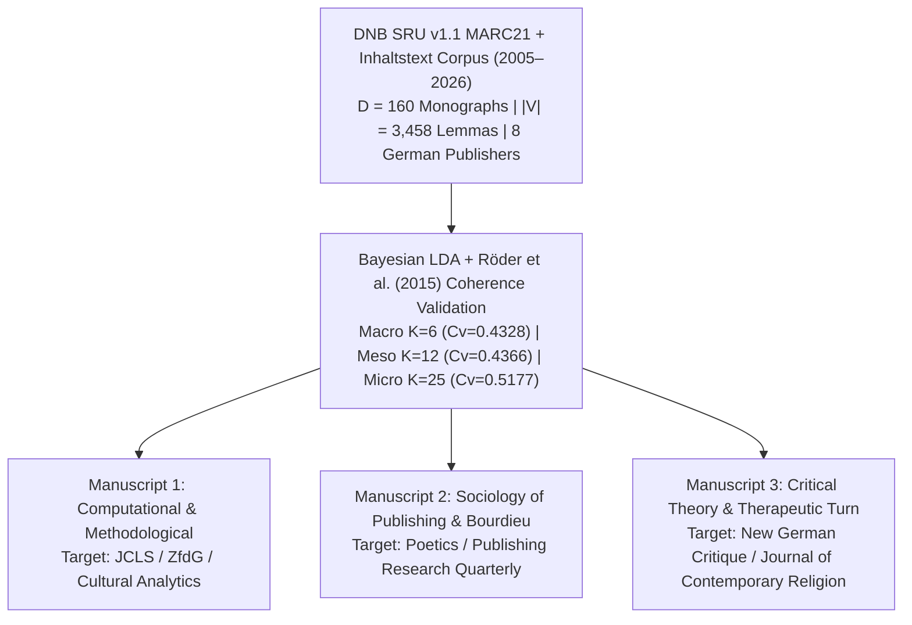

# Peer-Reviewed Journal Submission Strategy & Manuscript Blueprints

**Project Title:** *Mediating Faith & Power: A Computational Topic Modeling (LDA) Analysis of German Theological, Self-Help, and Secular-Academic Publishing (2005–2026)*  
**Author:** Paul Marandi, Ph.D. Scholar  
**Institution:** Centre for German Studies (CGS), School of Language, Literature and Culture Studies (SLL&CS), Jawaharlal Nehru University (JNU), New Delhi  
**Empirical Observatory:** [https://deutscheverlagelda.vercel.app](https://deutscheverlagelda.vercel.app)

---

## 1. Executive Publication Architecture

Because this doctoral project bridges **Computational Literary Studies (*Digitale Literaturwissenschaft*)**, **Book History (*Buchwissenschaft*)**, **Sociology of Religion (*Religionssoziologie*)**, and **German Critical Theory (*Kulturwissenschaft*)**, its empirical findings can be strategically unbundled into **three distinct, non-overlapping peer-reviewed journal articles** (the "Three-Pillar Dissertation Publication Model"):



---

## 2. Comprehensive Journal Target Matrix (24 Peer-Reviewed Venues)

### Pillar I: Computational Literary Studies, Digital Humanities & Cultural Analytics
*Primary fit for the **DNB SRU v1.1 MARC21 harvesting architecture**, **German compound-noun lemmatization (`de_core_news_lg`)**, **Röder et al. (2015) $C_v$ vs. $U_{\text{Mass}}$ coherence grid validation**, and **3-Pane Computational Hermeneutics Observatory**.*

| Journal | Publisher / Affiliation | Indexing / Tier | Language | Access Model | Strategic Fit & Submission Notes |
| :--- | :--- | :--- | :--- | :--- | :--- |
| **Journal of Computational Literary Studies (JCLS)** | Open Library of Humanities / TU Darmstadt | Scopus / DOAJ | English / German | Diamond OA (No APC) | **Top Priority (Methodological):** The premier European/German venue for computational *Germanistik*, DNB metadata analysis, and topic modeling. |
| **Zeitschrift für digitale Geisteswissenschaften (ZfdG)** | Forschungsverbund Marbach Weimar Wolfenbüttel | Scopus / DOAJ | German / English | Diamond OA (No APC) | **Top Priority (German DH):** Publishes landmark studies on German national bibliography (DNB) corpora, MARC21 pipelines, and distant reading. |
| **Journal of Cultural Analytics (CA)** | Open Access (Dir. Andrew Piper, McGill) | Web of Science / Scopus (Q1) | English | Diamond OA (No APC) | Ideal for macro-scale cultural sociology of book markets and lexical shifts across decades. |
| **Digital Scholarship in the Humanities (DSH)** | Oxford University Press (EADH) | AHCI / Scopus (Q1) | English | Hybrid | High-prestige venue for combining Bayesian latent variable models with hermeneutic close reading. |
| **Digital Humanities Quarterly (DHQ)** | Alliance of Digital Humanities Organizations | Scopus / Web of Science | English | Diamond OA (No APC) | Strong fit for papers showcasing both empirical topic modeling and interactive research workbench design. |
| **International Journal of Humanities and Arts Computing (IJHAC)** | Edinburgh University Press | AHCI / Scopus | English | Hybrid | Welcomes corpus-construction and national-catalog metadata studies. |

---

### Pillar II: Book History, Publishing Studies & Sociology of Literature (*Buchwissenschaft*)
*Primary fit for the **8-Publisher × 3-Archetype Matrix** (*Verlag Herder, St. Benno, SCM R. Brockhaus, Kösel-Verlag, Gräfe und Unzer, J. Kamphausen, Suhrkamp / Insel, C.H. Beck*) and **Pierre Bourdieu's theory of the field of cultural production**.*

| Journal | Publisher / Affiliation | Indexing / Tier | Language | Access Model | Strategic Fit & Submission Notes |
| :--- | :--- | :--- | :--- | :--- | :--- |
| **Poetics: Journal of Empirical Research on Culture, the Media and the Arts** | Elsevier | SSCI / Scopus (Q1) | English | Hybrid | **Top Priority (Sociology of Culture):** Flagship Bourdieu-tradition journal that privileges quantitative/computational methods (LDA, correspondence analysis) applied to publishing fields. |
| **Archiv für Geschichte des Buchwesens (AGB)** | De Gruyter (Historische Kommission des Börsenvereins) | Scopus / ERIH+ | German / English | Subscription / Green OA | Germany's most authoritative periodical for *Verlagsgeschichte* and structural transformations of the German book trade. |
| **Publishing Research Quarterly (PRQ)** | Springer | Scopus (Q2) | English | Hybrid | Focuses on contemporary book industry strategy (2005–2026), imprint repositioning, and the rise of the *Lebenshilfe* (self-help) market. |
| **Book History** | Johns Hopkins University Press (SHARP) | AHCI / Scopus (Q1) | English | Subscription | Flagship international journal for the social, economic, and ideological history of print culture. |
| **Internationales Archiv für Sozialgeschichte der deutschen Literatur (IASL)** | De Gruyter | AHCI / Scopus | German / English | Hybrid | Bridges German literary studies (*Germanistik*) with the institutional sociology of publishers and intellectual milieus. |
| **Logos: Journal of the World Book Community** | Brill | Scopus | English | Hybrid | Examines editorial gatekeeping, trade vs. religious publishing, and global book market shifts. |

---

### Pillar III: Sociology of Religion, Post-Secularism & the Therapeutic Turn
*Primary fit for testing the **three ideological regimes** ($RQ_1$ Ecclesiastical Continuity, $RQ_2$ Neoliberal Mindfulness/Self-Optimization, $RQ_3$ Post-Secular Critical Theory).*

| Journal | Publisher / Affiliation | Indexing / Tier | Language | Access Model | Strategic Fit & Submission Notes |
| :--- | :--- | :--- | :--- | :--- | :--- |
| **Journal of Contemporary Religion** | Taylor & Francis | AHCI / SSCI (Q1) | English | Hybrid | **Top Priority (Religion & Spirituality):** Leading venue on alternative spirituality, the mindfulness (*Achtsamkeit*) industry, and changing Christian institutions in Europe. |
| **Zeitschrift für Religionswissenschaft (ZfR)** | De Gruyter (DVRW) | Scopus / ERIH+ | German / English | Diamond OA | Official journal of the German Association for the Study of Religions; ideal for empirical studies of religion in German print media. |
| **Social Compass** | SAGE (ISSR) | SSCI / Scopus (Q1) | English / French | Hybrid | Strong focus on European secularization, post-secularism, and the commodification of spiritual practices. |
| **Sociology of Religion** | Oxford University Press (ASR) | SSCI (Q1) | English | Hybrid | Premier venue for quantitative and computational sociology of religious vs. secular discourse. |
| **Method & Theory in the Study of Religion (MTSR)** | Brill | AHCI / Scopus (Q1) | English | Hybrid | Ideal for demonstrating how Bayesian topic modeling operationalizes theories by Charles Taylor, Habermas, and Carrette & King. |
| **Culture and Religion** | Taylor & Francis | AHCI / Scopus | English | Hybrid | Explores the mediation of religion through consumer capitalism, lifestyle publishing, and popular culture. |

---

### Pillar IV: German Studies (*Germanistik* / *Kulturwissenschaft*) & Critical Theory
*Primary fit for situating the research within contemporary German intellectual history, **Suhrkamp-Kultur**, **C.H. Beck** humanities publishing, and neoliberal subjectivity.*

| Journal | Publisher / Affiliation | Indexing / Tier | Language | Access Model | Strategic Fit & Submission Notes |
| :--- | :--- | :--- | :--- | :--- | :--- |
| **New German Critique (NGC)** | Duke University Press | AHCI / Scopus (Q1) | English | Subscription | **Top Priority (Critical Theory):** Premier venue for Frankfurt School theory, *Suhrkamp* intellectual history, post-secularism (Habermas), and critiques of neoliberalism. |
| **German Studies Review (GSR)** | Johns Hopkins University Press (GSA) | AHCI / SSCI (Q1) | English | Subscription | Flagship interdisciplinary journal of the German Studies Association; welcomes studies on post-2000 German cultural institutions. |
| **Deutsche Vierteljahrsschrift für Literaturwissenschaft und Geistesgeschichte (DVjs)** | Springer / J.B. Metzler | AHCI / Scopus (Q1) | German / English | Hybrid | Classic venue for *Geistesgeschichte*, secularization debates, and computational approaches to German intellectual history. |
| **Seminar: A Journal of Germanic Studies** | University of Toronto Press | AHCI / Scopus | English / German | Hybrid | Frequently publishes special issues on Digital German Studies and contemporary German non-fiction (*Sachbuch*). |
| **German Life and Letters (GLL)** | Wiley | AHCI / Scopus | English / German | Hybrid | Strong UK/international venue for contemporary German cultural politics and publishing institutions. |
| **Kölner Zeitschrift für Soziologie und Sozialpsychologie (KZfSS)** | Springer VS | SSCI / Scopus (Q1) | German / English | Hybrid | Germany's leading sociology journal; strong fit for empirical analysis of the shift from *Seelsorge* to *Selbstoptimierung*. |

---

## 3. Tailored Manuscript Abstracts & Outlines

### Manuscript 1: Computational & Methodological Article
* **Target Venues:** *Journal of Computational Literary Studies (JCLS)* or *Zeitschrift für digitale Geisteswissenschaften (ZfdG)*
* **Proposed Title:** *Distant Reading the Post-Secular Book Market: A Bayesian Topic Modeling (LDA) and Coherence Validation Pipeline for German National Bibliography (DNB) Metadata (2005–2026)*

#### Abstract (English — Flowing Prose, 240 Words)
While computational literary studies have increasingly turned to national bibliographies to reconstruct macro-historical shifts in print culture, contemporary German non-fiction (*Sachbuch*) and religious-therapeutic publishing remain under-explored at scale. This article introduces an end-to-end computational hermeneutics pipeline that harvests, normalizes, and models catalog records and publisher blurbs (*Inhaltstexte*) from the German National Library (*Deutsche Nationalbibliothek*, DNB) via the SRU v1.1 protocol in MARC21 XML format (`2005–2026`). Focusing on a stratified corpus of eight major German publishing houses across confessional-theological (*Verlag Herder, St. Benno Verlag, SCM R. Brockhaus*), mindfulness/self-help (*Kösel-Verlag, Gräfe und Unzer, J. Kamphausen*), and secular-academic (*Suhrkamp / Insel, C.H. Beck*) segments, we extract a composite textual field combining MARC21 titles (`Tag 245$a/$b`), subject headings (`Tags 650/653/689$a`), summaries (`Tag 520$a`), and linked deposit blurbs (`Tag 856$u`). Following Unicode `NFC` normalization and German morphosyntactic lemmatization via spaCy (`de_core_news_lg`) restricted to open-class nouns, proper nouns, and adjectives ($|V| = 3,458$ lemmas), we evaluate variational Bayes Latent Dirichlet Allocation (LDA) across $K \in \{4, 6, 8, 10, 12, 15, 20, 25, 30\}$ using both intrinsic document co-occurrence ($U_{\text{Mass}}$) and extrinsic sliding-window Normalized Pointwise Mutual Information ($C_v$; Röder et al., 2015). We demonstrate that multi-scale granularity selection—contrasting a Macro Regime ($K=6, C_v=0.4328$), a Meso Editorial Regime ($K=12, C_v=0.4366$), and a Global Micro Optimum ($K=25, C_v=0.5177$)—captures both macro-ideological polarization and micro-thematic hybridization across twenty-first-century German print culture.

#### Zusammenfassung (Deutsch — für JCLS / ZfdG)
Obwohl computergestützte Studien zunehmend Nationalbibliografien nutzen, um makrosoziologische Transformationen des Buchmarktes zu rekonstruieren, blieb das zeitgenössische deutsche Sachbuch- und Religionssegment zwischen Theologie, Lebenshilfe und Kritischer Theorie bislang weitgehend unerforscht. Dieser Beitrag präsentiert eine vollständige Pipeline der *Computational Hermeneutics*, die Katalogdaten und Verlagsklappentexte (*Inhaltstexte*) der Deutschen Nationalbibliothek (DNB) über die SRU-Schnittstelle (v1.1) im MARC21-XML-Format für den Zeitraum `2005–2026` erschließt. Anhand eines stratifizierten Korpus von acht repräsentativen deutschen Verlagen aus dem konfessionell-theologischen (*Verlag Herder, St. Benno, SCM R. Brockhaus*), dem therapeutisch-achtsamkeitsorientierten (*Kösel-Verlag, Gräfe und Unzer, J. Kamphausen*) sowie dem säkular-wissenschaftlichen Feld (*Suhrkamp / Insel, C.H. Beck*) werden Titel (`Tag 245$a/$b`), Schlagwörter (`Tags 650/653/689$a`), Abstracts (`Tag 520$a`) und verlinkte Inhaltstexte (`Tag 856$u`) zusammengeführt. Nach Unicode-`NFC`-Normalisierung und morphosyntaktischer Lemmatisierung mittels spaCy (`de_core_news_lg`, gefiltert auf `NOUN`, `PROPN` und `ADJ`; Vokabulargröße $|V| = 3.458$) wird die Modellgüte der Latent Dirichlet Allocation (LDA) systematisch über $K \in [4, 30]$ mittels $U_{\text{Mass}}$ und $C_v$ (Röder et al., 2015) evaluiert. Die Ergebnisse zeigen, dass erst eine mehrskalige Modellierung – vom Makro-Regime ($K=6, C_v=0,4328$) über das Meso-Regime ($K=12, C_v=0,4366$) bis zum globalen Kohärenzoptimum ($K=25, C_v=0,5177$) – die diskursive Verschiebung von kirchlicher Seelsorge zu neoliberaler Selbstoptimierung präzise sichtbar macht.

#### Section Outline (IMRAD Structure)
1. **Introduction:** National bibliographies as cultural observatories; the gap in computational studies of contemporary German non-fiction and religious publishing (`2005–2026`).
2. **Corpus Design & DNB SRU Harvesting:** Stratified sampling of 8 German imprints; MARC21 field fusion (`245`, `264`, `520`, `650/689`, `856$u` *Inhaltstext* scraping); C1 control-character sanitization (`\u0098`/`\u009c`).
3. **Morphosyntactic Preprocessing & Bayesian Specification:** German compound-noun handling via `de_core_news_lg`; domain-neutral vs. ideological signal retention; online variational Bayes inference (Hoffman et al., 2010).
4. **Empirical Results: Multi-Scale Coherence Grid ($K \in [4, 30]$):** Divergence between intrinsic $U_{\text{Mass}}$ and extrinsic NPMI $C_v$; quantitative justification of the Macro ($K=6$), Meso ($K=12$), and Micro ($K=25$) analytical regimes.
5. **Discussion & Open-Science Observatory:** Bridging distant reading and hermeneutic inspection via the interactive 3-Pane Split-View Research IDE (`deutscheverlagelda.vercel.app`).

---

### Manuscript 2: Sociology of Publishing & Cultural Production Article
* **Target Venues:** *Poetics: Journal of Empirical Research on Culture, the Media and the Arts* or *Publishing Research Quarterly*
* **Proposed Title:** *From Confessional Pastoralism to Market Mindfulness: Mapping Ideological Differentiation Across Eight German Publishing Houses via Latent Dirichlet Allocation (2005–2026)*

#### Abstract (Flowing Prose, 235 Words)
Drawing on Pierre Bourdieu's sociology of cultural production and recent theories of the neoliberal therapeutic turn (Illouz, 2008; Carrette & King, 2005), this study investigates how German publishing houses have renegotiated the boundaries between theology, psychological self-optimization, and secular social critique over the past two decades (`2005–2026`). Whereas traditional book history relies on qualitative case studies of individual imprints, we apply Bayesian Latent Dirichlet Allocation (LDA) to bibliographic records and publisher blurbs (*Inhaltstexte*) harvested from the German National Library (DNB) across eight houses spanning three institutional poles: confessional-theological imprints (*Verlag Herder, St. Benno Verlag, SCM R. Brockhaus*), lifestyle and spirituality imprints (*Kösel-Verlag, Gräfe und Unzer, J. Kamphausen*), and secular-academic trade imprints (*Suhrkamp / Insel, C.H. Beck*). By projecting the posterior topic-word distributions ($\phi_k$) onto a three-way ideological taxonomy—*Traditional/Ecclesiastical*, *Neoliberal/Self-Optimization*, and *Critical/Secular-Humanist*—we construct an empirical Publisher × Ideological Archetype Matrix. Our findings reveal a pronounced structural bifurcation: while *Verlag Herder* and *St. Benno* preserve high concentrations of ecclesial and liturgical discourse (*Kirche, Liturgie, Sakrament*), historically Catholic houses such as *Kösel-Verlag* exhibit a decisive discursive pivot toward secularized mindfulness and resilience (*Achtsamkeit, Resilienz, Selbstoptimierung*), converging with commercial lifestyle imprints (*Gräfe und Unzer*). Conversely, *Suhrkamp* and *C.H. Beck* monopolize the macro-sociological critique of secularization and late capitalism (*Säkularisierung, Kapitalismus, Macht*), demonstrating how editorial gatekeeping mediates ideological power in contemporary print markets.

#### Section Outline (IMRAD Structure)
1. **Introduction:** Bourdieu's field of religious and cultural production applied to the 21st-century German book trade.
2. **Theoretical Framework:** The three discursive regimes—Ecclesiastical Continuity ($RQ_1$), the Neoliberal Therapeutic Turn ($RQ_2$), and Post-Secular Critical Theory ($RQ_3$).
3. **Data & Computational Methodology:** DNB SRU corpus (`2005–2026`); posterior document-topic aggregation ($\theta_d$) by publisher imprint and publication year.
4. **Results — The Publisher × Ideological Archetype Matrix:** Empirical comparison of imprint profiles; tracking the "Kösel pivot" from pastoral theology to secular mindfulness; diachronic trajectories across `2005–2026`.
5. **Conclusion:** Implications for the sociology of publishing and the commercialization of spiritual capital.

---

### Manuscript 3: Critical Theory & Sociology of Religion Article
* **Target Venues:** *New German Critique* or *Journal of Contemporary Religion*
* **Proposed Title:** *Seelsorge or Selbstoptimierung? The Displacement of Confessional Theology by Neoliberal Mindfulness in Contemporary German Print Culture (2005–2026)*

#### Abstract (Flowing Prose, 230 Words)
In *A Secular Age* (2007) and *Post-Secular Society* (2008), Charles Taylor and Jürgen Habermas diagnosed a pluralization of spiritual and secular frameworks in contemporary Western modernity, while Hartmut Rosa (2016) and Byung-Chul Han (2014) have critiqued the appropriation of contemplative traditions as instruments of neoliberal self-optimization (*Selbstoptimierung*). This article tests these philosophical diagnoses empirically against the lexical evolution of German religious, therapeutic, and critical-theoretical publishing between `2005` and `2026`. Combining computational topic modeling (Latent Dirichlet Allocation) of German National Library (DNB) catalog abstracts (*Inhaltstexte*) with close hermeneutic reading of representative monographs, we trace the shifting semantic neighborhoods of key German concepts across twenty-one years of print production. Our analysis demonstrates that the classical vocabulary of Christian pastoral care (*Seelsorge, Gnade, Erlösung, Gemeinde*) has not simply vanished under secularization; rather, in the commercial non-fiction market, it has been functionally translated into an individualized grammar of stress regulation, somatic resilience, and market performance (*Achtsamkeit, Resilienz, Gelassenheit, Burnout, Erfolg*). At the same time, high-theory imprints (*Suhrkamp, C.H. Beck*) have forged a counter-discourse centered on resonance, alienation, and democratic crisis (*Resonanz, Kapitalismus, Moderne*). By integrating distant reading with critical theory, the article shows how contemporary German publishing acts as a primary ideological apparatus where faith is either privatized into therapeutic self-management or mobilized as post-secular critique.

---

## 4. Cover Letter Template for Journal Submission

```text
[Date]

To the Editorial Board
[Journal Name, e.g., Journal of Computational Literary Studies / Poetics / New German Critique]

Subject: Manuscript Submission — "[Insert Selected Manuscript Title]"

Dear Editors,

I am pleased to submit our original research manuscript, "[Insert Selected Manuscript Title]," for consideration for publication in [Journal Name]. This research forms part of my doctoral dissertation at the Centre for German Studies (CGS), School of Language, Literature and Culture Studies (SLL&CS), Jawaharlal Nehru University (JNU), New Delhi.

[For JCLS / ZfdG / Cultural Analytics:]
Our study presents an end-to-end computational hermeneutics pipeline for harvesting and modeling German National Library (DNB) MARC21 records and publisher blurbs (Inhaltstexte) via the SRU v1.1 protocol across the period 2005–2026. Using German morphosyntactic lemmatization (spaCy de_core_news_lg, |V| = 3,458 lemmas) and systematic multi-metric coherence validation (Röder et al., 2015 Cv vs. UMass across K in [4, 30]), we demonstrate how multi-scale Latent Dirichlet Allocation (Macro K=6, Meso K=12, Micro K=25) uncovers the structural transformation of German theological, self-help (Lebenshilfe), and secular-academic publishing.

[For Poetics / New German Critique / Journal of Contemporary Religion:]
Bridging computational distant reading of German National Library (DNB) records (2005–2026) with the critical sociology of Pierre Bourdieu, Jürgen Habermas, Hartmut Rosa, and Eva Illouz, our study empirically maps how eight flagship German publishing houses (Verlag Herder, St. Benno, SCM R. Brockhaus, Kösel-Verlag, Gräfe und Unzer, J. Kamphausen, Suhrkamp / Insel, and C.H. Beck) have mediated the shift from confessional pastoral care (Seelsorge) to neoliberal self-optimization (Achtsamkeit, Resilienz, Selbstoptimierung).

To ensure full methodological transparency and reproducibility in accordance with open-science standards, we accompany the manuscript with an interactive 3-Pane Computational Hermeneutics Observatory (https://deutscheverlagelda.vercel.app) and open source code repository.

This manuscript is original, has not been published previously, and is not under consideration for publication elsewhere. Thank you for your time and consideration.

Sincerely,

Paul Marandi
Ph.D. Scholar
Centre for German Studies (CGS)
School of Language, Literature and Culture Studies (SLL&CS)
Jawaharlal Nehru University (JNU), New Delhi, India
```

---

## 5. Core APA 7th Edition Reference List for Manuscript Submissions

* Blei, D. M., Ng, A. Y., & Jordan, M. I. (2003). Latent Dirichlet allocation. *Journal of Machine Learning Research*, *3*, 993–1022.
* Bourdieu, P. (1993). *The field of cultural production: Essays on art and literature*. Columbia University Press.
* Carrette, J., & King, R. (2005). *Selling spirituality: The silent takeover of religion*. Routledge.
* Habermas, J. (2008). Notes on post-secular society. *New Perspectives Quarterly*, *25*(4), 17–29.
* Han, B.-C. (2014). *Psychopolitik: Neoliberalismus und die neuen Machttechniken*. S. Fischer Verlag.
* Hoffman, M., Bach, F. R., & Blei, D. M. (2010). Online learning for latent Dirichlet allocation. In *Advances in Neural Information Processing Systems* (Vol. 23, pp. 856–864).
* Illouz, E. (2008). *Saving the modern soul: Therapy, emotions, and the culture of self-help*. University of California Press.
* Mimno, D., Wallach, H., Talley, E., Leenders, M., & McCallum, A. (2011). Optimizing semantic coherence in topic models. In *Proceedings of the 2011 Conference on Empirical Methods in Natural Language Processing* (pp. 262–272). Association for Computational Linguistics.
* Piper, A. (2018). *Enumerations: Data and literary study*. University of Chicago Press.
* Röder, M., Both, A., & Hinneburg, A. (2015). Exploring the space of topic coherence measures. In *Proceedings of the Eighth ACM International Conference on Web Search and Data Mining (WSDM '15)* (pp. 399–408). ACM.
* Rosa, H. (2016). *Resonanz: Eine Soziologie der Weltbeziehung*. Suhrkamp Verlag.
* Taylor, C. (2007). *A secular age*. Harvard University Press.
