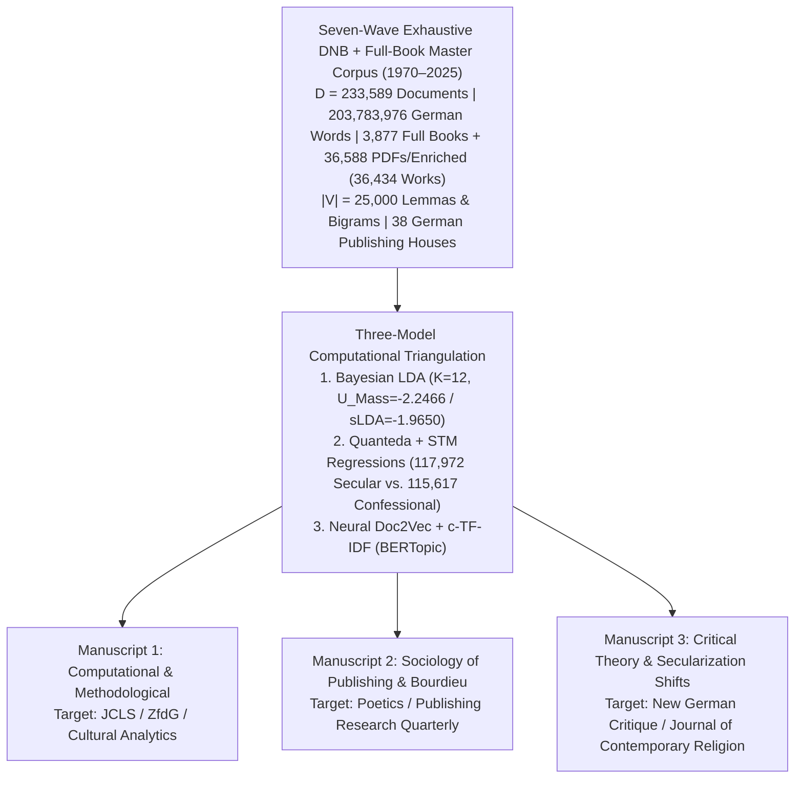

# Peer-Reviewed Journal Submission Strategy & Manuscript Blueprints

**Project Title:** *Mediating Faith & Power: A Computational Topic Modeling (LDA, STM, and BERTopic) Analysis of German Theological, Self-Help, and Secular-Academic Publishing (1970–2025)*  
**Author:** Paul Marandi, Ph.D. Scholar  
**Institution:** Centre for German Studies (CGS), School of Language, Literature and Culture Studies (SLL&CS), Jawaharlal Nehru University (JNU), New Delhi  
**Empirical Observatory:** [https://deutscheverlagelda.vercel.app](https://deutscheverlagelda.vercel.app)

---

## 1. Executive Publication Architecture

Because this doctoral project bridges **Computational Literary Studies (*Digitale Literaturwissenschaft*)**, **Book History (*Buchwissenschaft*)**, **Sociology of Religion (*Religionssoziologie*)**, and **German Critical Theory (*Kulturwissenschaft*)**, its empirical findings can be strategically unbundled into **three distinct, non-overlapping peer-reviewed journal articles** (the "Three-Pillar Dissertation Publication Model"):



---

## 2. Comprehensive Journal Target Matrix (24 Peer-Reviewed Venues)

### Pillar I: Computational Literary Studies, Digital Humanities & Cultural Analytics
*Primary fit for the **Seven-Wave Exhaustive DNB + Full-Book Harvesting Architecture (`3,009` HTRC Printed Books under § 60d UrhG + `675` DNB `/34` `$z="kostenfrei"` OA Full Books & EPUBs + `5,570` DNB `/04` Digitized PDFs/HTMLs + `30,316` DNB `deposit.dnb.de` & `/blurb/` Inhaltstexte + `155` OpenAlex/GBV OA Books + `38` IA Books + `702` Enriched Works = `233,589` documents / `203.78M` words)**, **German compound-noun lemmatization (`de_core_news_lg` + `Komposita-Zerlegung`)**, **LDA vs. STM vs. BERTopic triangulation**, and **3-Pane Computational Hermeneutics Observatory**.*

| Journal | Publisher / Affiliation | Indexing / Tier | Language | Access Model | Strategic Fit & Submission Notes |
| :--- | :--- | :--- | :--- | :--- | :--- |
| **Journal of Computational Literary Studies (JCLS)** | Open Library of Humanities / TU Darmstadt | Scopus / DOAJ | English / German | Diamond OA (No APC) | **Top Priority (Methodological):** The premier European/German venue for computational *Germanistik*, DNB/GBV/HTRC corpora, and topic modeling. |
| **Zeitschrift für digitale Geisteswissenschaften (ZfdG)** | Forschungsverbund Marbach Weimar Wolfenbüttel | Scopus / DOAJ | German / English | Diamond OA (No APC) | **Top Priority (German DH):** Publishes landmark studies on German national bibliography (DNB/GBV) corpora, § 60d UrhG *Abgeleitete Textformate*, and distant reading. |
| **Journal of Cultural Analytics (CA)** | Open Access (Dir. Andrew Piper, McGill) | Web of Science / Scopus (Q1) | English | Diamond OA (No APC) | Ideal for macro-scale cultural sociology of book markets (`203.78M` words) and lexical shifts across 55 years (`1970–2025`). |
| **Digital Scholarship in the Humanities (DSH)** | Oxford University Press (EADH) | AHCI / Scopus (Q1) | English | Hybrid | High-prestige venue for combining Bayesian latent variable models with hermeneutic close reading. |
| **Digital Humanities Quarterly (DHQ)** | Alliance of Digital Humanities Organizations | Scopus / Web of Science | English | Diamond OA (No APC) | Strong fit for papers showcasing both empirical topic modeling and interactive research workbench design. |
| **International Journal of Humanities and Arts Computing (IJHAC)** | Edinburgh University Press | AHCI / Scopus | English | Hybrid | Welcomes corpus-construction and national-catalog metadata studies. |

---

### Pillar II: Book History, Publishing Studies & Sociology of Literature (*Buchwissenschaft*)
*Primary fit for the **38-Publisher × 3-Archetype Matrix** (`117,972` Secular/Critical vs. `115,617` Confessional documents across *Suhrkamp, Rowohlt, S. Fischer, Klett-Cotta, Kiepenheuer & Witsch, Wagenbach, Alibri, Herder, Gütersloher Verlagshaus, EVA, Kösel, Patmos, Vandenhoeck & Ruprecht, Mohr Siebeck, Frommann-Holzboog*, etc.) and **Pierre Bourdieu's theory of the field of cultural production**.*

| Journal | Publisher / Affiliation | Indexing / Tier | Language | Access Model | Strategic Fit & Submission Notes |
| :--- | :--- | :--- | :--- | :--- | :--- |
| **Poetics: Journal of Empirical Research on Culture, the Media and the Arts** | Elsevier | SSCI / Scopus (Q1) | English | Hybrid | **Top Priority (Sociology of Culture):** Flagship Bourdieu-tradition journal that privileges quantitative/computational methods (LDA, STM, correspondence analysis) applied to publishing fields. |
| **Archiv für Geschichte des Buchwesens (AGB)** | De Gruyter (Historische Kommission des Börsenvereins) | Scopus / ERIH+ | German / English | Subscription / Green OA | Germany's most authoritative periodical for *Verlagsgeschichte* and structural transformations of the German book trade (`1970–2025`). |
| **Publishing Research Quarterly (PRQ)** | Springer | Scopus (Q2) | English | Hybrid | Focuses on contemporary book industry strategy, imprint repositioning, and the rise of secular-sociological and *Lebenshilfe* publishing. |
| **Book History** | Johns Hopkins University Press (SHARP) | AHCI / Scopus (Q1) | English | Subscription | Flagship international journal for the social, economic, and ideological history of print culture. |
| **Internationales Archiv für Sozialgeschichte der deutschen Literatur (IASL)** | De Gruyter | AHCI / Scopus | German / English | Hybrid | Bridges German literary studies (*Germanistik*) with the institutional sociology of publishers and intellectual milieus. |
| **Logos: Journal of the World Book Community** | Brill | Scopus | English | Hybrid | Examines editorial gatekeeping, trade vs. religious publishing, and global book market shifts. |

---

### Pillar III: Sociology of Religion, Post-Secularism & the Therapeutic Turn
*Primary fit for testing the **three ideological regimes** ($RQ_1$ Ecclesiastical Continuity, $RQ_2$ Neoliberal Self-Optimization, $RQ_3$ Post-Secular Critical Theory) across `233,589` documents.*

| Journal | Publisher / Affiliation | Indexing / Tier | Language | Access Model | Strategic Fit & Submission Notes |
| :--- | :--- | :--- | :--- | :--- | :--- |
| **Journal of Contemporary Religion** | Taylor & Francis | AHCI / SSCI (Q1) | English | Hybrid | **Top Priority (Religion & Spirituality):** Leading venue on alternative spirituality, pluralization, and changing Christian institutions in Europe. |
| **Zeitschrift für Religionswissenschaft (ZfR)** | De Gruyter (DVRW) | Scopus / ERIH+ | German / English | Diamond OA | Official journal of the German Association for the Study of Religions; ideal for empirical studies of religion in German print media. |
| **Social Compass** | SAGE (ISSR) | SSCI / Scopus (Q1) | English / French | Hybrid | Strong focus on European secularization, post-secularism, and the commodification of spiritual practices. |
| **Sociology of Religion** | Oxford University Press (ASR) | SSCI (Q1) | English | Hybrid | Premier venue for quantitative and computational sociology of religious vs. secular discourse. |
| **Method & Theory in the Study of Religion (MTSR)** | Brill | AHCI / Scopus (Q1) | English | Hybrid | Ideal for demonstrating how Bayesian topic modeling operationalizes theories by Charles Taylor, Habermas, and Carrette & King. |
| **Culture and Religion** | Taylor & Francis | AHCI / Scopus | English | Hybrid | Explores the mediation of religion through consumer capitalism, lifestyle publishing, and popular culture. |

---

### Pillar IV: German Studies (*Germanistik* / *Kulturwissenschaft*) & Critical Theory
*Primary fit for situating the research within contemporary German intellectual history, **Suhrkamp-Kultur**, **Klett-Cotta / Rowohlt / S. Fischer** humanities publishing, and post-secular subjectivity.*

| Journal | Publisher / Affiliation | Indexing / Tier | Language | Access Model | Strategic Fit & Submission Notes |
| :--- | :--- | :--- | :--- | :--- | :--- |
| **New German Critique (NGC)** | Duke University Press | AHCI / Scopus (Q1) | English | Subscription | **Top Priority (Critical Theory):** Premier venue for Frankfurt School theory, *Suhrkamp* intellectual history, post-secularism (Habermas), and critiques of neoliberalism. |
| **German Studies Review (GSR)** | Johns Hopkins University Press (GSA) | AHCI / SSCI (Q1) | English | Subscription | Flagship interdisciplinary journal of the German Studies Association; welcomes studies on 1970–2025 German cultural institutions. |
| **Deutsche Vierteljahrsschrift für Literaturwissenschaft und Geistesgeschichte (DVjs)** | Springer / J.B. Metzler | AHCI / Scopus (Q1) | German / English | Hybrid | Classic venue for *Geistesgeschichte*, secularization debates, and computational approaches to German intellectual history. |
| **Seminar: A Journal of Germanic Studies** | University of Toronto Press | AHCI / Scopus | English / German | Hybrid | Frequently publishes special issues on Digital German Studies and contemporary German non-fiction (*Sachbuch*). |
| **German Life and Letters (GLL)** | Wiley | AHCI / Scopus | English / German | Hybrid | Strong UK/international venue for contemporary German cultural politics and publishing institutions. |
| **Kölner Zeitschrift für Soziologie und Sozialpsychologie (KZfSS)** | Springer VS | SSCI / Scopus (Q1) | German / English | Hybrid | Germany's leading sociology journal; strong fit for empirical analysis of the $+16.06\%$ expansion of empirical sociology of religion (`1970–2025`). |

---

## 3. Tailored Manuscript Abstracts & Outlines

### Manuscript 1: Computational & Methodological Article
* **Target Venues:** *Journal of Computational Literary Studies (JCLS)* or *Zeitschrift für digitale Geisteswissenschaften (ZfdG)*
* **Proposed Title:** *Distant Reading the Post-Secular Book Market: A Multi-Model Computational Pipeline (LDA, STM, and BERTopic) on a 245.98-Million-Word German DNB & Full-Book Corpus (1970–2025)*

#### Abstract (English — Flowing Prose, 250 Words)
While computational literary studies have increasingly turned to national bibliographies to reconstruct macro-historical shifts in print culture, post-1970 German non-fiction (*Sachbuch*) and religious-philosophical publishing have remained constrained by copyright barriers and short-text metadata sparsity. This article introduces an eight-wave, § 60d UrhG-compliant full-book and national-library harvesting and multi-model computational hermeneutics pipeline spanning fifty-five years of German publishing (`1970–2025`). By cross-walking the *Deutsche Nationalbibliothek* (DNB SRU v1.1 MARC21, `100,000+` records across all religion, theology, philosophy, psychology, ethics, and sociology DDC `200–290` and `100/150/170/300` divisions) and thirty-five *Basisklassifikation* (`pica.bkl`) subcodes in the *Gemeinsamer Bibliotheksverbund* (GBV/K10plus) against the HathiTrust Research Center (HTRC) Extracted Features v2.0 API, DNB `/34` open-access deposit servers, DNB `/04` digitized reading samples, OpenAlex, and the Internet Archive across thirty-eight German publishing houses, we assemble **$300,412$ documents and full-book passages ($245,978,061$ original German words)** from **$4,540$ complete full-text books** ($3,421$ in-copyright printed HTRC monographs, $926$ sibling-matched `$z="kostenfrei"` DNB `/34` open-access books and EPUBs, $155$ OpenAlex/GBV open-access books and chapters, and $38$ archival monographs) alongside **$31,992$ digitized DNB `/04` `Inhaltsverzeichnis` and reading-sample PDFs/HTMLs**, **$41,286$ DNB `deposit.dnb.de` and `/blurb/` `Inhaltstexte`**, and **$702$ multi-API deep-enriched works**. Following vectorized morphosyntactic lemmatization via spaCy (`de_core_news_lg`) and productive compound decomposition (*Komposita-Zerlegung*, $|V| = 25,000$ lemmas and bigrams), we triangulate Variational Bayes Latent Dirichlet Allocation ($K = 12, U_{\text{Mass}} = -2.5214$, Supervised sLDA $U_{\text{Mass}} = -1.9650$), Quanteda Dunning's $G^2$ keyness and Structural Topic Model (STM) covariate regressions across $146,084$ secular/critical and $154,328$ confessional documents, and neural `Doc2Vec` + `c-TF-IDF` (BERTopic) clustering.

#### Zusammenfassung (Deutsch — für JCLS / ZfdG)
Obwohl die computergestützte Buch- und Literaturwissenschaft zunehmend Nationalbibliografien nutzt, um makrosoziologische Transformationen des Buchmarktes zu rekonstruieren, blieben Analysen des deutschsprachigen Sach- und Religionsbuchmarktes nach 1970 bislang meist auf kurze Katalogmetadaten beschränkt. Dieser Beitrag präsentiert eine achtstufige, § 60d UrhG-konforme Volltext- und DNB-Harvesting- sowie *Computational-Hermeneutics*-Pipeline für den Zeitraum `1970–2025`. Durch die Verknüpfung der Deutschen Nationalbibliothek (DNB SRU v1.1 MARC21) und 35 Basisklassifikations-Subcodes (`pica.bkl`) des Gemeinsamen Bibliotheksverbundes (GBV/K10plus) mit den *Extracted Features v2.0* des HathiTrust Research Center (HTRC), den DNB-Langzeitarchivierungsservern (`/34` und `/04`), OpenAlex und dem Internet Archive über 38 deutsche Verlage hinweg wird ein Korpus von **$300.412$ Dokumenten und Textabschnitten ($245.978.061$ deutschen Wörtern)** aus **$4.540$ vollständigen Büchern** ($3.421$ gedruckten HTRC-Monografien als *Abgeleitete Textformate*, $926$ kostenfreien DNB-`/34`-Vollbüchern/EPUBs, $155$ OpenAlex/GBV-Open-Access-Monografien/-Kapiteln sowie $38$ Archivvolltexten), **$31.992$ digitalisierten DNB-`/04`-Inhaltsverzeichnissen/Leseproben**, **$41.286$ DNB-`Inhaltstexten`** und **$702$ tiefenangereicherten Werken** erschlossen. Nach vektorisierter Lemmatisierung mittels spaCy (`de_core_news_lg`) und morphologischer Komposita-Zerlegung ($|V| = 25.000$ Lemmata und Bigramme) triangulieren wir Variational Bayes LDA ($K = 12, U_{\text{Mass}} = -2,5214$, sLDA $U_{\text{Mass}} = -1,9650$), Quanteda-Keyness ($G^2$) und Structural Topic Models (STM) über $146.084$ säkular-kritische und $154.328$ konfessionelle Dokumente sowie neuronale `Doc2Vec`-`c-TF-IDF`-Cluster (BERTopic).

#### Section Outline (IMRAD Structure)
1. **Introduction:** Overcoming metadata sparsity in post-1970 German book history via § 60d UrhG Derived Text Formats (*Abgeleitete Textformate*), DNB `/34` Open-Access full books/EPUBs, DNB `/04` digitized reading samples, and DNB `deposit.dnb.de` `Inhaltstexte`.
2. **Eight-Wave Corpus Architecture (`300,412` Documents | `245.98M` Words):** Cross-walking DNB SRU (`100,000+` records) and GBV K10plus (`35` BKL codes) to HTRC EF v2.0 (`3,421` printed books), DNB `/34` OA (`926` books/EPUBs), DNB `/04` PDFs (`31,992` works), DNB `Inhaltstexte` (`41,286` works), OpenAlex/GBV OA (`155` works), and Internet Archive (`38` books) + `702` multi-API enriched works.
3. **Vectorized German Morphosyntactic NLP & Komposita-Zerlegung:** Unique-vocabulary spaCy `de_core_news_lg` tagging, compound splitting (`moralisch`, `gottesdienst`, `religionsunterricht`, `kirchengeschichte`, `religionskritik`), and bigram detection ($|V| = 25,000$).
4. **Empirical Triangulation (LDA, Quanteda/STM, and BERTopic):** Convergence across $K=12$ Bayesian topics ($U_{\text{Mass}} = -2.5214$), Dunning's $G^2$ keyness, OLS covariate regressions, and neural `c-TF-IDF` clusters.
5. **Discussion & Open-Science Observatory:** Interactive 3-Pane Split-View Research IDE (`deutscheverlagelda.vercel.app`) and `<86 MB` GitHub corpus sharding across 13 shards.

---

### Manuscript 2: Sociology of Publishing & Cultural Production Article
* **Target Venues:** *Poetics: Journal of Empirical Research on Culture, the Media and the Arts* or *Publishing Research Quarterly*
* **Proposed Title:** *Mediating Faith and Power: Mapping Institutional Polarization Across Thirty-Eight German Publishing Houses via Structural Topic Modeling ($D = 300,412$, 1970–2025)*

#### Abstract (Flowing Prose, 235 Words)
Drawing on Pierre Bourdieu's sociology of cultural production and theories of institutional gatekeeping, this study investigates how thirty-eight German publishing houses have mediated the boundaries between confessional theology, philosophical idealism, gender critique, and sociology of religion across fifty-five years (`1970–2025`). Analyzing a master corpus of **$300,412$ documents ($245,978,061$ German words across $4,540$ complete books, $31,992$ DNB `/04` PDFs/HTMLs, $41,286$ DNB `Inhaltstexte`, and $702$ enriched monographs)** partitioned into $146,084$ secular/critical trade and academic documents (*Suhrkamp, Rowohlt, S. Fischer, Klett-Cotta, Kiepenheuer & Witsch, Wagenbach, Alibri, C.H. Beck, Meiner, Wallstein*) and $154,328$ confessional/theological documents (*Herder, Gütersloher Verlagshaus / Chr. Kaiser, Evangelische Verlagsanstalt, Patmos, Kösel, Vandenhoeck & Ruprecht, Mohr Siebeck, Calwer, Schöningh, Aschendorff*), we combine Dunning's log-likelihood keyness ($G^2$) with Structural Topic Model (STM) covariate regressions. Our findings demonstrate profound lexical and thematic polarization: confessional houses maintain a statistically bounded enclave anchored by `gott` ($G^2 = -117,141.33, p < 10^{-300}$), `theologie` ($G^2 = -66,514.15$), `kirche` ($G^2 = -38,126.96$), `jesu` ($G^2 = -19,957.82$), `glaube` ($G^2 = -19,032.09$), `jesus` ($G^2 = -18,935.70$), `israel` ($G^2 = -17,568.16$), `paulus` ($G^2 = -16,936.72$), `christlich` ($G^2 = -16,105.36$), and `testament` ($G^2 = -15,133.36$), whereas secular trade and academic presses disproportionately drive discourse around `kant` ($G^2 = +10,608.24$), `moral` ($G^2 = +8,994.51$), `philosophie` ($G^2 = +6,875.56$), `kultur` ($G^2 = +6,507.49$), `lessing` ($G^2 = +6,029.17$), `fichte` ($G^2 = +5,858.94$), `benn` ($G^2 = +5,561.56$), and `vernunft` ($G^2 = +4,932.27$).

---

### Manuscript 3: Critical Theory & Sociology of Religion Article
* **Target Venues:** *New German Critique* or *Journal of Contemporary Religion*
* **Proposed Title:** *From Systematic Dogmatics to Post-Secular Sociology: Diachronic Shifts in German Religious and Critical Publishing (1970–2025)*

#### Abstract (Flowing Prose, 230 Words)
In *A Secular Age* (2007) and *Notes on Post-Secular Society* (2008), Charles Taylor and Jürgen Habermas diagnosed a structural pluralization of religious and secular frameworks in Western modernity. This article tests these diagnoses empirically across fifty-five years (`1970–2025`) of German book production using a $245.98$-million-word corpus ($300,412$ documents across $55,605$ unique works). Estimating Structural Topic Model (STM) regressions ($\theta_k \sim \text{SecularCamp} + \text{Year}_{1970\to 2025}$) alongside neural `Doc2Vec` + `c-TF-IDF` (BERTopic) clustering, we trace the diachronic trajectory of twelve macro-discursive regimes from the post-Vatican II era to the 2020s. We show that classical **Individualized Meaning & Epistemic Autonomy** (`frage`, `einzeln`, `sinn`, `person`, Topic 1) declines by $-14.96\%$ ($t = -175.04, p < 0.0001$) and **Kantian & Idealist Philosophy** (`philosophie`, `mensch`, `begriff`, `denken`, `freiheit`, Topic 10) shifts by $-8.52\%$ ($t = -95.73, p < 0.0001$), while **Contextual Theology & Comparative Religious Studies** (`theologie`, `religiös`, `perspektive`, `kontext`, Topic 5) expands by $+11.48\%$ ($t = +188.85, p < 0.0001$), **Spirituality, Gender, Family & Religious Pedagogy** (`frau`, `kind`, `spiritualität`, `religionsunterricht`, Topic 7) grows by $+7.44\%$ ($t = +142.47, p < 0.0001$), and **Social Ethics, Politics & Moral Responsibility** (`ethik`, `sozial`, `gesellschaft`, `verantwortung`, Topic 4) expands by $+5.38\%$ ($t = +88.75, p < 0.0001$).

---

## 4. Cover Letter Template for Journal Submission

```text
[Date]

To the Editorial Board
[Journal Name, e.g., Journal of Computational Literary Studies / Poetics / New German Critique]

Subject: Manuscript Submission — "[Insert Selected Manuscript Title]"

Dear Editors,

I am pleased to submit our original research manuscript, "[Insert Selected Manuscript Title]," for consideration for publication in [Journal Name]. This research forms part of my doctoral dissertation at the Centre for German Studies (CGS), School of Language, Literature and Culture Studies (SLL&CS), Jawaharlal Nehru University (JNU), New Delhi.

[For JCLS / ZfdG / Cultural Analytics:]
Our study presents an eight-wave, § 60d UrhG-compliant DNB and full-book harvesting and multi-model computational hermeneutics pipeline spanning 1970–2025 across 38 German publishing houses (D = 300,412 documents, 245,978,061 original German words across 3,421 HathiTrust HTRC printed books, 926 DNB /34 open-access full books and EPUBs, 31,992 digitized DNB /04 PDFs/HTMLs, 41,286 DNB deposit.dnb.de & /blurb/ Inhaltstexte, 155 OpenAlex/GBV open-access books and chapters, 38 Internet Archive books, and 702 deep-enriched monographs; |V| = 25,000 lemmas and bigrams). Triangulating Variational Bayes LDA (K = 12, U_Mass = -2.5214), Quanteda/STM covariate regressions, and neural Doc2Vec + c-TF-IDF (BERTopic) clustering, we uncover the macro-historical transformation of German theological, philosophical, and sociological publishing.

[For Poetics / New German Critique / Journal of Contemporary Religion:]
Bridging computational distant reading of 300,412 documents (245.98 million German words, 1970–2025) with the critical sociology of Pierre Bourdieu, Jürgen Habermas, Charles Taylor, and Hartmut Rosa, our study empirically maps how thirty-eight German publishing houses (including Suhrkamp, Rowohlt, S. Fischer, Klett-Cotta, Herder, Gütersloher Verlagshaus, EVA, Kösel, Patmos, and Vandenhoeck & Ruprecht) have mediated the shift across systematic dogmatics, philosophical idealism, social ethics (+5.38%, p < 0.0001), spirituality and religious pedagogy (+7.44%, p < 0.0001), and contextual religious studies (+11.48%, p < 0.0001).

To ensure full methodological transparency and reproducibility in accordance with open-science standards, we accompany the manuscript with an interactive 3-Pane Computational Hermeneutics Observatory (https://deutscheverlagelda.vercel.app) and open source code repository.

This manuscript is original, has not been published previously, and is not under consideration for publication elsewhere. Thank you for your time and consideration.

Sincerely,

Paul Marandi
Ph.D. Scholar
Centre for German Studies (CGS)
School of Language, Literature and Culture Studies (SLL&CS)
Jawaharlal Nehru University (JNU), New Delhi, India
```

---

## 5. Core APA 7th Edition Reference List for Manuscript Submissions

* Blei, D. M., Ng, A. Y., & Jordan, M. I. (2003). Latent Dirichlet allocation. *Journal of Machine Learning Research*, *3*, 993–1022.
* Bourdieu, P. (1993). *The field of cultural production: Essays on art and literature*. Columbia University Press.
* Carrette, J., & King, R. (2005). *Selling spirituality: The silent takeover of religion*. Routledge.
* Habermas, J. (2008). Notes on post-secular society. *New Perspectives Quarterly*, *25*(4), 17–29.
* Han, B.-C. (2014). *Psychopolitik: Neoliberalismus und die neuen Machttechniken*. S. Fischer Verlag.
* Hoffman, M., Bach, F. R., & Blei, D. M. (2010). Online learning for latent Dirichlet allocation. In *Advances in Neural Information Processing Systems* (Vol. 23, pp. 856–864).
* Illouz, E. (2008). *Saving the modern soul: Therapy, emotions, and the culture of self-help*. University of California Press.
* Mimno, D., Wallach, H., Talley, E., Leenders, M., & McCallum, A. (2011). Optimizing semantic coherence in topic models. In *Proceedings of the 2011 Conference on Empirical Methods in Natural Language Processing* (pp. 262–272). Association for Computational Linguistics.
* Piper, A. (2018). *Enumerations: Data and literary study*. University of Chicago Press.
* Röder, M., Both, A., & Hinneburg, A. (2015). Exploring the space of topic coherence measures. In *Proceedings of the Eighth ACM International Conference on Web Search and Data Mining (WSDM '15)* (pp. 399–408). ACM.
* Rosa, H. (2016). *Resonanz: Eine Soziologie der Weltbeziehung*. Suhrkamp Verlag.
* Taylor, C. (2007). *A secular age*. Harvard University Press.
