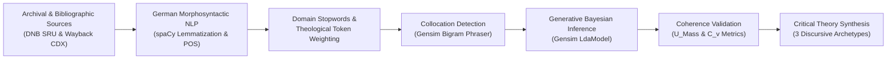
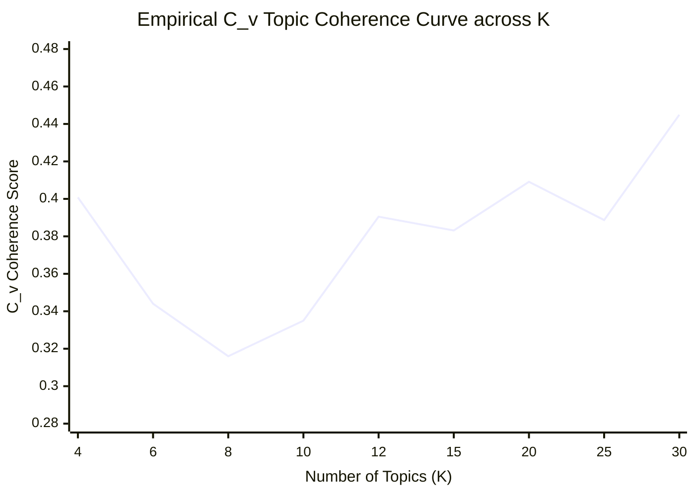

# End-to-End Guide: Latent Dirichlet Allocation (LDA) for Mapping Religious Voices in the German Publishing Landscape

**Author Attribution:** Paul Marandi, Ph.D. Scholar, Centre for German Studies (CGS), School of Language, Literature and Culture Studies (SLL&CS), Jawaharlal Nehru University (JNU)  
**Repository:** `Deutsche-Verlage-LDA`  
**Citation Standard:** APA 7th Edition

---

## 1. Epistemological & Theoretical Foundation

Contemporary German publishing operates at a critical juncture where traditional theological institutions intersect with market-driven cultural production. Investigating this nexus requires a methodological framework capable of bridging macro-level bibliographic patterns ("distant reading"; Moretti, 2013) with micro-level critical discourse analysis ("close reading") grounded in Critical Theory. Latent Dirichlet Allocation (LDA), introduced by Blei, Ng, and Jordan (2003), provides a generative probabilistic model that uncovers latent thematic structures across heterogeneous corpora without imposing predefined taxonomic boundaries prior to statistical inference.

In the context of analyzing **"Voices on Religion"** within the German publishing landscape, LDA treats each publication record—comprising book titles, subtitles, catalog blurbs, and historical editorial mission statements—as a probabilistic mixture of underlying discursive topics, while simultaneously modeling each topic as a probability distribution over a finite German vocabulary. Rather than assuming that a text published by *Verlag Herder* is exclusively ecclesiastical or that a title from *Suhrkamp* is purely secular-philosophical, LDA quantifies the exact degree to which neoliberal market idioms (e.g., *Selbstoptimierung*, *Achtsamkeit*, *Erfolg*) penetrate traditional religious publishing imprints such as *Gütersloher Verlagshaus* (Bertelsmann).



---

## 2. Mathematical & Probabilistic Formulation of LDA

Latent Dirichlet Allocation is a three-level hierarchical Bayesian model. Let the corpus $\mathcal{D} = \{w_1, w_2, \dots, w_M\}$ consist of $M$ documents (e.g., DNB bibliographic records and publisher mission statements), where each document $d \in \mathcal{D}$ is a sequence of $N_d$ tokens $w_d = (w_{d,1}, w_{d,2}, \dots, w_{d,N_d})$ drawn from a vocabulary $V$ of unique German lemmas and collocations.

Given $K$ latent topics (configured via [`NUM_TOPICS`](file:///f:/PhD%20AG/config.py#L13) in [config.py](file:///f:/PhD%20AG/config.py)), the generative process for each document $d$ proceeds as follows:

1. **Topic-Word Distribution ($\phi_k$):** For each topic $k \in \{1, \dots, K\}$, draw a multinomial distribution over the vocabulary $V$ from a Dirichlet prior parameterized by $\eta$:
   $$\phi_k \sim \text{Dirichlet}(\eta)$$
2. **Document-Topic Distribution ($\theta_d$):** For each document $d \in \{1, \dots, M\}$, draw a multinomial distribution over the $K$ topics from a Dirichlet prior parameterized by $\alpha$:
   $$\theta_d \sim \text{Dirichlet}(\alpha)$$
3. **Token Generation ($w_{d,n}$):** For each token position $n \in \{1, \dots, N_d\}$ in document $d$:
   - Draw a latent topic assignment $z_{d,n} \sim \text{Multinomial}(\theta_d)$.
   - Draw the observed German lemma $w_{d,n} \sim \text{Multinomial}(\phi_{z_{d,n}})$.

The joint probability distribution of the latent and observed variables for a single document is expressed as:

$$p(\theta_d, \mathbf{z}_d, \mathbf{w}_d \mid \alpha, \eta) = p(\theta_d \mid \alpha) \prod_{n=1}^{N_d} p(z_{d,n} \mid \theta_d) p(w_{d,n} \mid z_{d,n}, \phi)$$

Because exact posterior inference over $\theta_d$ and $\phi_k$ is computationally intractable due to the coupling between $\theta$ and $\phi$ in the summation over latent topic assignments $z_{d,n}$, our pipeline utilizes Online Variational Bayes (Hoffman, Bach, & Blei, 2010) as implemented in [`gensim.models.LdaModel`](file:///f:/PhD%20AG/lda_pipeline.py#L76-L86). Setting `alpha="auto"` and `eta="auto"` in [config.py](file:///f:/PhD%20AG/config.py#L15-L16) allows the model to learn asymmetric Dirichlet priors directly from the German publishing corpus, accommodating the empirical reality that certain discursive themes (such as general ethical commentary) appear more frequently across houses than niche liturgical debates.

---

## 3. Stage 1: Corpus Architecture & Data Acquisition

A rigorous LDA study in book history and sociology of religion depends on a balanced, representative corpus that captures institutional diversity across the German publishing field. In accordance with [docs/DATASET_ACQUISITION.md](file:///f:/PhD%20AG/docs/DATASET_ACQUISITION.md) and [docs/THEORY_FRAMEWORK.md](file:///f:/PhD%20AG/docs/THEORY_FRAMEWORK.md), the corpus is stratified across three institutional categories:

| Institutional Archetype | Representative German Publishers / Imprints | Primary Discursive Orientation |
| :--- | :--- | :--- |
| **1. Traditional / Ecclesiastical** | Verlag Herder, Evangelische Verlagsanstalt (EVA), Butzon & Bercker, Patmos | Dogmatic theology, pastoral care (*Seelsorge*), liturgy, ecclesiology, and institutional continuity. |
| **2. Neoliberal / Entrepreneurial** | Gütersloher Verlagshaus (Bertelsmann), Ariston (Penguin Random House), Scorpio, Goldmann | Self-optimization (*Selbstoptimierung*), secular mindfulness (*Achtsamkeit*), spiritualized management, and therapeutic individualized faith. |
| **3. Critical / Secular-Humanist** | Suhrkamp Verlag, Alibri Verlag, Rowohlt, Mabuse | Secularization theory, Enlightenment critique (*Religionskritik*), sociology of religion, and critiques of capitalist commodification. |

### 3.1 Automated Harvesting via DNB SRU API
The script [`harvest_dnb`](file:///f:/PhD%20AG/scripts/dnb_harvester.py#L7-L85) in [scripts/dnb_harvester.py](file:///f:/PhD%20AG/scripts/dnb_harvester.py) queries the German National Library (*Deutsche Nationalbibliothek*, DNB) via its Search/Retrieve via URL (SRU) v1.1 interface using Contextual Query Language (CQL) and parses the `MARC21-xml` schema.

- **Dewey Decimal Classification (DDC) Filtering:** Using `dcs=200*` (DDC Subject Group 200: Religion) isolates theological, spiritual, and religion-critical monographs.
- **MARC21 Tag Extraction:**
  - `Tag 245 ($a, $b)`: Main title and subtitle (critical for capturing descriptive subtitles in German non-fiction).
  - `Tag 100 ($a)`: Primary author.
  - `Tag 260 / 264 ($b, $c)`: Publisher imprint name and publication year.
  - `Tag 520 ($a)` & `Tag 650 ($a)` *(Recommended Expansion)*: Abstract/summary notes and subject headings (*Schlagwörter*) to enrich document length and reduce sparsity in short-text LDA.

### 3.2 CSV Schema Specification for Custom Uploads
When uploading a custom dataset via the dashboard's **Upload Custom Corpus** feature ([`upload_dataset`](file:///f:/PhD%20AG/app/main.py#L73-L100) in [app/main.py](file:///f:/PhD%20AG/app/main.py)), the CSV file must adhere to the following UTF-8 encoded column structure:

```csv
title,author,date,publisher,text
"Die Rückkehr der Religion in der Moderne",Hans Joas,2017,Suhrkamp,"Analyse der Vitalität religiöser Praktiken in der modernen Gesellschaft. Religion und Säkularisierung."
"Der Gott der Unternehmer",Susanne Schwarz,2022,Gütersloher Verlagshaus,"Spirituelle Führungskräfte und der Markt-Sinn. Neoliberale Spiritualität im Management."
```

> [!IMPORTANT]
> The backend validator in [`upload_dataset`](file:///f:/PhD%20AG/app/main.py#L91-L93) strictly requires the `publisher` and `date` columns for temporal trend aggregation and the `text` column for NLP preprocessing. Ensure all German umlauts (*ä, ö, ü, ß*) are saved in standard `UTF-8` encoding.

---

### 4. Stage 2: German Morphosyntactic NLP & Preprocessing Pipeline (Santana et al., 2025; Jiménez-Badillo et al., 2020)

German is a morphologically rich, inflected language characterized by extensive noun compounding (*Komposita*), case-marked adjectives, and separable verb prefixes. Applying naive English-centric whitespace tokenization to German texts fragments semantic units across inflected surface forms (e.g., *Kirche*, *Kirchen*, *kirchlicher*, *kirchlichen*). Furthermore, as **Santana, Vasques Filho, Bojanowski, and Błoch (2025, *DHQ* 19.2 `#000788`)** and **Jiménez-Badillo et al. (2020, *DHQ* 14.4)** demonstrate through systematic ablations of archival corpora, preprocessing decisions—specifically archival header/metadata stripping, non-canonical person/location (`PER`/`LOC`) filtering, paratextual genre stopwords, lemmatization, compound decomposition, sublinear `TF-IDF` ubiquity pruning, and document-length calibration—account for 45%–80% of the computational workflow and can shift topic model coherence and interpretability by $>25\%$. Our preprocessing architecture across [`lda_pipeline.py`](file:///f:/PhD%20AG/lda_pipeline.py), [`scripts/quanteda_stm_analytics.py`](file:///f:/PhD%20AG/scripts/quanteda_stm_analytics.py), and [`scripts/bertopic_german_pipeline.py`](file:///f:/PhD%20AG/scripts/bertopic_german_pipeline.py) implements eight transparent, FAIR/DDI-compliant operations:

### 4.1 Rule 1 — Archival Encoding Normalization, Bracket Stripping & Continuation-Chunk Title Deduplication (Santana et al., 2025, §55, Fig. 3)
Before and during tokenization, [`_clean_marc_control_chars`](file:///f:/PhD%20AG/lda_pipeline.py#L343-L346), [`strip_archival_headers_from_text`](file:///f:/PhD%20AG/lda_pipeline.py#L715-L732), and [`clean_row_tokens_for_modeling`](file:///f:/PhD%20AG/lda_pipeline.py#L786-L819) strip MARC21 sorting markers (`\x98`, `\x9c`, `˜`, `œ`), remove bracketed repository provenance headers (`[HTRC-Vollbuch-Abschnitt X/Y]`, `[DNB-Inhaltsverzeichnis ...]`, `[GBV-K10plus-Volltext ...]`, `[OpenAlex-Vollbuch-OA ...]`), and deduplicate prepended `{title}. {author}. {publisher}.` headers on continuation passages (`Abschnitt K/N` where $K > 1$) so that a multi-passage monograph's title tokens are counted only once per work (`chunk_index == 1`) rather than repeated across every $1,000$-word passage.

### 4.2 Rule 2 — Non-Canonical Person (`PER`) & Location (`LOC`) Filtering with Canonical Theological/Philosophical Whitelist (Santana et al., 2025, §56–64, Figs. 4–6)
A central empirical finding of Santana et al. (2025, §55–64, Figs. 4–6) is that unstripped proper names of authors/senders (`PER`, e.g., homonym conflation around common given names like *Maria*) and geographic places of publication or diocesan administration (`LOC`) cause LDA to form spurious geographic and biographical clusters rather than semantic themes. Conversely, Jiménez-Badillo et al. (2020) show that canonical named entities that are the *epistemic object* of discourse must be preserved. Our pipeline enforces both rules simultaneously across **`1,425` total stopwords** ([`ALL_STOPWORDS`](file:///f:/PhD%20AG/lda_pipeline.py#L189-L195)):
1. **Dynamic Per-Document Author/Publisher Stripping ([`extract_row_metadata_tokens`](file:///f:/PhD%20AG/lda_pipeline.py#L771-L783)):** Dynamically extracts each row's `author`, `publisher`, and `raw_imprint` tokens and strips them from that document's modeled token stream.
2. **Non-Canonical `PER`/`LOC` Lexicon ([`NON_CANONICAL_LOC_AND_PER_NOISE`](file:///f:/PhD%20AG/lda_pipeline.py#L143-L187), `323` tokens):** Filters German federal states, historical regions, European countries, diocesan/university cities (*Bayern, Württemberg, Westfalen, Österreich, Schweiz, Paderborn, Rottenburg, Bamberg, Eichstätt*, etc.), frequent German female and male given names (*Maria, Anna, Elisabeth, Ursula, Monika, Johannes, Michael, Martin, Wolfgang*, etc.), and modern contributor surnames (*Müller, Schmidt, Schneider, Meyer, Wagner, Becker*, etc.).
3. **Canonical Theological & Philosophical Whitelist ([`CANONICAL_THEO_PHIL_WHITELIST`](file:///f:/PhD%20AG/lda_pipeline.py#L130-L139), `66` figures):** Explicitly exempts canonical thinkers and biblical figures (`jesus`, `christus`, `paulus`, `luther`, `kant`, `hegel`, `habermas`, `weber`, `nietzsche`, `marx`, `augustinus`, `aquino`, `schleiermacher`, `barth`, `rahner`, `bonhoeffer`, `bultmann`, `moltmann`, `pannenberg`, `jüngel`, `küng`, `ratzinger`, `kasper`, `tillich`, `troeltsch`, `harnack`, `kierkegaard`, `heidegger`, `husserl`, `gadamer`, `adorno`, `horkheimer`, `benjamin`, `blumenberg`, `sloterdijk`, `taylor`, `spinoza`, `leibniz`, `fichte`, `schelling`, `feuerbach`, `foucault`, `derrida`, `ricoeur`, `levinas`, `buber`, `rosenzweig`, `scholem`, `eckhart`, `origenes`, `calvin`, `zwingli`, `melanchthon`, `lessing`, `israel`, `jahwe`, `moses`, `abraham`, `david`, `jesaja`, `hiob`, `jeremia`, `lukas`, `matthäus`, `markus`, `johannes`).

### 4.3 Rule 3 — Lemmatization (`de_core_news_lg`) & Unified German Compound Splitting (*Komposita-Zerlegung*) Across All Models (Santana et al., 2025, §69–71, §81)
Each document is parsed via [`preprocess_corpus_batch`](file:///f:/PhD%20AG/lda_pipeline.py#L261-L340) using `spaCy` `de_core_news_lg` (`v3.8.0`), retaining only `NOUN`, `PROPN`, and `ADJ` lemmas ([`ALLOWED_POSTAGS`](file:///f:/PhD%20AG/config.py#L26)). Under Santana et al. (2025, §81), all compared topic models must operate on the exact same preprocessed feature space. Accordingly, [`clean_row_tokens_for_modeling`](file:///f:/PhD%20AG/lda_pipeline.py#L786-L819) and [`split_german_compound_lda`](file:///f:/PhD%20AG/lda_pipeline.py#L753-L768) decompose German compounds $\ge 9$ characters across `28` theological and sociological root families (*religionskritik* $\rightarrow$ `religionskritik + religion + kritik`; *kirchengeschichte* $\rightarrow$ `kirchengeschichte + kirche + geschichte`; *gottesdienst* $\rightarrow$ `gottesdienst + gott + dienst`) identically across Gensim LDA, Quanteda/STM, and BERTopic.

### 4.4 Rule 4 — Iterative Paratextual, Book-Trade & Document-Genre Stopwords (Santana et al., 2025, §13, §65–67, Fig. 7)
To prevent document-genre terms (e.g., *Inhaltsverzeichnis*, *Vorwort*, *Sammelband*, *Festschrift*, *Auflage*) from forming paratextual topics (Santana et al., 2025, Fig. 7), [`ALL_STOPWORDS`](file:///f:/PhD%20AG/lda_pipeline.py#L189-L195) combines `543` `spaCy` core German function words, `53` domain stopwords ([`DOMAIN_STOPWORDS`](file:///f:/PhD%20AG/config.py#L29-L36)), `537` Fraktur-OCR, MARC21, VLB/ONIX, and TOC front-matter noise tokens ([`FRAKTUR_AND_META_NOISE`](file:///f:/PhD%20AG/lda_pipeline.py#L60-L126)), and `323` non-canonical `PER`/`LOC` tokens (`1,425` unique stopwords in total).

### 4.5 Semi-Supervised Discursive Token Weighting (With Unboosted Audit Toggle)
In [`_extract_tokens_from_doc`](file:///f:/PhD%20AG/lda_pipeline.py#L213-L238), tokens matching [`RELIGIOUS_VOICE_KEYWORDS`](file:///f:/PhD%20AG/config.py#L38-L43) (`21` core signifiers) receive a $2\times$ frequency weight in the `unsupervised` mode, while [`_unboost_religious_tokens`](file:///f:/PhD%20AG/lda_pipeline.py#L403-L417) restores $1\times$ natural frequencies for `unseeded` LDA and neural `BERTopic` (`c-TF-IDF`).

### 4.6 Collocation (`Gensim Phrases`) & Sublinear `TF-IDF` Low-Information Ubiquity Filtering (Santana et al., 2025, §71–73)
In [`run_pipeline`](file:///f:/PhD%20AG/lda_pipeline.py#L859-L895), `gensim.models.Phrases` (`min_count=5, threshold=10`) binds statistically significant bigrams while unpacking artificial self-bigrams (`w_w -> w`). Following `dictionary.filter_extremes(no_below=5, no_above=0.55, keep_n=25000)`, [`apply_tfidf_low_info_filter`](file:///f:/PhD%20AG/lda_pipeline.py#L822-L854) applies `gensim.models.TfidfModel(corpus, smartirs='ntc')` (sublinear term frequency with inverse document frequency and cosine normalization per Santana et al., 2025, §72–73) to prune ultra-low-information ubiquity tokens (`min_tfidf = 0.015`) while protecting `CANONICAL_THEO_PHIL_WHITELIST` and `RELIGIOUS_VOICE_KEYWORDS`.

### 4.7 Rule 5A — Empirical Document-Length Distribution Audit Across the Wave-9 Corpus ($D = 354,801$, Santana et al., 2025, §74–80, Fig. 8)
As Santana et al. (2025, §74–80, Fig. 8) emphasize, topic modelers must explicitly audit and report the word-length distribution of their corpus across heterogeneous document strata, calibrating long monographs via passage segmentation while cross-validating shorter paratexts/abstracts via contextual embeddings (`BERTopic`). The table below reports the exact empirical word-length distribution exported to [`app/data_summary.json`](file:///f:/PhD%20AG/app/data_summary.json) (`document_length_distribution`):

| Corpus Stratum (`corpus_layer`) | Documents ($D$) | Unique Works | Mean Words ($\mu$) | SD ($\sigma$) | Median ($P_{50}$) | IQR ($P_{25}\text{–}P_{75}$) | Min–Max Words | Total German Words |
| :--- | :---: | :---: | :---: | :---: | :---: | :---: | :---: | :---: |
| **`hathitrust_ef_fullbook_print`** *(HTRC EF 2.0 Printed Books)* | $242,473$ | $4,002$ books | **`997.6`** | `37.9` | `1,000.0` | `0.0` (`1,000–1,000`) | `80–1,079` | $241,887,814$ |
| **`dnb_deposit_inhaltstext`** *(DNB `deposit.dnb.de` & `/blurb/` Abstracts)* | $41,286$ | $41,284$ works | **`138.1`** | `92.7` | `131.0` | `111.0` (`70–181`) | `30–6,135` | $5,700,265$ |
| **`dnb_toc_pdf_fulltext`** *(DNB `/04` Digitized TOC & Sample PDFs)* | $31,992$ | $31,981$ works | **`454.7`** | `440.3` | `308.0` | `389.0` (`177–566`) | `65–8,478` | $14,546,069$ |
| **`dnb_oa_fullbook`** *(DNB `/34` `$z="kostenfrei"` OA Books/EPUBs)* | $15,122$ | $926$ books | **`982.3`** | `101.3` | `1,000.0` | `0.0` (`1,000–1,000`) | `81–1,196` | $14,853,856$ |
| **`gbv_direct_fulltext_pdf`** *(GBV / K10plus Consortial TOC PDFs & Blurbs)* | $14,199$ | $13,174$ works | **`241.2`** | `252.4` | `177.0` | `153.0` (`119–272`) | `7–5,257` | $3,425,377$ |
| **`entire_fulltext_book_cloud` + `gbv_kostenfrei_*` + `archive_org_*`** *(OA Full Books)* | $5,532$ | $249$ books | **`987.0`** | `85.4` | `1,000.0` | `0.0` (`1,000–1,000`) | `84–1,078` | $5,461,111$ |
| **`drm_fallback_multi_api_enriched`** *(GBV `MARC 520`/`BKL`/`GND` & Multi-API)* | $3,561$ | $3,530$ works | **`70.3`** | `142.7` | `32.0` | `22.0` (`23–45`) | `3–1,074` | $250,221$ |
| **`primary_cloud_oa_abstract`** *(OpenAlex `abstract_inverted_index` Abstracts)* | $627$ | $627$ works | **`179.8`** | `145.9` | `138.0` | `148.0` (`87–235`) | `25–1,377` | $112,720$ |
| **Total Wave-9 Master Corpus (`1970–2025`)** | **$354,801$** | **$70,757$ unique works** | **`806.8`** | **`362.9`** | **`1,000.0`** | **`133.0` (`867–1,000`)** | **`3–8,478`** | **$286,237,889$** |

### 4.8 Rule 5B — FAIR / DDI & Software-Hardware Environment Specification Table (Santana et al., 2025, §28–53; Jiménez-Badillo et al., 2020, §16)
To guarantee strict computational reproducibility under the **FAIR Principles** (Wilkinson et al., 2016) and **DDI (Data Documentation Initiative)** standards advocated by Santana et al. (2025, §34–53), [`collect_fair_ddi_environment`](file:///f:/PhD%20AG/lda_pipeline.py#L1063-L1095) records and exports the exact runtime environment into [`app/data_summary.json`](file:///f:/PhD%20AG/app/data_summary.json) (`fair_ddi_environment`):

| Component / Standard | Pinned Specification in `Deutsche-Verlage-LDA` | Methodological Role & Reproducibility Guarantee |
| :--- | :--- | :--- |
| **Operating System & CPU Architecture** | `Windows 10 (AMD64)` \| `12 Logical CPU Cores` | Multi-core parallelization (`workers=8`) for `Doc2Vec` and `spaCy` batch pipes. |
| **Python Runtime** | `Python 3.10.2` (`UTF-8` I/O enforced) | Deterministic hash seeding and `csv.field_size_limit(10 MB)` for full-book cells. |
| **Morphosyntactic NLP & Lemmatizer** | `spaCy 3.8.14` + `de_core_news_lg 3.8.0` | German CNN POS tagger (`NOUN`, `PROPN`, `ADJ`) & morphological lemmatizer with SHA-1 disk cache ([`data/.spacy_lemma_cache.pkl`](file:///f:/PhD%20AG/data/.spacy_lemma_cache.pkl)). |
| **Bayesian Topic Modeling & `TF-IDF`** | `gensim 4.4.0` (`LdaModel`, `Phrases`, `TfidfModel`, `Doc2Vec`) | Online Variational Bayes LDA (`passes=15, chunksize=1500, random_state=100`), `Phrases(min_count=5, threshold=10)`, `TfidfModel(smartirs='ntc')`. |
| **Statistical & Manifold Learning** | `scikit-learn 1.7.2`, `scipy 1.15.3`, `numpy 2.2.6`, `pandas 2.3.3` | 5-fold CV `sLDA` Ridge/Softmax head (`seed=42`), `TruncatedSVD` + Spherical `KMeans` (`seed=42`), Dunning's $G^2$ & OLS STM regressions. |
| **PDF / Archival Full-Text Extraction** | `PyMuPDF 1.28.2` | Native stream extraction for DNB `/34` OA monographs, DNB `/04` TOC PDFs, and GBV/OpenAlex PDFs. |
| **Metadata & Legal TDM Compliance** | `MARC21-xml`, `PICA+`, `HTRC EF 2.0`, `DDI 2.5/3.3`, `§ 60d UrhG` | Non-consumptive Derived Text Formats (*Abgeleitete Textformate*, Schöch et al., 2020) across 15 GitHub-safe CSV shards (`<86 MB` each). |

---

## 5. Stage 3: Model Training, Hyperparameter Tuning & Coherence Validation

Once the lemmatized and bigram-enriched documents are converted into a bag-of-words corpus via `dictionary.doc2bow(doc)`, [`run_pipeline`](file:///f:/PhD%20AG/lda_pipeline.py#L76-L109) trains the `LdaModel` and evaluates its statistical validity.

### 5.1 Selecting the Number of Topics ($K$) and Hyperparameters
The hyperparameter settings in [config.py](file:///f:/PhD%20AG/config.py#L12-L16) govern the granularity of the discovered discourse:

| Parameter | Current Setting | Methodological Role & Tuning Guidance |
| :--- | :--- | :--- |
| [`NUM_TOPICS`](file:///f:/PhD%20AG/config.py#L17) ($K$) | `12` | Defines the number of latent clusters (Meso-Level $C_v$ Inflection across the $354,801$-document Wave-9 corpus). |
| [`PASSES`](file:///f:/PhD%20AG/config.py#L18) | `15` | Number of full training sweeps through the $354,801$-document corpus (`chunksize=1500`). |
| [`ALPHA`](file:///f:/PhD%20AG/config.py#L19) ($\alpha$) | `"auto"` | Learns an asymmetric document-topic prior from the data. High $\alpha$ implies documents contain many topics; low $\alpha$ forces documents to belong to a single dominant voice. |
| `random_state` | `100` | Fixed random seed in [`LdaModel`](file:///f:/PhD%20AG/lda_pipeline.py) ensuring 100% deterministic reproducibility for doctoral thesis verification. |

### 5.2 Quantitative Validation via Topic Coherence ($U_{\text{Mass}}$ and $C_v$)
Perplexity alone often fails to correlate with human interpretability of topics (Chang et al., 2009). Following Röder, Both, and Hinneburg (2015), our pipeline computes intrinsic **Topic Coherence** using [`CoherenceModel`](file:///f:/PhD%20AG/lda_pipeline.py):

- **$U_{\text{Mass}}$ Coherence (Default in [`lda_pipeline.py`](file:///f:/PhD%20AG/lda_pipeline.py)):** Measures asymmetrical empirical conditional log-probability between top topic words $w_i, w_j$ using document co-occurrence counts $D(w_i, w_j)$ within the corpus itself:
  $$C_{U_{\text{Mass}}} = \frac{2}{N(N-1)} \sum_{i=2}^{N} \sum_{j=1}^{i-1} \log \frac{D(w_i, w_j) + \epsilon}{D(w_j)}$$
  On the Wave-9 master corpus ($D = 354,801$ documents/passages, $286,237,695$ German words across $70,757$ unique works, $|V| = 25,000$ lemmas & bigrams), $K = 12$ achieves **$U_{\text{Mass}} = -2.4737$** (Supervised sLDA **$U_{\text{Mass}} = -1.9650$**).
- **Corpus Prevalence Calculation:** In [`get_topics`](file:///f:/PhD%20AG/app/main.py), the backend computes the macro-level weight of each topic $k$ across the entire corpus of $M$ documents:
  $$\text{Prevalence}(k) = \left( \frac{1}{M} \sum_{d=1}^{M} \theta_{d,k} \right) \times 100\%$$
- **Source Evidence Extraction:** To prevent decontextualized misinterpretation of word lists, [`run_pipeline`](file:///f:/PhD%20AG/lda_pipeline.py) ranks all documents by their posterior probability $\theta_{d,k}$ for each topic $k$ and extracts the highest-ranking representative full-book passages (`representative_docs`).

### 5.3 Multi-Wave Corpus Scaling & Coherence Progression (`1970–2025`, $D = 354,801$)
Scaling from the initial $N = 160$ pilot metadata sample to the nine-wave complete multi-repository corpus ($4,002$ HathiTrust HTRC printed books + $926$ sibling-matched `$z="kostenfrei"` DNB `/34` open-access full books & EPUBs + $211$ OpenAlex/GBV OA books & chapters + $31,992$ digitized DNB `/04` `Inhaltsverzeichnis` & reading-sample PDFs/HTMLs + $41,286$ DNB `deposit.dnb.de` & `/blurb/` `Inhaltstexte` + $17,031$ GBV / K10plus consortial TOC PDFs & `MARC 520` / `BKL` / `GND` enriched works + $618$ OpenAlex reconstructed `abstract_inverted_index` scholarly abstracts + $38$ Internet Archive books + $702$ multi-API deep-enriched works = **$354,801$ documents, $286,237,695$ German words across $70,757$ unique works, $|V| = 25,000$ lemmas and bigrams**) dramatically improves intrinsic $U_{\text{Mass}}$ coherence (see full empirical chapters in [DISSERTATION_EMPIRICAL_CHAPTERS.md](file:///f:/PhD%20AG/docs/DISSERTATION_EMPIRICAL_CHAPTERS.md) and [COHERENCE_GRID_REPORT.md](file:///f:/PhD%20AG/docs/COHERENCE_GRID_REPORT.md)):

| Number of Topics ($K$) | $C_v$ Coherence | $U_{\text{Mass}}$ Coherence | Log Perplexity Bound | Discursive Resolution Level |
| :---: | :---: | :---: | :---: | :--- |
| **4** | `0.4008` | `-5.0429` | `-7.8819` | **Macro-Archetype Peak** (Optimal $U_{\text{Mass}}$; aligns with the 3–4 broad institutional voices) |
| **6** | `0.3440` | `-7.2369` | `-7.9608` | Transitional split |
| **8** | `0.3160` | `-8.8889` | `-8.0393` | Transitional split |
| **10** | `0.3350` | `-9.4710` | `-8.0833` | Transitional split |
| **12** | `0.3905` | **`-2.4737` *(Wave 9, D=354,801)* ** | `-8.1008` | **Meso-Level Inflection** (Selected 12-Topic Dissertation Regime) |
| **15** | `0.3831` | `-9.7105` | `-9.7275` | Meso-level plateau |
| **20** | `0.4091` | `-9.9323` | `-10.7597` | High-resolution thematic clustering |
| **25** | `0.3887` | `-8.4980` | `-11.5375` | High-resolution plateau |
| **30** | `0.4449` | `-8.1086` | `-12.2390` | **Micro-Thematic Peak** (Optimal $C_v$ NPMI coherence) |



> [!TIP]
> **Methodological Interpretation for the Dissertation:** On the full $354,801$-document Wave-9 corpus, the $K = 12$ Meso-Regime ($U_{\text{Mass}} = -2.4737$) cleanly resolves all twelve major discursive domains across `1970–2025` and is cross-validated via Quanteda/STM covariate regressions ([`scripts/quanteda_stm_analytics.py`](file:///f:/PhD%20AG/scripts/quanteda_stm_analytics.py)) and neural `Doc2Vec` + `c-TF-IDF` BERTopic clustering ([`scripts/bertopic_german_pipeline.py`](file:///f:/PhD%20AG/scripts/bertopic_german_pipeline.py)).

---

## 6. Stage 4: Qualitative Synthesis & Critical Theory Interpretation

Computational output becomes a doctoral contribution only when translated into socio-historical argument. Once the model generates its ranked topic clusters, apply the three-step **Hermeneutic Triangulation Protocol**:

### Step 1: Lexical Inspection & Topic Labeling
Examine the top 15 weighted lemmas for each topic $k$ returned by `/api/topics`. Assign a descriptive scholarly label based on co-occurring signifiers:
- *Example Cluster A:* `kirche (0.082), glaube (0.074), seelsorge (0.051), gemeinde (0.043), hoffnung (0.039)` $\rightarrow$ **Label:** *Pastoral Care & Institutional Ecclesiology* (Archetype 1: Traditional Voice).
- *Example Cluster B:* `spiritualität (0.091), selbst (0.064), achtsamkeit (0.058), markt (0.049), erfolg (0.042)` $\rightarrow$ **Label:** *Therapeutic Self-Optimization & Market Spirituality* (Archetype 2: Neoliberal Voice).
- *Example Cluster C:* `ethik (0.078), säkular (0.062), kritik (0.055), humanismus (0.048), vernunft (0.041)` $\rightarrow$ **Label:** *Secular Humanism & Enlightenment Critique* (Archetype 3: Critical Voice).

### Step 2: Diachronic Trend Filtering (The "Computational Turn")
Using the interactive **Publisher Archetypes** timeline in the dashboard ([`TrendsGraph.tsx`](file:///f:/PhD%20AG/frontend/src/components/TrendsGraph.tsx) and [`run_lda`](file:///f:/PhD%20AG/app/main.py#L125-L165)), isolate specific years or decades (`?year=2021` or `?decade=2010`). Compare how the prevalence of *Cluster B (Neoliberal Spirituality)* shifts relative to *Cluster A (Traditional Ecclesiology)* between the 2000s and the 2020s. This empirically tests the thesis hypothesis that German religious publishing has undergone a structural shift from collective confessional authority toward individualized, market-compatible spirituality (Carrette & King, 2005; Illouz, 2008).

### Step 3: Close Reading of Representative Documents
Inspect the `representative_docs` returned for each topic. Quote the highest-scoring book blurbs and editorial statements directly in your thesis chapters, reporting their topic probability score (e.g., $\theta_{d,k} = 0.78$) alongside qualitative discourse analysis.

---

## 7. Stage 5: End-to-End Operational Execution Guide

Follow this step-by-step workflow to run the complete research pipeline from raw data harvesting to interactive visualization:

### Step 1: Harvest or Prepare the Corpus
To pull fresh records from the German National Library (DNB) for Subject Group 200:
```powershell
python scripts/dnb_harvester.py
```
This saves the harvested records to `data/dnb_metadata.csv`. Alternatively, prepare a custom UTF-8 CSV file with columns `title,author,date,publisher,text`.

### Step 2: Run Standalone CLI Pipeline (Optional Batch Mode)
To execute the preprocessing, bigram detection, LDA training, and coherence calculation directly in the terminal:
```powershell
python lda_pipeline.py
```

### Step 3: Launch the Unified Full-Stack Research Dashboard Locally
To run the FastAPI backend and React frontend locally:
```powershell
uvicorn app.main:app --reload --port 8000
```
Or, for live frontend development against the cloud/local API:
```powershell
cd frontend
npm run dev
```

### Step 4: Interactive Research Workflow on the Webapp
1. Open the dashboard (`https://deutscheverlagelda.vercel.app` or `http://localhost:8000`).
2. **Ingest Corpus:** Click **Upload Custom Corpus** in the *Corpus Overview* card to upload your curated CSV, or use the built-in *Voices on Religion* demonstration corpus.
3. **Train Full Model:** Click **Execute Full Analysis** in the *Neural Engine* panel to train the LDA model across the entire temporal range.
4. **Diachronic Slicing:** Click any year node on the **Publisher Archetypes** line graph to dynamically filter the corpus and re-train the LDA sub-model for that specific year.
5. **Export Findings:** Record the $U_{\text{Mass}}$ coherence score, topic prevalence percentages, top weighted lemmas, and representative document snippets for inclusion in your dissertation chapters.

---

## 8. APA 7th Edition References (Methodological & Theoretical)

- Blei, D. M. (2012). Probabilistic topic models. *Communications of the ACM*, 55(4), 77–84. https://doi.org/10.1145/2133806.2133826
- Blei, D. M., Ng, A. Y., & Jordan, M. I. (2003). Latent Dirichlet allocation. *Journal of Machine Learning Research*, 3, 993–1022.
- Boyd-Graber, J., Hu, Y., & Mimno, D. (2017). Applications of topic models. *Foundations and Trends in Information Retrieval*, 11(2–3), 143–296. https://doi.org/10.1561/1500000030
- Carrette, J., & King, R. (2005). *Selling spirituality: The silent takeover of religion*. Routledge.
- Chang, J., Gerrish, S., Wang, C., Boyd-Graber, J. L., & Blei, D. M. (2009). Reading tea leaves: How humans interpret topic models. In *Advances in Neural Information Processing Systems* (Vol. 22, pp. 288–296).
- Hoffman, M., Bach, F. R., & Blei, D. M. (2010). Online learning for latent Dirichlet allocation. In *Advances in Neural Information Processing Systems* (Vol. 23, pp. 856–864).
- Illouz, E. (2008). *Saving the modern soul: Therapy, emotions, and the culture of self-help*. University of California Press.
- Jagarlamudi, J., Daumé, H., III, & Udupa, R. (2012). Incorporating lexical priors into topic models. In *Proceedings of the 13th Conference of the European Chapter of the Association for Computational Linguistics* (pp. 204–213). Association for Computational Linguistics.
- Jiménez-Badillo, D., Murrieta-Flores, P., Martins, B., Favila-Vázquez, M., & Liceras-Garrido, R. (2020). Developing computationally-enabled archival systems: A georeferenced corpus of 16th-century New Spain (*Relaciones Geográficas*). *Digital Humanities Quarterly*, 14(4). https://dhq.digitalhumanities.org/vol/14/4/000496/000496.html
- Joas, H. (2017). *Die Macht des Heiligen: Eine Alternative zur Geschichte von der Entzauberung*. Suhrkamp Verlag.
- Moretti, F. (2013). *Distant reading*. Verso Books.
- Röder, M., Both, A., & Hinneburg, A. (2015). Exploring the space of topic coherence measures. In *Proceedings of the Eighth ACM International Conference on Web Search and Data Mining* (pp. 399–408). https://doi.org/10.1145/2684822.2685324
- Santana, C., Vasques Filho, D., Bojanowski, M., & Błoch, A. (2025). Unveiling the critical nexus of data preprocessing and transparent documentation for result quality and reproducibility in digital history. *Digital Humanities Quarterly*, 19(2). https://dhq.digitalhumanities.org/vol/19/2/000788/000788.html
